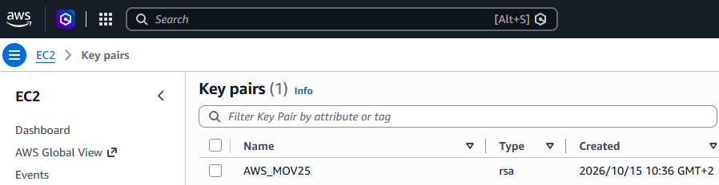
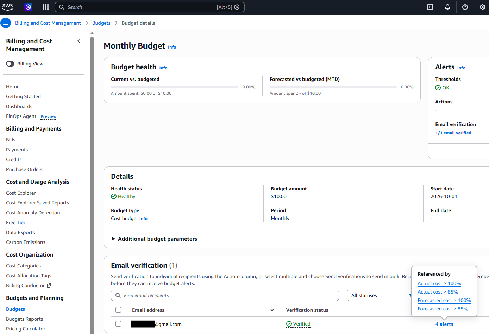
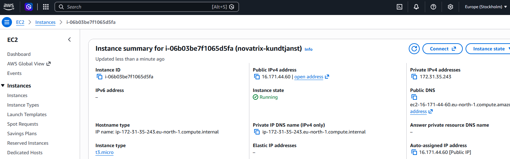
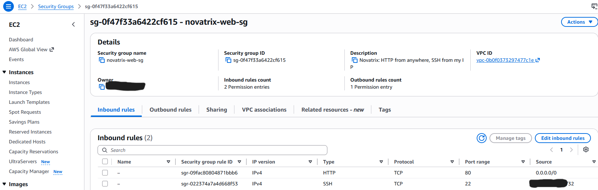
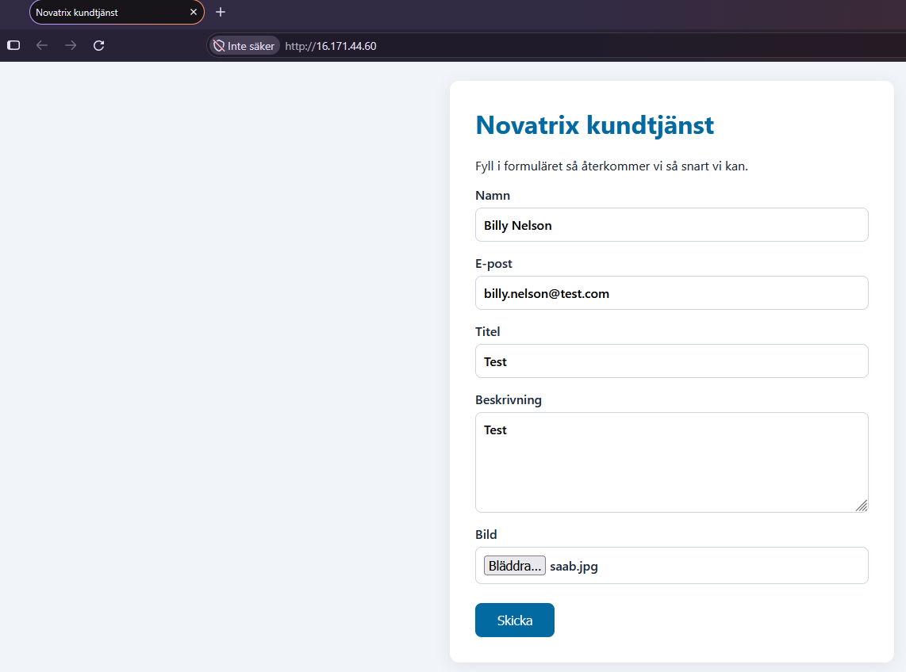
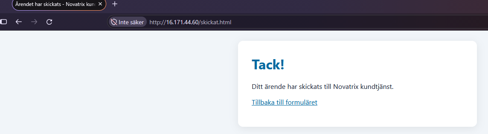
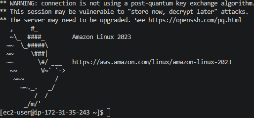

# __Driftsättning av webbserver i AWS__

Repository: https://github.com/03timnor/AWS_MOV25

*Tim Noreliusson Lingestedt, 2026-10-16*

Uppgiften går ut på att provisionera en EC2-instans och konfigurera en webbserver åt *Novatrix* i *AWS*.

För att uppnå nivån Väl Godkänt skall detta göras automatiserat med kod.

## *__1. Provisionera en EC2-instans och konfigurera en webbserver__*

Först skapas ett *Key Pair* som används för att ansluta till servern via *SSH* / port 22. Detta görs via *AWS*-portalen. Om inte nyckeln läcker ut så kan man använda samma par under hela *AWS*-kursen. Nyckelparet består av en publik nyckel som finns hos *AWS* och en privat som finns på min dator.



Script *V42_novatrix-ec2.sh* skapar upp en *EC2*-instans, skickar med *user data* som installerar *Apache* och skapar webbsidan.

Script *V42_novatrix-ec2.sh* skapar även *Security Group* *novatrix-web-sg* som har inställningar för att öppna *SSH* / port 22 endast för min publika IP-adress och port 80 för inkommande trafik till *Novatrix* hemsida.

Script *V42_novatrix-ec2.sh*:

```bash
#!/usr/bin/env bash
# =============================================================================
# Novatrix customer service - launches an EC2 instance (Amazon Linux 2023,
# free tier) running Apache (httpd) with a support ticket form.
#
# Requirements: AWS CLI v2 configured (aws configure) and an existing key pair.
# Run:          ./V42_novatrix-ec2.sh
# =============================================================================
set -euo pipefail

export MSYS_NO_PATHCONV=1

# ----- Settings --------------------------------------------------------------
REGION="eu-north-1"                       # Stockholm
INSTANCE_TYPE="t3.micro"                  # free tier eligible in eu-north-1
KEY_NAME="AWS_MOV25"                   # name of your existing key pair in AWS
KEY_FILE="$HOME/.ssh/${KEY_NAME}.pem"     # your private key
SG_NAME="novatrix-web-sg"
INSTANCE_NAME="novatrix-kundtjanst"

# ----- Look up the Amazon Linux 2023 AMI and your public IP ------------------
AMI_ID=$(aws ssm get-parameter --region "$REGION" \
  --name /aws/service/ami-amazon-linux-latest/al2023-ami-kernel-default-x86_64 \
  --query Parameter.Value --output text)

MY_IP=$(curl -s https://checkip.amazonaws.com | tr -d '[:space:]')
echo "AMI: $AMI_ID   Your IP: $MY_IP"

# ----- Security group --------------------------------------------------------
VPC_ID=$(aws ec2 describe-vpcs --region "$REGION" \
  --filters Name=is-default,Values=true --query 'Vpcs[0].VpcId' --output text)

SG_ID=$(aws ec2 describe-security-groups --region "$REGION" \
  --filters Name=group-name,Values="$SG_NAME" Name=vpc-id,Values="$VPC_ID" \
  --query 'SecurityGroups[0].GroupId' --output text)

if [[ "$SG_ID" == "None" ]]; then
  SG_ID=$(aws ec2 create-security-group --region "$REGION" \
    --group-name "$SG_NAME" --description "Novatrix: HTTP from anywhere, SSH from my IP" \
    --vpc-id "$VPC_ID" --query GroupId --output text)

  # Port 80 open to everyone
  aws ec2 authorize-security-group-ingress --region "$REGION" \
    --group-id "$SG_ID" --protocol tcp --port 80 --cidr 0.0.0.0/0 > /dev/null
  # Port 22 only from my IP
  aws ec2 authorize-security-group-ingress --region "$REGION" \
    --group-id "$SG_ID" --protocol tcp --port 22 --cidr "${MY_IP}/32" > /dev/null
  echo "Security group created: $SG_ID"
else
  echo "Security group already exists: $SG_ID"
fi

# ----- User data: Apache + website -------------------------------------------
USER_DATA=$(cat <<'USERDATA'
#!/bin/bash
dnf update -y
dnf install -y httpd

# --- Start page with the form ---
cat > /var/www/html/index.html <<'HTML'
<!DOCTYPE html>
<html lang="sv">
<head>
  <meta charset="UTF-8">
  <meta name="viewport" content="width=device-width, initial-scale=1.0">
  <title>Novatrix kundtjänst</title>
  <link rel="stylesheet" href="/style.css">
</head>
<body>
  <main class="card">
    <h1>Novatrix kundtjänst</h1>
    <p>Fyll i formuläret så återkommer vi så snart vi kan.</p>
    <form action="/cgi-bin/skicka" method="post" enctype="multipart/form-data">
      <label>Namn
        <input type="text" name="namn" required>
      </label>
      <label>E-post
        <input type="email" name="epost" required>
      </label>
      <label>Titel
        <input type="text" name="titel" required>
      </label>
      <label>Beskrivning
        <textarea name="beskrivning" rows="5" required></textarea>
      </label>
      <label>Bild
        <input type="file" name="bild" accept="image/*">
      </label>
      <button type="submit">Skicka</button>
    </form>
  </main>
</body>
</html>
HTML

# --- Confirmation page ---
cat > /var/www/html/skickat.html <<'HTML'
<!DOCTYPE html>
<html lang="sv">
<head>
  <meta charset="UTF-8">
  <meta name="viewport" content="width=device-width, initial-scale=1.0">
  <title>Ärendet har skickats - Novatrix kundtjänst</title>
  <link rel="stylesheet" href="/style.css">
</head>
<body>
  <main class="card">
    <h1>Tack!</h1>
    <p>Ditt ärende har skickats till Novatrix kundtjänst.</p>
    <p><a href="/">Tillbaka till formuläret</a></p>
  </main>
</body>
</html>
HTML

# --- Shared stylesheet ---
cat > /var/www/html/style.css <<'CSS'
* { box-sizing: border-box; }
body { font-family: system-ui, sans-serif; background: #f1f5f9; color: #1e293b;
       margin: 0; padding: 24px; display: flex; justify-content: center; }
.card { background: #fff; max-width: 560px; width: 100%; padding: 32px;
        border-radius: 12px; box-shadow: 0 4px 20px rgba(0,0,0,.08); }
h1 { margin-top: 0; color: #0369a1; }
label { display: block; margin-top: 16px; font-weight: 600; }
input, textarea { display: block; width: 100%; margin-top: 6px; padding: 10px;
                  border: 1px solid #cbd5e1; border-radius: 8px; font: inherit; }
button { margin-top: 24px; padding: 12px 28px; border: 0; border-radius: 8px;
         background: #0369a1; color: #fff; font-size: 1rem; cursor: pointer; }
button:hover { background: #075985; }
a { color: #0369a1; }
CSS

# --- CGI that receives the form (stores nothing) and redirects to the confirmation page ---
cat > /var/www/cgi-bin/skicka <<'CGI'
#!/bin/bash
cat > /dev/null                 # read and discard the form data
echo "Status: 303 See Other"
echo "Location: /skickat.html"
echo ""
CGI
chmod 755 /var/www/cgi-bin/skicka

systemctl enable --now httpd
USERDATA
)

# ----- Launch the instance ---------------------------------------------------
INSTANCE_ID=$(aws ec2 run-instances --region "$REGION" \
  --image-id "$AMI_ID" \
  --instance-type "$INSTANCE_TYPE" \
  --key-name "$KEY_NAME" \
  --security-group-ids "$SG_ID" \
  --associate-public-ip-address \
  --user-data "$USER_DATA" \
  --tag-specifications "ResourceType=instance,Tags=[{Key=Name,Value=$INSTANCE_NAME}]" \
  --query 'Instances[0].InstanceId' --output text)

echo "Instance launched: $INSTANCE_ID - waiting for it to reach 'running'..."
aws ec2 wait instance-running --region "$REGION" --instance-ids "$INSTANCE_ID"

PUBLIC_IP=$(aws ec2 describe-instances --region "$REGION" --instance-ids "$INSTANCE_ID" \
  --query 'Reservations[0].Instances[0].PublicIpAddress' --output text)

echo
echo "Done! The website will be up in 1-2 minutes (user data runs at boot)."
echo "  Website: http://$PUBLIC_IP"
echo "  SSH:     ssh -i $KEY_FILE ec2-user@$PUBLIC_IP"
echo
echo "Clean up when you are finished:"
echo "  aws ec2 terminate-instances --region $REGION --instance-ids $INSTANCE_ID"
echo "  aws ec2 wait instance-terminated --region $REGION --instance-ids $INSTANCE_ID"
echo "  aws ec2 delete-security-group --region $REGION --group-name $SG_NAME"
```

För att köra scriptet *V42_novatrix-ec2.sh*:

```bash
bash V42_novatrix-ec2.sh
```

## *__2. Månadsbudget__*

Månadsbudget är konfigurerad i *AWS*-portalen:



Den varnar (via e-post) för följande:

*Actual cost > 100%*

*Actual cost > 85%*

*Forecasted cost > 100%*

*Forecasted cost > 85%*

## *__3. Dokumentation__*

### Översikt

| Egenskap | Värde |
|---|---|
| Syfte | Webbsida med ärendeformulär för Novatrix kundtjänst |
| Molnleverantör | Amazon Web Services (AWS) |
| Region | `eu-north-1` (Stockholm) |
| Driftsättning | Bash-script med AWS CLI (`V42_novatrix-ec2.sh`) |

### Instans

| Egenskap | Värde |
|---|---|
| Tjänst | Amazon EC2 |
| Namn (tagg) | `novatrix-kundtjanst` |
| Instanstyp | `t3.micro`: 2 vCPU, 1 GiB RAM, free tier-berättigad |
| Operativsystem | Amazon Linux 2023 (x86_64), senaste AMI som hämtas via SSM |
| Lagring | EBS-rotvolym, AMI:ns standard: 8 GiB gp3 |
| Nätverk | Standard-VPC med publik IPv4-adress |
| Inloggningsanvändare | `ec2-user` |

### Säkerhet

#### Security group: `novatrix-web-sg`

| Riktning | Port | Protokoll | Källa | Syfte |
|---|---|---|---|---|
| Inkommande | 80 | TCP | `0.0.0.0/0` (alla) | HTTP, webbsidan |
| Inkommande | 22 | TCP | Administratörens IP | SSH, administration |
| Utgående | Alla | Alla | `0.0.0.0/0` | AWS standard (uppdateringar, paket) |

#### Nycklar och hemligheter

| Egenskap | Värde |
|---|---|
| Key pair | Befintligt key pair i AWS |
| Privat nyckel | Finns bara lokalt i `~/.ssh/` |
| Hemligheter i script | Inga. AWS-inloggningen hanteras av AWS CLI (`aws login` eller `aws configure`) |

### Programvara och konfiguration

| Komponent | Beskrivning |
|---|---|
| Webbserver | Apache HTTP Server (`httpd`), startar automatiskt vid uppstart |
| Konfiguration | User data som körs vid första uppstarten: systemuppdatering, installation av httpd, uppsättning av webbfiler |
| Formulärhantering | CGI-script (bash) som tar emot formuläret och skickar besökaren vidare till bekräftelsesidan. Ingen data sparas |

### Webbsidan

| Fil på instansen | Innehåll |
|---|---|
| `/var/www/html/index.html` | Startsida "Novatrix kundtjänst" med formulär: namn, e-post, titel, beskrivning, bild |
| `/var/www/html/skickat.html` | Bekräftelse: "Ditt ärende har skickats" |
| `/var/www/html/style.css` | Gemensam stil |
| `/var/www/cgi-bin/skicka` | Tar emot formuläret (POST) och svarar med en omdirigering (303) till bekräftelsen |

**Flöde:** användaren fyller i formuläret → klickar på Skicka → `cgi-bin/skicka` → `skickat.html`

### Åtkomst

| Typ | Adress / kommando |
|---|---|
| Webb | `http://<publik-IP>` |
| SSH | `ssh -i ~/.ssh/<nyckel>.pem ec2-user@<publik-IP>` |

### Kostnad

| Resurs | Kommentar |
|---|---|
| EC2 `t3.micro` | Free tier-berättigad |
| EBS 8 GiB gp3 | Inom free tier |
| Publik IPv4 | Ingår i free tier (750 h/månad), annars 0,005 USD/h |
| Rekommendation | Avsluta instansen när den inte används |

### Begränsningar (avgränsat i uppgiften)

| Begränsning | Kommentar |
|---|---|
| Endast HTTP | Ingen HTTPS/TLS |
| Ingen datalagring | Formulärdata och bilder sparas och skickas inte vidare |
| Dynamisk IP | Den publika IP-adressen ändras om instansen stoppas och startas igen (ingen Elastic IP) |
| En instans | Ingen redundans |

### Avveckling

```bash
aws ec2 terminate-instances --region eu-north-1 --instance-ids <instans-id>
aws ec2 wait instance-terminated --region eu-north-1 --instance-ids <instans-id>
aws ec2 delete-security-group --region eu-north-1 --group-name novatrix-web-sg
```

## *__4. Verifiering__*

*EC2*-instansen har skapats:



Säkerhetsreglerna är korrekta:



Sidan kan nås:





*SSH* fungerar:

