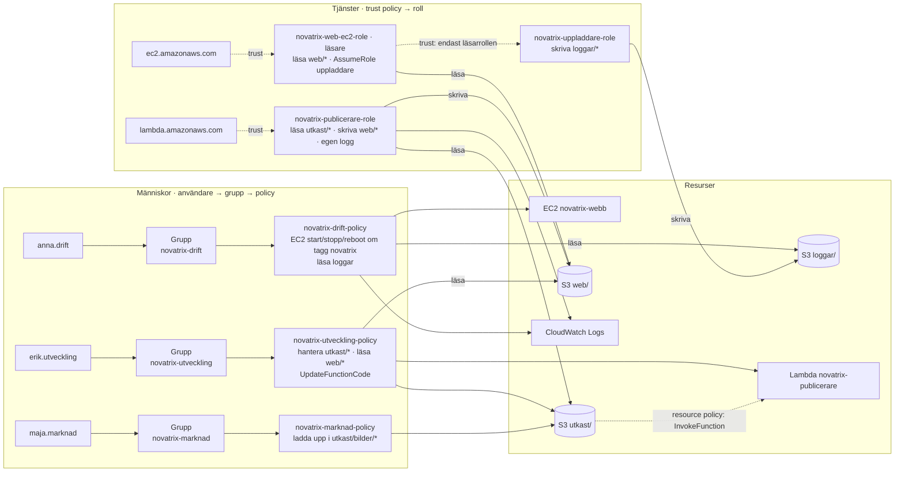
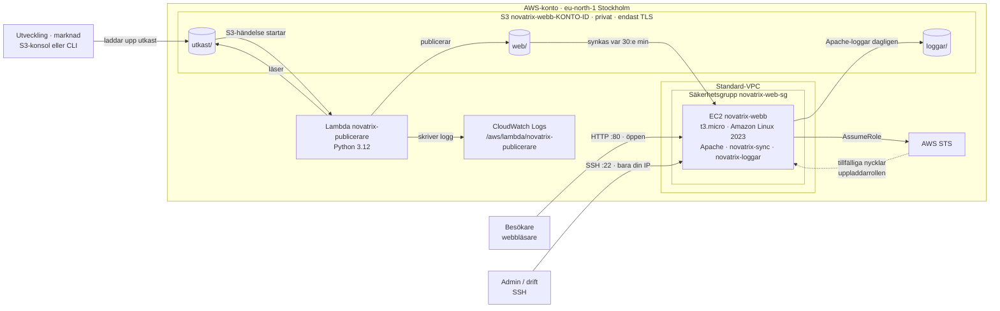

# IAM och identitet

Repository: https://github.com/03timnor/AWS_MOV25

*Tim Noreliusson Lingestedt, 2026-10-23*

Veckans uppgift går ut på att konfigurera *IAM*, grupper och policies i *AWS* enligt *Least Privilege*.

För att uppnå nivån Väl Godkänt skall detta göras automatiserat med kod, använda flera samverkande *IAM*-roller, använda genomtänkt *Least privilege*  och motivera designen.

## *__1. Provisionera miljön, användare, grupper och policies__*

##  *__2. Dokumentation__*

Region: `eu-north-1` (Stockholm). Alla resurser taggas `Projekt=novatrix`. `<konto-id>` är ens 12-siffriga AWS-konto-id.

### Översikt – alla resurser

| Typ | Namn | Syfte | Skapas av |
|---|---|---|---|
| EC2-instans | `novatrix-webb` | Webbserver (Apache) som visar välkomstsidan | `V43_novatrix-iam.sh` |
| Säkerhetsgrupp | `novatrix-web-sg` | Brandvägg för webbservern | `V43_novatrix-iam.sh` |
| Instance profile | `novatrix-web-ec2-profile` | Kopplar läsarrollen till EC2-instansen | `V43_novatrix-iam.sh` |
| S3-bucket | `novatrix-webb-<konto-id>` | Lagring för utkast, publicerad sajt och loggarkiv | `V43_novatrix-iam.sh` |
| Lambda | `novatrix-publicerare` | Kontrollerar och publicerar utkast till sajten | `V43_novatrix-iam.sh` |
| CloudWatch-logggrupp | `/aws/lambda/novatrix-publicerare` | Lambdans logg | `V43_novatrix-iam.sh` |
| IAM-roll | `novatrix-web-ec2-role` | Läsarroll för EC2 | `V43_novatrix-iam.sh` |
| IAM-roll | `novatrix-uppladdare-role` | Uppladdarroll, antas av läsarrollen (role chaining) | `V43_novatrix-iam.sh` |
| IAM-roll | `novatrix-publicerare-role` | Körroll för Lambdan | `V43_novatrix-iam.sh` |
| IAM-grupp | `novatrix-drift` | Drift | `V43_novatrix-iam.sh` |
| IAM-grupp | `novatrix-utveckling` | Utveckling | `V43_novatrix-iam.sh` |
| IAM-grupp | `novatrix-marknad` | Marknad | `V43_novatrix-iam.sh` |
| IAM-användare | `anna.drift` | Medlem i `novatrix-drift` | `V43_novatrix-iam.sh` |
| IAM-användare | `erik.utveckling` | Medlem i `novatrix-utveckling` | `V43_novatrix-iam.sh` |
| IAM-användare | `maja.marknad` | Medlem i `novatrix-marknad` | `V43_novatrix-iam.sh` |
| Managed policy | `novatrix-drift-policy` | Kopplad till `novatrix-drift` | `V43_novatrix-iam.sh` |
| Managed policy | `novatrix-utveckling-policy` | Kopplad till `novatrix-utveckling` | `V43_novatrix-iam.sh` |
| Managed policy | `novatrix-marknad-policy` | Kopplad till `novatrix-marknad` | `V43_novatrix-iam.sh` |

Allt tas bort med `V43_cleanup.sh`.

### S3-bucketens struktur

| Prefix | Innehåll | Skrivs av | Läses av | Övrigt |
|---|---|---|---|---|
| `utkast/` | Nytt innehåll som ska publiceras | Utveckling (allt), marknad (bara `utkast/bilder/`) | Lambdan, utveckling | Uppladdning startar Lambdan |
| `web/` | Den publicerade sajten | Endast Lambdan | EC2 (läsarrollen), utveckling | Bara tillåtna filtyper |
| `loggar/` | Arkiverade Apache-loggar | Endast uppladdarrollen | Drift | Tas bort efter 30 dagar |

| Bucketinställning | Värde | Varför |
|---|---|---|
| Block Public Access | Allt på | Besökare når aldrig S3 direkt, bara via EC2 |
| Bucket policy | Deny om `aws:SecureTransport = false` | All trafik måste gå över TLS |
| Händelse | `s3:ObjectCreated:*` på `utkast/` → Lambda | Startar publiceringen |
| Livscykelregel | `loggar/` raderas efter 30 dagar | Håller nere lagring och kostnad |

### IAM-roller (tjänster)

| Roll | Trust policy (vem får anta den) | Rättigheter | Får inte |
|---|---|---|---|
| `novatrix-web-ec2-role` (läsare) | `ec2.amazonaws.com` | `s3:ListBucket` med `s3:prefix = web/*`<br>`s3:GetObject` på `web/*`<br>`sts:AssumeRole` på uppladdarrollen | Skriva något, läsa utkast eller loggar, lista andra buckets |
| `novatrix-uppladdare-role` | Endast rollen `novatrix-web-ec2-role` | `s3:PutObject` på `loggar/*` | Läsa något, skriva till `web/` eller `utkast/`, radera, lista |
| `novatrix-publicerare-role` | `lambda.amazonaws.com` | `s3:GetObject` på `utkast/*`<br>`s3:PutObject` på `web/*`<br>`logs:CreateLogStream`, `logs:PutLogEvents` på sin egen logggrupp | Läsa `web/`, skriva `utkast/` (kan inte trigga sig själv), radera, lista, nå andra tjänster |

| Resursbaserad policy | Var | Tillåter | Villkor |
|---|---|---|---|
| `s3-utkast` | På Lambdan `novatrix-publicerare` | `s3.amazonaws.com` får `lambda:InvokeFunction` | `SourceArn` = vår bucket, `SourceAccount` = vårt konto (skydd mot confused deputy) |
| `EndastTLS` | På S3-bucketen | Nekar alla anrop utan TLS | `aws:SecureTransport = false` |

### IAM-grupper och användare (människor)

Användarna får rättigheter **endast** via sin grupp. Inga lösenord eller åtkomstnycklar skapas.

| Grupp | Användare | Får | Får inte |
|---|---|---|---|
| `novatrix-drift` | `anna.drift` | Se instanser och säkerhetsgrupper<br>Starta, stoppa och starta om instanser taggade `Projekt=novatrix`<br>Läsa Lambdans logg och CloudWatch-mätvärden<br>Lista och läsa `loggar/` | Terminera instanser, ändra innehåll eller kod, skriva i loggarkivet, anta uppladdarrollen, IAM |
| `novatrix-utveckling` | `erik.utveckling` | Lista, läsa, skriva och radera i `utkast/`<br>Läsa `web/`<br>`lambda:GetFunction`, `lambda:UpdateFunctionCode` på publiceraren<br>Läsa Lambdans logg | Skriva direkt till `web/`, läsa `loggar/` (besökares IP), ändra Lambdans roll eller inställningar, `iam:PassRole`, se eller styra EC2 |
| `novatrix-marknad` | `maja.marknad` | Lista, läsa och skriva i `utkast/bilder/` | Ändra HTML och CSS, radera, skriva till `web/`, se resten av bucketen, Lambda |

### IAM-översikt

Heldragen pil = rättighet. Streckad pil = vem som får anta en roll (trust policy) eller starta Lambdan (resource policy).



### 5. Behörighetskedjor

#### Publicering

| Steg | Vem | Identitet | Åtgärd | Resultat |
|---|---|---|---|---|
| 1 | Utveckling / marknad | IAM-användare via grupp | `s3:PutObject` till `utkast/` | Fil ligger som utkast |
| 2 | S3 | Resursbaserad policy på Lambdan | `lambda:InvokeFunction` | Lambdan startas |
| 3 | Lambda | `novatrix-publicerare-role` | `GetObject utkast/` → kontroll av filtyp och storlek → `PutObject web/` | Godkända filer publiceras, övriga nekas och loggas |
| 4 | EC2 | `novatrix-web-ec2-role` | `ListBucket` + `GetObject` på `web/` var 30:e minut | Apache visar ny version |

#### Role chaining (loggarkivering)

| Steg | Identitet | Åtgärd | Resultat |
|---|---|---|---|
| 1 | `novatrix-web-ec2-role` (läsare) | `sts:AssumeRole` på uppladdarrollen | STS kontrollerar uppladdarens trust policy: anroparen är läsarrollen, så det godkänns |
| 2 | `novatrix-uppladdare-role` | Tillfälliga nycklar i 15 minuter | Kan bara skriva till `loggar/` |
| 3 | `novatrix-uppladdare-role` | `s3:PutObject` på `loggar/<instans-id>/…` | Apache-loggarna arkiveras |

Uppladdarrollen kan **bara** antas av en session som redan kör med läsarrollen, alltså EC2-instansen. Varken användarna eller en administratör kan anta den.

### Nätverk och EC2

| Inställning | Värde | Varför |
|---|---|---|
| Instanstyp | `t3.micro` | Free tier |
| CPU-kredit | `standard` | Ingen extra kostnad vid hög CPU-last |
| AMI | Senaste Amazon Linux 2023 (via SSM-parameter) | Alltid uppdaterad och gratis |
| VPC | Kontots standard-VPC | Ingen NAT gateway behövs |
| Publik IPv4 | Ja (automatisk) | Nåbar för besökare och SSH |
| IMDS | v2 krävs, hop limit 1 | Försvårar stöld av rollens nycklar via SSRF |
| Säkerhetsgrupp, port 80 | `0.0.0.0/0` | Webbplatsen är publik |
| Säkerhetsgrupp, port 22 | Din IP `/32` | SSH bara från ens dator |
| Nyckelpar | `AWS_MOV25` | SSH-inloggning |

### Komponenter på EC2-instansen

| Komponent | Typ | Vad den gör | Körs |
|---|---|---|---|
| `httpd` | Tjänst | Apache, visar `/var/www/html` | Alltid |
| `/usr/local/bin/novatrix-sync` | Script | `aws s3 sync` från `web/` till `/var/www/html` | Via timer |
| `novatrix-sync.timer` | systemd-timer | Startar synken | 2 min efter uppstart, sedan var 30:e minut |
| `/usr/local/bin/s3-curl` | Script | Läser/skriver S3 med bara `curl`, IMDSv2 och SigV4 | Manuellt |
| `/usr/local/bin/som-uppladdare` | Script | Antar uppladdarrollen och kör ett kommando som den (role chaining) | Manuellt och av loggjobbet |
| `/usr/local/bin/novatrix-loggar` | Script | Komprimerar och laddar upp Apache-loggar till `loggar/` | Via timer |
| `novatrix-loggar.timer` | systemd-timer | Startar loggjobbet | En gång per dygn |

### Kostnad

| Resurs | Kostnad | Kommentar |
|---|---|---|
| EC2 `t3.micro` | ca $0.011/timme | Free tier-berättigad, dras från credits på nya konton |
| Publik IPv4 | $0.005/timme | Bara när instansen kör |
| EBS 8 GB gp3 | ca $0.02/dygn | Instansens disk |
| S3 | Försumbar | Några kB data, ca 1 500 LIST-anrop/månad |
| Lambda | Gratis | Inom 1 miljon anrop/månad |
| CloudWatch Logs | Gratis | 7 dagars lagring, långt under 5 GB |
| IAM, STS | Gratis | |
| **Totalt** | **ca $0.40/dygn** | Ett testpass på 1–2 timmar kostar några cent |

### Script

| Script | Syfte |
|---|---|
| `V43_config.sh` | Gemensamma namn, ARN:er och inställningar. Läses in av de andra, körs inte själv. |
| `V43_novatrix-iam.sh` | Skapar hela miljön. Kan köras om. |
| `V43_verify.sh` | Testar alla behörigheter och sparar resultatet i `V43_verifiering_<datum>.txt`. |
| `V43_cleanup.sh` | Tar bort allt. Bekräftas med `JA`. |

### Verifiering

| Del | Metod | Antal tester | Vad som visas |
|---|---|---|---|
| 1 | IAM Policy Simulator | 51 | Varje användare och roll: både tillåtna och nekade åtgärder, inklusive villkor (tagg, prefix) |
| 2 | Riktiga anrop från ens dator | 6 | Sajten svarar, `.html` publiceras, `.php` stoppas, Lambdan loggar med sin roll, admin nekas att anta uppladdarrollen |
| 3 | Riktiga anrop inifrån EC2 via SSH | 14 | `s3-curl` läser `web/` men nekas annat, ny publicering syns, role chaining före och efter, uppladdarens begränsningar, loggarkivering |
| **Totalt** | | **71** | Mål: `71 OK, 0 FEL` |

### Mappstruktur

#### Repository

```text
AWS_MOV25/
├── .gitignore                             # utesluter .v43_build/ och *.pem
├── README.md                              # översikt över repot
├── V42/                                   # förra veckans uppgift
│   ├── images/
│   ├── README.md
│   └── V42_novatrix-ec2.sh
└── V43/
    ├── README.md                          # beskrivning, motivering och verifiering
    ├── V43_config.sh                      # gemensamma namn och inställningar
    ├── V43_novatrix-iam.sh                # skapar hela miljön
    ├── V43_verify.sh                      # 71 tester av behörigheterna
    ├── V43_cleanup.sh                     # tar bort allt
    ├── V43_verifiering_20261024-1258.txt  # resultat från V43_verify.sh
    └── pictures/                          # skärmdumpar från verifieringen

Webbsidan och Lambdakoden finns inbäddade i `V43_novatrix-iam.sh` och skapas
tillfälligt i `.v43_build/` när scriptet körs. Den mappen tas bort av `V43_cleanup.sh` och ingår inte i repot.
```

#### S3-bucketen

```text
s3://novatrix-webb-<konto-id>/
├── utkast/                       # människor laddar upp → startar Lambdan
│   ├── index.html                #   utveckling
│   ├── style.css                 #   utveckling
│   └── bilder/                   #   marknad får bara skriva här
│       └── kran.svg
├── web/                          # publicerad sajt, skrivs bara av Lambdan
│   ├── index.html                #   läses av EC2 (läsarrollen)
│   ├── style.css
│   └── bilder/
│       └── kran.svg
└── loggar/                       # skrivs bara av uppladdarrollen, raderas efter 30 dagar
    └── <instans-id>/
        ├── <tid>-access_log.gz
        └── <tid>-error_log.gz
```

#### EC2-instansen

```text
/
├── var/www/html/                 # sajten, synkas från s3://…/web/
├── var/log/httpd/                # Apache-loggar, arkiveras till s3://…/loggar/
├── usr/local/bin/
│   ├── novatrix-sync             # aws s3 sync web/ → /var/www/html
│   ├── novatrix-loggar           # laddar upp Apache-loggar via uppladdarrollen
│   ├── som-uppladdare            # role chaining: läsare → uppladdare
│   └── s3-curl                   # läser S3 med bara curl och instansrollen
└── etc/systemd/system/
    ├── novatrix-sync.timer       # var 30:e minut
    ├── novatrix-sync.service
    ├── novatrix-loggar.timer     # en gång per dygn
    └── novatrix-loggar.service
```

### Arkitektur



##  *__3. Least privilege och motivering__*

##  *__4. Verifiering__*:

### Hemsida kan nås:


### IAM simulator *Drift*:


### IAM simulator *Utveckling*:


### IAM simulator *Marknad*:


### IAM simulator *EC2*:


### IAM simulator *Publicerare*:


### IAM simulator *Uppladdare*:


### Console *Drift*:


### Console *Utveckling*:


### Console *Marknad*:


### EC2:


### Role chaining:


### Verification script result:


```text
Novatrix V43 - verifiering 2026-10-24 12:58   konto 236780468239   region eu-north-1

=== Del 1: IAM policy simulator ===

--- anna.drift (grupp novatrix-drift) ---
OK   förväntat ALLOW fick ALLOW ec2:DescribeInstances  -  se alla instanser
OK   förväntat ALLOW fick ALLOW ec2:StopInstances  -  stoppa instans taggad Projekt=novatrix
OK   förväntat DENY  fick DENY  ec2:StopInstances  -  stoppa instans från annat projekt
OK   förväntat DENY  fick DENY  ec2:TerminateInstances  -  terminera Novatrix-instansen
OK   förväntat ALLOW fick ALLOW logs:FilterLogEvents  -  läsa publiceringsloggen
OK   förväntat ALLOW fick ALLOW s3:GetObject  -  läsa arkiverad Apache-logg
OK   förväntat DENY  fick DENY  s3:PutObject  -  skriva i loggarkivet
OK   förväntat DENY  fick DENY  sts:AssumeRole  -  anta uppladdarrollen
OK   förväntat DENY  fick DENY  s3:PutObject  -  ändra webbplatsens innehåll
OK   förväntat DENY  fick DENY  lambda:UpdateFunctionCode  -  ändra publicerarens kod
OK   förväntat DENY  fick DENY  iam:CreateUser  -  skapa IAM-användare

--- erik.utveckling (grupp novatrix-utveckling) ---
OK   förväntat ALLOW fick ALLOW s3:PutObject  -  ladda upp utkast
OK   förväntat ALLOW fick ALLOW s3:GetObject  -  läsa publicerad sida
OK   förväntat DENY  fick DENY  s3:PutObject  -  publicera förbi publiceraren
OK   förväntat ALLOW fick ALLOW lambda:UpdateFunctionCode  -  driftsätta ny publicerarkod
OK   förväntat DENY  fick DENY  lambda:UpdateFunctionConfiguration  -  byta roll/inställningar på Lambda
OK   förväntat DENY  fick DENY  iam:PassRole  -  skicka vidare Lambdarollen
OK   förväntat DENY  fick DENY  ec2:StopInstances  -  stoppa servern
OK   förväntat DENY  fick DENY  s3:GetObject  -  läsa besökarloggar

--- maja.marknad (grupp novatrix-marknad) ---
OK   förväntat ALLOW fick ALLOW s3:PutObject  -  ladda upp bild
OK   förväntat ALLOW fick ALLOW s3:ListBucket  -  lista sina bilder
OK   förväntat DENY  fick DENY  s3:ListBucket  -  lista hela bucketen
OK   förväntat DENY  fick DENY  s3:PutObject  -  ändra sidans HTML
OK   förväntat DENY  fick DENY  s3:PutObject  -  publicera förbi publiceraren
OK   förväntat DENY  fick DENY  s3:DeleteObject  -  radera bilder
OK   förväntat DENY  fick DENY  lambda:UpdateFunctionCode  -  ändra publicerarens kod

--- roll novatrix-web-ec2-role (EC2-instansen) ---
OK   förväntat ALLOW fick ALLOW s3:GetObject  -  läsa publicerad sajt
OK   förväntat ALLOW fick ALLOW s3:ListBucket  -  lista web/
OK   förväntat DENY  fick DENY  s3:ListBucket  -  lista utkast/
OK   förväntat DENY  fick DENY  s3:GetObject  -  läsa opublicerade utkast
OK   förväntat DENY  fick DENY  s3:PutObject  -  skriva över sajten
OK   förväntat DENY  fick DENY  s3:ListAllMyBuckets  -  lista kontots buckets
OK   förväntat DENY  fick DENY  s3:PutObject  -  skriva loggar själv (utan att byta roll)
OK   förväntat ALLOW fick ALLOW sts:AssumeRole  -  begära uppladdarrollen
OK   förväntat DENY  fick DENY  sts:AssumeRole  -  begära publicerarrollen

--- roll novatrix-uppladdare-role (antas av EC2-rollen) ---
OK   förväntat ALLOW fick ALLOW s3:PutObject  -  ladda upp logg
OK   förväntat DENY  fick DENY  s3:GetObject  -  läsa loggar
OK   förväntat DENY  fick DENY  s3:GetObject  -  läsa publicerad sajt
OK   förväntat DENY  fick DENY  s3:PutObject  -  skriva över sajten
OK   förväntat DENY  fick DENY  s3:PutObject  -  lägga utkast (starta publicering)
OK   förväntat DENY  fick DENY  s3:ListBucket  -  lista bucketen
OK   förväntat DENY  fick DENY  s3:DeleteObject  -  radera loggar

--- roll novatrix-publicerare-role (publiceraren) ---
OK   förväntat ALLOW fick ALLOW s3:GetObject  -  läsa utkast
OK   förväntat ALLOW fick ALLOW s3:PutObject  -  publicera till web/
OK   förväntat ALLOW fick ALLOW logs:PutLogEvents  -  skriva till egen logggrupp
OK   förväntat DENY  fick DENY  logs:PutLogEvents  -  skriva till annan logggrupp
OK   förväntat DENY  fick DENY  s3:PutObject  -  skriva utkast (kan inte trigga sig själv)
OK   förväntat DENY  fick DENY  s3:GetObject  -  läsa publicerad sajt
OK   förväntat DENY  fick DENY  s3:DeleteObject  -  radera publicerade filer
OK   förväntat DENY  fick DENY  s3:ListBucket  -  lista bucketen
OK   förväntat DENY  fick DENY  ec2:DescribeInstances  -  se EC2-instanser

=== Del 2: publiceringskedjan (utkast -> Lambda -> web/ -> webbplats) ===
Webbplats: http://16.170.251.154
OK   förväntat 200   fick 200   startsidan svarar (HTTP-status)
OK   förväntat ALLOW fick ALLOW startsidan är välkomstsidan från S3
OK   förväntat ALLOW fick ALLOW utkast/v43-test-125949.html publiceras till web/ av Lambdan
OK   förväntat DENY  fick DENY  utkast/v43-test-125949.php (otillåten filtyp) publiceras inte

Senaste publiceringsloggen (väntar tills testets rader har levererats till CloudWatch):
2026-10-24T10:52:44.756000+00:00 2026/10/24/[$LATEST]9281cef51f85409f8bdeac7d6dd84801 {"publicerad": "web/index.html", "bytes": 1149}
2026-10-24T10:52:44.971000+00:00 2026/10/24/[$LATEST]9281cef51f85409f8bdeac7d6dd84801 {"publicerad": "web/style.css", "bytes": 1518}
2026-10-24T10:52:46.624000+00:00 2026/10/24/[$LATEST]9281cef51f85409f8bdeac7d6dd84801 {"publicerad": "web/bilder/kran.svg", "bytes": 728}
2026-10-24T10:59:51.618000+00:00 2026/10/24/[$LATEST]eebef73bffa6464ea67b4e1f0b578f4f {"publicerad": "web/v43-test-125949.html", "bytes": 46}
2026-10-24T10:59:52.270000+00:00 2026/10/24/[$LATEST]eebef73bffa6464ea67b4e1f0b578f4f {"nekad": "utkast/v43-test-125949.php", "orsak": "filtypen .php publiceras inte"}
OK   förväntat ALLOW fick ALLOW Lambdan skriver sin logg med sin egen roll (raden ovan)

OK   förväntat DENY  fick DENY  du själv (admin, utan läsarrollen) antar uppladdarrollen

=== Del 3: inifrån EC2-instansen (S3 med curl och instansrollen) ===
Instansen kör som: arn:aws:sts::236780468239:assumed-role/novatrix-web-ec2-role/i-0ce271f9672b5cd55
OK   förväntat ALLOW fick ALLOW curl: läsa web/index.html
OK   förväntat DENY  fick DENY  curl: läsa utkast/index.html
OK   förväntat DENY  fick DENY  curl: skriva till web/
OK   förväntat DENY  fick DENY  cli: lista kontots buckets
OK   förväntat DENY  fick DENY  cli: lista IAM-användare
OK   förväntat ALLOW fick ALLOW ny publicering syns på sajten

--- Role chaining: läsarrollen -> uppladdarrollen ---
Identitet före rollbytet:  arn:aws:sts::236780468239:assumed-role/novatrix-web-ec2-role/i-0ce271f9672b5cd55
Identitet efter rollbytet: arn:aws:sts::236780468239:assumed-role/novatrix-uppladdare-role/uppladdare-ip-172-31-38-203

OK   förväntat DENY  fick DENY  läsarrollen: skriva logg själv
OK   förväntat ALLOW fick ALLOW läsarrollen antar uppladdarrollen
OK   förväntat ALLOW fick ALLOW uppladdaren: skriva till loggar/
OK   förväntat DENY  fick DENY  uppladdaren: läsa web/
OK   förväntat DENY  fick DENY  uppladdaren: skriva till web/
OK   förväntat DENY  fick DENY  uppladdaren: lägga utkast
OK   förväntat ALLOW fick ALLOW loggjobbet arkiverar Apache-loggarna
OK   förväntat ALLOW fick ALLOW arkiverade loggar finns i s3://novatrix-webb-236780468239/loggar/ (2 st)

=== Resultat: 71 OK, 0 FEL ===
Sparat i V43_verifiering_20261024-1258.txt
```