# Nätverk och säkerhet

Repository: https://github.com/03timnor/AWS_MOV25

*Tim Noreliusson Lingestedt, 2026-10-31*

Veckans uppgift går ut på att skapa ett säkert nätverk. Lösningen skall använda sig av *VPC* med subnät, konfigurerad routing och använda *Defence in depth* med *Security groups* och *NACL*. Nätverket skall vara förberett för nästa veckas uppgift som innehåller en databas så ett privat subnät skall skapas för databasen.

För att uppnå nivå Väl Godkänt skall man tillämpa *Defence in depth* genom hela lösningen, beskriva vilka hot som lagren skyddar emot. Miljön skall skapas med kod.

## *__1.Provisionera miljön / nätverk__*

*V44_novatrix.sh* bygger hela miljön, består av följande kod:

```bash
#!/usr/bin/env bash
# =============================================================================
# Novatrix V44 - own network with defense in depth (builds on V43's IAM setup).
#
# NEW IN V44 - the network, defined as code in V44_network.yaml (CloudFormation):
#
#   VPC 10.0.0.0/16, three tiers in separate subnets:
#     mgmt-a  10.0.0.0/24   public   bastion (only SSH entry, only from your IP)
#     web-a/b 10.0.2.0/23   public   Apache web server (HTTP/HTTPS from everyone)
#     data-a/b 10.0.10.0/23 private  prepared for the database (no internet route)
#   Internet gateway + public route table, private route table WITHOUT internet,
#   security groups (stateful, per instance) AND network ACLs (stateless, per
#   subnet) - two independent firewalls, S3 gateway endpoint with an endpoint
#   policy, VPC flow logs that record accepted and rejected traffic.
#
#   On top of that: the default security group is emptied, the instance roles
#   only work through the VPC endpoint (bucket policy), SSH is hardened,
#   root disks are encrypted and the bastion has no IAM role at all.
#
# FROM V43 (unchanged) - the site's content lives in S3. Publishing is a chain:
#
#   people --PutObject--> S3 utkast/   (drafts; each group only its own prefix)
#   S3 event --invokes--> Lambda        (resource policy: only our bucket/account)
#   Lambda role --Get utkast/, Put web/--> S3 web/   (validates file types)
#   EC2 instance role --List/Get web/--> serves the site, also via plain curl
#
# Role chaining on the web server:
#   EC2 instance role (reader, can write NOTHING)
#     --sts:AssumeRole--> uploader role (trusts ONLY the reader role)
#       --PutObject--> S3 loggar/   (daily Apache log archive)
#
# Plus IAM groups + users for Novatrix roles: drift, utveckling, marknad.
#
# Requirements: AWS CLI v2 with admin credentials, existing key pair, zip OR
#               python OR powershell (to package the Lambda).
#               V43's instance must be gone (./V43_cleanup.sh) - V44 moves the
#               web server out of the default VPC.
# Run:          ./V44_novatrix.sh       (safe to re-run; re-run if your IP changes)
# Verify:       ./V44_verify.sh
# Clean up:     ./V44_cleanup.sh
# =============================================================================
set -euo pipefail
cd "$(dirname "$0")"
source ./V44_config.sh

TAGS_IAM="Key=${TAG_KEY},Value=${TAG_VALUE}"

# ----- Helpers ---------------------------------------------------------------
step() { echo; echo "=== $* ==="; }

# Retry a command while IAM changes propagate (IAM is eventually consistent).
retry() {
  local n
  for n in $(seq 1 12); do
    if "$@" 2>"$WORK_DIR/retry.err"; then return 0; fi
    echo "  ...waiting for IAM to propagate ($n/12)" >&2
    sleep 5
  done
  cat "$WORK_DIR/retry.err" >&2
  return 1
}

# Create a customer managed policy, or publish a new default version if it exists.
ensure_policy() {
  local name=$1 doc=$2
  local arn="arn:aws:iam::${ACCOUNT_ID}:policy/${name}"
  if aws iam get-policy --policy-arn "$arn" >/dev/null 2>&1; then
    local v
    for v in $(aws iam list-policy-versions --policy-arn "$arn" \
                 --query 'Versions[?IsDefaultVersion==`false`].VersionId' --output text); do
      aws iam delete-policy-version --policy-arn "$arn" --version-id "$v"
    done
    aws iam create-policy-version --policy-arn "$arn" --policy-document "$doc" \
      --set-as-default >/dev/null
  else
    aws iam create-policy --policy-name "$name" --policy-document "$doc" \
      --tags "$TAGS_IAM" >/dev/null
  fi
  echo "$arn"
}

# Create a role, or refresh its trust policy if it exists.
ensure_role() {
  local name=$1 trust=$2 description=$3
  if aws iam get-role --role-name "$name" >/dev/null 2>&1; then
    aws iam update-assume-role-policy --role-name "$name" --policy-document "$trust"
  else
    aws iam create-role --role-name "$name" --assume-role-policy-document "$trust" \
      --description "$description" --tags "$TAGS_IAM" >/dev/null
  fi
}

# Package the Lambda with whatever zip tool exists (Git Bash usually lacks zip).
make_lambda_zip() {
  rm -f "$WORK_DIR/lambda.zip"
  if command -v zip >/dev/null 2>&1; then
    (cd "$WORK_DIR" && zip -q lambda.zip lambda_function.py)
    return
  fi
  local py
  for py in python3 python; do
    if command -v "$py" >/dev/null 2>&1 && "$py" -c "import zipfile" >/dev/null 2>&1; then
      (cd "$WORK_DIR" && "$py" -c "import zipfile; z=zipfile.ZipFile('lambda.zip','w'); z.write('lambda_function.py'); z.close()")
      return
    fi
  done
  if command -v powershell.exe >/dev/null 2>&1; then
    (cd "$WORK_DIR" && powershell.exe -NoProfile -Command \
      "Compress-Archive -Force -Path lambda_function.py -DestinationPath lambda.zip")
    return
  fi
  echo "Found no zip, python or powershell to package the Lambda." >&2
  exit 1
}

# =============================================================================
# 1. Policy documents
# =============================================================================

# ----- Trust policies: WHO may assume each service role ----------------------
EC2_TRUST=$(cat <<JSON
{
  "Version": "2012-10-17",
  "Statement": [{
    "Effect": "Allow",
    "Principal": { "Service": "ec2.amazonaws.com" },
    "Action": "sts:AssumeRole"
  }]
}
JSON
)

LAMBDA_TRUST=$(cat <<JSON
{
  "Version": "2012-10-17",
  "Statement": [{
    "Effect": "Allow",
    "Principal": { "Service": "lambda.amazonaws.com" },
    "Action": "sts:AssumeRole"
  }]
}
JSON
)

# ----- Permission policies: WHAT each service role may do --------------------
# EC2 (reader): read-only, and only the published site (web/). It writes NOTHING
# itself - to upload logs it must first assume the uploader role.
EC2_ROLE_POLICY=$(cat <<JSON
{
  "Version": "2012-10-17",
  "Statement": [
    {
      "Sid": "ListaPubliceradSajt",
      "Effect": "Allow",
      "Action": "s3:ListBucket",
      "Resource": "${BUCKET_ARN}",
      "Condition": { "StringLike": { "s3:prefix": ["web/*"] } }
    },
    {
      "Sid": "LasPubliceradSajt",
      "Effect": "Allow",
      "Action": "s3:GetObject",
      "Resource": "${BUCKET_ARN}/web/*"
    },
    {
      "Sid": "BegarUppladdarroll",
      "Effect": "Allow",
      "Action": "sts:AssumeRole",
      "Resource": "${UPLOADER_ROLE_ARN}"
    }
  ]
}
JSON
)

# Uploader trust: ONLY a session running with the EC2 reader role may assume it.
# Not the EC2 service, not users, not even administrators.
UPLOADER_TRUST=$(cat <<JSON
{
  "Version": "2012-10-17",
  "Statement": [{
    "Sid": "EndastLasarrollen",
    "Effect": "Allow",
    "Principal": { "AWS": "${EC2_ROLE_ARN}" },
    "Action": "sts:AssumeRole"
  }]
}
JSON
)

# Uploader: write-only, and only to the log archive. Cannot read anything.
UPLOADER_ROLE_POLICY=$(cat <<JSON
{
  "Version": "2012-10-17",
  "Statement": [{
    "Sid": "LaddaUppLoggar",
    "Effect": "Allow",
    "Action": "s3:PutObject",
    "Resource": "${BUCKET_ARN}/loggar/*"
  }]
}
JSON
)

# Lambda: read drafts, write published files, log to its own log group. Nothing else.
LAMBDA_ROLE_POLICY=$(cat <<JSON
{
  "Version": "2012-10-17",
  "Statement": [
    {
      "Sid": "LasUtkast",
      "Effect": "Allow",
      "Action": "s3:GetObject",
      "Resource": "${BUCKET_ARN}/utkast/*"
    },
    {
      "Sid": "Publicera",
      "Effect": "Allow",
      "Action": "s3:PutObject",
      "Resource": "${BUCKET_ARN}/web/*"
    },
    {
      "Sid": "SkrivEgnaLoggar",
      "Effect": "Allow",
      "Action": ["logs:CreateLogStream", "logs:PutLogEvents"],
      "Resource": "${LOG_GROUP_ARN}:*"
    }
  ]
}
JSON
)

# ----- Group policies: humans --------------------------------------------------
# Drift: operate the Novatrix servers (also start/stop the bastion) and read
# logs/metrics/network setup. No content, no code, and NO network changes:
# opening a port takes an administrator and a change in V44_network.yaml.
DRIFT_POLICY=$(cat <<JSON
{
  "Version": "2012-10-17",
  "Statement": [
    {
      "Sid": "OversiktUtanResursniva",
      "Effect": "Allow",
      "Action": [
        "ec2:DescribeInstances", "ec2:DescribeInstanceStatus", "ec2:DescribeSecurityGroups",
        "ec2:DescribeSecurityGroupRules", "ec2:DescribeNetworkAcls", "ec2:DescribeVpcs",
        "ec2:DescribeSubnets", "ec2:DescribeRouteTables", "ec2:DescribeVpcEndpoints",
        "ec2:DescribeFlowLogs",
        "cloudwatch:GetMetricData", "cloudwatch:GetMetricStatistics", "cloudwatch:ListMetrics",
        "logs:DescribeLogGroups"
      ],
      "Resource": "*"
    },
    {
      "Sid": "LasFlodesloggar",
      "Effect": "Allow",
      "Action": ["logs:DescribeLogStreams", "logs:GetLogEvents", "logs:FilterLogEvents"],
      "Resource": "${FLOW_LOG_GROUP_ARN}:*"
    },
    {
      "Sid": "StyrEndastNovatrixInstanser",
      "Effect": "Allow",
      "Action": ["ec2:StartInstances", "ec2:StopInstances", "ec2:RebootInstances"],
      "Resource": "arn:aws:ec2:${REGION}:${ACCOUNT_ID}:instance/*",
      "Condition": { "StringEquals": { "aws:ResourceTag/${TAG_KEY}": "${TAG_VALUE}" } }
    },
    {
      "Sid": "LasPubliceringsloggar",
      "Effect": "Allow",
      "Action": ["logs:DescribeLogStreams", "logs:GetLogEvents", "logs:FilterLogEvents"],
      "Resource": "${LOG_GROUP_ARN}:*"
    },
    {
      "Sid": "ListaWebbserverloggar",
      "Effect": "Allow",
      "Action": "s3:ListBucket",
      "Resource": "${BUCKET_ARN}",
      "Condition": { "StringLike": { "s3:prefix": ["loggar/*"] } }
    },
    {
      "Sid": "LasWebbserverloggar",
      "Effect": "Allow",
      "Action": "s3:GetObject",
      "Resource": "${BUCKET_ARN}/loggar/*"
    }
  ]
}
JSON
)

# Utveckling: upload any draft, read the published site, deploy publisher code.
# Can NOT write web/ directly - everything goes through the publisher's checks.
DEV_POLICY=$(cat <<JSON
{
  "Version": "2012-10-17",
  "Statement": [
    {
      "Sid": "ListaSajten",
      "Effect": "Allow",
      "Action": "s3:ListBucket",
      "Resource": "${BUCKET_ARN}",
      "Condition": { "StringLike": { "s3:prefix": ["utkast/*", "web/*"] } }
    },
    {
      "Sid": "HanteraUtkast",
      "Effect": "Allow",
      "Action": ["s3:GetObject", "s3:PutObject", "s3:DeleteObject"],
      "Resource": "${BUCKET_ARN}/utkast/*"
    },
    {
      "Sid": "LasPubliceradSajt",
      "Effect": "Allow",
      "Action": "s3:GetObject",
      "Resource": "${BUCKET_ARN}/web/*"
    },
    {
      "Sid": "DriftsattPublicerarkod",
      "Effect": "Allow",
      "Action": ["lambda:GetFunction", "lambda:UpdateFunctionCode"],
      "Resource": "${FUNCTION_ARN}"
    },
    {
      "Sid": "LasPubliceringsloggar",
      "Effect": "Allow",
      "Action": ["logs:DescribeLogStreams", "logs:GetLogEvents", "logs:FilterLogEvents"],
      "Resource": "${LOG_GROUP_ARN}:*"
    },
    {
      "Sid": "ListaLoggrupper",
      "Effect": "Allow",
      "Action": "logs:DescribeLogGroups",
      "Resource": "*"
    }
  ]
}
JSON
)

# Marknad: upload images to utkast/bilder/ only. Cannot delete, cannot touch pages.
MARKNAD_POLICY=$(cat <<JSON
{
  "Version": "2012-10-17",
  "Statement": [
    {
      "Sid": "ListaEgnaBilder",
      "Effect": "Allow",
      "Action": "s3:ListBucket",
      "Resource": "${BUCKET_ARN}",
      "Condition": { "StringLike": { "s3:prefix": ["utkast/bilder/*"] } }
    },
    {
      "Sid": "LaddaUppBilder",
      "Effect": "Allow",
      "Action": ["s3:GetObject", "s3:PutObject"],
      "Resource": "${BUCKET_ARN}/utkast/bilder/*"
    }
  ]
}
JSON
)

# =============================================================================
# 2. Network - deployed from V44_network.yaml (infrastructure as code)
# =============================================================================
step "Network: VPC, subnets, route tables, security groups, NACLs ($STACK_NAME)"

# V44 moves the web server out of the default VPC. A V43 instance with the
# same name would be mistaken for ours, so it has to go first.
OLD=$(aws ec2 describe-instances --region "$REGION" \
  --filters Name=tag:Name,Values="$INSTANCE_NAME" Name=instance-state-name,Values=pending,running,stopping,stopped \
  --query 'Reservations[].Instances[?VpcId!=`null`].[InstanceId,VpcId]' --output text)
STACK_VPC=$(stack_output VpcId)
while read -r old_id old_vpc; do
  [[ -z "${old_id:-}" || "$old_vpc" == "$STACK_VPC" ]] && continue
  echo "Found V43 instance $old_id in $old_vpc (not the Novatrix VPC)." >&2
  echo "Run ./V43_cleanup.sh (or terminate it) first, then run this script again." >&2
  exit 1
done <<<"$OLD"

MY_IP=$(curl -s https://checkip.amazonaws.com | tr -d '[:space:]')
[[ "$MY_IP" =~ ^[0-9]+\.[0-9]+\.[0-9]+\.[0-9]+$ ]] || { echo "Could not read your public IP." >&2; exit 1; }
echo "Admin access (SSH to the bastion) only from: ${MY_IP}/32"

# deploy = create the stack the first time, apply only the differences later.
# Re-running with a new IP updates the bastion's security group AND NACL.
aws cloudformation deploy --region "$REGION" \
  --stack-name "$STACK_NAME" \
  --template-file "$NETWORK_TEMPLATE" \
  --capabilities CAPABILITY_NAMED_IAM \
  --no-fail-on-empty-changeset \
  --parameter-overrides \
      AdminCidr="${MY_IP}/32" \
      DbPort="$DB_PORT" \
      SiteBucket="$SITE_BUCKET" \
      FlowLogGroupName="$FLOW_LOG_GROUP" \
      ProjectTag="$TAG_VALUE" \
  --tags "${TAG_KEY}=${TAG_VALUE}"

VPC_ID=$(stack_output VpcId)
MGMT_SUBNET=$(stack_output MgmtSubnetAId)
WEB_SUBNET=$(stack_output WebSubnetAId)
BASTION_SG=$(stack_output BastionSgId)
WEB_SG=$(stack_output WebSgId)
S3_ENDPOINT=$(stack_output S3EndpointId)
DEFAULT_SG=$(stack_output DefaultSecurityGroupId)
echo "VPC: $VPC_ID   S3 endpoint: $S3_ENDPOINT"
echo "Subnets: mgmt $MGMT_SUBNET, web $WEB_SUBNET   SG: bastion $BASTION_SG, web $WEB_SG"

# Every VPC gets a "default" security group that lets its members talk to each
# other freely. CloudFormation can't manage it, so empty it here: anything
# launched by mistake without our groups ends up with no access at all.
default_sg_rules() {   # false = inbound rules, true = outbound rules
  aws ec2 describe-security-group-rules --region "$REGION" \
    --filters Name=group-id,Values="$DEFAULT_SG" \
    --query "SecurityGroupRules[?IsEgress==\`$1\`].SecurityGroupRuleId" --output text
}
IN_RULES=$(default_sg_rules false)
OUT_RULES=$(default_sg_rules true)
if [[ -n "$IN_RULES" ]]; then
  aws ec2 revoke-security-group-ingress --region "$REGION" --group-id "$DEFAULT_SG" \
    --security-group-rule-ids $IN_RULES >/dev/null
fi
if [[ -n "$OUT_RULES" ]]; then
  aws ec2 revoke-security-group-egress --region "$REGION" --group-id "$DEFAULT_SG" \
    --security-group-rule-ids $OUT_RULES >/dev/null
fi
echo "Default security group $DEFAULT_SG emptied (no rules in, no rules out)"

# =============================================================================
# 3. Storage
# =============================================================================
step "Storage: S3 bucket and log group"
if aws s3api head-bucket --bucket "$SITE_BUCKET" 2>/dev/null; then
  echo "Bucket already exists: $SITE_BUCKET"
else
  aws s3api create-bucket --bucket "$SITE_BUCKET" --region "$REGION" \
    --create-bucket-configuration LocationConstraint="$REGION" >/dev/null
  echo "Bucket created: $SITE_BUCKET"
fi
# The bucket is private: visitors reach the site through EC2, never S3 directly.
aws s3api put-public-access-block --bucket "$SITE_BUCKET" --public-access-block-configuration \
  BlockPublicAcls=true,IgnorePublicAcls=true,BlockPublicPolicy=true,RestrictPublicBuckets=true
aws s3api put-bucket-tagging --bucket "$SITE_BUCKET" \
  --tagging "TagSet=[{Key=${TAG_KEY},Value=${TAG_VALUE}}]"
# Resource policy:
#  1. refuse every request that is not encrypted in transit (TLS)
#  2. NEW V44: the web server's roles only work from inside the Novatrix VPC,
#     through the S3 endpoint. If an attacker steals the instance credentials
#     (e.g. via SSRF against the metadata service) they are useless elsewhere.
aws s3api put-bucket-policy --bucket "$SITE_BUCKET" --policy "$(cat <<JSON
{
  "Version": "2012-10-17",
  "Statement": [
    {
      "Sid": "EndastTLS",
      "Effect": "Deny",
      "Principal": "*",
      "Action": "s3:*",
      "Resource": ["${BUCKET_ARN}", "${BUCKET_ARN}/*"],
      "Condition": { "Bool": { "aws:SecureTransport": "false" } }
    },
    {
      "Sid": "InstansrollerEndastViaVpcEndpoint",
      "Effect": "Deny",
      "Principal": "*",
      "Action": "s3:*",
      "Resource": ["${BUCKET_ARN}", "${BUCKET_ARN}/*"],
      "Condition": {
        "ArnEquals": { "aws:PrincipalArn": ["${EC2_ROLE_ARN}", "${UPLOADER_ROLE_ARN}"] },
        "StringNotEquals": { "aws:SourceVpce": "${S3_ENDPOINT}" }
      }
    }
  ]
}
JSON
)"
# Keep storage (and cost) small: archived web server logs expire automatically.
aws s3api put-bucket-lifecycle-configuration --bucket "$SITE_BUCKET" \
  --lifecycle-configuration "$(cat <<JSON
{
  "Rules": [{
    "ID": "rensa-gamla-loggar",
    "Status": "Enabled",
    "Filter": { "Prefix": "loggar/" },
    "Expiration": { "Days": ${LOG_RETENTION_DAYS} }
  }]
}
JSON
)"

# Created here (not by Lambda) so the Lambda role needs no logs:CreateLogGroup.
aws logs create-log-group --region "$REGION" --log-group-name "$LOG_GROUP" 2>/dev/null || true
aws logs put-retention-policy --region "$REGION" --log-group-name "$LOG_GROUP" --retention-in-days 7

# =============================================================================
# 4. Service roles
# =============================================================================
step "Service roles"
ensure_role "$EC2_ROLE" "$EC2_TRUST" "Novatrix web server: read the published site in S3"
aws iam put-role-policy --role-name "$EC2_ROLE" --policy-name "novatrix-web-ec2-access" \
  --policy-document "$EC2_ROLE_POLICY"
echo "Role ready: $EC2_ROLE"

if ! aws iam get-instance-profile --instance-profile-name "$EC2_PROFILE" >/dev/null 2>&1; then
  aws iam create-instance-profile --instance-profile-name "$EC2_PROFILE" --tags "$TAGS_IAM" >/dev/null
  aws iam add-role-to-instance-profile --instance-profile-name "$EC2_PROFILE" --role-name "$EC2_ROLE"
fi
echo "Instance profile ready: $EC2_PROFILE"

# Retry: IAM rejects a trust policy naming a role that has not propagated yet.
retry ensure_role "$UPLOADER_ROLE" "$UPLOADER_TRUST" "Novatrix: upload web server logs, assumable only by the EC2 role"
aws iam put-role-policy --role-name "$UPLOADER_ROLE" --policy-name "novatrix-uppladdare-access" \
  --policy-document "$UPLOADER_ROLE_POLICY"
echo "Role ready: $UPLOADER_ROLE (assumable only by $EC2_ROLE)"

ensure_role "$LAMBDA_ROLE" "$LAMBDA_TRUST" "Novatrix publisher: S3 utkast/ -> web/"
aws iam put-role-policy --role-name "$LAMBDA_ROLE" --policy-name "novatrix-publicerare-access" \
  --policy-document "$LAMBDA_ROLE_POLICY"
echo "Role ready: $LAMBDA_ROLE"

# =============================================================================
# 5. Publisher Lambda + S3 trigger
# =============================================================================
step "Publisher Lambda and S3 event trigger"
cat > "$WORK_DIR/lambda_function.py" <<'PY'
"""Novatrix publisher: copies approved drafts from utkast/ to web/.

Only web file types are published, and with a correct Content-Type, so a
draft can never put e.g. a script or an executable on the website.
"""
import json
import os
import urllib.parse

import boto3

s3 = boto3.client("s3")

ALLOWED = {
    ".html": "text/html; charset=utf-8",
    ".css": "text/css; charset=utf-8",
    ".js": "text/javascript; charset=utf-8",
    ".txt": "text/plain; charset=utf-8",
    ".svg": "image/svg+xml",
    ".png": "image/png",
    ".jpg": "image/jpeg",
    ".jpeg": "image/jpeg",
    ".webp": "image/webp",
    ".ico": "image/x-icon",
}
MAX_BYTES = 5 * 1024 * 1024


def log(**fields):
    print(json.dumps(fields, ensure_ascii=False))


def lambda_handler(event, context):
    for record in event["Records"]:
        bucket = record["s3"]["bucket"]["name"]
        key = urllib.parse.unquote_plus(record["s3"]["object"]["key"])
        size = record["s3"]["object"].get("size", 0)
        rel = key[len("utkast/"):] if key.startswith("utkast/") else ""
        ext = os.path.splitext(rel)[1].lower()

        if not rel or ".." in rel or rel.endswith("/"):
            log(nekad=key, orsak="ogiltig sökväg")
        elif ext not in ALLOWED:
            log(nekad=key, orsak=f"filtypen {ext or '(ingen)'} publiceras inte")
        elif size > MAX_BYTES:
            log(nekad=key, orsak="filen är större än 5 MB")
        else:
            body = s3.get_object(Bucket=bucket, Key=key)["Body"].read()
            s3.put_object(Bucket=bucket, Key=f"web/{rel}", Body=body,
                          ContentType=ALLOWED[ext], CacheControl="max-age=300")
            log(publicerad=f"web/{rel}", bytes=len(body))
    return {"ok": True}
PY
make_lambda_zip

if aws lambda get-function --region "$REGION" --function-name "$FUNCTION_NAME" >/dev/null 2>&1; then
  aws lambda update-function-code --region "$REGION" --function-name "$FUNCTION_NAME" \
    --zip-file "fileb://$WORK_DIR/lambda.zip" >/dev/null
  aws lambda wait function-updated-v2 --region "$REGION" --function-name "$FUNCTION_NAME"
  echo "Lambda code updated: $FUNCTION_NAME"
else
  # Retry: a brand new role can take a few seconds before Lambda may assume it.
  retry aws lambda create-function --region "$REGION" --function-name "$FUNCTION_NAME" \
    --runtime python3.12 --handler lambda_function.lambda_handler \
    --role "$LAMBDA_ROLE_ARN" --zip-file "fileb://$WORK_DIR/lambda.zip" \
    --timeout 15 --memory-size 128 \
    --tags "${TAG_KEY}=${TAG_VALUE}" >/dev/null
  aws lambda wait function-active-v2 --region "$REGION" --function-name "$FUNCTION_NAME"
  echo "Lambda created: $FUNCTION_NAME"
fi

# Resource-based policy on the Lambda: only S3, only from OUR bucket and OUR
# account may invoke it (protects against the confused deputy problem).
aws lambda add-permission --region "$REGION" --function-name "$FUNCTION_NAME" \
  --statement-id s3-utkast --action lambda:InvokeFunction \
  --principal s3.amazonaws.com \
  --source-arn "$BUCKET_ARN" \
  --source-account "$ACCOUNT_ID" >/dev/null 2>&1 || true

# Trigger only on utkast/ - the Lambda writes to web/, so it can never trigger itself.
retry aws s3api put-bucket-notification-configuration --bucket "$SITE_BUCKET" \
  --notification-configuration "$(cat <<JSON
{
  "LambdaFunctionConfigurations": [{
    "Id": "publicera-utkast",
    "LambdaFunctionArn": "${FUNCTION_ARN}",
    "Events": ["s3:ObjectCreated:*"],
    "Filter": { "Key": { "FilterRules": [ { "Name": "prefix", "Value": "utkast/" } ] } }
  }]
}
JSON
)"
echo "S3 -> Lambda trigger ready (utkast/*)"

# =============================================================================
# 6. Human access: groups, policies, users
# =============================================================================
step "IAM groups, policies and users"
for group in "$DRIFT_GROUP" "$DEV_GROUP" "$MARKNAD_GROUP"; do
  aws iam get-group --group-name "$group" >/dev/null 2>&1 \
    || aws iam create-group --group-name "$group" >/dev/null
done

DRIFT_POLICY_ARN=$(ensure_policy "novatrix-drift-policy" "$DRIFT_POLICY")
DEV_POLICY_ARN=$(ensure_policy "novatrix-utveckling-policy" "$DEV_POLICY")
MARKNAD_POLICY_ARN=$(ensure_policy "novatrix-marknad-policy" "$MARKNAD_POLICY")

aws iam attach-group-policy --group-name "$DRIFT_GROUP"   --policy-arn "$DRIFT_POLICY_ARN"
aws iam attach-group-policy --group-name "$DEV_GROUP"     --policy-arn "$DEV_POLICY_ARN"
aws iam attach-group-policy --group-name "$MARKNAD_GROUP" --policy-arn "$MARKNAD_POLICY_ARN"
echo "Groups ready: $DRIFT_GROUP, $DEV_GROUP, $MARKNAD_GROUP"

# Users get permissions ONLY through their group - never directly.
# No passwords or access keys are created here.
for entry in "${USERS[@]}"; do
  user=${entry%%:*}
  group=${entry##*:}
  aws iam get-user --user-name "$user" >/dev/null 2>&1 \
    || aws iam create-user --user-name "$user" --tags "$TAGS_IAM" >/dev/null
  aws iam add-user-to-group --user-name "$user" --group-name "$group"
  echo "User ready: $user -> $group"
done

# =============================================================================
# 7. Website: uploaded as drafts, published by the Lambda (the chain in action)
# =============================================================================
step "Website drafts to s3://$SITE_BUCKET/utkast/"
mkdir -p "$WORK_DIR/site/bilder"

cat > "$WORK_DIR/site/index.html" <<'HTML'
<!DOCTYPE html>
<html lang="sv">
<head>
  <meta charset="UTF-8">
  <meta name="viewport" content="width=device-width, initial-scale=1.0">
  <title>Novatrix – webbplatsen byggs om</title>
  <meta name="description" content="Novatrix nya webbplats är under konstruktion.">
  <link rel="icon" href="/bilder/kran.svg" type="image/svg+xml">
  <link rel="stylesheet" href="/style.css">
</head>
<body>
  <header class="topp">
    <span class="logo">Novatrix</span>
  </header>

  <main class="hero">
    
    <p class="etikett">Under konstruktion</p>
    <h1>Välkommen till Novatrix</h1>
    <p class="ingress">Vi bygger en ny webbplats just nu. Snart hittar du allt om oss,
      våra tjänster och hur du kommer i kontakt med oss här.</p>

    <div class="framsteg" role="progressbar" aria-valuenow="40" aria-valuemin="0" aria-valuemax="100">
      <span style="width: 40%"></span>
    </div>
    <p class="liten">Tack för ditt tålamod – välkommen tillbaka snart!</p>
  </main>

  <footer class="fot">
    <p>&copy; 2026 Novatrix</p>
  </footer>
</body>
</html>
HTML

cat > "$WORK_DIR/site/style.css" <<'CSS'
:root {
  --bg: #f1f5f9; --kort: #ffffff; --text: #1e293b; --dampad: #64748b;
  --accent: #0369a1; --varning: #f59e0b;
}
* { box-sizing: border-box; }
html, body { height: 100%; }
body {
  margin: 0; font-family: system-ui, -apple-system, "Segoe UI", sans-serif;
  background: var(--bg); color: var(--text); line-height: 1.6;
  display: flex; flex-direction: column;
}
.topp { padding: 20px 24px; }
.logo { font-weight: 800; font-size: 1.25rem; letter-spacing: .02em; color: var(--accent); }
.hero {
  flex: 1; width: 100%; max-width: 640px; margin: 0 auto; padding: 24px 24px 48px;
  display: flex; flex-direction: column; align-items: center; text-align: center;
}
.illustration { margin: 12px 0 20px; }
.etikett {
  margin: 0; padding: 4px 12px; border-radius: 999px; font-size: .8rem; font-weight: 700;
  text-transform: uppercase; letter-spacing: .08em; background: #fef3c7; color: #92400e;
}
h1 { margin: 16px 0 8px; font-size: clamp(1.8rem, 5vw, 2.6rem); line-height: 1.2; }
.ingress { margin: 0 0 28px; font-size: 1.1rem; color: var(--dampad); }
.framsteg { width: 100%; max-width: 360px; height: 10px; border-radius: 999px; background: #e2e8f0; overflow: hidden; }
.framsteg span {
  display: block; height: 100%; border-radius: 999px;
  background: repeating-linear-gradient(45deg, var(--varning) 0 10px, #fbbf24 10px 20px);
}
.liten { margin-top: 12px; font-size: .9rem; color: var(--dampad); }
.fot { padding: 20px 24px; text-align: center; font-size: .85rem; color: var(--dampad); }
.fot p { margin: 0; }
CSS

cat > "$WORK_DIR/site/bilder/kran.svg" <<'SVG'
<svg xmlns="http://www.w3.org/2000/svg" viewBox="0 0 160 160" fill="none">
  <rect x="10" y="140" width="140" height="8" rx="4" fill="#cbd5e1"/>
  <rect x="44" y="40" width="10" height="100" fill="#0369a1"/>
  <rect x="20" y="32" width="120" height="10" rx="2" fill="#0369a1"/>
  <rect x="20" y="42" width="18" height="14" rx="2" fill="#475569"/>
  <path d="M49 32 L49 18 L60 32" stroke="#0369a1" stroke-width="4" stroke-linejoin="round"/>
  <line x1="118" y1="42" x2="118" y2="88" stroke="#475569" stroke-width="2"/>
  <path d="M112 88 h12 v6 a6 6 0 0 1 -12 0 z" fill="#475569"/>
  <rect x="98" y="100" width="40" height="40" rx="3" fill="#f59e0b"/>
  <rect x="104" y="106" width="28" height="6" rx="2" fill="#fbbf24"/>
</svg>
SVG

for f in index.html style.css bilder/kran.svg; do
  aws s3 cp "$WORK_DIR/site/$f" "s3://${SITE_BUCKET}/utkast/$f" --region "$REGION" --only-show-errors
done
echo "Drafts uploaded - waiting for the publisher to copy them to web/ ..."
PUBLISHED=no
for i in $(seq 1 24); do
  if aws s3api head-object --bucket "$SITE_BUCKET" --key web/index.html --region "$REGION" >/dev/null 2>&1; then
    PUBLISHED=yes; break
  fi
  sleep 5
done
[[ "$PUBLISHED" == yes ]] && echo "Published: web/index.html" \
  || echo "WARNING: web/index.html not published yet - check: aws logs tail $LOG_GROUP --region $REGION"

# =============================================================================
# 8. EC2: web server (public subnet) + bastion (management subnet)
# =============================================================================
step "EC2: web server in $WEB_SUBNET, bastion in $MGMT_SUBNET"
AMI_ID=$(aws ssm get-parameter --region "$REGION" \
  --name /aws/service/ami-amazon-linux-latest/al2023-ami-kernel-default-x86_64 \
  --query Parameter.Value --output text)
echo "AMI: $AMI_ID"

# Shared by both instances: IMDSv2 only (blocks SSRF-style credential theft
# with a plain GET), and an encrypted root disk.
METADATA_OPTS="HttpTokens=required,HttpEndpoint=enabled,HttpPutResponseHopLimit=1"
DISK_OPTS="DeviceName=/dev/xvda,Ebs={Encrypted=true,VolumeType=gp3,DeleteOnTermination=true}"

# Find a running/pending instance by Name tag, inside the Novatrix VPC only.
find_instance() {
  aws ec2 describe-instances --region "$REGION" \
    --filters Name=tag:Name,Values="$1" Name=vpc-id,Values="$VPC_ID" \
              Name=instance-state-name,Values=pending,running \
    --query 'Reservations[0].Instances[0].InstanceId' --output text
}

# SSH hardening shared by web server and bastion (sshd uses the FIRST value it
# reads, and 10-* is read before Amazon Linux's own 50-redhat.conf).
SSHD_COMMON='PermitRootLogin no
PasswordAuthentication no
KbdInteractiveAuthentication no
X11Forwarding no
AllowAgentForwarding no
MaxAuthTries 3
LoginGraceTime 30
ClientAliveInterval 300
ClientAliveCountMax 2'

# User data: Apache (HTTP + HTTPS) + a timer that pulls web/ from S3 + a pure-curl S3 client.
USER_DATA=$(cat <<'USERDATA'
#!/bin/bash
set -e
dnf install -y httpd mod_ssl

# --- SSH hardening: reachable only from the bastion, and may not be used as a
#     tunnel itself (no forwarding from the web server).
cat > /etc/ssh/sshd_config.d/10-novatrix.conf <<'SSHD'
__SSHD_COMMON__
AllowTcpForwarding no
SSHD
# Validate before reloading: a typo must never lock us out of the server.
if sshd -t; then systemctl reload sshd
else echo "sshd rejected 10-novatrix.conf - removed it" >&2; rm -f /etc/ssh/sshd_config.d/10-novatrix.conf; fi

# --- HTTPS: self-signed certificate (no domain yet - see the documentation).
# Created before Apache starts, so mod_ssl uses it instead of generating one.
openssl req -x509 -nodes -newkey rsa:2048 -days 365 -subj "/CN=novatrix-webb" \
  -keyout /etc/pki/tls/private/localhost.key -out /etc/pki/tls/certs/localhost.crt
chmod 600 /etc/pki/tls/private/localhost.key

# --- Apache hardening: reveal nothing about versions, no TRACE, security headers.
cat > /etc/httpd/conf.d/10-novatrix-sakerhet.conf <<'CONF'
ServerTokens Prod
ServerSignature Off
TraceEnable Off
Header always set X-Content-Type-Options "nosniff"
Header always set X-Frame-Options "DENY"
Header always set Referrer-Policy "strict-origin-when-cross-origin"
Header always set Content-Security-Policy "default-src 'self'; style-src 'self' 'unsafe-inline'; frame-ancestors 'none'"
CONF

# --- s3-curl: reach S3 with nothing but curl and the instance role ----------
# Usage: s3-curl <key>          GET  s3://<bucket>/<key>
#        s3-curl <key> <file>   PUT  <file> to s3://<bucket>/<key>  (role denies it)
cat > /usr/local/bin/s3-curl <<'SH'
#!/bin/bash
set -euo pipefail
BUCKET="__BUCKET__"
REGION="__REGION__"
IMDS="http://169.254.169.254/latest"
# IMDSv2: get a session token, then the role's temporary credentials
TOKEN=$(curl -sf -X PUT "$IMDS/api/token" -H "X-aws-ec2-metadata-token-ttl-seconds: 300")
ROLE=$(curl -sf -H "X-aws-ec2-metadata-token: $TOKEN" "$IMDS/meta-data/iam/security-credentials/")
CREDS=$(curl -sf -H "X-aws-ec2-metadata-token: $TOKEN" "$IMDS/meta-data/iam/security-credentials/$ROLE")
field() { python3 -c "import json,sys; print(json.load(sys.stdin)['$1'])" <<<"$CREDS"; }
URL="https://${BUCKET}.s3.${REGION}.amazonaws.com/$1"
ARGS=(--silent --show-error --fail-with-body
      --aws-sigv4 "aws:amz:${REGION}:s3"
      --user "$(field AccessKeyId):$(field SecretAccessKey)"
      -H "x-amz-security-token: $(field Token)"
      -H "x-amz-content-sha256: UNSIGNED-PAYLOAD")
if [[ $# -ge 2 ]]; then curl "${ARGS[@]}" -T "$2" "$URL"; else curl "${ARGS[@]}" "$URL"; fi
SH
chmod 755 /usr/local/bin/s3-curl

# --- novatrix-sync: copy the published site from S3 to Apache --------------
cat > /usr/local/bin/novatrix-sync <<'SH'
#!/bin/bash
aws s3 sync "s3://__BUCKET__/web/" /var/www/html/ --region __REGION__ --only-show-errors
SH
chmod 755 /usr/local/bin/novatrix-sync

cat > /etc/systemd/system/novatrix-sync.service <<'UNIT'
[Unit]
Description=Pull the published Novatrix site from S3
After=network-online.target
Wants=network-online.target
[Service]
Type=oneshot
ExecStart=/usr/local/bin/novatrix-sync
UNIT

cat > /etc/systemd/system/novatrix-sync.timer <<'UNIT'
[Unit]
Description=Pull the Novatrix site from S3 periodically
[Timer]
OnBootSec=2min
OnUnitActiveSec=__INTERVAL__
[Install]
WantedBy=timers.target
UNIT

# --- som-uppladdare: role chaining -------------------------------------------
# Runs a command as the uploader role. Only works because the instance is
# running with the reader role - that is the only principal the uploader trusts.
# Usage: som-uppladdare aws s3 cp fil.txt s3://<bucket>/loggar/fil.txt
cat > /usr/local/bin/som-uppladdare <<'SH'
#!/bin/bash
set -euo pipefail
CREDS=$(aws sts assume-role --region __REGION__ \
  --role-arn "__UPLOADER_ARN__" \
  --role-session-name "uppladdare-$(hostname -s)" \
  --duration-seconds 900 \
  --query '[Credentials.AccessKeyId,Credentials.SecretAccessKey,Credentials.SessionToken]' \
  --output text)
read -r AK SK ST <<<"$CREDS"
AWS_ACCESS_KEY_ID=$AK AWS_SECRET_ACCESS_KEY=$SK AWS_SESSION_TOKEN=$ST exec "$@"
SH
chmod 755 /usr/local/bin/som-uppladdare

# --- novatrix-loggar: archive Apache logs via the uploader role ------------
cat > /usr/local/bin/novatrix-loggar <<'SH'
#!/bin/bash
set -euo pipefail
IMDS="http://169.254.169.254/latest"
TOKEN=$(curl -sf -X PUT "$IMDS/api/token" -H "X-aws-ec2-metadata-token-ttl-seconds: 60")
IID=$(curl -sf -H "X-aws-ec2-metadata-token: $TOKEN" "$IMDS/meta-data/instance-id")
STAMP=$(date -u +%Y%m%dT%H%M%SZ)
for f in access_log error_log; do
  [[ -s "/var/log/httpd/$f" ]] || continue
  gzip -c "/var/log/httpd/$f" > "/tmp/$f.gz"
  /usr/local/bin/som-uppladdare aws s3 cp "/tmp/$f.gz" \
    "s3://__BUCKET__/loggar/$IID/$STAMP-$f.gz" --region __REGION__ --only-show-errors
  rm -f "/tmp/$f.gz"
  echo "Uploaded $f -> loggar/$IID/$STAMP-$f.gz"
done
SH
chmod 755 /usr/local/bin/novatrix-loggar

cat > /etc/systemd/system/novatrix-loggar.service <<'UNIT'
[Unit]
Description=Archive Apache logs to S3 via the uploader role
After=network-online.target
Wants=network-online.target
[Service]
Type=oneshot
ExecStart=/usr/local/bin/novatrix-loggar
UNIT

cat > /etc/systemd/system/novatrix-loggar.timer <<'UNIT'
[Unit]
Description=Archive Apache logs to S3 once a day
[Timer]
OnCalendar=daily
Persistent=true
[Install]
WantedBy=timers.target
UNIT

# First sync (retry while the role's credentials become available)
for i in $(seq 1 12); do
  /usr/local/bin/novatrix-sync && [[ -f /var/www/html/index.html ]] && break
  sleep 5
done

systemctl daemon-reload
systemctl enable --now httpd novatrix-sync.timer novatrix-loggar.timer
USERDATA
)
USER_DATA=${USER_DATA//__BUCKET__/$SITE_BUCKET}
USER_DATA=${USER_DATA//__UPLOADER_ARN__/$UPLOADER_ROLE_ARN}
USER_DATA=${USER_DATA//__REGION__/$REGION}
USER_DATA=${USER_DATA//__INTERVAL__/$SYNC_INTERVAL}
USER_DATA=${USER_DATA//__SSHD_COMMON__/$SSHD_COMMON}

# Bastion user data: installs NOTHING (its security group doesn't even allow
# it to reach the internet). Only hardens SSH: it may forward SSH connections
# (port 22) and nothing else, so it can't be used as a tunnel to the database.
BASTION_USER_DATA=$(cat <<'USERDATA'
#!/bin/bash
set -e
cat > /etc/ssh/sshd_config.d/10-novatrix.conf <<'SSHD'
__SSHD_COMMON__
AllowTcpForwarding local
PermitOpen *:22
SSHD
# Validate before reloading: a typo must never lock us out of the server.
if sshd -t; then systemctl reload sshd
else echo "sshd rejected 10-novatrix.conf - removed it" >&2; rm -f /etc/ssh/sshd_config.d/10-novatrix.conf; fi
USERDATA
)
BASTION_USER_DATA=${BASTION_USER_DATA//__SSHD_COMMON__/$SSHD_COMMON}

# --- Web server: public subnet web-a, web security group, reader role --------
INSTANCE_ID=$(find_instance "$INSTANCE_NAME")
if [[ "$INSTANCE_ID" != "None" ]]; then
  echo "Web server already running: $INSTANCE_ID (run V44_cleanup.sh first to relaunch it)"
else
  # Retry: a new instance profile is not usable by EC2 for a few seconds.
  INSTANCE_ID=$(retry aws ec2 run-instances --region "$REGION" \
    --image-id "$AMI_ID" \
    --instance-type "$INSTANCE_TYPE" \
    --key-name "$KEY_NAME" \
    --subnet-id "$WEB_SUBNET" \
    --security-group-ids "$WEB_SG" \
    --associate-public-ip-address \
    --iam-instance-profile Name="$EC2_PROFILE" \
    --credit-specification CpuCredits=standard \
    --metadata-options "$METADATA_OPTS" \
    --block-device-mappings "$DISK_OPTS" \
    --user-data "$USER_DATA" \
    --tag-specifications "ResourceType=instance,Tags=[{Key=Name,Value=$INSTANCE_NAME},{Key=Roll,Value=webb},{Key=${TAG_KEY},Value=${TAG_VALUE}}]" \
    --query 'Instances[0].InstanceId' --output text)
  echo "Web server launched: $INSTANCE_ID"
fi

# --- Bastion: public subnet mgmt-a, bastion security group, NO IAM role -----
BASTION_ID=$(find_instance "$BASTION_NAME")
if [[ "$BASTION_ID" != "None" ]]; then
  echo "Bastion already running: $BASTION_ID"
else
  BASTION_ID=$(aws ec2 run-instances --region "$REGION" \
    --image-id "$AMI_ID" \
    --instance-type "$INSTANCE_TYPE" \
    --key-name "$KEY_NAME" \
    --subnet-id "$MGMT_SUBNET" \
    --security-group-ids "$BASTION_SG" \
    --associate-public-ip-address \
    --credit-specification CpuCredits=standard \
    --metadata-options "$METADATA_OPTS" \
    --block-device-mappings "$DISK_OPTS" \
    --user-data "$BASTION_USER_DATA" \
    --tag-specifications "ResourceType=instance,Tags=[{Key=Name,Value=$BASTION_NAME},{Key=Roll,Value=bastion},{Key=${TAG_KEY},Value=${TAG_VALUE}}]" \
    --query 'Instances[0].InstanceId' --output text)
  echo "Bastion launched: $BASTION_ID"
fi

echo "Waiting for both instances to be 'running'..."
aws ec2 wait instance-running --region "$REGION" --instance-ids "$INSTANCE_ID" "$BASTION_ID"

read -r PUBLIC_IP PRIVATE_IP < <(aws ec2 describe-instances --region "$REGION" --instance-ids "$INSTANCE_ID" \
  --query 'Reservations[0].Instances[0].[PublicIpAddress,PrivateIpAddress]' --output text)
BASTION_IP=$(aws ec2 describe-instances --region "$REGION" --instance-ids "$BASTION_ID" \
  --query 'Reservations[0].Instances[0].PublicIpAddress' --output text)

echo
echo "Done! The website is up in 1-2 minutes (user data runs at boot)."
echo "  Website:  http://$PUBLIC_IP   and   https://$PUBLIC_IP  (self-signed certificate)"
echo "  Bastion:  ssh -i $KEY_FILE ec2-user@$BASTION_IP"
echo "  Web (only via the bastion):"
echo "            ssh -i $KEY_FILE -o ProxyCommand=\"ssh -i $KEY_FILE -W %h:%p ec2-user@$BASTION_IP\" ec2-user@$PRIVATE_IP"
echo "  On EC2:   s3-curl web/index.html      (read S3 with plain curl + the role)"
echo "            sudo systemctl start novatrix-sync   (pull changes now instead of every $SYNC_INTERVAL)"
echo "            som-uppladdare aws sts get-caller-identity   (role chaining: reader -> uploader)"
echo "            sudo systemctl start novatrix-loggar (archive Apache logs now instead of daily)"
echo
echo "Tip:      stop the bastion when you are not administering - nothing else needs it:"
echo "            aws ec2 stop-instances --instance-ids $BASTION_ID --region $REGION"
echo "Next:     ./V44_verify.sh     (tests every permission, the chain AND the network)"
echo "Clean up: ./V44_cleanup.sh"
```

*V44_novatrix* beskriver nätverket som en mall, består av följande kod:

```yaml
AWSTemplateFormatVersion: "2010-09-09"
Description: >
  Novatrix V44 - network as code. VPC with three tiers (management, web, data),
  internet gateway, route tables, security groups AND network ACLs (defense in
  depth), S3 gateway endpoint, VPC flow logs and a prepared DB subnet group.
  Deployed by V44_novatrix.sh with `aws cloudformation deploy`.

# =============================================================================
# Address plan (10.0.0.0/16, two availability zones)
#
#   mgmt-a  10.0.0.0/24   public   bastion host (the only SSH entry point)
#   web-a   10.0.2.0/24   public   web server (Apache)
#   web-b   10.0.3.0/24   public   reserved: second web server / load balancer
#   data-a  10.0.10.0/24  private  database (coming), NO route to the internet
#   data-b  10.0.11.0/24  private  database standby (RDS needs two AZs)
#
# Web tier = 10.0.2.0/23, data tier = 10.0.10.0/23, so one NACL rule covers both
# subnets of a tier.
# =============================================================================

Parameters:
  AdminCidr:
    Type: String
    Description: The only address allowed to SSH to the bastion (your public IP /32)
    AllowedPattern: '^(\d{1,3}\.){3}\d{1,3}/32$'
    ConstraintDescription: Must be a single host, e.g. 203.0.113.10/32
  DbPort:
    Type: Number
    Default: 3306
    Description: Port of the coming database (3306 MySQL/MariaDB, 5432 PostgreSQL)
  SiteBucket:
    Type: String
    Description: The Novatrix bucket - the only bucket the S3 endpoint lets through
  FlowLogGroupName:
    Type: String
    Default: /novatrix/vpc-flodesloggar
  ProjectTag:
    Type: String
    Default: novatrix

Mappings:
  Natverk:
    Vpc:     { Cidr: 10.0.0.0/16 }
    MgmtA:   { Cidr: 10.0.0.0/24 }
    WebA:    { Cidr: 10.0.2.0/24 }
    WebB:    { Cidr: 10.0.3.0/24 }
    WebAll:  { Cidr: 10.0.2.0/23 }
    DataA:   { Cidr: 10.0.10.0/24 }
    DataB:   { Cidr: 10.0.11.0/24 }
    DataAll: { Cidr: 10.0.10.0/23 }
    # Ephemeral (client) ports. Our servers run Linux, which picks source ports
    # in 32768-60999, so return traffic TO our servers only needs that range.
    # Visitors and admins can be anything (Windows, NAT), so traffic FROM our
    # servers back to them uses the wide range 1024-65535.
    Linux:   { From: 32768, To: 60999 }

Resources:
  # ===========================================================================
  # VPC + internet gateway
  # ===========================================================================
  Vpc:
    Type: AWS::EC2::VPC
    Properties:
      CidrBlock: !FindInMap [Natverk, Vpc, Cidr]
      EnableDnsSupport: true
      EnableDnsHostnames: true
      Tags:
        - { Key: Name, Value: novatrix-vpc }
        - { Key: Projekt, Value: !Ref ProjectTag }

  InternetGateway:
    Type: AWS::EC2::InternetGateway
    Properties:
      Tags:
        - { Key: Name, Value: novatrix-igw }
        - { Key: Projekt, Value: !Ref ProjectTag }

  InternetGatewayAttachment:
    Type: AWS::EC2::VPCGatewayAttachment
    Properties:
      VpcId: !Ref Vpc
      InternetGatewayId: !Ref InternetGateway

  # ===========================================================================
  # Subnets. MapPublicIpOnLaunch is OFF even in the public subnets: only an
  # instance that explicitly asks for a public IP gets one.
  # ===========================================================================
  MgmtSubnetA:
    Type: AWS::EC2::Subnet
    Properties:
      VpcId: !Ref Vpc
      CidrBlock: !FindInMap [Natverk, MgmtA, Cidr]
      AvailabilityZone: !Select [0, !GetAZs ""]
      MapPublicIpOnLaunch: false
      Tags:
        - { Key: Name, Value: novatrix-mgmt-a (publikt) }
        - { Key: Niva, Value: mgmt }
        - { Key: Projekt, Value: !Ref ProjectTag }

  WebSubnetA:
    Type: AWS::EC2::Subnet
    Properties:
      VpcId: !Ref Vpc
      CidrBlock: !FindInMap [Natverk, WebA, Cidr]
      AvailabilityZone: !Select [0, !GetAZs ""]
      MapPublicIpOnLaunch: false
      Tags:
        - { Key: Name, Value: novatrix-web-a (publikt) }
        - { Key: Niva, Value: web }
        - { Key: Projekt, Value: !Ref ProjectTag }

  WebSubnetB:
    Type: AWS::EC2::Subnet
    Properties:
      VpcId: !Ref Vpc
      CidrBlock: !FindInMap [Natverk, WebB, Cidr]
      AvailabilityZone: !Select [1, !GetAZs ""]
      MapPublicIpOnLaunch: false
      Tags:
        - { Key: Name, Value: novatrix-web-b (publikt) }
        - { Key: Niva, Value: web }
        - { Key: Projekt, Value: !Ref ProjectTag }

  DataSubnetA:
    Type: AWS::EC2::Subnet
    Properties:
      VpcId: !Ref Vpc
      CidrBlock: !FindInMap [Natverk, DataA, Cidr]
      AvailabilityZone: !Select [0, !GetAZs ""]
      MapPublicIpOnLaunch: false
      Tags:
        - { Key: Name, Value: novatrix-data-a (privat) }
        - { Key: Niva, Value: data }
        - { Key: Projekt, Value: !Ref ProjectTag }

  DataSubnetB:
    Type: AWS::EC2::Subnet
    Properties:
      VpcId: !Ref Vpc
      CidrBlock: !FindInMap [Natverk, DataB, Cidr]
      AvailabilityZone: !Select [1, !GetAZs ""]
      MapPublicIpOnLaunch: false
      Tags:
        - { Key: Name, Value: novatrix-data-b (privat) }
        - { Key: Niva, Value: data }
        - { Key: Projekt, Value: !Ref ProjectTag }

  # ===========================================================================
  # Route tables
  #   public : local + 0.0.0.0/0 -> IGW + S3 prefix list -> gateway endpoint
  #   private: local ONLY. No IGW, no NAT: the data tier cannot reach or be
  #            reached from the internet, whatever the firewalls say.
  # ===========================================================================
  PublicRouteTable:
    Type: AWS::EC2::RouteTable
    Properties:
      VpcId: !Ref Vpc
      Tags:
        - { Key: Name, Value: novatrix-rt-publik }
        - { Key: Projekt, Value: !Ref ProjectTag }

  PublicDefaultRoute:
    Type: AWS::EC2::Route
    DependsOn: InternetGatewayAttachment
    Properties:
      RouteTableId: !Ref PublicRouteTable
      DestinationCidrBlock: 0.0.0.0/0
      GatewayId: !Ref InternetGateway

  PrivateRouteTable:
    Type: AWS::EC2::RouteTable
    Properties:
      VpcId: !Ref Vpc
      Tags:
        - { Key: Name, Value: novatrix-rt-privat }
        - { Key: Projekt, Value: !Ref ProjectTag }

  MgmtSubnetARouteAssoc:
    Type: AWS::EC2::SubnetRouteTableAssociation
    Properties: { SubnetId: !Ref MgmtSubnetA, RouteTableId: !Ref PublicRouteTable }
  WebSubnetARouteAssoc:
    Type: AWS::EC2::SubnetRouteTableAssociation
    Properties: { SubnetId: !Ref WebSubnetA, RouteTableId: !Ref PublicRouteTable }
  WebSubnetBRouteAssoc:
    Type: AWS::EC2::SubnetRouteTableAssociation
    Properties: { SubnetId: !Ref WebSubnetB, RouteTableId: !Ref PublicRouteTable }
  DataSubnetARouteAssoc:
    Type: AWS::EC2::SubnetRouteTableAssociation
    Properties: { SubnetId: !Ref DataSubnetA, RouteTableId: !Ref PrivateRouteTable }
  DataSubnetBRouteAssoc:
    Type: AWS::EC2::SubnetRouteTableAssociation
    Properties: { SubnetId: !Ref DataSubnetB, RouteTableId: !Ref PrivateRouteTable }

  # ===========================================================================
  # S3 gateway endpoint (free). S3 traffic from the public subnets stays on the
  # AWS network, and the bucket policy can demand that the instance roles only
  # are used from here (stolen credentials are useless outside the VPC).
  # The endpoint policy only lets through OUR bucket and the Amazon Linux
  # package repository - an attacker on the server can't copy data out to his
  # own bucket in this region.
  # ===========================================================================
  S3Endpoint:
    Type: AWS::EC2::VPCEndpoint
    Properties:
      VpcId: !Ref Vpc
      ServiceName: !Sub com.amazonaws.${AWS::Region}.s3
      VpcEndpointType: Gateway
      RouteTableIds: [!Ref PublicRouteTable]
      PolicyDocument:
        Version: "2012-10-17"
        Statement:
          - Sid: EndastNovatrixBucket
            Effect: Allow
            Principal: "*"
            Action: "s3:*"
            Resource:
              - !Sub arn:aws:s3:::${SiteBucket}
              - !Sub arn:aws:s3:::${SiteBucket}/*
          - Sid: AmazonLinuxPaketforrad
            Effect: Allow
            Principal: "*"
            Action: s3:GetObject
            Resource: !Sub arn:aws:s3:::al2023-repos-${AWS::Region}-de612dc2/*

  # ===========================================================================
  # Security groups (stateful, per instance). Rules reference OTHER security
  # groups instead of IP addresses where possible: "only the bastion may SSH",
  # "only the web servers may reach the database".
  #
  # Defining SecurityGroupEgress inline replaces AWS's default "allow all out".
  # Rules that would create a reference loop are separate resources below.
  # ===========================================================================
  DbSecurityGroup:
    Type: AWS::EC2::SecurityGroup
    Properties:
      GroupName: novatrix-db-sg
      GroupDescription: Novatrix database - only the web tier, on the DB port
      VpcId: !Ref Vpc
      SecurityGroupEgress:
        # A security group cannot be completely empty outbound in CloudFormation,
        # so the only rule points at loopback = the database can start nothing.
        - { IpProtocol: "-1", CidrIp: 127.0.0.1/32, Description: Ingen utgaende trafik }
      Tags:
        - { Key: Name, Value: novatrix-db-sg }
        - { Key: Projekt, Value: !Ref ProjectTag }

  WebSecurityGroup:
    Type: AWS::EC2::SecurityGroup
    Properties:
      GroupName: novatrix-web-sg
      GroupDescription: Novatrix web server - HTTP/HTTPS from everyone, SSH only from the bastion
      VpcId: !Ref Vpc
      SecurityGroupIngress:
        - { IpProtocol: tcp, FromPort: 80,  ToPort: 80,  CidrIp: 0.0.0.0/0, Description: HTTP fran internet }
        - { IpProtocol: tcp, FromPort: 443, ToPort: 443, CidrIp: 0.0.0.0/0, Description: HTTPS fran internet }
        - { IpProtocol: icmp, FromPort: 3, ToPort: 4, CidrIp: 0.0.0.0/0, Description: Path MTU Discovery }
      SecurityGroupEgress:
        - { IpProtocol: tcp, FromPort: 443, ToPort: 443, CidrIp: 0.0.0.0/0, Description: "HTTPS ut: S3, STS, paketforrad" }
        - IpProtocol: tcp
          FromPort: !Ref DbPort
          ToPort: !Ref DbPort
          DestinationSecurityGroupId: !Ref DbSecurityGroup
          Description: Till databasen
      Tags:
        - { Key: Name, Value: novatrix-web-sg }
        - { Key: Projekt, Value: !Ref ProjectTag }

  BastionSecurityGroup:
    Type: AWS::EC2::SecurityGroup
    Properties:
      GroupName: novatrix-bastion-sg
      GroupDescription: Novatrix bastion - SSH only from the admin IP, out only SSH to the web servers
      VpcId: !Ref Vpc
      SecurityGroupIngress:
        - { IpProtocol: tcp, FromPort: 22, ToPort: 22, CidrIp: !Ref AdminCidr, Description: SSH fran admin-IP }
      SecurityGroupEgress:
        - IpProtocol: tcp
          FromPort: 22
          ToPort: 22
          DestinationSecurityGroupId: !Ref WebSecurityGroup
          Description: SSH vidare till webbservrar
      Tags:
        - { Key: Name, Value: novatrix-bastion-sg }
        - { Key: Projekt, Value: !Ref ProjectTag }

  WebIngressSshFromBastion:
    Type: AWS::EC2::SecurityGroupIngress
    Properties:
      GroupId: !Ref WebSecurityGroup
      IpProtocol: tcp
      FromPort: 22
      ToPort: 22
      SourceSecurityGroupId: !Ref BastionSecurityGroup
      Description: SSH endast fran bastionen

  DbIngressFromWeb:
    Type: AWS::EC2::SecurityGroupIngress
    Properties:
      GroupId: !Ref DbSecurityGroup
      IpProtocol: tcp
      FromPort: !Ref DbPort
      ToPort: !Ref DbPort
      SourceSecurityGroupId: !Ref WebSecurityGroup
      Description: Databasport endast fran webbservrar

  # ===========================================================================
  # Network ACLs (stateless, per subnet) - the second, independent firewall.
  # Stateless means return traffic must be allowed explicitly (ephemeral ports).
  # Everything not listed hits the implicit rule "*  DENY".
  # ===========================================================================

  # ----- mgmt tier (bastion) -------------------------------------------------
  MgmtNacl:
    Type: AWS::EC2::NetworkAcl
    Properties:
      VpcId: !Ref Vpc
      Tags:
        - { Key: Name, Value: novatrix-nacl-mgmt }
        - { Key: Projekt, Value: !Ref ProjectTag }
  MgmtNaclInSshAdmin:
    Type: AWS::EC2::NetworkAclEntry
    Properties:
      NetworkAclId: !Ref MgmtNacl
      RuleNumber: 100
      Egress: false
      Protocol: 6
      RuleAction: allow
      CidrBlock: !Ref AdminCidr
      PortRange: { From: 22, To: 22 }
  MgmtNaclInReturnFromWeb:
    Type: AWS::EC2::NetworkAclEntry
    Properties:
      NetworkAclId: !Ref MgmtNacl
      RuleNumber: 110
      Egress: false
      Protocol: 6
      RuleAction: allow
      CidrBlock: !FindInMap [Natverk, WebAll, Cidr]
      PortRange: { From: !FindInMap [Natverk, Linux, From], To: !FindInMap [Natverk, Linux, To] }
  MgmtNaclOutReturnToAdmin:
    Type: AWS::EC2::NetworkAclEntry
    Properties:
      NetworkAclId: !Ref MgmtNacl
      RuleNumber: 100
      Egress: true
      Protocol: 6
      RuleAction: allow
      CidrBlock: !Ref AdminCidr
      PortRange: { From: 1024, To: 65535 }
  MgmtNaclOutSshToWeb:
    Type: AWS::EC2::NetworkAclEntry
    Properties:
      NetworkAclId: !Ref MgmtNacl
      RuleNumber: 110
      Egress: true
      Protocol: 6
      RuleAction: allow
      CidrBlock: !FindInMap [Natverk, WebAll, Cidr]
      PortRange: { From: 22, To: 22 }
  MgmtNaclAssocA:
    Type: AWS::EC2::SubnetNetworkAclAssociation
    Properties: { SubnetId: !Ref MgmtSubnetA, NetworkAclId: !Ref MgmtNacl }

  # ----- web tier ---------------------------------------------------------------
  WebNacl:
    Type: AWS::EC2::NetworkAcl
    Properties:
      VpcId: !Ref Vpc
      Tags:
        - { Key: Name, Value: novatrix-nacl-web }
        - { Key: Projekt, Value: !Ref ProjectTag }
  WebNaclInHttp:
    Type: AWS::EC2::NetworkAclEntry
    Properties:
      NetworkAclId: !Ref WebNacl
      RuleNumber: 100
      Egress: false
      Protocol: 6
      RuleAction: allow
      CidrBlock: 0.0.0.0/0
      PortRange: { From: 80, To: 80 }
  WebNaclInHttps:
    Type: AWS::EC2::NetworkAclEntry
    Properties:
      NetworkAclId: !Ref WebNacl
      RuleNumber: 110
      Egress: false
      Protocol: 6
      RuleAction: allow
      CidrBlock: 0.0.0.0/0
      PortRange: { From: 443, To: 443 }
  WebNaclInSshFromMgmt:
    Type: AWS::EC2::NetworkAclEntry
    Properties:
      NetworkAclId: !Ref WebNacl
      RuleNumber: 120
      Egress: false
      Protocol: 6
      RuleAction: allow
      CidrBlock: !FindInMap [Natverk, MgmtA, Cidr]
      PortRange: { From: 22, To: 22 }
  WebNaclInReturn:
    # Answers to the server's OWN outbound connections (S3, STS, packages, DB).
    # Linux range only, so e.g. 3306, 8080 and 9200 from the internet are
    # stopped here already - not just by the security group.
    Type: AWS::EC2::NetworkAclEntry
    Properties:
      NetworkAclId: !Ref WebNacl
      RuleNumber: 130
      Egress: false
      Protocol: 6
      RuleAction: allow
      CidrBlock: 0.0.0.0/0
      PortRange: { From: !FindInMap [Natverk, Linux, From], To: !FindInMap [Natverk, Linux, To] }
  WebNaclInPmtud:
    Type: AWS::EC2::NetworkAclEntry
    Properties:
      NetworkAclId: !Ref WebNacl
      RuleNumber: 140
      Egress: false
      Protocol: 1
      RuleAction: allow
      CidrBlock: 0.0.0.0/0
      Icmp: { Type: 3, Code: 4 }
  WebNaclOutReturn:
    # Answers to visitors (any client OS) and to the bastion.
    Type: AWS::EC2::NetworkAclEntry
    Properties:
      NetworkAclId: !Ref WebNacl
      RuleNumber: 100
      Egress: true
      Protocol: 6
      RuleAction: allow
      CidrBlock: 0.0.0.0/0
      PortRange: { From: 1024, To: 65535 }
  WebNaclOutHttps:
    Type: AWS::EC2::NetworkAclEntry
    Properties:
      NetworkAclId: !Ref WebNacl
      RuleNumber: 110
      Egress: true
      Protocol: 6
      RuleAction: allow
      CidrBlock: 0.0.0.0/0
      PortRange: { From: 443, To: 443 }
  WebNaclOutDb:
    Type: AWS::EC2::NetworkAclEntry
    Properties:
      NetworkAclId: !Ref WebNacl
      RuleNumber: 120
      Egress: true
      Protocol: 6
      RuleAction: allow
      CidrBlock: !FindInMap [Natverk, DataAll, Cidr]
      PortRange: { From: !Ref DbPort, To: !Ref DbPort }
  WebNaclAssocA:
    Type: AWS::EC2::SubnetNetworkAclAssociation
    Properties: { SubnetId: !Ref WebSubnetA, NetworkAclId: !Ref WebNacl }
  WebNaclAssocB:
    Type: AWS::EC2::SubnetNetworkAclAssociation
    Properties: { SubnetId: !Ref WebSubnetB, NetworkAclId: !Ref WebNacl }

  # ----- data tier (database) ------------------------------------------------
  DataNacl:
    Type: AWS::EC2::NetworkAcl
    Properties:
      VpcId: !Ref Vpc
      Tags:
        - { Key: Name, Value: novatrix-nacl-data }
        - { Key: Projekt, Value: !Ref ProjectTag }
  DataNaclInDbFromWeb:
    Type: AWS::EC2::NetworkAclEntry
    Properties:
      NetworkAclId: !Ref DataNacl
      RuleNumber: 100
      Egress: false
      Protocol: 6
      RuleAction: allow
      CidrBlock: !FindInMap [Natverk, WebAll, Cidr]
      PortRange: { From: !Ref DbPort, To: !Ref DbPort }
  DataNaclOutReturnToWeb:
    Type: AWS::EC2::NetworkAclEntry
    Properties:
      NetworkAclId: !Ref DataNacl
      RuleNumber: 100
      Egress: true
      Protocol: 6
      RuleAction: allow
      CidrBlock: !FindInMap [Natverk, WebAll, Cidr]
      PortRange: { From: !FindInMap [Natverk, Linux, From], To: !FindInMap [Natverk, Linux, To] }
  DataNaclAssocA:
    Type: AWS::EC2::SubnetNetworkAclAssociation
    Properties: { SubnetId: !Ref DataSubnetA, NetworkAclId: !Ref DataNacl }
  DataNaclAssocB:
    Type: AWS::EC2::SubnetNetworkAclAssociation
    Properties: { SubnetId: !Ref DataSubnetB, NetworkAclId: !Ref DataNacl }

  # ===========================================================================
  # Prepared for the database: an RDS subnet group over the two private
  # subnets (free, creates no database).
  # ===========================================================================
  DbSubnetGroup:
    Type: AWS::RDS::DBSubnetGroup
    Properties:
      DBSubnetGroupName: novatrix-db-subnets
      DBSubnetGroupDescription: Novatrix - private subnets for the coming database
      SubnetIds: [!Ref DataSubnetA, !Ref DataSubnetB]
      Tags:
        - { Key: Projekt, Value: !Ref ProjectTag }

  # ===========================================================================
  # VPC flow logs: every accepted AND rejected connection attempt in the VPC,
  # 1-minute aggregation, kept 7 days. This is how we SHOW what is let through
  # and what is blocked - and how an attack would be detected afterwards.
  # ===========================================================================
  FlowLogGroup:
    Type: AWS::Logs::LogGroup
    Properties:
      LogGroupName: !Ref FlowLogGroupName
      RetentionInDays: 7
      Tags:
        - { Key: Projekt, Value: !Ref ProjectTag }

  FlowLogRole:
    Type: AWS::IAM::Role
    Properties:
      RoleName: novatrix-flodeslogg-role
      Description: Lets the VPC flow log service write to the Novatrix flow log group only
      AssumeRolePolicyDocument:
        Version: "2012-10-17"
        Statement:
          - Effect: Allow
            Principal: { Service: vpc-flow-logs.amazonaws.com }
            Action: sts:AssumeRole
            Condition:   # confused deputy protection: only for OUR account
              StringEquals: { "aws:SourceAccount": !Ref AWS::AccountId }
              ArnLike: { "aws:SourceArn": !Sub "arn:aws:ec2:${AWS::Region}:${AWS::AccountId}:vpc-flow-log/*" }
      Policies:
        - PolicyName: novatrix-flodeslogg-access
          PolicyDocument:
            Version: "2012-10-17"
            Statement:
              - Effect: Allow
                Action: [logs:CreateLogStream, logs:PutLogEvents, logs:DescribeLogStreams]
                Resource: !Sub "${FlowLogGroup.Arn}"
              - Effect: Allow
                Action: logs:DescribeLogGroups
                Resource: "*"
      Tags:
        - { Key: Projekt, Value: !Ref ProjectTag }

  VpcFlowLog:
    Type: AWS::EC2::FlowLog
    Properties:
      ResourceType: VPC
      ResourceId: !Ref Vpc
      TrafficType: ALL
      LogDestinationType: cloud-watch-logs
      LogGroupName: !Ref FlowLogGroup
      DeliverLogsPermissionArn: !GetAtt FlowLogRole.Arn
      MaxAggregationInterval: 60
      Tags:
        - { Key: Name, Value: novatrix-flodeslogg }
        - { Key: Projekt, Value: !Ref ProjectTag }

Outputs:
  VpcId:                { Value: !Ref Vpc }
  DefaultSecurityGroupId: { Value: !GetAtt Vpc.DefaultSecurityGroup }
  MgmtSubnetAId:        { Value: !Ref MgmtSubnetA }
  WebSubnetAId:         { Value: !Ref WebSubnetA }
  WebSubnetBId:         { Value: !Ref WebSubnetB }
  DataSubnetAId:        { Value: !Ref DataSubnetA }
  DataSubnetBId:        { Value: !Ref DataSubnetB }
  PublicRouteTableId:   { Value: !Ref PublicRouteTable }
  PrivateRouteTableId:  { Value: !Ref PrivateRouteTable }
  BastionSgId:          { Value: !Ref BastionSecurityGroup }
  WebSgId:              { Value: !Ref WebSecurityGroup }
  DbSgId:               { Value: !Ref DbSecurityGroup }
  MgmtNaclId:           { Value: !Ref MgmtNacl }
  WebNaclId:            { Value: !Ref WebNacl }
  DataNaclId:           { Value: !Ref DataNacl }
  S3EndpointId:         { Value: !Ref S3Endpoint }
  DbSubnetGroupName:    { Value: !Ref DbSubnetGroup }
  FlowLogGroupName:     { Value: !Ref FlowLogGroup }
```

*V44_config.sh* innehåller gemensamma inställningar, består av följande kod:

```bash
# =============================================================================
# Novatrix V44 - shared settings. Sourced by the other V44 scripts, not run.
# =============================================================================

# Stop Git Bash on Windows from rewriting paths like /aws/lambda/... into C:\...
export MSYS_NO_PATHCONV=1

# aws.exe on Windows ends its text output lines with \r\n. Bash only strips the
# \n, so values arrive as e.g. "True\r" and comparisons silently fail. Strip
# every \r from AWS CLI output (pipefail in the scripts keeps aws's exit code).
aws() { command aws "$@" | tr -d '\r'; }

REGION="eu-north-1"                        # Stockholm
TAG_KEY="Projekt"
TAG_VALUE="novatrix"

ACCOUNT_ID=$(aws sts get-caller-identity --query Account --output text)
if [[ -z "$ACCOUNT_ID" ]]; then
  echo "Could not read account id - is the AWS CLI configured (aws configure)?" >&2
  exit 1
fi

# ----- Network (V44): defined as code in V44_network.yaml --------------------
STACK_NAME="novatrix-natverk"              # CloudFormation stack for the whole network
NETWORK_TEMPLATE="V44_network.yaml"
DB_PORT=3306                               # coming database (3306 MySQL/MariaDB, 5432 PostgreSQL)
FLOW_LOG_GROUP="/novatrix/vpc-flodesloggar"
FLOW_LOG_GROUP_ARN="arn:aws:logs:${REGION}:${ACCOUNT_ID}:log-group:${FLOW_LOG_GROUP}"

# ----- Storage: ONE bucket, three prefixes ----------------------------------
#   utkast/  drafts uploaded by people    (writes trigger the publisher Lambda)
#   web/     published site               (written only by the Lambda, read by EC2)
#   loggar/  Apache log archive           (written only via the uploader role, read by drift)
SITE_BUCKET="novatrix-webb-${ACCOUNT_ID}"
FUNCTION_NAME="novatrix-publicerare"
LOG_GROUP="/aws/lambda/${FUNCTION_NAME}"

# ----- Service roles (machines) ---------------------------------------------
EC2_ROLE="novatrix-web-ec2-role"
EC2_PROFILE="novatrix-web-ec2-profile"
UPLOADER_ROLE="novatrix-uppladdare-role"   # may ONLY be assumed by the EC2 role (role chaining)
LAMBDA_ROLE="novatrix-publicerare-role"
LOG_RETENTION_DAYS=30                      # loggar/ objects are deleted after this many days

# ----- Human access: groups and users (user:group) --------------------------
DRIFT_GROUP="novatrix-drift"
DEV_GROUP="novatrix-utveckling"
MARKNAD_GROUP="novatrix-marknad"
USERS=(
  "anna.drift:${DRIFT_GROUP}"
  "erik.utveckling:${DEV_GROUP}"
  "maja.marknad:${MARKNAD_GROUP}"
)

# ----- EC2 --------------------------------------------------------------------
INSTANCE_TYPE="t3.micro"                   # free tier eligible in eu-north-1
                                           # (launched with CpuCredits=standard: no surplus CPU charges)
KEY_NAME="AWS_MOV25"
KEY_FILE="$HOME/.ssh/${KEY_NAME}.pem"
INSTANCE_NAME="novatrix-webb"              # web server, public subnet web-a
BASTION_NAME="novatrix-bastion"            # jump host, public subnet mgmt-a
LEGACY_SG_NAME="novatrix-web-sg"           # V43's group in the DEFAULT VPC (removed by cleanup)
SYNC_INTERVAL="30min"                      # how often EC2 pulls web/ (keeps S3 requests in free tier)

# ----- Derived ARNs -------------------------------------------------------------
BUCKET_ARN="arn:aws:s3:::${SITE_BUCKET}"
FUNCTION_ARN="arn:aws:lambda:${REGION}:${ACCOUNT_ID}:function:${FUNCTION_NAME}"
LOG_GROUP_ARN="arn:aws:logs:${REGION}:${ACCOUNT_ID}:log-group:${LOG_GROUP}"
EC2_ROLE_ARN="arn:aws:iam::${ACCOUNT_ID}:role/${EC2_ROLE}"
UPLOADER_ROLE_ARN="arn:aws:iam::${ACCOUNT_ID}:role/${UPLOADER_ROLE}"
LAMBDA_ROLE_ARN="arn:aws:iam::${ACCOUNT_ID}:role/${LAMBDA_ROLE}"

# Read one output value from the network stack (empty if the stack is missing).
stack_output() {
  local v
  v=$(aws cloudformation describe-stacks --region "$REGION" --stack-name "$STACK_NAME" \
        --query "Stacks[0].Outputs[?OutputKey=='$1'].OutputValue" --output text 2>/dev/null) || v=""
  [[ "$v" == "None" ]] && v=""
  echo "$v"
}

# Local scratch folder (relative, so it also works with aws.exe on Windows)
WORK_DIR=".v44_build"
mkdir -p "$WORK_DIR"
```

*V44_verify.sh* verifierar att allt fungerar, består av följande kod:

```bash
#!/usr/bin/env bash
# =============================================================================
# Novatrix V44 - verifies the IAM setup (from V43) AND the new network.
#
#   Part 1: IAM policy simulator - every user and role, allowed AND denied cases
#   Part 2: the publishing chain for real - draft -> Lambda -> web/ -> website
#           (now over HTTP and HTTPS)
#   Part 3: from inside the web server, reached ONLY via the bastion - S3 with
#           plain curl and the role, and role chaining reader -> uploader
#   Part 4: the network - design as AWS sees it, every SG and NACL rule, and
#           real connection attempts: what gets through and what is blocked,
#           from the internet, from the bastion and from the web server.
#           Ends with the VPC flow logs' own ACCEPT/REJECT records as proof.
#
# All output is also saved to V44_verifiering_<date>.txt for the report.
# =============================================================================
set -uo pipefail
cd "$(dirname "$0")"
source ./V44_config.sh

OUT="V44_verifiering_$(date +%Y%m%d-%H%M).txt"
exec > >(tee "$OUT") 2>&1

PASS=0
FAIL=0
U="arn:aws:iam::${ACCOUNT_ID}:user"
START_MS=$(( ($(date +%s) - 120) * 1000 ))   # flow log search window starts here

record() {   # expected got description
  if [[ "$1" == "$2" ]]; then PASS=$((PASS + 1)); printf 'OK   '; else FAIL=$((FAIL + 1)); printf 'FEL  '; fi
  printf 'förväntat %-5s fick %-5s %s\n' "$1" "$2" "$3"
}

# check <principal-arn> <action> <resource-arn> <ALLOW|DENY> <description> [context-json]
check() {
  local args=(iam simulate-principal-policy --policy-source-arn "$1" --action-names "$2"
              --resource-arns "$3" --query 'EvaluationResults[0].EvalDecision' --output text)
  [[ -n "${6:-}" ]] && args+=(--context-entries "$6")
  local decision got
  decision=$(aws "${args[@]}" 2>&1)
  case "$decision" in
    allowed)                   got=ALLOW ;;
    implicitDeny|explicitDeny) got=DENY ;;
    *)                         got=ERROR; echo "     $decision" ;;
  esac
  record "$4" "$got" "$2  -  $5"
}

tag_ctx()    { echo "[{\"ContextKeyName\":\"aws:ResourceTag/${TAG_KEY}\",\"ContextKeyValues\":[\"$1\"],\"ContextKeyType\":\"string\"}]"; }
prefix_ctx() { echo "[{\"ContextKeyName\":\"s3:prefix\",\"ContextKeyValues\":[\"$1\"],\"ContextKeyType\":\"string\"}]"; }

# Run a command, kill it after <seconds>. Portable (Git Bash/macOS lack a
# reliable `timeout`). Returns the command's status, or 124 on timeout.
with_timeout() {
  local secs=$1 pid i; shift
  "$@" & pid=$!
  for (( i = 0; i < secs * 2; i++ )); do
    kill -0 "$pid" 2>/dev/null || { wait "$pid"; return $?; }
    sleep 0.5
  done
  kill "$pid" 2>/dev/null; wait "$pid" 2>/dev/null
  return 124
}
# TCP connection attempt from THIS computer: 0 = port answered, else blocked.
probe() { with_timeout 5 bash -c "exec 3<>/dev/tcp/$1/$2" 2>/dev/null; }

INSTANCE_ARN="arn:aws:ec2:${REGION}:${ACCOUNT_ID}:instance/i-0123456789abcdef0"
SG_ARN="arn:aws:ec2:${REGION}:${ACCOUNT_ID}:security-group/sg-0123456789abcdef0"
NACL_ARN="arn:aws:ec2:${REGION}:${ACCOUNT_ID}:network-acl/acl-0123456789abcdef0"
STACK_ARN="arn:aws:cloudformation:${REGION}:${ACCOUNT_ID}:stack/${STACK_NAME}/*"
DRAFT="${BUCKET_ARN}/utkast/index.html"
DRAFT_IMG="${BUCKET_ARN}/utkast/bilder/logo.png"
WEB="${BUCKET_ARN}/web/index.html"
WEB_IMG="${BUCKET_ARN}/web/bilder/logo.png"
LOGG="${BUCKET_ARN}/loggar/i-0123456789abcdef0/access_log.gz"

echo "Novatrix V44 - verifiering $(date '+%Y-%m-%d %H:%M')   konto $ACCOUNT_ID   region $REGION"

# =============================================================================
echo; echo "=== Del 1: IAM policy simulator ==="
# =============================================================================
echo; echo "--- anna.drift (grupp $DRIFT_GROUP) ---"
check "$U/anna.drift" ec2:DescribeInstances "*" ALLOW "se alla instanser"
check "$U/anna.drift" ec2:StopInstances "$INSTANCE_ARN" ALLOW "stoppa instans taggad ${TAG_KEY}=${TAG_VALUE}" "$(tag_ctx "$TAG_VALUE")"
check "$U/anna.drift" ec2:StartInstances "$INSTANCE_ARN" ALLOW "starta bastionen när den behövs (taggad ${TAG_KEY}=${TAG_VALUE})" "$(tag_ctx "$TAG_VALUE")"
check "$U/anna.drift" ec2:StopInstances "$INSTANCE_ARN" DENY  "stoppa instans från annat projekt" "$(tag_ctx annat)"
check "$U/anna.drift" ec2:TerminateInstances "$INSTANCE_ARN" DENY "terminera Novatrix-instansen" "$(tag_ctx "$TAG_VALUE")"
check "$U/anna.drift" logs:FilterLogEvents "${LOG_GROUP_ARN}:*" ALLOW "läsa publiceringsloggen"
check "$U/anna.drift" logs:FilterLogEvents "${FLOW_LOG_GROUP_ARN}:*" ALLOW "läsa VPC-flödesloggarna"
check "$U/anna.drift" ec2:DescribeNetworkAcls "*" ALLOW "se nätverkets NACL:er"
check "$U/anna.drift" ec2:AuthorizeSecurityGroupIngress "$SG_ARN" DENY "öppna en port i en security group"
check "$U/anna.drift" ec2:CreateNetworkAclEntry "$NACL_ARN" DENY "lägga till en NACL-regel"
check "$U/anna.drift" cloudformation:UpdateStack "$STACK_ARN" DENY "ändra nätverksstacken"
check "$U/anna.drift" s3:GetObject "$LOGG" ALLOW "läsa arkiverad Apache-logg"
check "$U/anna.drift" s3:PutObject "$LOGG" DENY "skriva i loggarkivet"
check "$U/anna.drift" sts:AssumeRole "$UPLOADER_ROLE_ARN" DENY "anta uppladdarrollen"
check "$U/anna.drift" s3:PutObject "$DRAFT" DENY "ändra webbplatsens innehåll"
check "$U/anna.drift" lambda:UpdateFunctionCode "$FUNCTION_ARN" DENY "ändra publicerarens kod"
check "$U/anna.drift" iam:CreateUser "*" DENY "skapa IAM-användare"

echo; echo "--- erik.utveckling (grupp $DEV_GROUP) ---"
check "$U/erik.utveckling" s3:PutObject "$DRAFT" ALLOW "ladda upp utkast"
check "$U/erik.utveckling" s3:GetObject "$WEB" ALLOW "läsa publicerad sida"
check "$U/erik.utveckling" s3:PutObject "$WEB" DENY "publicera förbi publiceraren"
check "$U/erik.utveckling" lambda:UpdateFunctionCode "$FUNCTION_ARN" ALLOW "driftsätta ny publicerarkod"
check "$U/erik.utveckling" lambda:UpdateFunctionConfiguration "$FUNCTION_ARN" DENY "byta roll/inställningar på Lambda"
check "$U/erik.utveckling" iam:PassRole "$LAMBDA_ROLE_ARN" DENY "skicka vidare Lambdarollen"
check "$U/erik.utveckling" ec2:StopInstances "$INSTANCE_ARN" DENY "stoppa servern" "$(tag_ctx "$TAG_VALUE")"
check "$U/erik.utveckling" s3:GetObject "$LOGG" DENY "läsa besökarloggar"
check "$U/erik.utveckling" logs:FilterLogEvents "${FLOW_LOG_GROUP_ARN}:*" DENY "läsa VPC-flödesloggarna"
check "$U/erik.utveckling" ec2:AuthorizeSecurityGroupIngress "$SG_ARN" DENY "öppna en port i en security group"

echo; echo "--- maja.marknad (grupp $MARKNAD_GROUP) ---"
check "$U/maja.marknad" s3:PutObject "$DRAFT_IMG" ALLOW "ladda upp bild"
check "$U/maja.marknad" s3:ListBucket "$BUCKET_ARN" ALLOW "lista sina bilder" "$(prefix_ctx utkast/bilder/)"
check "$U/maja.marknad" s3:ListBucket "$BUCKET_ARN" DENY  "lista hela bucketen" "$(prefix_ctx utkast/)"
check "$U/maja.marknad" s3:PutObject "$DRAFT" DENY "ändra sidans HTML"
check "$U/maja.marknad" s3:PutObject "$WEB_IMG" DENY "publicera förbi publiceraren"
check "$U/maja.marknad" s3:DeleteObject "$DRAFT_IMG" DENY "radera bilder"
check "$U/maja.marknad" lambda:UpdateFunctionCode "$FUNCTION_ARN" DENY "ändra publicerarens kod"

echo; echo "--- roll $EC2_ROLE (EC2-instansen) ---"
check "$EC2_ROLE_ARN" s3:GetObject "$WEB" ALLOW "läsa publicerad sajt"
check "$EC2_ROLE_ARN" s3:ListBucket "$BUCKET_ARN" ALLOW "lista web/" "$(prefix_ctx web/)"
check "$EC2_ROLE_ARN" s3:ListBucket "$BUCKET_ARN" DENY  "lista utkast/" "$(prefix_ctx utkast/)"
check "$EC2_ROLE_ARN" s3:GetObject "$DRAFT" DENY "läsa opublicerade utkast"
check "$EC2_ROLE_ARN" s3:PutObject "$WEB" DENY "skriva över sajten"
check "$EC2_ROLE_ARN" s3:ListAllMyBuckets "*" DENY "lista kontots buckets"
check "$EC2_ROLE_ARN" s3:PutObject "$LOGG" DENY "skriva loggar själv (utan att byta roll)"
check "$EC2_ROLE_ARN" sts:AssumeRole "$UPLOADER_ROLE_ARN" ALLOW "begära uppladdarrollen"
check "$EC2_ROLE_ARN" sts:AssumeRole "$LAMBDA_ROLE_ARN" DENY "begära publicerarrollen"
check "$EC2_ROLE_ARN" ec2:AuthorizeSecurityGroupIngress "$SG_ARN" DENY "öppna sin egen brandvägg"

echo; echo "--- roll $UPLOADER_ROLE (antas av EC2-rollen) ---"
check "$UPLOADER_ROLE_ARN" s3:PutObject "$LOGG" ALLOW "ladda upp logg"
check "$UPLOADER_ROLE_ARN" s3:GetObject "$LOGG" DENY "läsa loggar"
check "$UPLOADER_ROLE_ARN" s3:GetObject "$WEB" DENY "läsa publicerad sajt"
check "$UPLOADER_ROLE_ARN" s3:PutObject "$WEB" DENY "skriva över sajten"
check "$UPLOADER_ROLE_ARN" s3:PutObject "$DRAFT" DENY "lägga utkast (starta publicering)"
check "$UPLOADER_ROLE_ARN" s3:ListBucket "$BUCKET_ARN" DENY "lista bucketen" "$(prefix_ctx loggar/)"
check "$UPLOADER_ROLE_ARN" s3:DeleteObject "$LOGG" DENY "radera loggar"

echo; echo "--- roll $LAMBDA_ROLE (publiceraren) ---"
check "$LAMBDA_ROLE_ARN" s3:GetObject "$DRAFT" ALLOW "läsa utkast"
check "$LAMBDA_ROLE_ARN" s3:PutObject "$WEB" ALLOW "publicera till web/"
check "$LAMBDA_ROLE_ARN" logs:PutLogEvents "${LOG_GROUP_ARN}:*" ALLOW "skriva till egen logggrupp"
check "$LAMBDA_ROLE_ARN" logs:PutLogEvents "arn:aws:logs:${REGION}:${ACCOUNT_ID}:log-group:annan-grupp:*" DENY "skriva till annan logggrupp"
check "$LAMBDA_ROLE_ARN" s3:PutObject "$DRAFT" DENY "skriva utkast (kan inte trigga sig själv)"
check "$LAMBDA_ROLE_ARN" s3:GetObject "$WEB" DENY "läsa publicerad sajt"
check "$LAMBDA_ROLE_ARN" s3:DeleteObject "$WEB" DENY "radera publicerade filer"
check "$LAMBDA_ROLE_ARN" s3:ListBucket "$BUCKET_ARN" DENY "lista bucketen" "$(prefix_ctx web/)"
check "$LAMBDA_ROLE_ARN" ec2:DescribeInstances "*" DENY "se EC2-instanser"

# =============================================================================
echo; echo "=== Del 2: publiceringskedjan (utkast -> Lambda -> web/ -> webbplats) ==="
# =============================================================================
VPC_ID=$(stack_output VpcId)
instance_info() {   # name -> "public-ip private-ip id" of the running instance in our VPC
  aws ec2 describe-instances --region "$REGION" \
    --filters Name=tag:Name,Values="$1" Name=vpc-id,Values="${VPC_ID:-none}" Name=instance-state-name,Values=running \
    --query 'Reservations[0].Instances[0].[PublicIpAddress,PrivateIpAddress,InstanceId]' --output text 2>/dev/null
}
read -r IP WEB_PRIV WEB_ID <<<"$(instance_info "$INSTANCE_NAME")"
read -r BASTION_IP BASTION_PRIV BASTION_ID <<<"$(instance_info "$BASTION_NAME")"
[[ "${IP:-None}" == "None" ]] && IP=""
[[ "${BASTION_IP:-None}" == "None" ]] && BASTION_IP=""

if [[ -z "$IP" ]]; then
  echo "Ingen körande webbserver i $STACK_NAME-VPC:n hittades - hoppar över webbplatstesterna."
else
  echo "Webbplats: http://$IP  och  https://$IP   (webbserver $WEB_ID, privat IP $WEB_PRIV)"
  PAGE=$(curl -s -m 10 -w '\n%{http_code}' "http://$IP/")
  record 200 "$(tail -n1 <<<"$PAGE")" "startsidan svarar över HTTP (port 80)"
  grep -qi "under konstruktion" <<<"$PAGE" && got=ALLOW || got=DENY
  record ALLOW "$got" "startsidan är välkomstsidan från S3"
  # -k: the certificate is self-signed (no domain yet), but the traffic IS encrypted
  record 200 "$(curl -sk -m 10 -o /dev/null -w '%{http_code}' "https://$IP/")" "startsidan svarar över HTTPS (port 443)"
  HEADERS=$(curl -skI -m 10 "https://$IP/")
  grep -qi '^x-frame-options: *DENY' <<<"$HEADERS" && got=ALLOW || got=DENY
  record ALLOW "$got" "säkerhetshuvuden skickas (X-Frame-Options, CSP, nosniff)"
  grep -qiE '^server: *apache/[0-9]' <<<"$HEADERS" && got=ALLOW || got=DENY
  record DENY "$got" "Server-huvudet avslöjar Apache-version"
fi

STAMP=$(date +%H%M%S)
TEST_OK="v44-test-${STAMP}.html"
TEST_BAD="v44-test-${STAMP}.php"
echo "<p>Publicerad av V44-verifieringen ${STAMP}</p>" > "$WORK_DIR/$TEST_OK"
echo "<?php echo 'ska aldrig publiceras'; ?>" > "$WORK_DIR/$TEST_BAD"
aws s3 cp "$WORK_DIR/$TEST_OK"  "s3://$SITE_BUCKET/utkast/$TEST_OK"  --region "$REGION" --only-show-errors
aws s3 cp "$WORK_DIR/$TEST_BAD" "s3://$SITE_BUCKET/utkast/$TEST_BAD" --region "$REGION" --only-show-errors

published() { aws s3api head-object --bucket "$SITE_BUCKET" --key "web/$1" --region "$REGION" >/dev/null 2>&1; }
got=DENY
for i in $(seq 1 12); do published "$TEST_OK" && { got=ALLOW; break; }; sleep 5; done
record ALLOW "$got" "utkast/$TEST_OK publiceras till web/ av Lambdan"
published "$TEST_BAD" && got=ALLOW || got=DENY
record DENY "$got" "utkast/$TEST_BAD (otillåten filtyp) publiceras inte"

echo; echo "Senaste publiceringsloggen (väntar tills testets rader har levererats till CloudWatch):"
# CloudWatch Logs delivers log lines a few seconds after the Lambda wrote them,
# so poll until both test files show up (max ~60 s).
for i in $(seq 1 12); do
  LAMBDA_LOG=$(aws logs tail "$LOG_GROUP" --region "$REGION" --since 10m 2>&1 | grep -E "publicerad|nekad")
  grep -q "web/$TEST_OK" <<<"$LAMBDA_LOG" && grep -q "$TEST_BAD" <<<"$LAMBDA_LOG" && break
  sleep 5
done
tail -n 6 <<<"$LAMBDA_LOG"
# Real proof of the log permission: these lines were written by the Lambda itself, with its role.
grep -q "web/$TEST_OK" <<<"$LAMBDA_LOG" && got=ALLOW || got=DENY
record ALLOW "$got" "Lambdan skriver sin logg med sin egen roll (raden ovan)"

# Trust policy test for real: even an administrator may NOT assume the uploader
# role, because its trust policy only names the EC2 reader role.
echo
if out=$(aws sts assume-role --role-arn "$UPLOADER_ROLE_ARN" --role-session-name v44-admin-test 2>&1); then
  got=ALLOW
elif grep -qiE "AccessDenied|not authorized" <<<"$out"; then
  got=DENY
else
  got=ERROR; echo "     $out" | head -n 2
fi
record DENY "$got" "du själv (admin, utan läsarrollen) antar uppladdarrollen"

# =============================================================================
echo; echo "=== Del 3: inifrån webbservern - via bastionen (S3 med curl och instansrollen) ==="
# =============================================================================
# The web server has NO SSH from the internet any more. Every SSH session goes
# laptop -> bastion (public, only your IP) -> web server (private IP, only from
# the bastion's security group). ProxyCommand makes ssh do that jump for us.
# A fresh known_hosts per run: trust-on-first-use, without clashing with other
# labs that used the same private IPs. LogLevel=ERROR hides the SSH client's
# own notices so they don't mix with the results.
KNOWN="$WORK_DIR/known_hosts_verify"
rm -f "$KNOWN"
SSH_BASE=(-i "$KEY_FILE" -o StrictHostKeyChecking=accept-new -o UserKnownHostsFile="$KNOWN"
          -o ConnectTimeout=10 -o LogLevel=ERROR -o BatchMode=yes)
JUMP="ssh -i '$KEY_FILE' -o StrictHostKeyChecking=accept-new -o UserKnownHostsFile='$KNOWN' -o ConnectTimeout=10 -o LogLevel=ERROR -o BatchMode=yes -W %h:%p ec2-user@${BASTION_IP}"

bastion()    { ssh "${SSH_BASE[@]}" ec2-user@"$BASTION_IP" "$1" 2>&1; }
remote()     { ssh "${SSH_BASE[@]}" -o "ProxyCommand=$JUMP" ec2-user@"$WEB_PRIV" "$1" 2>&1; }          # stdout+stderr
remote_out() { ssh "${SSH_BASE[@]}" -o "ProxyCommand=$JUMP" ec2-user@"$WEB_PRIV" "$1" 2>/dev/null; }   # stdout only
remote_check() {   # expected description command
  local output got
  if output=$(remote "$3"); then
    got=ALLOW
  elif grep -qiE "AccessDenied|not authorized|Forbidden|\(403\)| 403" <<<"$output"; then
    got=DENY
  else
    got=ERROR; echo "     $output" | head -n 3
  fi
  record "$1" "$got" "$2"
}
# Network test run ON a server: the marker tells "blocked" apart from "SSH failed".
net_check() {   # expected description bastion|remote command
  local output got
  output=$(with_timeout 30 "$3" "($4) >/dev/null 2>&1 && echo __OPPEN__ || echo __STANGD__")
  case "$output" in
    *__OPPEN__*)  got=ALLOW ;;
    *__STANGD__*) got=DENY ;;
    *)            got=ERROR; echo "     $output" | head -n 3 ;;
  esac
  record "$1" "$got" "$2"
}

SSH_OK=no
if [[ -z "$IP" || -z "$BASTION_IP" ]]; then
  echo "Hoppar över (webbserver eller bastion saknas/är stoppad)."
elif [[ ! -f "$KEY_FILE" ]]; then
  echo "Hittar inte $KEY_FILE - hoppar över SSH-testerna."
else
  echo "Bastion: $BASTION_IP ($BASTION_ID)  ->  webbserver $WEB_PRIV ($WEB_ID)"
  remote_check ALLOW "SSH till webbservern via bastionen" "true"
  remote "true" >/dev/null && SSH_OK=yes
fi

if [[ "$SSH_OK" == yes ]]; then
  echo "Instansen kör som: $(remote_out "aws sts get-caller-identity --query Arn --output text")"
  R="--region $REGION"
  remote_check ALLOW "SSH-härdning aktiv (inga lösenord, ingen root, ingen tunnling)" \
    "sudo sshd -T | grep -qx 'passwordauthentication no' && sudo sshd -T | grep -qx 'permitrootlogin no' && sudo sshd -T | grep -qx 'allowtcpforwarding no'"
  remote_check ALLOW "curl: läsa web/index.html"      "s3-curl web/index.html | grep -qi konstruktion"
  remote_check DENY  "curl: läsa utkast/index.html"   "s3-curl utkast/index.html"
  remote_check DENY  "curl: skriva till web/"         "echo hack > /tmp/h.html && s3-curl web/hack.html /tmp/h.html"
  remote_check DENY  "cli: lista kontots buckets"     "aws s3 ls $R"
  remote_check DENY  "cli: lista IAM-användare"       "aws iam list-users"
  remote_check ALLOW "ny publicering syns på sajten"  \
    "sudo systemctl start novatrix-sync && curl -sf http://localhost/$TEST_OK | grep -q V44"

  echo; echo "--- Role chaining: läsarrollen -> uppladdarrollen ---"
  echo "Identitet före rollbytet:  $(remote_out "aws sts get-caller-identity --query Arn --output text")"
  echo "Identitet efter rollbytet: $(remote_out "som-uppladdare aws sts get-caller-identity --query Arn --output text")"
  echo
  LT="loggar/verifiering-${STAMP}"
  remote_check DENY  "läsarrollen: skriva logg själv" \
    "echo test | aws s3 cp - s3://$SITE_BUCKET/$LT/direkt.txt $R"
  remote_check ALLOW "läsarrollen antar uppladdarrollen" \
    "som-uppladdare aws sts get-caller-identity --query Arn --output text | grep -q assumed-role/$UPLOADER_ROLE/"
  remote_check ALLOW "uppladdaren: skriva till loggar/" \
    "echo test | som-uppladdare aws s3 cp - s3://$SITE_BUCKET/$LT/via-roll.txt $R"
  remote_check DENY  "uppladdaren: läsa web/" \
    "som-uppladdare aws s3 cp s3://$SITE_BUCKET/web/index.html - $R"
  remote_check DENY  "uppladdaren: skriva till web/" \
    "echo hack | som-uppladdare aws s3 cp - s3://$SITE_BUCKET/web/hack.html $R"
  remote_check DENY  "uppladdaren: lägga utkast" \
    "echo hack | som-uppladdare aws s3 cp - s3://$SITE_BUCKET/utkast/hack.html $R"
  remote_check ALLOW "loggjobbet arkiverar Apache-loggarna" \
    "curl -s -o /dev/null http://localhost/ && sudo systemctl start novatrix-loggar"
  n=$(aws s3api list-objects-v2 --bucket "$SITE_BUCKET" --prefix loggar/i- --region "$REGION" \
        --query 'length(Contents || `[]`)' --output text 2>/dev/null)
  [[ "${n:-0}" =~ ^[0-9]+$ && "${n:-0}" -gt 0 ]] && got=ALLOW || got=DENY
  record ALLOW "$got" "arkiverade loggar finns i s3://$SITE_BUCKET/loggar/ ($n st)"
  aws s3 rm "s3://$SITE_BUCKET/$LT/" --recursive --region "$REGION" --only-show-errors 2>/dev/null
fi

# =============================================================================
echo; echo "=== Del 4: nätverket ==="
# =============================================================================
if [[ -z "$VPC_ID" ]]; then
  echo "Nätverksstacken $STACK_NAME finns inte - kör ./V44_novatrix.sh först."
else
MY_IP=$(curl -s https://checkip.amazonaws.com | tr -d '[:space:]')
declare -A NAMES   # resource id -> readable name, used in the tables
for k in MgmtSubnetAId:mgmt-a WebSubnetAId:web-a WebSubnetBId:web-b DataSubnetAId:data-a DataSubnetBId:data-b \
         BastionSgId:bastion-sg WebSgId:web-sg DbSgId:db-sg S3EndpointId:s3-endpoint; do
  NAMES[$(stack_output "${k%%:*}")]=${k##*:}
done
name_of() { local id=$1; echo "${NAMES[$id]:-$id}"; }

echo; echo "--- 4.1 Segmentering: subnät och route tables (som AWS ser dem) ---"
printf '%-8s %-15s %-12s %-24s %s\n' SUBNÄT CIDR AZ "ROUTE TABLE" "VÄG TILL INTERNET"
for key in MgmtSubnetAId WebSubnetAId WebSubnetBId DataSubnetAId DataSubnetBId; do
  sid=$(stack_output "$key")
  read -r cidr az <<<"$(aws ec2 describe-subnets --region "$REGION" --subnet-ids "$sid" \
      --query 'Subnets[0].[CidrBlock,AvailabilityZone]' --output text)"
  read -r rt igw <<<"$(aws ec2 describe-route-tables --region "$REGION" \
      --filters Name=association.subnet-id,Values="$sid" \
      --query 'RouteTables[0].[RouteTableId, Routes[?DestinationCidrBlock==`0.0.0.0/0`].GatewayId | [0]]' --output text)"
  printf '%-8s %-15s %-12s %-24s %s\n' "$(name_of "$sid")" "$cidr" "$az" "$rt" "$([[ "$igw" == igw-* ]] && echo "ja -> $igw" || echo "NEJ (endast lokalt)")"
done
echo
PUB_RT=$(stack_output PublicRouteTableId); PRIV_RT=$(stack_output PrivateRouteTableId)
for rt in "$PUB_RT" "$PRIV_RT"; do
  echo "Rutter i $rt:"
  aws ec2 describe-route-tables --region "$REGION" --route-table-ids "$rt" \
    --query 'RouteTables[0].Routes[].[DestinationCidrBlock || DestinationPrefixListId, GatewayId, State]' --output text \
    | awk '{ printf "    %-22s -> %-24s %s\n", $1, $2, $3 }'
done
n=$(aws ec2 describe-route-tables --region "$REGION" --route-table-ids "$PRIV_RT" \
      --query 'length(RouteTables[0].Routes[?DestinationCidrBlock==`0.0.0.0/0`])' --output text)
[[ "$n" == "0" ]] && got=DENY || got=ALLOW
record DENY "$got" "privata subnät (databasen) har en väg till internet"
n=$(aws ec2 describe-route-tables --region "$REGION" --route-table-ids "$PUB_RT" \
      --query "length(RouteTables[0].Routes[?GatewayId=='$(stack_output S3EndpointId)'])" --output text)
[[ "$n" -ge 1 ]] 2>/dev/null && got=ALLOW || got=DENY
record ALLOW "$got" "publika subnät når S3 via gateway endpoint (inte via internet)"
n=$(aws ec2 describe-security-group-rules --region "$REGION" \
      --filters Name=group-id,Values="$(stack_output DefaultSecurityGroupId)" \
      --query 'length(SecurityGroupRules)' --output text)
[[ "$n" == "0" ]] && got=DENY || got=ALLOW
record DENY "$got" "VPC:ns default security group har några regler ($n st)"
DBSG=$(aws rds describe-db-subnet-groups --region "$REGION" --db-subnet-group-name "$(stack_output DbSubnetGroupName)" \
         --query 'DBSubnetGroups[0].Subnets[].SubnetIdentifier' --output text 2>/dev/null)
[[ "$DBSG" == *"$(stack_output DataSubnetAId)"* && "$DBSG" == *"$(stack_output DataSubnetBId)"* ]] && got=ALLOW || got=DENY
record ALLOW "$got" "DB subnet group förberedd över data-a + data-b"

echo; echo "--- 4.2 Security groups (stateful - svarstrafik släpps automatiskt) ---"
fmt_proto() { case "$1" in -1) echo alla ;; *) echo "$1" ;; esac; }
for key in BastionSgId WebSgId DbSgId; do
  sg=$(stack_output "$key")
  echo "$(name_of "$sg") ($sg):"
  aws ec2 describe-security-group-rules --region "$REGION" --filters Name=group-id,Values="$sg" \
    --query 'SecurityGroupRules[].[IsEgress, IpProtocol, FromPort, ToPort, CidrIpv4 || ReferencedGroupInfo.GroupId || PrefixListId]' \
    --output text | sort | while read -r egress proto from to peer; do
      if [[ "$proto" == icmp ]]; then ports="typ $from kod $to"
      elif [[ "$from" == "-1" ]]; then ports="alla"
      elif [[ "$from" == "$to" ]]; then ports="$from"
      else ports="$from-$to"; fi
      [[ "$egress" == "True" ]] && dir="UT  till" || dir="IN  från"
      printf '    TILLÅT %s %-28s %-5s port %s\n' "$dir" "$(name_of "$peer")" "$(fmt_proto "$proto")" "$ports"
    done
  echo "    (allt annat: BLOCKERAS)"
done

echo; echo "--- 4.3 Network ACL:er (stateless - regler prövas i nummerordning, första träff gäller) ---"
for key in MgmtNaclId WebNaclId DataNaclId; do
  acl=$(stack_output "$key")
  label=${key%NaclId}; label=$(tr '[:upper:]' '[:lower:]' <<<"$label")
  echo "nacl-$label ($acl):"
  aws ec2 describe-network-acls --region "$REGION" --network-acl-ids "$acl" \
    --query 'NetworkAcls[0].Entries[].[Egress, RuleNumber, RuleAction, Protocol, CidrBlock, PortRange.From, PortRange.To, IcmpTypeCode.Type, IcmpTypeCode.Code]' \
    --output text | sort -k1,1 -k2,2n | while read -r egress nr action proto cidr from to itype icode; do
      case "$proto" in 6) p=tcp ;; 17) p=udp ;; 1) p=icmp ;; -1) p=alla ;; *) p=$proto ;; esac
      if [[ "$p" == icmp ]]; then ports="typ $itype kod $icode"
      elif [[ "$from" == "None" ]]; then ports="alla"
      elif [[ "$from" == "$to" ]]; then ports="$from"
      else ports="$from-$to"; fi
      [[ "$nr" == "32767" ]] && nr="*"
      [[ "$egress" == "True" ]] && dir="UT " || dir="IN "
      printf '    %s %5s  %-6s %-4s %-18s port %s\n' "$dir" "$nr" "$(tr '[:lower:]' '[:upper:]' <<<"$action")" "$p" "$cidr" "$ports"
    done
done

echo; echo "--- 4.4 Från internet (den här datorn, $MY_IP) ---"
if [[ -n "$IP" ]]; then
  for t in "80:ALLOW:HTTP" "443:ALLOW:HTTPS" "22:DENY:SSH direkt till webbservern" \
           "${DB_PORT}:DENY:databasporten" "8080:DENY:alternativ webbport" "3389:DENY:RDP"; do
    port=${t%%:*}; rest=${t#*:}; exp=${rest%%:*}; desc=${rest#*:}
    probe "$IP" "$port" && got=ALLOW || got=DENY
    record "$exp" "$got" "webbserver $IP:$port  ($desc)"
  done
fi
if [[ -n "$BASTION_IP" ]]; then
  for t in "22:ALLOW:SSH från din IP" "80:DENY:HTTP" "443:DENY:HTTPS"; do
    port=${t%%:*}; rest=${t#*:}; exp=${rest%%:*}; desc=${rest#*:}
    probe "$BASTION_IP" "$port" && got=ALLOW || got=DENY
    record "$exp" "$got" "bastion $BASTION_IP:$port  ($desc)"
  done
fi
echo "    (databasen finns inte än; data-nivån visas av regeltabellerna ovan: den nås bara från web-sg/10.0.2.0/23"
echo "     på port $DB_PORT, har ingen publik IP och ingen väg till internet)"

if [[ "$SSH_OK" == yes ]]; then
  echo; echo "--- 4.5 Från bastionen (hoppserver: får bara vidarebefordra SSH) ---"
  net_check ALLOW "bastion -> webbserver $WEB_PRIV:22 (SSH)"   bastion "timeout 5 bash -c '</dev/tcp/$WEB_PRIV/22'"
  net_check DENY  "bastion -> webbserver $WEB_PRIV:80 (HTTP)"  bastion "timeout 5 bash -c '</dev/tcp/$WEB_PRIV/80'"
  net_check DENY  "bastion -> internet :443 (ladda ner verktyg/exfiltrera)" bastion "curl -s -m 6 -o /dev/null https://checkip.amazonaws.com"
  out=$(bastion "sudo sshd -T | grep -x 'permitopen \*:22' && sudo sshd -T | grep -x 'passwordauthentication no'")
  [[ $(grep -c . <<<"$out") -eq 2 ]] && got=ALLOW || got=DENY
  record ALLOW "$got" "bastionens SSH-härdning aktiv (PermitOpen *:22, inga lösenord)"
  # sshd on the bastion only forwards to port 22 (PermitOpen *:22): it can't be
  # used as a tunnel to the web server's port 80 or the coming database.
  # ssh prints the refusal reason ("administratively prohibited") at INFO
  # level, so these calls use LogLevel=INFO instead of SSH_BASE's ERROR
  # (otherwise only "stdio forwarding failed" is shown). The first tunnel, to
  # the allowed port 22, proves the test can tell "open" from "refused".
  tunnel_check() {   # expected description host:port
    local out got
    out=$(with_timeout 20 ssh -i "$KEY_FILE" -o StrictHostKeyChecking=accept-new -o UserKnownHostsFile="$KNOWN" \
            -o ConnectTimeout=10 -o BatchMode=yes -o LogLevel=INFO \
            -W "$3" ec2-user@"$BASTION_IP" </dev/null 2>&1)
    if grep -qi "administratively prohibited" <<<"$out"; then got=DENY       # sshd refused the tunnel
    elif grep -q "SSH-2.0" <<<"$out"; then got=ALLOW                        # tunnel open, got a banner
    else got=ERROR; echo "     $(head -n 3 <<<"$out")"; fi
    record "$1" "$got" "$2"
  }
  tunnel_check ALLOW "SSH-tunnel genom bastionen till port 22 (kontroll: tillåten port)" "127.0.0.1:22"
  tunnel_check DENY  "SSH-tunnel genom bastionen till $WEB_PRIV:80 (sshd PermitOpen)" "$WEB_PRIV:80"
  tunnel_check DENY  "SSH-tunnel genom bastionen till databasporten 10.0.10.10:$DB_PORT" "10.0.10.10:$DB_PORT"

  echo; echo "--- 4.6 Från webbservern (det en angripare som tagit över Apache skulle försöka) ---"
  net_check ALLOW "webb -> internet :443 (S3, STS, paketförråd)" remote "curl -s -m 8 -o /dev/null https://checkip.amazonaws.com"
  net_check DENY  "webb -> internet :80 (okrypterad trafik ut)"    remote "curl -s -m 6 -o /dev/null http://checkip.amazonaws.com"
  net_check DENY  "webb -> internet :22 (SSH ut till angriparens server)" remote "timeout 5 bash -c '</dev/tcp/github.com/22'"
  net_check DENY  "webb -> bastion $BASTION_PRIV:22 (bakåt mot admin-zonen)" remote "timeout 5 bash -c '</dev/tcp/$BASTION_PRIV/22'"
  net_check ALLOW "webb -> S3 via endpoint (sajtens innehåll)"   remote "s3-curl web/index.html"

  echo; echo "--- 4.7 Stulna nycklar: instansrollens credentials används UTANFÖR VPC:n ---"
  # Simulates credential theft (e.g. SSRF against the metadata service): read the
  # role's temporary keys on the server and use them from this computer instead.
  # The keys are never printed.
  CREDS=$(ssh "${SSH_BASE[@]}" -o "ProxyCommand=$JUMP" ec2-user@"$WEB_PRIV" 'bash -s' 2>/dev/null <<'EOF'
TOKEN=$(curl -sf -X PUT http://169.254.169.254/latest/api/token -H "X-aws-ec2-metadata-token-ttl-seconds: 60")
ROLE=$(curl -sf -H "X-aws-ec2-metadata-token: $TOKEN" http://169.254.169.254/latest/meta-data/iam/security-credentials/)
curl -sf -H "X-aws-ec2-metadata-token: $TOKEN" "http://169.254.169.254/latest/meta-data/iam/security-credentials/$ROLE" \
  | python3 -c 'import json,sys; d=json.load(sys.stdin); print(d["AccessKeyId"], d["SecretAccessKey"], d["Token"])'
EOF
)
  read -r AK SK ST <<<"$CREDS"
  stolen() { env -u AWS_PROFILE AWS_ACCESS_KEY_ID="$AK" AWS_SECRET_ACCESS_KEY="$SK" AWS_SESSION_TOKEN="$ST" "$@"; }
  if [[ -z "${ST:-}" ]]; then
    record ALLOW ERROR "kunde inte hämta instansrollens nycklar för testet"
  else
    out=$(stolen aws sts get-caller-identity --query Arn --output text 2>&1)
    [[ "$out" == *"assumed-role/$EC2_ROLE/"* ]] && got=ALLOW || got=DENY
    record ALLOW "$got" "de stulna nycklarna är giltiga (sts get-caller-identity)"
    if out=$(stolen aws s3 cp "s3://$SITE_BUCKET/web/index.html" - --region "$REGION" 2>&1); then got=ALLOW
    elif grep -qi "AccessDenied\|Forbidden\|403" <<<"$out"; then got=DENY
    else got=ERROR; echo "     $(head -n 2 <<<"$out")"; fi
    record DENY "$got" "...men S3 nekar dem utanför VPC:n (bucket policy aws:SourceVpce)"
  fi
  unset AK SK ST CREDS
fi

echo; echo "--- 4.8 VPC flow logs: AWS:s egen logg över släppt (ACCEPT) och blockerad (REJECT) trafik ---"
# Flow logs are aggregated per minute and delivered to CloudWatch a few
# minutes later, so poll for the records of the attempts made above.
flow() {   # src dst dstport action -> matching records
  aws logs filter-log-events --region "$REGION" --log-group-name "$FLOW_LOG_GROUP" --start-time "$START_MS" \
    --filter-pattern "[version, account, eni, src=\"$1\", dst=\"$2\", srcport, dstport=$3, protocol=6, packets, bytes, start, end, action=\"$4\", status]" \
    --query 'events[].message' --output text 2>/dev/null | tr '\t' '\n' | grep -v '^$'
}
if [[ -n "$IP" && -n "$BASTION_IP" ]]; then
  echo "Format: version konto ENI källa mål källport målport protokoll paket bytes start slut BESLUT status"
  echo "Väntar på leverans (upp till 6 minuter)..."
  WANT=("$MY_IP $WEB_PRIV 443 ACCEPT HTTPS till webbservern"
        "$MY_IP $WEB_PRIV 22 REJECT SSH direkt till webbservern"
        "$MY_IP $WEB_PRIV $DB_PORT REJECT databasporten på webbservern"
        "$MY_IP $BASTION_PRIV 22 ACCEPT SSH till bastionen")
  declare -A FOUND=()
  for i in $(seq 1 24); do
    for w in "${WANT[@]}"; do
      read -r s d p a _ <<<"$w"
      [[ -n "${FOUND[$w]:-}" ]] && continue
      line=$(flow "$s" "$d" "$p" "$a" | head -n 1)
      [[ -n "$line" ]] && FOUND[$w]=$line
    done
    [[ ${#FOUND[@]} -eq ${#WANT[@]} ]] && break
    sleep 15
  done
  for w in "${WANT[@]}"; do
    read -r s d p a desc <<<"$w"
    if [[ -n "${FOUND[$w]:-}" ]]; then
      record "$a" "$a" "flödeslogg: $desc"
      echo "       ${FOUND[$w]}"
    else
      echo "INFO flödeslogg: $desc - ingen post levererad ännu (kör testet igen om en stund)"
    fi
  done
fi
fi   # end: network stack exists

# Remove the test files again (admin credentials)
for k in "utkast/$TEST_OK" "utkast/$TEST_BAD" "web/$TEST_OK"; do
  aws s3 rm "s3://$SITE_BUCKET/$k" --region "$REGION" --only-show-errors 2>/dev/null
done
rm -f "$WORK_DIR/$TEST_OK" "$WORK_DIR/$TEST_BAD"
[[ "$SSH_OK" == yes ]] && remote "sudo rm -f /var/www/html/$TEST_OK" >/dev/null || true

echo
echo "=== Resultat: $PASS OK, $FAIL FEL ==="
echo "Sparat i $OUT"
[[ $FAIL -eq 0 ]]
```

*V44_cleanup.sh* raderar hela miljön, består av följande kod:

```bash
#!/usr/bin/env bash
# =============================================================================
# Novatrix V44 - removes everything V44_novatrix.sh created
# (instances, the network stack, IAM, Lambda, S3) plus V43's leftover
# security group in the default VPC.
# =============================================================================
set -uo pipefail
cd "$(dirname "$0")"
source ./V44_config.sh

read -r -p "This deletes ALL Novatrix V44 resources in account $ACCOUNT_ID. Type JA: " answer
[[ "$answer" == "JA" ]] || { echo "Aborted."; exit 1; }

quiet() { "$@" >/dev/null 2>&1 || true; }

# Instances first: their network interfaces live in the subnets, so the
# network stack can't be deleted while they exist.
echo "EC2 instances (web server + bastion)..."
IDS=$(aws ec2 describe-instances --region "$REGION" \
  --filters Name=tag:Name,Values="$INSTANCE_NAME","$BASTION_NAME" \
            Name=instance-state-name,Values=pending,running,stopping,stopped \
  --query 'Reservations[].Instances[].InstanceId' --output text)
if [[ -n "$IDS" ]]; then
  quiet aws ec2 terminate-instances --region "$REGION" --instance-ids $IDS
  aws ec2 wait instance-terminated --region "$REGION" --instance-ids $IDS
fi

echo "Network stack $STACK_NAME (VPC, subnets, route tables, SG, NACL, endpoint, flow logs)..."
if aws cloudformation describe-stacks --region "$REGION" --stack-name "$STACK_NAME" >/dev/null 2>&1; then
  aws cloudformation delete-stack --region "$REGION" --stack-name "$STACK_NAME"
  if ! aws cloudformation wait stack-delete-complete --region "$REGION" --stack-name "$STACK_NAME"; then
    echo "  WARNING: stack deletion failed - see the Events tab of $STACK_NAME in the CloudFormation console."
  fi
fi

echo "V43 leftover security group in the default VPC (if any)..."
DEFAULT_VPC=$(aws ec2 describe-vpcs --region "$REGION" --filters Name=is-default,Values=true \
  --query 'Vpcs[0].VpcId' --output text 2>/dev/null)
LEGACY_SG=$(aws ec2 describe-security-groups --region "$REGION" \
  --filters Name=group-name,Values="$LEGACY_SG_NAME" Name=vpc-id,Values="$DEFAULT_VPC" \
  --query 'SecurityGroups[0].GroupId' --output text 2>/dev/null)
[[ -n "$LEGACY_SG" && "$LEGACY_SG" != "None" ]] && quiet aws ec2 delete-security-group --region "$REGION" --group-id "$LEGACY_SG"

echo "Lambda and log group..."
quiet aws lambda delete-function --region "$REGION" --function-name "$FUNCTION_NAME"
quiet aws logs delete-log-group --region "$REGION" --log-group-name "$LOG_GROUP"

echo "S3 bucket..."
quiet aws s3 rm "s3://$SITE_BUCKET" --recursive --region "$REGION"
quiet aws s3api delete-bucket --bucket "$SITE_BUCKET" --region "$REGION"

echo "Service roles..."
quiet aws iam remove-role-from-instance-profile --instance-profile-name "$EC2_PROFILE" --role-name "$EC2_ROLE"
quiet aws iam delete-instance-profile --instance-profile-name "$EC2_PROFILE"
quiet aws iam delete-role-policy --role-name "$EC2_ROLE" --policy-name novatrix-web-ec2-access
quiet aws iam delete-role --role-name "$EC2_ROLE"
quiet aws iam delete-role-policy --role-name "$UPLOADER_ROLE" --policy-name novatrix-uppladdare-access
quiet aws iam delete-role --role-name "$UPLOADER_ROLE"
quiet aws iam delete-role-policy --role-name "$LAMBDA_ROLE" --policy-name novatrix-publicerare-access
quiet aws iam delete-role --role-name "$LAMBDA_ROLE"

echo "Users..."
for entry in "${USERS[@]}"; do
  user=${entry%%:*}
  group=${entry##*:}
  quiet aws iam remove-user-from-group --user-name "$user" --group-name "$group"
  quiet aws iam delete-login-profile --user-name "$user"
  for key in $(aws iam list-access-keys --user-name "$user" \
                 --query 'AccessKeyMetadata[].AccessKeyId' --output text 2>/dev/null); do
    quiet aws iam delete-access-key --user-name "$user" --access-key-id "$key"
  done
  quiet aws iam delete-user --user-name "$user"
done

echo "Groups and policies..."
for pair in "$DRIFT_GROUP:novatrix-drift-policy" "$DEV_GROUP:novatrix-utveckling-policy" \
            "$MARKNAD_GROUP:novatrix-marknad-policy"; do
  group=${pair%%:*}
  arn="arn:aws:iam::${ACCOUNT_ID}:policy/${pair##*:}"
  quiet aws iam detach-group-policy --group-name "$group" --policy-arn "$arn"
  quiet aws iam delete-group --group-name "$group"
  for v in $(aws iam list-policy-versions --policy-arn "$arn" \
               --query 'Versions[?IsDefaultVersion==`false`].VersionId' --output text 2>/dev/null); do
    quiet aws iam delete-policy-version --policy-arn "$arn" --version-id "$v"
  done
  quiet aws iam delete-policy --policy-arn "$arn"
done

rm -rf "$WORK_DIR"
echo "Done."
```

## *__2. Dokumentation__*

### Miljön

| Komponent | Namn | Placering | Adress / värde | Skydd och ansvar |
|---|---|---|---|---|
| VPC | novatrix-vpc | eu-north-1 (Stockholm) | 10.0.0.0/16 | Eget isolerat nätverk, ersätter default-VPC:n från V43. Default security group tömd. |
| Internet gateway | novatrix-igw | Kopplad till VPC:n | – | Enda vägen mellan VPC:n och internet, används bara av de publika subnäten |
| Subnät | novatrix-mgmt-a | eu-north-1a, **publikt** | 10.0.0.0/24 | Administrationszon för bastionen. NACL: nacl-mgmt |
| Subnät | novatrix-web-a | eu-north-1a, **publikt** | 10.0.2.0/24 | Webbservern. NACL: nacl-web |
| Subnät | novatrix-web-b | eu-north-1b, **publikt** | 10.0.3.0/24 | Reserverat för webbserver 2 eller lastbalanserare. NACL: nacl-web |
| Subnät | novatrix-data-a | eu-north-1a, **privat** | 10.0.10.0/24 | Förberett för databasen. NACL: nacl-data |
| Subnät | novatrix-data-b | eu-north-1b, **privat** | 10.0.11.0/24 | Förberett för DB-standby. NACL: nacl-data |
| Route table | novatrix-rt-publik | mgmt-a, web-a, web-b | local · 0.0.0.0/0 → IGW · S3 → VPCE | Ger internetåtkomst. S3-trafiken stannar i AWS-nätet |
| Route table | novatrix-rt-privat | data-a, data-b | Endast local | **Ingen väg till internet**, varken IGW eller NAT |
| Security group | novatrix-bastion-sg | Bastionen | In: 22 från admin-IP/32 · Ut: 22 till web-sg | Stateful brandvägg per instans |
| Security group | novatrix-web-sg | Webbservern | In: 80, 443 från alla, 22 från bastion-sg · Ut: 443, 3306 till db-sg | Stateful brandvägg per instans |
| Security group | novatrix-db-sg | Kommande databas | In: 3306 från web-sg · Ut: inget | Stateful brandvägg per instans |
| Network ACL | nacl-mgmt / nacl-web / nacl-data | Per subnätnivå | Numrerade regler + `*` DENY | Stateless brandvägg per subnät, andra oberoende lagret |
| EC2 | novatrix-bastion | mgmt-a | Privat 10.0.0.86 + publik IP | Hoppserver. Ingen IAM-roll, ingen internetåtkomst, sshd tillåter bara tunnlar till port 22, krypterad disk, IMDSv2 |
| EC2 | novatrix-webb | web-a | Privat 10.0.2.14 + publik IP | Apache HTTP/HTTPS, läsarroll mot S3 web/, härdad SSH (bara från bastionen), säkerhetshuvuden, krypterad disk, IMDSv2 |
| VPC endpoint | S3 gateway endpoint | rt-publik | vpce-… | Endpoint-policy: bara Novatrix-bucketen och Amazon Linux-paketförrådet |
| S3 | novatrix-webb-&lt;konto&gt; | Regionen | utkast/ · web/ · loggar/ | Privat bucket. Kräver TLS. Instansrollerna nekas om anropet inte går via VPC-endpointen |
| DB subnet group | novatrix-db-subnets | data-a + data-b | – | Förberedd för RDS (Multi-AZ) |
| Flödesloggar | novatrix-flodeslogg | Hela VPC:n | CloudWatch /novatrix/vpc-flodesloggar | All trafik, ACCEPT och REJECT, 1-minutersintervall, sparas 7 dagar |
| Infrastruktur som kod | novatrix-natverk | CloudFormation | 48 resurser | Hela nätverket skapas från V44_network.yaml |

### Nätverkstrafiken: tillåts eller blockeras

| # | Från | Till | Port | Resultat | Lager som avgör | Verifierat i |
|---|---|---|---|---|---|---|
| 1 | Internet | Webbservern | 80 (HTTP) | ✅ Tillåts | NACL-web 100 + web-sg | verify 2, 4.4, flödeslogg |
| 2 | Internet | Webbservern | 443 (HTTPS) | ✅ Tillåts | NACL-web 110 + web-sg | verify 2, 4.4, flödeslogg ACCEPT |
| 3 | Admin-IP | Bastionen | 22 (SSH) | ✅ Tillåts | NACL-mgmt 100 + bastion-sg | verify 4.4, flödeslogg ACCEPT |
| 4 | Bastionen | Webbservern | 22 (SSH) | ✅ Tillåts | bastion-sg ut → web-sg in (bara från bastion-sg) + NACL-mgmt 110 / NACL-web 120 | verify 3, 4.5 |
| 5 | Webbservern | S3 (via VPC-endpoint) | 443 | ✅ Tillåts | web-sg ut 443 + endpoint-policy + bucket policy | verify 3, 4.6 |
| 6 | Webbservern | Internet (STS, paketförråd) | 443 | ✅ Tillåts | web-sg ut 443 + NACL-web 110 | verify 4.6 |
| 7 | Webbservern | Databasen | 3306 | ✅ Förberett | web-sg → db-sg + NACL-web 120 / NACL-data 100 | regeltabeller verify 4.2–4.3 |
| 8 | Internet | Webbservern | 22 (SSH) | ❌ Blockeras | NACL-web (22 bara från mgmt) **och** web-sg (22 bara från bastion-sg) | verify 4.4, flödeslogg REJECT |
| 9 | Internet | Webbservern | 3306, 8080, 3389 | ❌ Blockeras | NACL-web (ingen regel) **och** web-sg | verify 4.4, flödeslogg REJECT |
| 10 | Annan IP än admin | Bastionen | 22 | ❌ Blockeras | NACL-mgmt **och** bastion-sg (bara admin-IP/32) | regeltabeller + flödeslogg (skanningar) |
| 11 | Internet | Bastionen | 80, 443 | ❌ Blockeras | NACL-mgmt **och** bastion-sg | verify 4.4 |
| 12 | Internet | Databasen | alla | ❌ Omöjligt | Ingen publik IP, ingen route, NACL-data, db-sg | regeltabeller + route table |
| 13 | Bastionen | Webbservern | 80 | ❌ Blockeras | bastion-sg ut (bara 22) + NACL-mgmt ut | verify 4.5 |
| 14 | Bastionen | Internet | 443 m.fl. | ❌ Blockeras | bastion-sg ut + NACL-mgmt ut | verify 4.5, flödeslogg REJECT |
| 15 | SSH-tunnel via bastionen | Webbservern 80 / databasen 3306 | – | ❌ Blockeras | sshd `PermitOpen *:22` (och bastion-sg) | verify 4.5 |
| 16 | Webbservern | Internet | 80 (HTTP) | ❌ Blockeras | web-sg ut (bara 443) | verify 4.6 |
| 17 | Webbservern | Internet | 22 (SSH) | ❌ Blockeras | web-sg ut | verify 4.6 |
| 18 | Webbservern | Bastionen | 22 | ❌ Blockeras | web-sg ut + bastion-sg in + NACL-mgmt in | verify 4.6 |
| 19 | Webbservern / bastionen | Internet | 123 (NTP) | ❌ Blockeras | SG ut. Klockan synkas ändå via AWS interna tidstjänst | flödeslogg REJECT |
| 20 | Databasen | Var som helst | alla | ❌ Blockeras | db-sg ut + NACL-data ut + ingen route | regeltabeller |
| 21 | Instansrollens nycklar utanför VPC:n | S3 | 443 | ❌ Nekas | Bucket policy `aws:SourceVpce` | verify 4.7 |
| 22 | Webbservern | Annan S3-bucket i regionen | 443 | ❌ Nekas | Endpoint-policyn | endpoint-policy (mallen) |

__Förklaring:__ ✅ tillåts · ❌ blockeras. Under *Verifierat i* står vilket test eller vilken del av `V44_verify.sh` som bevisar raden. Det står "regeltabeller" där testet inte kan göras med en riktig anslutning, eftersom det kräver en annan IP eller en databas som inte finns än.

### Nätverksskiss

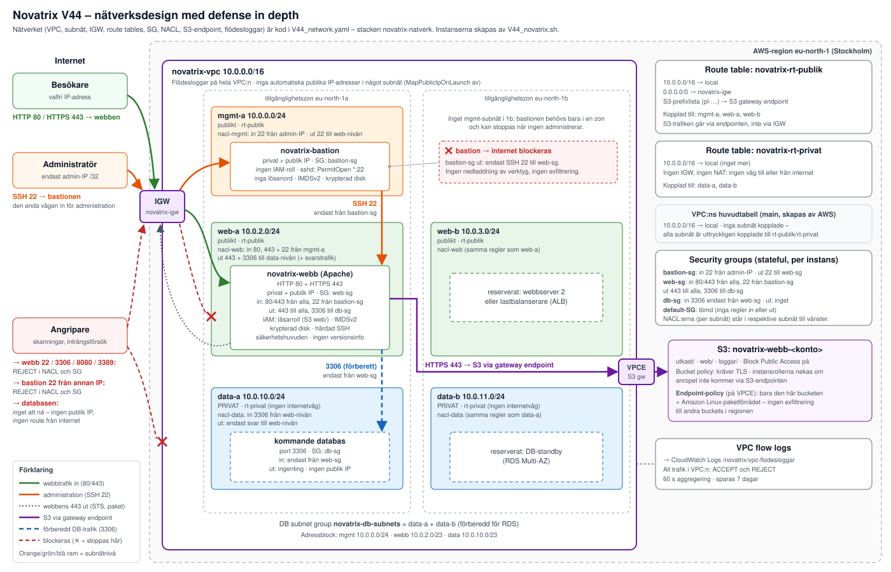

### Defense in depth

*Defense in depth* uppfylls genom att varje hot möts av flera oberoende lager som till exempel nätverssegmentering, *NACL*, routing, *Bastion*, *Security groups*, *IAM* värdhantering och kryptering. Om ett lager fallerar räcker det inte för att en angripare skall nå känsliga resurser. Flödesloggarna gör försöken synliga i efterhand.

### Lager

| Nivå | Vad miljön har | Exempel på vad det stoppar |
|---|---|---|
| **1. Segmentering** | Tre nivåer i egna subnät: mgmt, web och data | En kapad webbserver kommer inte åt admin-zonen |
| **2. Routing** | Datanivån saknar route till internet och publika IP-adresser | Databasen kan inte nås utifrån, även om en brandväggsregel skulle bli fel |
| **3. Network ACL:er** | Stateless regler per subnät med implicit DENY | Portskanningar stoppas redan vid subnätgränsen, även om en security group öppnats av misstag |
| **4. Security groups** | Stateful regler per instans som pekar på andra SG:er, och begränsad utgående trafik | Bara bastionen kan SSH:a till webben och bara webben når DB-porten. En kapad server kan inte ringa hem |
| **5. Bastion** | En enda SSH-ingång, bara från admin-IP, utan IAM-roll och utan internetåtkomst | Webbserverns port 22 syns inte från internet. En kapad bastion ger inga AWS-rättigheter |
| **6. Värdhärdning** | SSH utan lösenord och root, inga tunnlar. Apache utan versionsinfo och med säkerhetshuvuden. IMDSv2, krypterade diskar | Lösenordsgissning, SSRF mot metadatatjänsten och riktade exploits |
| **7. Kryptering** | HTTPS, TLS-krav mot S3, S3-trafik via VPC-endpoint | Avlyssning och manipulation |
| **8. Identitet (IAM)** | Minsta privilegium för roller och användare, och ingen människa kan ändra brandväggen | Insiderhot och kapade konton som öppnar portar |
| **9. Data** | Privat bucket, bucket policy som kräver VPC-endpointen, endpoint-policy som bara släpper vår bucket | Stulna nycklar fungerar inte utanför VPC:n och data kan inte kopieras till angriparens bucket |
| **10. Upptäckt** | Flödesloggar med ACCEPT och REJECT | Gör det möjligt att se skanningar och spåra ett intrång i efterhand |
| **11. Infrastruktur som kod** | Hela nätverket i `V44_network.yaml` | Klickfel och obemärkta ändringar, eftersom allt kan granskas och återskapas |

### Mappstruktur

```
AWS_MOV25/
├── V42/                      # Apache-webbserver på EC2
│   ├── images/
│   ├── README.md
│   └── V42_novatrix-ec2.sh
├── V43/                      # IAM med minsta privilegium, S3 och Lambda
│   ├── pictures/
│   ├── README.md
│   ├── V43_cleanup.sh
│   ├── V43_config.sh
│   ├── V43_novatrix-iam.sh
│   ├── V43_verifiering_20261024-1258.txt
│   └── V43_verify.sh
├── V44/                      # Eget nätverk med defense in depth
│   ├── pictures/
│   ├── README.md
│   ├── V44_cleanup.sh
│   ├── V44_config.sh
│   ├── V44_network.yaml
│   ├── V44_novatrix.sh
│   └── V44_verify.sh
├── .gitignore
└── README.md
```

## *__3. Verifiering__*

Webbservern via *HTTP* och *HTTPS*:

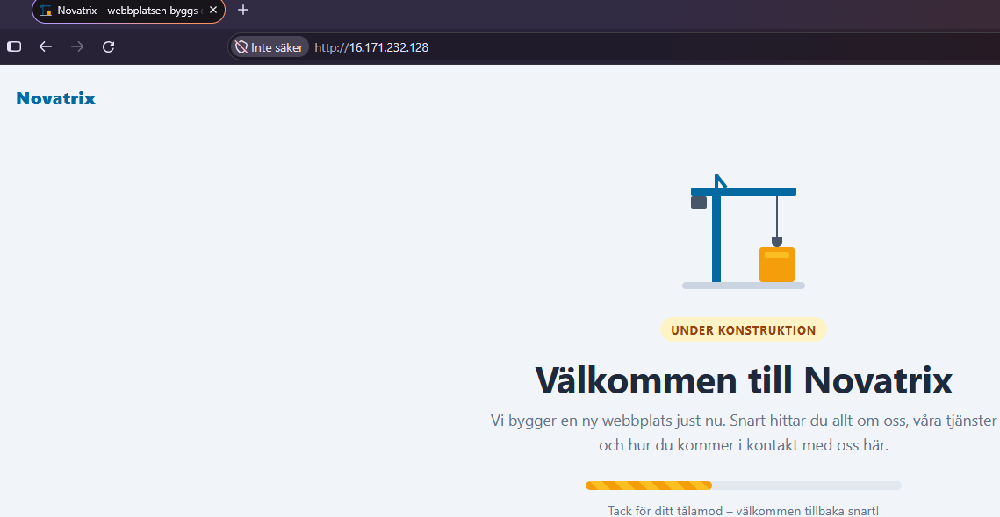

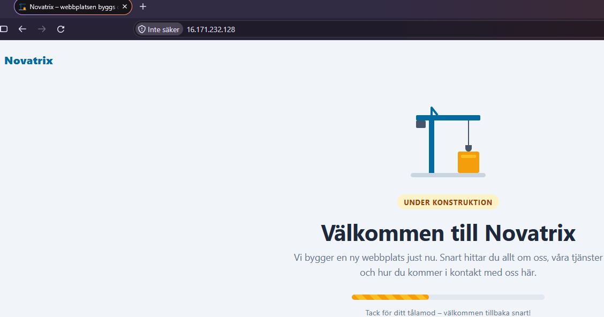

*EC2*:

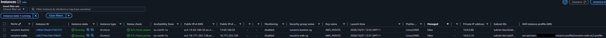

*VPC*:

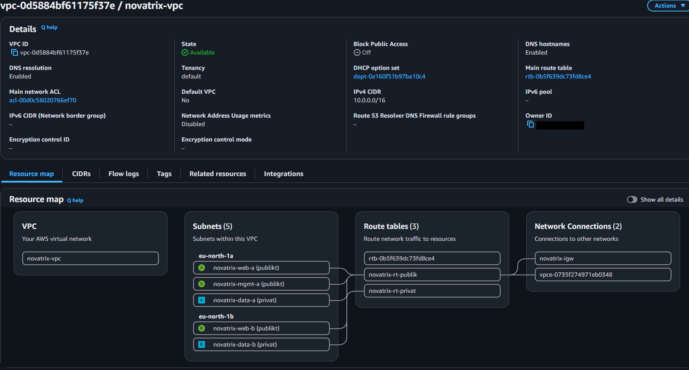

*Subnets*:

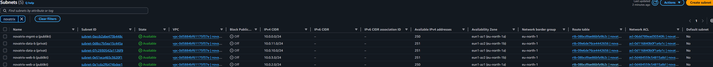

*Security groups*:

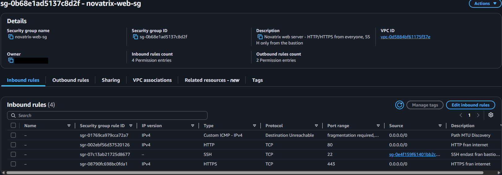

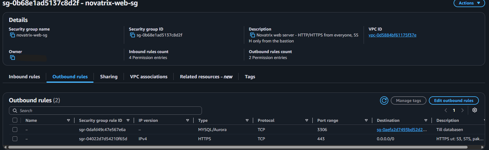

*Route tables*:

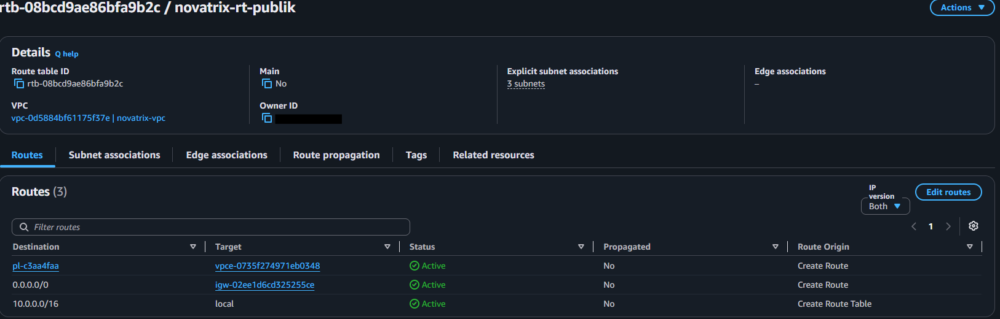

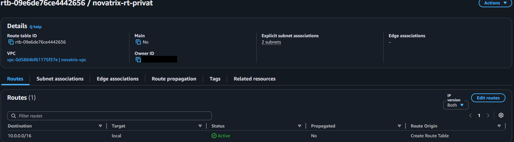

*NACL*:

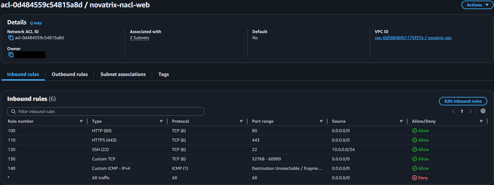

*SSH* nekad:

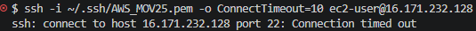

*Bastion* tillåten:

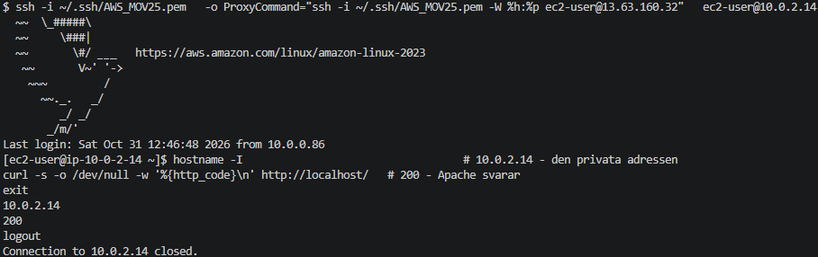

*Flow logs*:

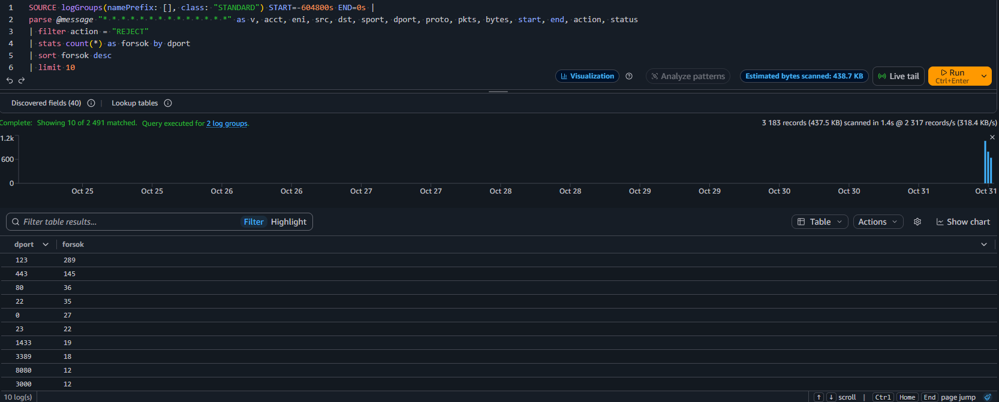

Nätverket som kod:

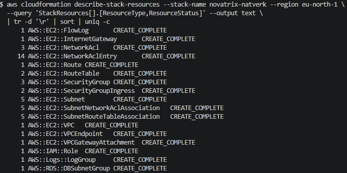

Verifierings script OK:

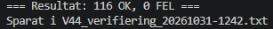
