# __Databas och lagring__

Repository: https://github.com/03timnor/AWS_MOV25

*Tim Noreliusson Lingestedt, 2026-11-05*

Veckans uppgift innefattar att börja med *WordPress*-stacken. *WordPress* behöver en databas och lagring aom kopplas ihop med webbservern för att fungera.

Väl Godkänt delen av uppgiften gåt ut på att göra motiverade val av databas och lagringsnivåer, säkra åtkomsten och att miljön skall skapas med kod.

## *__1. Provisionera miljön__*

### *__V45_novatrix.sh bygger hela miljön, består av följande kod:__*

```bash
#!/usr/bin/env bash
# =============================================================================
# Novatrix V45 - WordPress on RDS + EFS + S3 (builds on V44's network and V43's IAM).
#
# NEW IN V45 - added to the same CloudFormation stack (V45_infra.yaml):
#
#   RDS MariaDB     db.t4g.micro, 20 GiB gp2, encrypted, Single-AZ, private
#                   subnet data-a, NO public access, automated backup 1 day
#   EFS             encrypted shared storage for the WordPress files, mount
#                   targets in the private data tier, TLS + IAM + access point
#   Firewalls       db-sg / efs-sg accept ONLY web-sg; NACLs for 3306 and 2049
#
#   And in this script:
#   Secrets         DB and WordPress passwords generated here, kept in SSM
#                   Parameter Store (SecureString) - never in files or the repo
#   S3              backup/ prefix: daily DB dump + wp-content, lifecycle rule
#                   deletes backups after 14 days. web/ = static content,
#                   served under /statiskt/
#   Web server      WordPress (PHP-FPM) on EFS, own DB user that only reaches
#                   the wordpress database, installed with WP-CLI
#
# FROM V43/V44 (unchanged) - bastion as the only SSH entry, IAM groups/users,
# the publishing chain utkast/ -> Lambda -> web/, role chaining reader ->
# uploader, S3 only via the VPC endpoint, flow logs.
#
# Requirements: AWS CLI v2 with admin credentials, existing key pair, zip OR
#               python OR powershell (to package the Lambda).
# Run:          ./V45_novatrix.sh       (safe to re-run; re-run if your IP changes)
# Verify:       ./V45_verify.sh
# Clean up:     ./V45_cleanup.sh
# =============================================================================
set -euo pipefail
cd "$(dirname "$0")"
source ./V45_config.sh

TAGS_IAM="Key=${TAG_KEY},Value=${TAG_VALUE}"

# ----- Helpers ---------------------------------------------------------------
step() { echo; echo "=== $* ==="; }

# Retry a command while IAM changes propagate (IAM is eventually consistent).
retry() {
  local n
  for n in $(seq 1 12); do
    if "$@" 2>"$WORK_DIR/retry.err"; then return 0; fi
    echo "  ...waiting for IAM to propagate ($n/12)" >&2
    sleep 5
  done
  cat "$WORK_DIR/retry.err" >&2
  return 1
}

# Create a customer managed policy, or publish a new default version if it exists.
ensure_policy() {
  local name=$1 doc=$2
  local arn="arn:aws:iam::${ACCOUNT_ID}:policy/${name}"
  if aws iam get-policy --policy-arn "$arn" >/dev/null 2>&1; then
    local v
    for v in $(aws iam list-policy-versions --policy-arn "$arn" \
                 --query 'Versions[?IsDefaultVersion==`false`].VersionId' --output text); do
      aws iam delete-policy-version --policy-arn "$arn" --version-id "$v"
    done
    aws iam create-policy-version --policy-arn "$arn" --policy-document "$doc" \
      --set-as-default >/dev/null
  else
    aws iam create-policy --policy-name "$name" --policy-document "$doc" \
      --tags "$TAGS_IAM" >/dev/null
  fi
  echo "$arn"
}

# Create a role, or refresh its trust policy if it exists.
ensure_role() {
  local name=$1 trust=$2 description=$3
  if aws iam get-role --role-name "$name" >/dev/null 2>&1; then
    aws iam update-assume-role-policy --role-name "$name" --policy-document "$trust"
  else
    aws iam create-role --role-name "$name" --assume-role-policy-document "$trust" \
      --description "$description" --tags "$TAGS_IAM" >/dev/null
  fi
}

# 32 random letters/digits. Only [A-Za-z0-9]: valid for RDS (which forbids
# / @ " and spaces) and safe inside SQL and PHP strings.
random_password() {
  local pw
  pw=$(head -c 600 /dev/urandom | LC_ALL=C tr -dc 'A-Za-z0-9' | cut -c1-32)
  [[ ${#pw} -eq 32 ]] || { echo "Could not generate a password." >&2; exit 1; }
  echo "$pw"
}

# Create an SSM SecureString with a random password - only if it doesn't exist,
# so a re-run never changes a password the database already uses.
ensure_secret() {
  local name=$1 description=$2
  if aws ssm get-parameter --region "$REGION" --name "$name" >/dev/null 2>&1; then
    echo "Secret exists:  $name"
  else
    aws ssm put-parameter --region "$REGION" --name "$name" --type SecureString \
      --value "$(random_password)" --description "$description" \
      --tags "$TAGS_IAM" >/dev/null
    echo "Secret created: $name"
  fi
}

# Package the Lambda with whatever zip tool exists (Git Bash usually lacks zip).
make_lambda_zip() {
  rm -f "$WORK_DIR/lambda.zip"
  if command -v zip >/dev/null 2>&1; then
    (cd "$WORK_DIR" && zip -q lambda.zip lambda_function.py)
    return
  fi
  local py
  for py in python3 python; do
    if command -v "$py" >/dev/null 2>&1 && "$py" -c "import zipfile" >/dev/null 2>&1; then
      (cd "$WORK_DIR" && "$py" -c "import zipfile; z=zipfile.ZipFile('lambda.zip','w'); z.write('lambda_function.py'); z.close()")
      return
    fi
  done
  if command -v powershell.exe >/dev/null 2>&1; then
    (cd "$WORK_DIR" && powershell.exe -NoProfile -Command \
      "Compress-Archive -Force -Path lambda_function.py -DestinationPath lambda.zip")
    return
  fi
  echo "Found no zip, python or powershell to package the Lambda." >&2
  exit 1
}

# =============================================================================
# 1. Policy documents that don't depend on the stack
# =============================================================================

# ----- Trust policies: WHO may assume each service role ----------------------
EC2_TRUST=$(cat <<JSON
{
  "Version": "2012-10-17",
  "Statement": [{
    "Effect": "Allow",
    "Principal": { "Service": "ec2.amazonaws.com" },
    "Action": "sts:AssumeRole"
  }]
}
JSON
)

LAMBDA_TRUST=$(cat <<JSON
{
  "Version": "2012-10-17",
  "Statement": [{
    "Effect": "Allow",
    "Principal": { "Service": "lambda.amazonaws.com" },
    "Action": "sts:AssumeRole"
  }]
}
JSON
)

# Uploader trust: ONLY a session running with the EC2 reader role may assume it.
# Not the EC2 service, not users, not even administrators.
UPLOADER_TRUST=$(cat <<JSON
{
  "Version": "2012-10-17",
  "Statement": [{
    "Sid": "EndastLasarrollen",
    "Effect": "Allow",
    "Principal": { "AWS": "${EC2_ROLE_ARN}" },
    "Action": "sts:AssumeRole"
  }]
}
JSON
)

# Uploader: write-only, and only to the log archive and the backup prefix.
# Cannot read, list or delete anything - a hacked web server can add a backup
# but never read or destroy the old ones.
UPLOADER_ROLE_POLICY=$(cat <<JSON
{
  "Version": "2012-10-17",
  "Statement": [{
    "Sid": "LaddaUppLoggarOchBackup",
    "Effect": "Allow",
    "Action": "s3:PutObject",
    "Resource": ["${BUCKET_ARN}/loggar/*", "${BUCKET_ARN}/backup/*"]
  }]
}
JSON
)

# Lambda: read drafts, write published files, log to its own log group. Nothing else.
LAMBDA_ROLE_POLICY=$(cat <<JSON
{
  "Version": "2012-10-17",
  "Statement": [
    {
      "Sid": "LasUtkast",
      "Effect": "Allow",
      "Action": "s3:GetObject",
      "Resource": "${BUCKET_ARN}/utkast/*"
    },
    {
      "Sid": "Publicera",
      "Effect": "Allow",
      "Action": "s3:PutObject",
      "Resource": "${BUCKET_ARN}/web/*"
    },
    {
      "Sid": "SkrivEgnaLoggar",
      "Effect": "Allow",
      "Action": ["logs:CreateLogStream", "logs:PutLogEvents"],
      "Resource": "${LOG_GROUP_ARN}:*"
    }
  ]
}
JSON
)

# ----- Group policies: humans --------------------------------------------------
# Drift: operate the Novatrix servers, read logs/metrics/network/database/EFS
# setup and download backups (to restore). No content, no code, no network or
# database changes, no secrets.
DRIFT_POLICY=$(cat <<JSON
{
  "Version": "2012-10-17",
  "Statement": [
    {
      "Sid": "OversiktUtanResursniva",
      "Effect": "Allow",
      "Action": [
        "ec2:DescribeInstances", "ec2:DescribeInstanceStatus", "ec2:DescribeSecurityGroups",
        "ec2:DescribeSecurityGroupRules", "ec2:DescribeNetworkAcls", "ec2:DescribeVpcs",
        "ec2:DescribeSubnets", "ec2:DescribeRouteTables", "ec2:DescribeVpcEndpoints",
        "ec2:DescribeFlowLogs",
        "rds:DescribeDBInstances", "rds:DescribeDBSnapshots", "rds:DescribeDBSubnetGroups",
        "elasticfilesystem:DescribeFileSystems", "elasticfilesystem:DescribeMountTargets",
        "elasticfilesystem:DescribeAccessPoints",
        "cloudwatch:GetMetricData", "cloudwatch:GetMetricStatistics", "cloudwatch:ListMetrics",
        "logs:DescribeLogGroups"
      ],
      "Resource": "*"
    },
    {
      "Sid": "LasFlodesloggar",
      "Effect": "Allow",
      "Action": ["logs:DescribeLogStreams", "logs:GetLogEvents", "logs:FilterLogEvents"],
      "Resource": "${FLOW_LOG_GROUP_ARN}:*"
    },
    {
      "Sid": "StyrEndastNovatrixInstanser",
      "Effect": "Allow",
      "Action": ["ec2:StartInstances", "ec2:StopInstances", "ec2:RebootInstances"],
      "Resource": "arn:aws:ec2:${REGION}:${ACCOUNT_ID}:instance/*",
      "Condition": { "StringEquals": { "aws:ResourceTag/${TAG_KEY}": "${TAG_VALUE}" } }
    },
    {
      "Sid": "LasPubliceringsloggar",
      "Effect": "Allow",
      "Action": ["logs:DescribeLogStreams", "logs:GetLogEvents", "logs:FilterLogEvents"],
      "Resource": "${LOG_GROUP_ARN}:*"
    },
    {
      "Sid": "ListaLoggarOchBackuper",
      "Effect": "Allow",
      "Action": "s3:ListBucket",
      "Resource": "${BUCKET_ARN}",
      "Condition": { "StringLike": { "s3:prefix": ["loggar/*", "backup/*"] } }
    },
    {
      "Sid": "LasLoggarOchBackuper",
      "Effect": "Allow",
      "Action": "s3:GetObject",
      "Resource": ["${BUCKET_ARN}/loggar/*", "${BUCKET_ARN}/backup/*"]
    }
  ]
}
JSON
)

# Utveckling: upload any draft, read the published site, deploy publisher code.
# Can NOT write web/ directly - everything goes through the publisher's checks.
DEV_POLICY=$(cat <<JSON
{
  "Version": "2012-10-17",
  "Statement": [
    {
      "Sid": "ListaSajten",
      "Effect": "Allow",
      "Action": "s3:ListBucket",
      "Resource": "${BUCKET_ARN}",
      "Condition": { "StringLike": { "s3:prefix": ["utkast/*", "web/*"] } }
    },
    {
      "Sid": "HanteraUtkast",
      "Effect": "Allow",
      "Action": ["s3:GetObject", "s3:PutObject", "s3:DeleteObject"],
      "Resource": "${BUCKET_ARN}/utkast/*"
    },
    {
      "Sid": "LasPubliceradSajt",
      "Effect": "Allow",
      "Action": "s3:GetObject",
      "Resource": "${BUCKET_ARN}/web/*"
    },
    {
      "Sid": "DriftsattPublicerarkod",
      "Effect": "Allow",
      "Action": ["lambda:GetFunction", "lambda:UpdateFunctionCode"],
      "Resource": "${FUNCTION_ARN}"
    },
    {
      "Sid": "LasPubliceringsloggar",
      "Effect": "Allow",
      "Action": ["logs:DescribeLogStreams", "logs:GetLogEvents", "logs:FilterLogEvents"],
      "Resource": "${LOG_GROUP_ARN}:*"
    },
    {
      "Sid": "ListaLoggrupper",
      "Effect": "Allow",
      "Action": "logs:DescribeLogGroups",
      "Resource": "*"
    }
  ]
}
JSON
)

# Marknad: upload images to utkast/bilder/ only. Cannot delete, cannot touch pages.
MARKNAD_POLICY=$(cat <<JSON
{
  "Version": "2012-10-17",
  "Statement": [
    {
      "Sid": "ListaEgnaBilder",
      "Effect": "Allow",
      "Action": "s3:ListBucket",
      "Resource": "${BUCKET_ARN}",
      "Condition": { "StringLike": { "s3:prefix": ["utkast/bilder/*"] } }
    },
    {
      "Sid": "LaddaUppBilder",
      "Effect": "Allow",
      "Action": ["s3:GetObject", "s3:PutObject"],
      "Resource": "${BUCKET_ARN}/utkast/bilder/*"
    }
  ]
}
JSON
)

# =============================================================================
# 2. Pre-checks and secrets
# =============================================================================
step "Pre-checks"
# The web server must be a V45 server (WordPress on EFS). An older one (V43 in
# the default VPC, V44 serving the static site) would be mistaken for ours.
# Web servers are stateless - content lives in S3, EFS and RDS - so replacing
# one loses nothing.
OLD=$(aws ec2 describe-instances --region "$REGION" \
  --filters Name=tag:Name,Values="$INSTANCE_NAME" Name=instance-state-name,Values=pending,running,stopping,stopped \
  --query "Reservations[].Instances[].[InstanceId, Tags[?Key=='Version'].Value | [0]]" --output text)
while read -r old_id old_version; do
  [[ -z "${old_id:-}" || "$old_version" == "$VERSION_TAG" ]] && continue
  echo "Found an older web server $old_id (not a $VERSION_TAG WordPress server)." >&2
  echo "Terminate it first, then run this script again:" >&2
  echo "  aws ec2 terminate-instances --region $REGION --instance-ids $old_id" >&2
  echo "(a V43 server in the default VPC: ./V43_cleanup.sh)" >&2
  exit 1
done <<<"$OLD"
echo "No older web server in the way."

MY_IP=$(curl -s https://checkip.amazonaws.com | tr -d '[:space:]')
[[ "$MY_IP" =~ ^[0-9]+\.[0-9]+\.[0-9]+\.[0-9]+$ ]] || { echo "Could not read your public IP." >&2; exit 1; }
echo "Admin access (SSH to the bastion) only from: ${MY_IP}/32"

step "Secrets in SSM Parameter Store (SecureString)"
ensure_secret "$DB_MASTER_PW_PARAM" "Novatrix RDS master password (only used to create the WordPress DB user)"
ensure_secret "$DB_APP_PW_PARAM"    "Novatrix WordPress database user password"
ensure_secret "$WP_ADMIN_PW_PARAM"  "Novatrix WordPress admin password"

# =============================================================================
# 3. Network, database and shared storage - V45_infra.yaml (infrastructure as code)
# =============================================================================
step "Infrastructure: network + RDS + EFS ($STACK_NAME)"
echo "The first time, RDS takes 5-15 minutes to create - the script waits."

# deploy = create the stack the first time, apply only the differences later.
# Re-running with a new IP updates the bastion's security group AND NACL.
aws cloudformation deploy --region "$REGION" \
  --stack-name "$STACK_NAME" \
  --template-file "$INFRA_TEMPLATE" \
  --capabilities CAPABILITY_NAMED_IAM \
  --no-fail-on-empty-changeset \
  --parameter-overrides \
      AdminCidr="${MY_IP}/32" \
      DbPort="$DB_PORT" \
      DbInstanceClass="$DB_INSTANCE_CLASS" \
      DbAllocatedStorage="$DB_STORAGE_GB" \
      DbBackupRetentionDays="$DB_BACKUP_RETENTION_DAYS" \
      DbName="$DB_NAME" \
      DbMasterUsername="$DB_MASTER_USER" \
      WebRoleName="$EC2_ROLE" \
      SiteBucket="$SITE_BUCKET" \
      FlowLogGroupName="$FLOW_LOG_GROUP" \
      ProjectTag="$TAG_VALUE" \
  --tags "${TAG_KEY}=${TAG_VALUE}"

VPC_ID=$(stack_output VpcId)
MGMT_SUBNET=$(stack_output MgmtSubnetAId)
WEB_SUBNET=$(stack_output WebSubnetAId)
BASTION_SG=$(stack_output BastionSgId)
WEB_SG=$(stack_output WebSgId)
S3_ENDPOINT=$(stack_output S3EndpointId)
DEFAULT_SG=$(stack_output DefaultSecurityGroupId)
DB_HOST=$(stack_output DbEndpoint)
FS_ID=$(stack_output FileSystemId)
AP_ID=$(stack_output AccessPointId)
AP_ARN=$(stack_output AccessPointArn)
FS_ARN="arn:aws:elasticfilesystem:${REGION}:${ACCOUNT_ID}:file-system/${FS_ID}"
echo "VPC: $VPC_ID   S3 endpoint: $S3_ENDPOINT"
echo "Subnets: mgmt $MGMT_SUBNET, web $WEB_SUBNET   SG: bastion $BASTION_SG, web $WEB_SG"
echo "Database: $DB_HOST:$DB_PORT   EFS: $FS_ID (access point $AP_ID)"

# Every VPC gets a "default" security group that lets its members talk to each
# other freely. CloudFormation can't manage it, so empty it here: anything
# launched by mistake without our groups ends up with no access at all.
default_sg_rules() {   # false = inbound rules, true = outbound rules
  aws ec2 describe-security-group-rules --region "$REGION" \
    --filters Name=group-id,Values="$DEFAULT_SG" \
    --query "SecurityGroupRules[?IsEgress==\`$1\`].SecurityGroupRuleId" --output text
}
IN_RULES=$(default_sg_rules false)
OUT_RULES=$(default_sg_rules true)
if [[ -n "$IN_RULES" ]]; then
  aws ec2 revoke-security-group-ingress --region "$REGION" --group-id "$DEFAULT_SG" \
    --security-group-rule-ids $IN_RULES >/dev/null
fi
if [[ -n "$OUT_RULES" ]]; then
  aws ec2 revoke-security-group-egress --region "$REGION" --group-id "$DEFAULT_SG" \
    --security-group-rule-ids $OUT_RULES >/dev/null
fi
echo "Default security group $DEFAULT_SG emptied (no rules in, no rules out)"

# EC2 (reader) role policy - needs the stack's EFS ids.
#   S3:   read-only, and only the published static content (web/). It writes
#         NOTHING to S3 itself - logs and backups go through the uploader role.
#   SSM:  read exactly the three Novatrix secrets (the master password is
#         needed once, at first boot, to create the WordPress DB user).
#   EFS:  mount and write - only through the WordPress access point.
EC2_ROLE_POLICY=$(cat <<JSON
{
  "Version": "2012-10-17",
  "Statement": [
    {
      "Sid": "ListaPubliceradSajt",
      "Effect": "Allow",
      "Action": "s3:ListBucket",
      "Resource": "${BUCKET_ARN}",
      "Condition": { "StringLike": { "s3:prefix": ["web/*"] } }
    },
    {
      "Sid": "LasPubliceradSajt",
      "Effect": "Allow",
      "Action": "s3:GetObject",
      "Resource": "${BUCKET_ARN}/web/*"
    },
    {
      "Sid": "BegarUppladdarroll",
      "Effect": "Allow",
      "Action": "sts:AssumeRole",
      "Resource": "${UPLOADER_ROLE_ARN}"
    },
    {
      "Sid": "LasNovatrixHemligheter",
      "Effect": "Allow",
      "Action": "ssm:GetParameter",
      "Resource": [
        "${SSM_ARN_PREFIX}${DB_MASTER_PW_PARAM}",
        "${SSM_ARN_PREFIX}${DB_APP_PW_PARAM}",
        "${SSM_ARN_PREFIX}${WP_ADMIN_PW_PARAM}"
      ]
    },
    {
      "Sid": "MonteraWordpressViaAccessPoint",
      "Effect": "Allow",
      "Action": ["elasticfilesystem:ClientMount", "elasticfilesystem:ClientWrite"],
      "Resource": "${FS_ARN}",
      "Condition": { "StringEquals": { "elasticfilesystem:AccessPointArn": "${AP_ARN}" } }
    }
  ]
}
JSON
)

# =============================================================================
# 4. Storage: S3 (static content + backups) and log group
# =============================================================================
step "Storage: S3 bucket and log group"
if aws s3api head-bucket --bucket "$SITE_BUCKET" 2>/dev/null; then
  echo "Bucket already exists: $SITE_BUCKET"
else
  aws s3api create-bucket --bucket "$SITE_BUCKET" --region "$REGION" \
    --create-bucket-configuration LocationConstraint="$REGION" >/dev/null
  echo "Bucket created: $SITE_BUCKET"
fi
# The bucket is private: visitors reach the site through EC2, never S3 directly.
aws s3api put-public-access-block --bucket "$SITE_BUCKET" --public-access-block-configuration \
  BlockPublicAcls=true,IgnorePublicAcls=true,BlockPublicPolicy=true,RestrictPublicBuckets=true
aws s3api put-bucket-tagging --bucket "$SITE_BUCKET" \
  --tagging "TagSet=[{Key=${TAG_KEY},Value=${TAG_VALUE}}]"
# Resource policy:
#  1. refuse every request that is not encrypted in transit (TLS)
#  2. the web server's roles only work from inside the Novatrix VPC, through
#     the S3 endpoint. Stolen instance credentials are useless elsewhere.
aws s3api put-bucket-policy --bucket "$SITE_BUCKET" --policy "$(cat <<JSON
{
  "Version": "2012-10-17",
  "Statement": [
    {
      "Sid": "EndastTLS",
      "Effect": "Deny",
      "Principal": "*",
      "Action": "s3:*",
      "Resource": ["${BUCKET_ARN}", "${BUCKET_ARN}/*"],
      "Condition": { "Bool": { "aws:SecureTransport": "false" } }
    },
    {
      "Sid": "InstansrollerEndastViaVpcEndpoint",
      "Effect": "Deny",
      "Principal": "*",
      "Action": "s3:*",
      "Resource": ["${BUCKET_ARN}", "${BUCKET_ARN}/*"],
      "Condition": {
        "ArnEquals": { "aws:PrincipalArn": ["${EC2_ROLE_ARN}", "${UPLOADER_ROLE_ARN}"] },
        "StringNotEquals": { "aws:SourceVpce": "${S3_ENDPOINT}" }
      }
    }
  ]
}
JSON
)"
# Lifecycle rules - storage (and cost) never grows without limit:
#   backup/  database dumps and wp-content archives: deleted after 14 days
#   loggar/  Apache logs: deleted after 30 days
#   all      half-finished multipart uploads (e.g. an interrupted backup): 1 day
aws s3api put-bucket-lifecycle-configuration --bucket "$SITE_BUCKET" \
  --lifecycle-configuration "$(cat <<JSON
{
  "Rules": [
    {
      "ID": "rensa-gamla-backuper",
      "Status": "Enabled",
      "Filter": { "Prefix": "backup/" },
      "Expiration": { "Days": ${BACKUP_RETENTION_DAYS} }
    },
    {
      "ID": "rensa-gamla-loggar",
      "Status": "Enabled",
      "Filter": { "Prefix": "loggar/" },
      "Expiration": { "Days": ${LOG_RETENTION_DAYS} }
    },
    {
      "ID": "rensa-avbrutna-uppladdningar",
      "Status": "Enabled",
      "Filter": { "Prefix": "" },
      "AbortIncompleteMultipartUpload": { "DaysAfterInitiation": 1 }
    }
  ]
}
JSON
)"
echo "Lifecycle: backup/ ${BACKUP_RETENTION_DAYS} days, loggar/ ${LOG_RETENTION_DAYS} days"

# Created here (not by Lambda) so the Lambda role needs no logs:CreateLogGroup.
aws logs create-log-group --region "$REGION" --log-group-name "$LOG_GROUP" 2>/dev/null || true
aws logs put-retention-policy --region "$REGION" --log-group-name "$LOG_GROUP" --retention-in-days 7

# =============================================================================
# 5. Service roles
# =============================================================================
step "Service roles"
ensure_role "$EC2_ROLE" "$EC2_TRUST" "Novatrix web server: WordPress on EFS, read static content in S3"
aws iam put-role-policy --role-name "$EC2_ROLE" --policy-name "novatrix-web-ec2-access" \
  --policy-document "$EC2_ROLE_POLICY"
echo "Role ready: $EC2_ROLE"

if ! aws iam get-instance-profile --instance-profile-name "$EC2_PROFILE" >/dev/null 2>&1; then
  aws iam create-instance-profile --instance-profile-name "$EC2_PROFILE" --tags "$TAGS_IAM" >/dev/null
  aws iam add-role-to-instance-profile --instance-profile-name "$EC2_PROFILE" --role-name "$EC2_ROLE"
fi
echo "Instance profile ready: $EC2_PROFILE"

# Retry: IAM rejects a trust policy naming a role that has not propagated yet.
retry ensure_role "$UPLOADER_ROLE" "$UPLOADER_TRUST" "Novatrix: upload logs and backups, assumable only by the EC2 role"
aws iam put-role-policy --role-name "$UPLOADER_ROLE" --policy-name "novatrix-uppladdare-access" \
  --policy-document "$UPLOADER_ROLE_POLICY"
echo "Role ready: $UPLOADER_ROLE (assumable only by $EC2_ROLE)"

ensure_role "$LAMBDA_ROLE" "$LAMBDA_TRUST" "Novatrix publisher: S3 utkast/ -> web/"
aws iam put-role-policy --role-name "$LAMBDA_ROLE" --policy-name "novatrix-publicerare-access" \
  --policy-document "$LAMBDA_ROLE_POLICY"
echo "Role ready: $LAMBDA_ROLE"

# =============================================================================
# 6. Publisher Lambda + S3 trigger
# =============================================================================
step "Publisher Lambda and S3 event trigger"
cat > "$WORK_DIR/lambda_function.py" <<'PY'
"""Novatrix publisher: copies approved drafts from utkast/ to web/.

Only web file types are published, and with a correct Content-Type, so a
draft can never put e.g. a script or an executable on the website.
"""
import json
import os
import urllib.parse

import boto3

s3 = boto3.client("s3")

ALLOWED = {
    ".html": "text/html; charset=utf-8",
    ".css": "text/css; charset=utf-8",
    ".js": "text/javascript; charset=utf-8",
    ".txt": "text/plain; charset=utf-8",
    ".svg": "image/svg+xml",
    ".png": "image/png",
    ".jpg": "image/jpeg",
    ".jpeg": "image/jpeg",
    ".webp": "image/webp",
    ".ico": "image/x-icon",
}
MAX_BYTES = 5 * 1024 * 1024


def log(**fields):
    print(json.dumps(fields, ensure_ascii=False))


def lambda_handler(event, context):
    for record in event["Records"]:
        bucket = record["s3"]["bucket"]["name"]
        key = urllib.parse.unquote_plus(record["s3"]["object"]["key"])
        size = record["s3"]["object"].get("size", 0)
        rel = key[len("utkast/"):] if key.startswith("utkast/") else ""
        ext = os.path.splitext(rel)[1].lower()

        if not rel or ".." in rel or rel.endswith("/"):
            log(nekad=key, orsak="ogiltig sökväg")
        elif ext not in ALLOWED:
            log(nekad=key, orsak=f"filtypen {ext or '(ingen)'} publiceras inte")
        elif size > MAX_BYTES:
            log(nekad=key, orsak="filen är större än 5 MB")
        else:
            body = s3.get_object(Bucket=bucket, Key=key)["Body"].read()
            s3.put_object(Bucket=bucket, Key=f"web/{rel}", Body=body,
                          ContentType=ALLOWED[ext], CacheControl="max-age=300")
            log(publicerad=f"web/{rel}", bytes=len(body))
    return {"ok": True}
PY
make_lambda_zip

if aws lambda get-function --region "$REGION" --function-name "$FUNCTION_NAME" >/dev/null 2>&1; then
  aws lambda update-function-code --region "$REGION" --function-name "$FUNCTION_NAME" \
    --zip-file "fileb://$WORK_DIR/lambda.zip" >/dev/null
  aws lambda wait function-updated-v2 --region "$REGION" --function-name "$FUNCTION_NAME"
  echo "Lambda code updated: $FUNCTION_NAME"
else
  # Retry: a brand new role can take a few seconds before Lambda may assume it.
  retry aws lambda create-function --region "$REGION" --function-name "$FUNCTION_NAME" \
    --runtime python3.12 --handler lambda_function.lambda_handler \
    --role "$LAMBDA_ROLE_ARN" --zip-file "fileb://$WORK_DIR/lambda.zip" \
    --timeout 15 --memory-size 128 \
    --tags "${TAG_KEY}=${TAG_VALUE}" >/dev/null
  aws lambda wait function-active-v2 --region "$REGION" --function-name "$FUNCTION_NAME"
  echo "Lambda created: $FUNCTION_NAME"
fi

# Resource-based policy on the Lambda: only S3, only from OUR bucket and OUR
# account may invoke it (protects against the confused deputy problem).
aws lambda add-permission --region "$REGION" --function-name "$FUNCTION_NAME" \
  --statement-id s3-utkast --action lambda:InvokeFunction \
  --principal s3.amazonaws.com \
  --source-arn "$BUCKET_ARN" \
  --source-account "$ACCOUNT_ID" >/dev/null 2>&1 || true

# Trigger only on utkast/ - the Lambda writes to web/, so it can never trigger itself.
retry aws s3api put-bucket-notification-configuration --bucket "$SITE_BUCKET" \
  --notification-configuration "$(cat <<JSON
{
  "LambdaFunctionConfigurations": [{
    "Id": "publicera-utkast",
    "LambdaFunctionArn": "${FUNCTION_ARN}",
    "Events": ["s3:ObjectCreated:*"],
    "Filter": { "Key": { "FilterRules": [ { "Name": "prefix", "Value": "utkast/" } ] } }
  }]
}
JSON
)"
echo "S3 -> Lambda trigger ready (utkast/*)"

# =============================================================================
# 7. Human access: groups, policies, users
# =============================================================================
step "IAM groups, policies and users"
for group in "$DRIFT_GROUP" "$DEV_GROUP" "$MARKNAD_GROUP"; do
  aws iam get-group --group-name "$group" >/dev/null 2>&1 \
    || aws iam create-group --group-name "$group" >/dev/null
done

DRIFT_POLICY_ARN=$(ensure_policy "novatrix-drift-policy" "$DRIFT_POLICY")
DEV_POLICY_ARN=$(ensure_policy "novatrix-utveckling-policy" "$DEV_POLICY")
MARKNAD_POLICY_ARN=$(ensure_policy "novatrix-marknad-policy" "$MARKNAD_POLICY")

aws iam attach-group-policy --group-name "$DRIFT_GROUP"   --policy-arn "$DRIFT_POLICY_ARN"
aws iam attach-group-policy --group-name "$DEV_GROUP"     --policy-arn "$DEV_POLICY_ARN"
aws iam attach-group-policy --group-name "$MARKNAD_GROUP" --policy-arn "$MARKNAD_POLICY_ARN"
echo "Groups ready: $DRIFT_GROUP, $DEV_GROUP, $MARKNAD_GROUP"

# Users get permissions ONLY through their group - never directly.
# No passwords or access keys are created here.
for entry in "${USERS[@]}"; do
  user=${entry%%:*}
  group=${entry##*:}
  aws iam get-user --user-name "$user" >/dev/null 2>&1 \
    || aws iam create-user --user-name "$user" --tags "$TAGS_IAM" >/dev/null
  aws iam add-user-to-group --user-name "$user" --group-name "$group"
  echo "User ready: $user -> $group"
done

# =============================================================================
# 8. Static content: uploaded as drafts, published by the Lambda, served by
#    the web server under /statiskt/ (WordPress owns the rest of the site)
# =============================================================================
step "Static content drafts to s3://$SITE_BUCKET/utkast/"
mkdir -p "$WORK_DIR/site/bilder"

# Relative links: the page lives under /statiskt/ on the web server.
cat > "$WORK_DIR/site/index.html" <<'HTML'
<!DOCTYPE html>
<html lang="sv">
<head>
  <meta charset="UTF-8">
  <meta name="viewport" content="width=device-width, initial-scale=1.0">
  <title>Novatrix – statisk sida</title>
  <meta name="description" content="Statiskt innehåll som publiceras från S3.">
  <link rel="icon" href="bilder/kran.svg" type="image/svg+xml">
  <link rel="stylesheet" href="style.css">
</head>
<body>
  <header class="topp">
    <span class="logo">Novatrix</span>
  </header>

  <main class="hero">
    
    <p class="etikett">Statisk sida</p>
    <h1>Statiskt innehåll från S3</h1>
    <p class="ingress">Den här sidan laddas upp som utkast, kontrolleras av publiceraren
      (Lambda) och hämtas av webbservern från S3. Själva webbplatsen är WordPress.</p>
    <p><a href="/">Till Novatrix webbplats</a></p>
  </main>

  <footer class="fot">
    <p>&copy; 2026 Novatrix</p>
  </footer>
</body>
</html>
HTML

cat > "$WORK_DIR/site/style.css" <<'CSS'
:root {
  --bg: #f1f5f9; --kort: #ffffff; --text: #1e293b; --dampad: #64748b;
  --accent: #0369a1; --varning: #f59e0b;
}
* { box-sizing: border-box; }
html, body { height: 100%; }
body {
  margin: 0; font-family: system-ui, -apple-system, "Segoe UI", sans-serif;
  background: var(--bg); color: var(--text); line-height: 1.6;
  display: flex; flex-direction: column;
}
.topp { padding: 20px 24px; }
.logo { font-weight: 800; font-size: 1.25rem; letter-spacing: .02em; color: var(--accent); }
.hero {
  flex: 1; width: 100%; max-width: 640px; margin: 0 auto; padding: 24px 24px 48px;
  display: flex; flex-direction: column; align-items: center; text-align: center;
}
.illustration { margin: 12px 0 20px; }
.etikett {
  margin: 0; padding: 4px 12px; border-radius: 999px; font-size: .8rem; font-weight: 700;
  text-transform: uppercase; letter-spacing: .08em; background: #e0f2fe; color: #075985;
}
h1 { margin: 16px 0 8px; font-size: clamp(1.8rem, 5vw, 2.6rem); line-height: 1.2; }
.ingress { margin: 0 0 20px; font-size: 1.1rem; color: var(--dampad); }
a { color: var(--accent); font-weight: 600; }
.fot { padding: 20px 24px; text-align: center; font-size: .85rem; color: var(--dampad); }
.fot p { margin: 0; }
CSS

cat > "$WORK_DIR/site/bilder/kran.svg" <<'SVG'
<svg xmlns="http://www.w3.org/2000/svg" viewBox="0 0 160 160" fill="none">
  <rect x="10" y="140" width="140" height="8" rx="4" fill="#cbd5e1"/>
  <rect x="44" y="40" width="10" height="100" fill="#0369a1"/>
  <rect x="20" y="32" width="120" height="10" rx="2" fill="#0369a1"/>
  <rect x="20" y="42" width="18" height="14" rx="2" fill="#475569"/>
  <path d="M49 32 L49 18 L60 32" stroke="#0369a1" stroke-width="4" stroke-linejoin="round"/>
  <line x1="118" y1="42" x2="118" y2="88" stroke="#475569" stroke-width="2"/>
  <path d="M112 88 h12 v6 a6 6 0 0 1 -12 0 z" fill="#475569"/>
  <rect x="98" y="100" width="40" height="40" rx="3" fill="#f59e0b"/>
  <rect x="104" y="106" width="28" height="6" rx="2" fill="#fbbf24"/>
</svg>
SVG

for f in index.html style.css bilder/kran.svg; do
  aws s3 cp "$WORK_DIR/site/$f" "s3://${SITE_BUCKET}/utkast/$f" --region "$REGION" --only-show-errors
done
echo "Drafts uploaded - waiting for the publisher to copy them to web/ ..."
PUBLISHED=no
for i in $(seq 1 24); do
  if aws s3api head-object --bucket "$SITE_BUCKET" --key web/index.html --region "$REGION" >/dev/null 2>&1; then
    PUBLISHED=yes; break
  fi
  sleep 5
done
[[ "$PUBLISHED" == yes ]] && echo "Published: web/index.html" \
  || echo "WARNING: web/index.html not published yet - check: aws logs tail $LOG_GROUP --region $REGION"

# =============================================================================
# 9. EC2: web server with WordPress (public subnet) + bastion (management subnet)
# =============================================================================
step "EC2: web server in $WEB_SUBNET, bastion in $MGMT_SUBNET"
AMI_ID=$(aws ssm get-parameter --region "$REGION" \
  --name /aws/service/ami-amazon-linux-latest/al2023-ami-kernel-default-x86_64 \
  --query Parameter.Value --output text)
echo "AMI: $AMI_ID"

# Shared by both instances: IMDSv2 only (blocks SSRF-style credential theft
# with a plain GET), and an encrypted root disk.
METADATA_OPTS="HttpTokens=required,HttpEndpoint=enabled,HttpPutResponseHopLimit=1"
DISK_OPTS="DeviceName=/dev/xvda,Ebs={Encrypted=true,VolumeType=gp3,DeleteOnTermination=true}"

# Find a running/pending instance by Name tag, inside the Novatrix VPC only.
find_instance() {
  aws ec2 describe-instances --region "$REGION" \
    --filters Name=tag:Name,Values="$1" Name=vpc-id,Values="$VPC_ID" \
              Name=instance-state-name,Values=pending,running \
    --query 'Reservations[0].Instances[0].InstanceId' --output text
}

# SSH hardening shared by web server and bastion (sshd uses the FIRST value it
# reads, and 10-* is read before Amazon Linux's own 50-redhat.conf).
SSHD_COMMON='PermitRootLogin no
PasswordAuthentication no
KbdInteractiveAuthentication no
X11Forwarding no
AllowAgentForwarding no
MaxAuthTries 3
LoginGraceTime 30
ClientAliveInterval 300
ClientAliveCountMax 2'

# User data: Apache + PHP-FPM, EFS mount, WordPress (DB user + install), static
# content from S3, log archive and daily backup via the uploader role.
# Everything that touches EFS or the database is idempotent: a second web
# server (or a replacement) finds WordPress already installed and just mounts it.
USER_DATA=$(cat <<'USERDATA'
#!/bin/bash
set -euo pipefail

# --- Settings for this server (also read by the timers' scripts) -----------
mkdir -p /etc/novatrix
cat > /etc/novatrix/wordpress.env <<'ENV'
REGION=__REGION__
BUCKET=__BUCKET__
FS_ID=__FS_ID__
AP_ID=__AP_ID__
DB_HOST=__DB_HOST__
DB_PORT=__DB_PORT__
DB_NAME=__DB_NAME__
DB_MASTER_USER=__DB_MASTER_USER__
DB_APP_USER=__DB_APP_USER__
DB_MASTER_PW_PARAM=__DB_MASTER_PW_PARAM__
DB_APP_PW_PARAM=__DB_APP_PW_PARAM__
WP_ADMIN_PW_PARAM=__WP_ADMIN_PW_PARAM__
WP_ROOT=__WP_ROOT__
ENV
chmod 644 /etc/novatrix/wordpress.env
source /etc/novatrix/wordpress.env

# --- Packages: required ones must install, extras are best effort ----------
dnf install -y httpd mod_ssl php php-fpm php-mysqlnd mariadb105 amazon-efs-utils
dnf install -y --setopt=strict=0 php-gd php-mbstring php-xml php-opcache php-intl || true

# --- TLS to the database: RDS requires it (require_secure_transport=ON) ----
# Trust Amazon RDS's certificate authority, so both the mysql client and PHP
# verify that they really talk to OUR database (no man-in-the-middle).
curl -fsSL -o /etc/pki/ca-trust/source/anchors/rds-$REGION.pem \
  "https://truststore.pki.rds.amazonaws.com/$REGION/$REGION-bundle.pem"
update-ca-trust extract

# --- SSH hardening: reachable only from the bastion, no forwarding ---------
cat > /etc/ssh/sshd_config.d/10-novatrix.conf <<'SSHD'
__SSHD_COMMON__
AllowTcpForwarding no
SSHD
# Validate before reloading: a typo must never lock us out of the server.
if sshd -t; then systemctl reload sshd
else echo "sshd rejected 10-novatrix.conf - removed it" >&2; rm -f /etc/ssh/sshd_config.d/10-novatrix.conf; fi

# --- HTTPS: self-signed certificate (no domain yet - see the documentation).
openssl req -x509 -nodes -newkey rsa:2048 -days 365 -subj "/CN=novatrix-webb" \
  -keyout /etc/pki/tls/private/localhost.key -out /etc/pki/tls/certs/localhost.crt
chmod 600 /etc/pki/tls/private/localhost.key

# --- Apache + PHP hardening -------------------------------------------------
# CSP/X-Frame-Options allow same-origin framing: WordPress's own editor needs it.
cat > /etc/httpd/conf.d/10-novatrix-sakerhet.conf <<'CONF'
ServerTokens Prod
ServerSignature Off
TraceEnable Off
Header always set X-Content-Type-Options "nosniff"
Header always set X-Frame-Options "SAMEORIGIN"
Header always set Referrer-Policy "strict-origin-when-cross-origin"
Header always set Content-Security-Policy "frame-ancestors 'self'"

<Directory "/var/www/html">
    Options -Indexes +FollowSymLinks
    AllowOverride All
    Require all granted
</Directory>
# XML-RPC: old remote API, a favourite for password guessing. Not used here.
<Files "xmlrpc.php">
    Require all denied
</Files>
# Uploaded files are data, never code: no PHP runs from the uploads folder.
<Directory "/var/www/html/wp-content/uploads">
    <FilesMatch "\.(php|phtml|phar)$">
        Require all denied
    </FilesMatch>
</Directory>

# Static content published from S3 web/ (the Lambda chain)
Alias /statiskt/ /var/www/statiskt/
<Directory "/var/www/statiskt">
    Options -Indexes
    AllowOverride None
    Require all granted
</Directory>
CONF
cat > /etc/php.d/90-novatrix.ini <<'INI'
expose_php = Off
upload_max_filesize = 16M
post_max_size = 16M
INI

# --- EFS: WordPress files on shared storage --------------------------------
# tls = encrypted NFS, iam = the instance role authenticates, accesspoint =
# forced to uid/gid 48 (apache) under /wordpress. nofail: a missing EFS must
# never stop the server from booting (we would lose SSH).
mkdir -p "$WP_ROOT"
echo "$FS_ID:/ $WP_ROOT efs _netdev,nofail,tls,iam,accesspoint=$AP_ID 0 0" >> /etc/fstab
for i in $(seq 1 18); do
  mount "$WP_ROOT" 2>/dev/null && break
  echo "waiting for EFS / the instance role ($i/18)"; sleep 10
done
mountpoint -q "$WP_ROOT"
# Apache and PHP must never start on the empty local folder underneath.
for svc in httpd php-fpm; do
  mkdir -p /etc/systemd/system/$svc.service.d
  printf '[Unit]\nRequiresMountsFor=%s\n' "$WP_ROOT" > /etc/systemd/system/$svc.service.d/10-novatrix-efs.conf
done

# --- s3-curl: reach S3 with nothing but curl and the instance role ----------
cat > /usr/local/bin/s3-curl <<'SH'
#!/bin/bash
set -euo pipefail
BUCKET="__BUCKET__"
REGION="__REGION__"
IMDS="http://169.254.169.254/latest"
TOKEN=$(curl -sf -X PUT "$IMDS/api/token" -H "X-aws-ec2-metadata-token-ttl-seconds: 300")
ROLE=$(curl -sf -H "X-aws-ec2-metadata-token: $TOKEN" "$IMDS/meta-data/iam/security-credentials/")
CREDS=$(curl -sf -H "X-aws-ec2-metadata-token: $TOKEN" "$IMDS/meta-data/iam/security-credentials/$ROLE")
field() { python3 -c "import json,sys; print(json.load(sys.stdin)['$1'])" <<<"$CREDS"; }
URL="https://${BUCKET}.s3.${REGION}.amazonaws.com/$1"
ARGS=(--silent --show-error --fail-with-body
      --aws-sigv4 "aws:amz:${REGION}:s3"
      --user "$(field AccessKeyId):$(field SecretAccessKey)"
      -H "x-amz-security-token: $(field Token)"
      -H "x-amz-content-sha256: UNSIGNED-PAYLOAD")
if [[ $# -ge 2 ]]; then curl "${ARGS[@]}" -T "$2" "$URL"; else curl "${ARGS[@]}" "$URL"; fi
SH
chmod 755 /usr/local/bin/s3-curl

# --- novatrix-sync: static content S3 web/ -> /var/www/statiskt -------------
mkdir -p /var/www/statiskt
cat > /usr/local/bin/novatrix-sync <<'SH'
#!/bin/bash
aws s3 sync "s3://__BUCKET__/web/" /var/www/statiskt/ --region __REGION__ --only-show-errors
SH
chmod 755 /usr/local/bin/novatrix-sync

# --- som-uppladdare: role chaining (reader -> uploader) ---------------------
cat > /usr/local/bin/som-uppladdare <<'SH'
#!/bin/bash
set -euo pipefail
CREDS=$(aws sts assume-role --region __REGION__ \
  --role-arn "__UPLOADER_ARN__" \
  --role-session-name "uppladdare-$(hostname -s)" \
  --duration-seconds 900 \
  --query '[Credentials.AccessKeyId,Credentials.SecretAccessKey,Credentials.SessionToken]' \
  --output text)
read -r AK SK ST <<<"$CREDS"
AWS_ACCESS_KEY_ID=$AK AWS_SECRET_ACCESS_KEY=$SK AWS_SESSION_TOKEN=$ST exec "$@"
SH
chmod 755 /usr/local/bin/som-uppladdare

# --- novatrix-loggar: archive Apache logs via the uploader role ------------
cat > /usr/local/bin/novatrix-loggar <<'SH'
#!/bin/bash
set -euo pipefail
IMDS="http://169.254.169.254/latest"
TOKEN=$(curl -sf -X PUT "$IMDS/api/token" -H "X-aws-ec2-metadata-token-ttl-seconds: 60")
IID=$(curl -sf -H "X-aws-ec2-metadata-token: $TOKEN" "$IMDS/meta-data/instance-id")
STAMP=$(date -u +%Y%m%dT%H%M%SZ)
for f in access_log error_log; do
  [[ -s "/var/log/httpd/$f" ]] || continue
  gzip -c "/var/log/httpd/$f" > "/tmp/$f.gz"
  /usr/local/bin/som-uppladdare aws s3 cp "/tmp/$f.gz" \
    "s3://__BUCKET__/loggar/$IID/$STAMP-$f.gz" --region __REGION__ --only-show-errors
  rm -f "/tmp/$f.gz"
  echo "Uploaded $f -> loggar/$IID/$STAMP-$f.gz"
done
SH
chmod 755 /usr/local/bin/novatrix-loggar

# --- novatrix-db: mysql client with a password from SSM (never on disk) ----
# Usage: novatrix-db app|master [mysql/mysqldump args]   (NOVATRIX_DUMP=1 -> mysqldump)
cat > /usr/local/bin/novatrix-db <<'SH'
#!/bin/bash
set -euo pipefail
source /etc/novatrix/wordpress.env
case "${1:-}" in
  app)    user=$DB_APP_USER;    param=$DB_APP_PW_PARAM ;;
  master) user=$DB_MASTER_USER; param=$DB_MASTER_PW_PARAM ;;
  *) echo "usage: novatrix-db app|master [args]" >&2; exit 2 ;;
esac
shift
pw=$(aws ssm get-parameter --region "$REGION" --name "$param" --with-decryption \
       --query Parameter.Value --output text)
cnf=$(mktemp); trap 'rm -f "$cnf"' EXIT
printf '[client]\nhost=%s\nport=%s\nuser=%s\npassword=%s\nssl-ca=/etc/pki/ca-trust/source/anchors/rds-%s.pem\nssl-verify-server-cert\n' \
  "$DB_HOST" "$DB_PORT" "$user" "$pw" "$REGION" > "$cnf"
if [[ -n "${NOVATRIX_DUMP:-}" ]]; then mysqldump --defaults-extra-file="$cnf" "$@"
else mysql --defaults-extra-file="$cnf" "$@"; fi
SH
chmod 750 /usr/local/bin/novatrix-db

# --- novatrix-backup: DB dump + wp-content -> S3 backup/ (uploader role) ---
# The lifecycle rule on backup/ deletes these after 14 days.
cat > /usr/local/bin/novatrix-backup <<'SH'
#!/bin/bash
set -euo pipefail
source /etc/novatrix/wordpress.env
STAMP=$(date -u +%Y%m%dT%H%M%SZ)
DUMP=$(mktemp /tmp/novatrix-db-XXXXXX.sql.gz); trap 'rm -f "$DUMP"' EXIT
# Dump first, upload after: a failed dump never becomes an empty "backup" in S3.
NOVATRIX_DUMP=1 /usr/local/bin/novatrix-db app --single-transaction --no-tablespaces "$DB_NAME" | gzip > "$DUMP"
/usr/local/bin/som-uppladdare aws s3 cp "$DUMP" \
  "s3://$BUCKET/backup/db/$STAMP-$DB_NAME.sql.gz" --region "$REGION" --only-show-errors
echo "Uploaded backup/db/$STAMP-$DB_NAME.sql.gz"
tar -czf - -C "$WP_ROOT" wp-content | /usr/local/bin/som-uppladdare aws s3 cp - \
  "s3://$BUCKET/backup/filer/$STAMP-wp-content.tar.gz" --region "$REGION" --only-show-errors
echo "Uploaded backup/filer/$STAMP-wp-content.tar.gz"
SH
chmod 750 /usr/local/bin/novatrix-backup

# --- systemd units: sync (30 min), logs + backup (daily), wp-cron (5 min) --
unit() {   # name description exec-start [user]
  printf '[Unit]\nDescription=%s\nAfter=network-online.target\nWants=network-online.target\n[Service]\nType=oneshot\nExecStart=%s\n' \
    "$2" "$3" > /etc/systemd/system/$1.service
  [[ -n "${4:-}" ]] && echo "User=$4" >> /etc/systemd/system/$1.service
  return 0
}
timer() {  # name description timer-lines
  printf '[Unit]\nDescription=%s\n[Timer]\n%s\n[Install]\nWantedBy=timers.target\n' "$2" "$3" \
    > /etc/systemd/system/$1.timer
}
unit  novatrix-sync   "Pull the published static content from S3" /usr/local/bin/novatrix-sync
timer novatrix-sync   "Pull static content periodically" "OnBootSec=2min
OnUnitActiveSec=__INTERVAL__"
unit  novatrix-loggar "Archive Apache logs to S3 via the uploader role" /usr/local/bin/novatrix-loggar
timer novatrix-loggar "Archive Apache logs daily" "OnCalendar=daily
Persistent=true"
unit  novatrix-backup "Back up WordPress (database + wp-content) to S3" /usr/local/bin/novatrix-backup
timer novatrix-backup "Back up WordPress daily" "OnCalendar=*-*-* 00:00:00
Persistent=true"
# WordPress's own cron is triggered by visitors through an HTTP call to the
# site itself - the web security group (correctly) doesn't allow that, so it
# runs from systemd instead.
unit  novatrix-wpcron "WordPress scheduled tasks" "/usr/bin/php $WP_ROOT/wp-cron.php" apache
timer novatrix-wpcron "WordPress scheduled tasks every 5 minutes" "OnBootSec=5min
OnUnitActiveSec=5min"

# --- Database: WordPress's own user (master password only used here) -------
for i in $(seq 1 30); do
  /usr/local/bin/novatrix-db master -e "SELECT 1" >/dev/null 2>&1 && break
  echo "waiting for the database ($i/30)"; sleep 10
done
APP_PW=$(aws ssm get-parameter --region "$REGION" --name "$DB_APP_PW_PARAM" --with-decryption \
           --query Parameter.Value --output text)
# Host part = the web tier 10.0.2.0/23: the user can't log in from anywhere else.
/usr/local/bin/novatrix-db master <<SQL
CREATE DATABASE IF NOT EXISTS $DB_NAME CHARACTER SET utf8mb4 COLLATE utf8mb4_unicode_ci;
CREATE USER IF NOT EXISTS '$DB_APP_USER'@'10.0.2.0/255.255.254.0' IDENTIFIED BY '$APP_PW';
ALTER USER '$DB_APP_USER'@'10.0.2.0/255.255.254.0' IDENTIFIED BY '$APP_PW';
GRANT ALL PRIVILEGES ON $DB_NAME.* TO '$DB_APP_USER'@'10.0.2.0/255.255.254.0';
SQL

# --- WordPress on EFS (WP-CLI) ----------------------------------------------
curl -fsSL -o /usr/local/bin/wp https://raw.githubusercontent.com/wp-cli/builds/gh-pages/phar/wp-cli.phar
chmod 755 /usr/local/bin/wp
# 512 MB: PHP's default 128 MB is too little to unpack the WordPress archive.
WP=(/usr/bin/php -d memory_limit=512M /usr/local/bin/wp --path="$WP_ROOT" --allow-root)
[[ -f "$WP_ROOT/wp-includes/version.php" ]] || "${WP[@]}" core download --locale=__WP_LOCALE__
if [[ ! -f "$WP_ROOT/wp-config.php" ]]; then
  "${WP[@]}" config create --dbname="$DB_NAME" --dbuser="$DB_APP_USER" --dbpass="$APP_PW" \
    --dbhost="$DB_HOST:$DB_PORT" --locale=__WP_LOCALE__ --skip-check --extra-php <<'PHP'
// Novatrix: the site address follows the address the visitor used, because the
// public IP changes when the instance is stopped/started (no domain yet).
if (isset($_SERVER['HTTP_HOST'])) {
    $novatrix_scheme = (!empty($_SERVER['HTTPS']) && $_SERVER['HTTPS'] !== 'off') ? 'https' : 'http';
    define('WP_HOME', $novatrix_scheme . '://' . $_SERVER['HTTP_HOST']);
    define('WP_SITEURL', WP_HOME);
}
define('MYSQL_CLIENT_FLAGS', MYSQLI_CLIENT_SSL);   // TLS to RDS (CA in the system trust store)
define('DISABLE_WP_CRON', true);      // runs from systemd (novatrix-wpcron.timer)
define('DISALLOW_FILE_EDIT', true);   // no PHP editing from the admin panel
define('FS_METHOD', 'direct');
define('WP_AUTO_UPDATE_CORE', 'minor');
PHP
fi
if ! "${WP[@]}" core is-installed 2>/dev/null; then
  TOKEN=$(curl -sf -X PUT http://169.254.169.254/latest/api/token -H "X-aws-ec2-metadata-token-ttl-seconds: 60")
  PUBLIC_IP=$(curl -sf -H "X-aws-ec2-metadata-token: $TOKEN" http://169.254.169.254/latest/meta-data/public-ipv4)
  ADMIN_PW=$(aws ssm get-parameter --region "$REGION" --name "$WP_ADMIN_PW_PARAM" --with-decryption \
               --query Parameter.Value --output text)
  "${WP[@]}" core install --url="http://$PUBLIC_IP" --title="__WP_TITLE__" \
    --admin_user="__WP_ADMIN_USER__" --admin_password="$ADMIN_PW" \
    --admin_email="__WP_ADMIN_EMAIL__" --skip-email
  "${WP[@]}" option update blogdescription "WordPress på RDS och EFS"
  "${WP[@]}" post create --post_type=page --post_status=publish --post_title="Om Novatrix" \
    --post_content="Den här sidan ligger i databasen (RDS). Bilder och filer ligger på delad lagring (EFS)."
fi
mkdir -p "$WP_ROOT/wp-content/uploads"

# --- First static sync (retry while the role's credentials become available)
for i in $(seq 1 12); do
  /usr/local/bin/novatrix-sync && [[ -f /var/www/statiskt/index.html ]] && break
  sleep 5
done

systemctl daemon-reload
systemctl enable --now php-fpm httpd novatrix-sync.timer novatrix-loggar.timer \
  novatrix-backup.timer novatrix-wpcron.timer
echo "Novatrix WordPress ready"
USERDATA
)
USER_DATA=${USER_DATA//__BUCKET__/$SITE_BUCKET}
USER_DATA=${USER_DATA//__UPLOADER_ARN__/$UPLOADER_ROLE_ARN}
USER_DATA=${USER_DATA//__REGION__/$REGION}
USER_DATA=${USER_DATA//__INTERVAL__/$SYNC_INTERVAL}
USER_DATA=${USER_DATA//__SSHD_COMMON__/$SSHD_COMMON}
USER_DATA=${USER_DATA//__FS_ID__/$FS_ID}
USER_DATA=${USER_DATA//__AP_ID__/$AP_ID}
USER_DATA=${USER_DATA//__DB_HOST__/$DB_HOST}
USER_DATA=${USER_DATA//__DB_PORT__/$DB_PORT}
USER_DATA=${USER_DATA//__DB_NAME__/$DB_NAME}
USER_DATA=${USER_DATA//__DB_MASTER_USER__/$DB_MASTER_USER}
USER_DATA=${USER_DATA//__DB_APP_USER__/$DB_APP_USER}
USER_DATA=${USER_DATA//__DB_MASTER_PW_PARAM__/$DB_MASTER_PW_PARAM}
USER_DATA=${USER_DATA//__DB_APP_PW_PARAM__/$DB_APP_PW_PARAM}
USER_DATA=${USER_DATA//__WP_ADMIN_PW_PARAM__/$WP_ADMIN_PW_PARAM}
USER_DATA=${USER_DATA//__WP_ROOT__/$WP_ROOT}
USER_DATA=${USER_DATA//__WP_LOCALE__/$WP_LOCALE}
USER_DATA=${USER_DATA//__WP_TITLE__/$WP_TITLE}
USER_DATA=${USER_DATA//__WP_ADMIN_USER__/$WP_ADMIN_USER}
USER_DATA=${USER_DATA//__WP_ADMIN_EMAIL__/$WP_ADMIN_EMAIL}
if (( ${#USER_DATA} > 16000 )); then
  echo "User data is ${#USER_DATA} bytes - EC2 allows 16 KB." >&2; exit 1
fi

# Bastion user data: installs NOTHING (its security group doesn't even allow
# it to reach the internet). Only hardens SSH: it may forward SSH connections
# (port 22) and nothing else, so it can't be used as a tunnel to the database.
BASTION_USER_DATA=$(cat <<'USERDATA'
#!/bin/bash
set -e
cat > /etc/ssh/sshd_config.d/10-novatrix.conf <<'SSHD'
__SSHD_COMMON__
AllowTcpForwarding local
PermitOpen *:22
SSHD
# Validate before reloading: a typo must never lock us out of the server.
if sshd -t; then systemctl reload sshd
else echo "sshd rejected 10-novatrix.conf - removed it" >&2; rm -f /etc/ssh/sshd_config.d/10-novatrix.conf; fi
USERDATA
)
BASTION_USER_DATA=${BASTION_USER_DATA//__SSHD_COMMON__/$SSHD_COMMON}

# --- Web server: public subnet web-a, web security group, reader role --------
INSTANCE_ID=$(find_instance "$INSTANCE_NAME")
if [[ "$INSTANCE_ID" != "None" ]]; then
  echo "Web server already running: $INSTANCE_ID (terminate it to relaunch - WordPress lives on EFS/RDS)"
else
  # Retry: a new instance profile is not usable by EC2 for a few seconds.
  INSTANCE_ID=$(retry aws ec2 run-instances --region "$REGION" \
    --image-id "$AMI_ID" \
    --instance-type "$INSTANCE_TYPE" \
    --key-name "$KEY_NAME" \
    --subnet-id "$WEB_SUBNET" \
    --security-group-ids "$WEB_SG" \
    --associate-public-ip-address \
    --iam-instance-profile Name="$EC2_PROFILE" \
    --credit-specification CpuCredits=standard \
    --metadata-options "$METADATA_OPTS" \
    --block-device-mappings "$DISK_OPTS" \
    --user-data "$USER_DATA" \
    --tag-specifications "ResourceType=instance,Tags=[{Key=Name,Value=$INSTANCE_NAME},{Key=Roll,Value=webb},{Key=Version,Value=$VERSION_TAG},{Key=${TAG_KEY},Value=${TAG_VALUE}}]" \
    --query 'Instances[0].InstanceId' --output text)
  echo "Web server launched: $INSTANCE_ID"
fi

# --- Bastion: public subnet mgmt-a, bastion security group, NO IAM role -----
BASTION_ID=$(find_instance "$BASTION_NAME")
if [[ "$BASTION_ID" != "None" ]]; then
  echo "Bastion already running: $BASTION_ID"
else
  BASTION_ID=$(aws ec2 run-instances --region "$REGION" \
    --image-id "$AMI_ID" \
    --instance-type "$INSTANCE_TYPE" \
    --key-name "$KEY_NAME" \
    --subnet-id "$MGMT_SUBNET" \
    --security-group-ids "$BASTION_SG" \
    --associate-public-ip-address \
    --credit-specification CpuCredits=standard \
    --metadata-options "$METADATA_OPTS" \
    --block-device-mappings "$DISK_OPTS" \
    --user-data "$BASTION_USER_DATA" \
    --tag-specifications "ResourceType=instance,Tags=[{Key=Name,Value=$BASTION_NAME},{Key=Roll,Value=bastion},{Key=Version,Value=$VERSION_TAG},{Key=${TAG_KEY},Value=${TAG_VALUE}}]" \
    --query 'Instances[0].InstanceId' --output text)
  echo "Bastion launched: $BASTION_ID"
fi

echo "Waiting for both instances to be 'running'..."
aws ec2 wait instance-running --region "$REGION" --instance-ids "$INSTANCE_ID" "$BASTION_ID"

read -r PUBLIC_IP PRIVATE_IP < <(aws ec2 describe-instances --region "$REGION" --instance-ids "$INSTANCE_ID" \
  --query 'Reservations[0].Instances[0].[PublicIpAddress,PrivateIpAddress]' --output text)
BASTION_IP=$(aws ec2 describe-instances --region "$REGION" --instance-ids "$BASTION_ID" \
  --query 'Reservations[0].Instances[0].PublicIpAddress' --output text)

echo
echo "Done! WordPress is up in 3-5 minutes (user data installs it at first boot)."
echo "  WordPress:  http://$PUBLIC_IP   and   https://$PUBLIC_IP  (self-signed certificate)"
echo "  Admin:      http://$PUBLIC_IP/wp-admin   user: $WP_ADMIN_USER"
echo "              password (copy into Git Bash):"
echo "              MSYS_NO_PATHCONV=1 aws ssm get-parameter --region $REGION --name $WP_ADMIN_PW_PARAM --with-decryption --query Parameter.Value --output text"
echo "  Static:     http://$PUBLIC_IP$STATIC_URL_PATH/   (published from S3 web/)"
echo "  Bastion:    ssh -i $KEY_FILE ec2-user@$BASTION_IP"
echo "  Web (only via the bastion):"
echo "              ssh -i $KEY_FILE -o ProxyCommand=\"ssh -i $KEY_FILE -W %h:%p ec2-user@$BASTION_IP\" ec2-user@$PRIVATE_IP"
echo "  On EC2:     sudo cat /var/log/cloud-init-output.log   (the WordPress installation)"
echo "              sudo /usr/local/bin/novatrix-db app -e 'SHOW TABLES' $DB_NAME   (as WordPress's DB user)"
echo "              df -h $WP_ROOT                             (the shared storage, EFS)"
echo "              sudo systemctl start novatrix-backup       (back up now instead of at 00:00 UTC)"
echo
echo "Tip:      stop the bastion when you are not administering - nothing else needs it:"
echo "            aws ec2 stop-instances --instance-ids $BASTION_ID --region $REGION"
echo "Next:     ./V45_verify.sh     (tests permissions, WordPress on RDS + EFS, backups AND the network)"
echo "Clean up: ./V45_cleanup.sh"
```

### *__V45_infra.yaml beskriver nätverket, databas och lagring som en CloudFormation-mall, består av följande kod:__*

```yaml
AWSTemplateFormatVersion: "2010-09-09"
Description: >
  Novatrix V45 - network, database and shared storage as code. VPC with three
  tiers (management, web, data), security groups AND network ACLs (defense in
  depth), S3 gateway endpoint, VPC flow logs, RDS MariaDB in the private data
  tier and EFS (shared WordPress files) with mount targets in the data tier.
  Deployed by V45_novatrix.sh with `aws cloudformation deploy`.

# =============================================================================
# Address plan (10.0.0.0/16, two availability zones)
#
#   mgmt-a  10.0.0.0/24   public   bastion host (the only SSH entry point)
#   web-a   10.0.2.0/24   public   web server (Apache)
#   web-b   10.0.3.0/24   public   reserved: second web server / load balancer
#   data-a  10.0.10.0/24  private  RDS MariaDB + EFS mount target, NO internet route
#   data-b  10.0.11.0/24  private  EFS mount target (the DB subnet group needs two AZs)
#
# Web tier = 10.0.2.0/23, data tier = 10.0.10.0/23, so one NACL rule covers both
# subnets of a tier.
# =============================================================================

Parameters:
  AdminCidr:
    Type: String
    Description: The only address allowed to SSH to the bastion (your public IP /32)
    AllowedPattern: '^(\d{1,3}\.){3}\d{1,3}/32$'
    ConstraintDescription: Must be a single host, e.g. 203.0.113.10/32
  DbPort:
    Type: Number
    Default: 3306
    Description: Database port (MariaDB 3306)
  DbInstanceClass:
    Type: String
    Default: db.t4g.micro
    AllowedValues: [db.t4g.micro, db.t3.micro]
    Description: Free tier / Free plan classes only - a typo can't create an expensive database
  DbAllocatedStorage:
    Type: Number
    Default: 20
    MinValue: 20
    MaxValue: 20
    Description: GiB of gp2 storage (20 = free tier allowance and RDS minimum)
  DbBackupRetentionDays:
    Type: Number
    Default: 1
    MinValue: 1
    MaxValue: 1
    Description: Days of automated RDS backups (Free plan allows at most 1)
  DbName:
    Type: String
    Default: wordpress
  DbMasterUsername:
    Type: String
    Default: novatrixadmin
    NoEcho: true
  WebRoleName:
    Type: String
    Default: novatrix-web-ec2-role
    Description: The web server's instance role - the only principal EFS lets mount
  SiteBucket:
    Type: String
    Description: The Novatrix bucket - the only bucket the S3 endpoint lets through
  FlowLogGroupName:
    Type: String
    Default: /novatrix/vpc-flodesloggar
  ProjectTag:
    Type: String
    Default: novatrix

Mappings:
  Natverk:
    Vpc:     { Cidr: 10.0.0.0/16 }
    MgmtA:   { Cidr: 10.0.0.0/24 }
    WebA:    { Cidr: 10.0.2.0/24 }
    WebB:    { Cidr: 10.0.3.0/24 }
    WebAll:  { Cidr: 10.0.2.0/23 }
    DataA:   { Cidr: 10.0.10.0/24 }
    DataB:   { Cidr: 10.0.11.0/24 }
    DataAll: { Cidr: 10.0.10.0/23 }
    # Ephemeral (client) ports. Our servers run Linux, which picks source ports
    # in 32768-60999, so return traffic TO our servers only needs that range.
    # Visitors and admins can be anything (Windows, NAT), so traffic FROM our
    # servers back to them uses the wide range 1024-65535.
    Linux:   { From: 32768, To: 60999 }

Resources:
  # ===========================================================================
  # VPC + internet gateway
  # ===========================================================================
  Vpc:
    Type: AWS::EC2::VPC
    Properties:
      CidrBlock: !FindInMap [Natverk, Vpc, Cidr]
      EnableDnsSupport: true
      EnableDnsHostnames: true
      Tags:
        - { Key: Name, Value: novatrix-vpc }
        - { Key: Projekt, Value: !Ref ProjectTag }

  InternetGateway:
    Type: AWS::EC2::InternetGateway
    Properties:
      Tags:
        - { Key: Name, Value: novatrix-igw }
        - { Key: Projekt, Value: !Ref ProjectTag }

  InternetGatewayAttachment:
    Type: AWS::EC2::VPCGatewayAttachment
    Properties:
      VpcId: !Ref Vpc
      InternetGatewayId: !Ref InternetGateway

  # ===========================================================================
  # Subnets. MapPublicIpOnLaunch is OFF even in the public subnets: only an
  # instance that explicitly asks for a public IP gets one.
  # ===========================================================================
  MgmtSubnetA:
    Type: AWS::EC2::Subnet
    Properties:
      VpcId: !Ref Vpc
      CidrBlock: !FindInMap [Natverk, MgmtA, Cidr]
      AvailabilityZone: !Select [0, !GetAZs ""]
      MapPublicIpOnLaunch: false
      Tags:
        - { Key: Name, Value: novatrix-mgmt-a (publikt) }
        - { Key: Niva, Value: mgmt }
        - { Key: Projekt, Value: !Ref ProjectTag }

  WebSubnetA:
    Type: AWS::EC2::Subnet
    Properties:
      VpcId: !Ref Vpc
      CidrBlock: !FindInMap [Natverk, WebA, Cidr]
      AvailabilityZone: !Select [0, !GetAZs ""]
      MapPublicIpOnLaunch: false
      Tags:
        - { Key: Name, Value: novatrix-web-a (publikt) }
        - { Key: Niva, Value: web }
        - { Key: Projekt, Value: !Ref ProjectTag }

  WebSubnetB:
    Type: AWS::EC2::Subnet
    Properties:
      VpcId: !Ref Vpc
      CidrBlock: !FindInMap [Natverk, WebB, Cidr]
      AvailabilityZone: !Select [1, !GetAZs ""]
      MapPublicIpOnLaunch: false
      Tags:
        - { Key: Name, Value: novatrix-web-b (publikt) }
        - { Key: Niva, Value: web }
        - { Key: Projekt, Value: !Ref ProjectTag }

  DataSubnetA:
    Type: AWS::EC2::Subnet
    Properties:
      VpcId: !Ref Vpc
      CidrBlock: !FindInMap [Natverk, DataA, Cidr]
      AvailabilityZone: !Select [0, !GetAZs ""]
      MapPublicIpOnLaunch: false
      Tags:
        - { Key: Name, Value: novatrix-data-a (privat) }
        - { Key: Niva, Value: data }
        - { Key: Projekt, Value: !Ref ProjectTag }

  DataSubnetB:
    Type: AWS::EC2::Subnet
    Properties:
      VpcId: !Ref Vpc
      CidrBlock: !FindInMap [Natverk, DataB, Cidr]
      AvailabilityZone: !Select [1, !GetAZs ""]
      MapPublicIpOnLaunch: false
      Tags:
        - { Key: Name, Value: novatrix-data-b (privat) }
        - { Key: Niva, Value: data }
        - { Key: Projekt, Value: !Ref ProjectTag }

  # ===========================================================================
  # Route tables
  #   public : local + 0.0.0.0/0 -> IGW + S3 prefix list -> gateway endpoint
  #   private: local ONLY. No IGW, no NAT: the data tier cannot reach or be
  #            reached from the internet, whatever the firewalls say.
  # ===========================================================================
  PublicRouteTable:
    Type: AWS::EC2::RouteTable
    Properties:
      VpcId: !Ref Vpc
      Tags:
        - { Key: Name, Value: novatrix-rt-publik }
        - { Key: Projekt, Value: !Ref ProjectTag }

  PublicDefaultRoute:
    Type: AWS::EC2::Route
    DependsOn: InternetGatewayAttachment
    Properties:
      RouteTableId: !Ref PublicRouteTable
      DestinationCidrBlock: 0.0.0.0/0
      GatewayId: !Ref InternetGateway

  PrivateRouteTable:
    Type: AWS::EC2::RouteTable
    Properties:
      VpcId: !Ref Vpc
      Tags:
        - { Key: Name, Value: novatrix-rt-privat }
        - { Key: Projekt, Value: !Ref ProjectTag }

  MgmtSubnetARouteAssoc:
    Type: AWS::EC2::SubnetRouteTableAssociation
    Properties: { SubnetId: !Ref MgmtSubnetA, RouteTableId: !Ref PublicRouteTable }
  WebSubnetARouteAssoc:
    Type: AWS::EC2::SubnetRouteTableAssociation
    Properties: { SubnetId: !Ref WebSubnetA, RouteTableId: !Ref PublicRouteTable }
  WebSubnetBRouteAssoc:
    Type: AWS::EC2::SubnetRouteTableAssociation
    Properties: { SubnetId: !Ref WebSubnetB, RouteTableId: !Ref PublicRouteTable }
  DataSubnetARouteAssoc:
    Type: AWS::EC2::SubnetRouteTableAssociation
    Properties: { SubnetId: !Ref DataSubnetA, RouteTableId: !Ref PrivateRouteTable }
  DataSubnetBRouteAssoc:
    Type: AWS::EC2::SubnetRouteTableAssociation
    Properties: { SubnetId: !Ref DataSubnetB, RouteTableId: !Ref PrivateRouteTable }

  # ===========================================================================
  # S3 gateway endpoint (free). S3 traffic from the public subnets stays on the
  # AWS network, and the bucket policy can demand that the instance roles only
  # are used from here (stolen credentials are useless outside the VPC).
  # The endpoint policy only lets through OUR bucket and the Amazon Linux
  # package repository - an attacker on the server can't copy data out to his
  # own bucket in this region.
  # ===========================================================================
  S3Endpoint:
    Type: AWS::EC2::VPCEndpoint
    Properties:
      VpcId: !Ref Vpc
      ServiceName: !Sub com.amazonaws.${AWS::Region}.s3
      VpcEndpointType: Gateway
      RouteTableIds: [!Ref PublicRouteTable]
      PolicyDocument:
        Version: "2012-10-17"
        Statement:
          - Sid: EndastNovatrixBucket
            Effect: Allow
            Principal: "*"
            Action: "s3:*"
            Resource:
              - !Sub arn:aws:s3:::${SiteBucket}
              - !Sub arn:aws:s3:::${SiteBucket}/*
          - Sid: AmazonLinuxPaketforrad
            Effect: Allow
            Principal: "*"
            Action: s3:GetObject
            Resource: !Sub arn:aws:s3:::al2023-repos-${AWS::Region}-de612dc2/*

  # ===========================================================================
  # Security groups (stateful, per instance). Rules reference OTHER security
  # groups instead of IP addresses where possible: "only the bastion may SSH",
  # "only the web servers may reach the database".
  #
  # Defining SecurityGroupEgress inline replaces AWS's default "allow all out".
  # Rules that would create a reference loop are separate resources below.
  # ===========================================================================
  DbSecurityGroup:
    Type: AWS::EC2::SecurityGroup
    Properties:
      GroupName: novatrix-db-sg
      GroupDescription: Novatrix RDS database - only the web servers, on the DB port
      VpcId: !Ref Vpc
      SecurityGroupEgress:
        # A security group cannot be completely empty outbound in CloudFormation,
        # so the only rule points at loopback = the database can start nothing.
        - { IpProtocol: "-1", CidrIp: 127.0.0.1/32, Description: Ingen utgaende trafik }
      Tags:
        - { Key: Name, Value: novatrix-db-sg }
        - { Key: Projekt, Value: !Ref ProjectTag }

  EfsSecurityGroup:
    Type: AWS::EC2::SecurityGroup
    Properties:
      GroupName: novatrix-efs-sg
      GroupDescription: Novatrix EFS mount targets - only the web servers, NFS 2049
      VpcId: !Ref Vpc
      SecurityGroupEgress:
        - { IpProtocol: "-1", CidrIp: 127.0.0.1/32, Description: Ingen utgaende trafik }
      Tags:
        - { Key: Name, Value: novatrix-efs-sg }
        - { Key: Projekt, Value: !Ref ProjectTag }

  WebSecurityGroup:
    Type: AWS::EC2::SecurityGroup
    Properties:
      GroupName: novatrix-web-sg
      GroupDescription: Novatrix web server - HTTP/HTTPS from everyone, SSH only from the bastion
      VpcId: !Ref Vpc
      SecurityGroupIngress:
        - { IpProtocol: tcp, FromPort: 80,  ToPort: 80,  CidrIp: 0.0.0.0/0, Description: HTTP fran internet }
        - { IpProtocol: tcp, FromPort: 443, ToPort: 443, CidrIp: 0.0.0.0/0, Description: HTTPS fran internet }
        - { IpProtocol: icmp, FromPort: 3, ToPort: 4, CidrIp: 0.0.0.0/0, Description: Path MTU Discovery }
      SecurityGroupEgress:
        - { IpProtocol: tcp, FromPort: 443, ToPort: 443, CidrIp: 0.0.0.0/0, Description: "HTTPS ut: S3, STS, paketforrad" }
        - IpProtocol: tcp
          FromPort: !Ref DbPort
          ToPort: !Ref DbPort
          DestinationSecurityGroupId: !Ref DbSecurityGroup
          Description: Till databasen (RDS)
        - IpProtocol: tcp
          FromPort: 2049
          ToPort: 2049
          DestinationSecurityGroupId: !Ref EfsSecurityGroup
          Description: Till delad lagring (EFS, NFS)
      Tags:
        - { Key: Name, Value: novatrix-web-sg }
        - { Key: Projekt, Value: !Ref ProjectTag }

  BastionSecurityGroup:
    Type: AWS::EC2::SecurityGroup
    Properties:
      GroupName: novatrix-bastion-sg
      GroupDescription: Novatrix bastion - SSH only from the admin IP, out only SSH to the web servers
      VpcId: !Ref Vpc
      SecurityGroupIngress:
        - { IpProtocol: tcp, FromPort: 22, ToPort: 22, CidrIp: !Ref AdminCidr, Description: SSH fran admin-IP }
      SecurityGroupEgress:
        - IpProtocol: tcp
          FromPort: 22
          ToPort: 22
          DestinationSecurityGroupId: !Ref WebSecurityGroup
          Description: SSH vidare till webbservrar
      Tags:
        - { Key: Name, Value: novatrix-bastion-sg }
        - { Key: Projekt, Value: !Ref ProjectTag }

  WebIngressSshFromBastion:
    Type: AWS::EC2::SecurityGroupIngress
    Properties:
      GroupId: !Ref WebSecurityGroup
      IpProtocol: tcp
      FromPort: 22
      ToPort: 22
      SourceSecurityGroupId: !Ref BastionSecurityGroup
      Description: SSH endast fran bastionen

  DbIngressFromWeb:
    Type: AWS::EC2::SecurityGroupIngress
    Properties:
      GroupId: !Ref DbSecurityGroup
      IpProtocol: tcp
      FromPort: !Ref DbPort
      ToPort: !Ref DbPort
      SourceSecurityGroupId: !Ref WebSecurityGroup
      Description: Databasport endast fran webbservrar

  EfsIngressFromWeb:
    Type: AWS::EC2::SecurityGroupIngress
    Properties:
      GroupId: !Ref EfsSecurityGroup
      IpProtocol: tcp
      FromPort: 2049
      ToPort: 2049
      SourceSecurityGroupId: !Ref WebSecurityGroup
      Description: NFS endast fran webbservrar

  # ===========================================================================
  # Network ACLs (stateless, per subnet) - the second, independent firewall.
  # Stateless means return traffic must be allowed explicitly (ephemeral ports).
  # Everything not listed hits the implicit rule "*  DENY".
  # ===========================================================================

  # ----- mgmt tier (bastion) -------------------------------------------------
  MgmtNacl:
    Type: AWS::EC2::NetworkAcl
    Properties:
      VpcId: !Ref Vpc
      Tags:
        - { Key: Name, Value: novatrix-nacl-mgmt }
        - { Key: Projekt, Value: !Ref ProjectTag }
  MgmtNaclInSshAdmin:
    Type: AWS::EC2::NetworkAclEntry
    Properties:
      NetworkAclId: !Ref MgmtNacl
      RuleNumber: 100
      Egress: false
      Protocol: 6
      RuleAction: allow
      CidrBlock: !Ref AdminCidr
      PortRange: { From: 22, To: 22 }
  MgmtNaclInReturnFromWeb:
    Type: AWS::EC2::NetworkAclEntry
    Properties:
      NetworkAclId: !Ref MgmtNacl
      RuleNumber: 110
      Egress: false
      Protocol: 6
      RuleAction: allow
      CidrBlock: !FindInMap [Natverk, WebAll, Cidr]
      PortRange: { From: !FindInMap [Natverk, Linux, From], To: !FindInMap [Natverk, Linux, To] }
  MgmtNaclOutReturnToAdmin:
    Type: AWS::EC2::NetworkAclEntry
    Properties:
      NetworkAclId: !Ref MgmtNacl
      RuleNumber: 100
      Egress: true
      Protocol: 6
      RuleAction: allow
      CidrBlock: !Ref AdminCidr
      PortRange: { From: 1024, To: 65535 }
  MgmtNaclOutSshToWeb:
    Type: AWS::EC2::NetworkAclEntry
    Properties:
      NetworkAclId: !Ref MgmtNacl
      RuleNumber: 110
      Egress: true
      Protocol: 6
      RuleAction: allow
      CidrBlock: !FindInMap [Natverk, WebAll, Cidr]
      PortRange: { From: 22, To: 22 }
  MgmtNaclAssocA:
    Type: AWS::EC2::SubnetNetworkAclAssociation
    Properties: { SubnetId: !Ref MgmtSubnetA, NetworkAclId: !Ref MgmtNacl }

  # ----- web tier ---------------------------------------------------------------
  WebNacl:
    Type: AWS::EC2::NetworkAcl
    Properties:
      VpcId: !Ref Vpc
      Tags:
        - { Key: Name, Value: novatrix-nacl-web }
        - { Key: Projekt, Value: !Ref ProjectTag }
  WebNaclInHttp:
    Type: AWS::EC2::NetworkAclEntry
    Properties:
      NetworkAclId: !Ref WebNacl
      RuleNumber: 100
      Egress: false
      Protocol: 6
      RuleAction: allow
      CidrBlock: 0.0.0.0/0
      PortRange: { From: 80, To: 80 }
  WebNaclInHttps:
    Type: AWS::EC2::NetworkAclEntry
    Properties:
      NetworkAclId: !Ref WebNacl
      RuleNumber: 110
      Egress: false
      Protocol: 6
      RuleAction: allow
      CidrBlock: 0.0.0.0/0
      PortRange: { From: 443, To: 443 }
  WebNaclInSshFromMgmt:
    Type: AWS::EC2::NetworkAclEntry
    Properties:
      NetworkAclId: !Ref WebNacl
      RuleNumber: 120
      Egress: false
      Protocol: 6
      RuleAction: allow
      CidrBlock: !FindInMap [Natverk, MgmtA, Cidr]
      PortRange: { From: 22, To: 22 }
  WebNaclInReturn:
    # Answers to the server's OWN outbound connections (S3, STS, SSM, packages,
    # wordpress.org, DB, EFS - the EFS client uses non-reserved source ports).
    # Linux range only, so e.g. 3306, 8080 and 9200 from the internet are
    # stopped here already - not just by the security group.
    Type: AWS::EC2::NetworkAclEntry
    Properties:
      NetworkAclId: !Ref WebNacl
      RuleNumber: 130
      Egress: false
      Protocol: 6
      RuleAction: allow
      CidrBlock: 0.0.0.0/0
      PortRange: { From: !FindInMap [Natverk, Linux, From], To: !FindInMap [Natverk, Linux, To] }
  WebNaclInPmtud:
    Type: AWS::EC2::NetworkAclEntry
    Properties:
      NetworkAclId: !Ref WebNacl
      RuleNumber: 140
      Egress: false
      Protocol: 1
      RuleAction: allow
      CidrBlock: 0.0.0.0/0
      Icmp: { Type: 3, Code: 4 }
  WebNaclOutReturn:
    # Answers to visitors (any client OS) and to the bastion.
    Type: AWS::EC2::NetworkAclEntry
    Properties:
      NetworkAclId: !Ref WebNacl
      RuleNumber: 100
      Egress: true
      Protocol: 6
      RuleAction: allow
      CidrBlock: 0.0.0.0/0
      PortRange: { From: 1024, To: 65535 }
  WebNaclOutHttps:
    Type: AWS::EC2::NetworkAclEntry
    Properties:
      NetworkAclId: !Ref WebNacl
      RuleNumber: 110
      Egress: true
      Protocol: 6
      RuleAction: allow
      CidrBlock: 0.0.0.0/0
      PortRange: { From: 443, To: 443 }
  WebNaclOutDb:
    Type: AWS::EC2::NetworkAclEntry
    Properties:
      NetworkAclId: !Ref WebNacl
      RuleNumber: 120
      Egress: true
      Protocol: 6
      RuleAction: allow
      CidrBlock: !FindInMap [Natverk, DataAll, Cidr]
      PortRange: { From: !Ref DbPort, To: !Ref DbPort }
  WebNaclOutNfs:
    Type: AWS::EC2::NetworkAclEntry
    Properties:
      NetworkAclId: !Ref WebNacl
      RuleNumber: 130
      Egress: true
      Protocol: 6
      RuleAction: allow
      CidrBlock: !FindInMap [Natverk, DataAll, Cidr]
      PortRange: { From: 2049, To: 2049 }
  WebNaclAssocA:
    Type: AWS::EC2::SubnetNetworkAclAssociation
    Properties: { SubnetId: !Ref WebSubnetA, NetworkAclId: !Ref WebNacl }
  WebNaclAssocB:
    Type: AWS::EC2::SubnetNetworkAclAssociation
    Properties: { SubnetId: !Ref WebSubnetB, NetworkAclId: !Ref WebNacl }

  # ----- data tier (database) ------------------------------------------------
  DataNacl:
    Type: AWS::EC2::NetworkAcl
    Properties:
      VpcId: !Ref Vpc
      Tags:
        - { Key: Name, Value: novatrix-nacl-data }
        - { Key: Projekt, Value: !Ref ProjectTag }
  DataNaclInDbFromWeb:
    Type: AWS::EC2::NetworkAclEntry
    Properties:
      NetworkAclId: !Ref DataNacl
      RuleNumber: 100
      Egress: false
      Protocol: 6
      RuleAction: allow
      CidrBlock: !FindInMap [Natverk, WebAll, Cidr]
      PortRange: { From: !Ref DbPort, To: !Ref DbPort }
  DataNaclInNfsFromWeb:
    Type: AWS::EC2::NetworkAclEntry
    Properties:
      NetworkAclId: !Ref DataNacl
      RuleNumber: 110
      Egress: false
      Protocol: 6
      RuleAction: allow
      CidrBlock: !FindInMap [Natverk, WebAll, Cidr]
      PortRange: { From: 2049, To: 2049 }
  DataNaclOutReturnToWeb:
    Type: AWS::EC2::NetworkAclEntry
    Properties:
      NetworkAclId: !Ref DataNacl
      RuleNumber: 100
      Egress: true
      Protocol: 6
      RuleAction: allow
      CidrBlock: !FindInMap [Natverk, WebAll, Cidr]
      PortRange: { From: !FindInMap [Natverk, Linux, From], To: !FindInMap [Natverk, Linux, To] }
  DataNaclAssocA:
    Type: AWS::EC2::SubnetNetworkAclAssociation
    Properties: { SubnetId: !Ref DataSubnetA, NetworkAclId: !Ref DataNacl }
  DataNaclAssocB:
    Type: AWS::EC2::SubnetNetworkAclAssociation
    Properties: { SubnetId: !Ref DataSubnetB, NetworkAclId: !Ref DataNacl }

  # ===========================================================================
  # Database: RDS MariaDB in the private data tier.
  # ===========================================================================
  DbSubnetGroup:
    Type: AWS::RDS::DBSubnetGroup
    Properties:
      DBSubnetGroupName: novatrix-db-subnets
      DBSubnetGroupDescription: Novatrix - private subnets for the coming database
      SubnetIds: [!Ref DataSubnetA, !Ref DataSubnetB]
      Tags:
        - { Key: Projekt, Value: !Ref ProjectTag }

  # Choices (cost first, see the documentation):
  #   db.t4g.micro, 20 GiB gp2, Single-AZ  - all inside the free tier / Free plan
  #   same AZ as the web server            - no cross-AZ data transfer charges
  #   PubliclyAccessible false             - no public IP, and the subnet has no
  #                                          internet route anyway
  #   StorageEncrypted (aws/rds key)       - encryption at rest, free
  #   BackupRetentionPeriod 1              - automated backups + point-in-time
  #                                          restore for the last day (Free plan max)
  # The master password is never in this file or on the command line: CloudFormation
  # reads it from SSM Parameter Store (created by V45_novatrix.sh).
  Database:
    Type: AWS::RDS::DBInstance
    DeletionPolicy: Delete          # lab: cleanup removes everything (default would leave a paid snapshot)
    UpdateReplacePolicy: Snapshot   # but never lose data if a change forces a replacement
    Properties:
      DBInstanceIdentifier: novatrix-db
      Engine: mariadb
      DBInstanceClass: !Ref DbInstanceClass
      AllocatedStorage: !Ref DbAllocatedStorage
      StorageType: gp2
      StorageEncrypted: true
      MultiAZ: false
      AvailabilityZone: !Select [0, !GetAZs ""]
      DBSubnetGroupName: !Ref DbSubnetGroup
      VPCSecurityGroups: [!Ref DbSecurityGroup]
      PubliclyAccessible: false
      Port: !Ref DbPort
      DBName: !Ref DbName
      MasterUsername: !Ref DbMasterUsername
      MasterUserPassword: "{{resolve:ssm-secure:/novatrix/db/master-losenord}}"
      BackupRetentionPeriod: !Ref DbBackupRetentionDays
      PreferredBackupWindow: "01:00-01:30"              # UTC, after the S3 backup at 00:00
      PreferredMaintenanceWindow: "sun:02:00-sun:02:30"
      AutoMinorVersionUpgrade: true
      CopyTagsToSnapshot: true
      DeleteAutomatedBackups: true
      DeletionProtection: false
      EnablePerformanceInsights: false
      MonitoringInterval: 0
      Tags:
        - { Key: Name, Value: novatrix-db }
        - { Key: Projekt, Value: !Ref ProjectTag }

  # ===========================================================================
  # Shared storage: EFS for the WordPress files. Every web server mounts the
  # same file system, so a second server in web-b serves the same site.
  #
  # Three locks besides the network:
  #   1. file system policy: only encrypted (TLS) connections, only the web
  #      server's role, only through an access point
  #   2. access point: every client is forced to uid/gid 48 (apache) in
  #      /wordpress - not even root on the server can act as root on EFS
  #   3. encryption at rest (aws/elasticfilesystem key)
  # ===========================================================================
  FileSystem:
    Type: AWS::EFS::FileSystem
    DeletionPolicy: Delete
    UpdateReplacePolicy: Retain
    Properties:
      Encrypted: true
      PerformanceMode: generalPurpose
      ThroughputMode: bursting       # no charge per GB read/written (elastic charges per GB)
      BackupPolicy: { Status: DISABLED }   # AWS Backup costs extra; wp-content goes to S3 backup/ daily
      FileSystemPolicy:
        Version: "2012-10-17"
        Statement:
          - Sid: EndastKrypteradTrafik
            Effect: Deny
            Principal: { AWS: "*" }
            Action: "*"
            Condition:
              Bool: { "aws:SecureTransport": "false" }
          - Sid: EndastWebbserverrollenViaAccessPoint
            Effect: Allow
            Principal: { AWS: "*" }
            Action: [elasticfilesystem:ClientMount, elasticfilesystem:ClientWrite]
            Condition:
              ArnEquals: { "aws:PrincipalArn": !Sub "arn:aws:iam::${AWS::AccountId}:role/${WebRoleName}" }
              StringLike: { "elasticfilesystem:AccessPointArn": !Sub "arn:aws:elasticfilesystem:${AWS::Region}:${AWS::AccountId}:access-point/*" }
      FileSystemTags:
        - { Key: Name, Value: novatrix-wordpress-efs }
        - { Key: Projekt, Value: !Ref ProjectTag }

  WordpressAccessPoint:
    Type: AWS::EFS::AccessPoint
    Properties:
      FileSystemId: !Ref FileSystem
      PosixUser: { Uid: "48", Gid: "48" }          # apache on Amazon Linux 2023
      RootDirectory:
        Path: /wordpress
        CreationInfo: { OwnerUid: "48", OwnerGid: "48", Permissions: "0755" }
      AccessPointTags:
        - { Key: Name, Value: novatrix-wordpress-ap }
        - { Key: Projekt, Value: !Ref ProjectTag }

  # Mount targets in the PRIVATE data subnets, one per AZ (the web server uses
  # the one in its own AZ: no cross-AZ traffic).
  EfsMountTargetA:
    Type: AWS::EFS::MountTarget
    Properties:
      FileSystemId: !Ref FileSystem
      SubnetId: !Ref DataSubnetA
      SecurityGroups: [!Ref EfsSecurityGroup]
  EfsMountTargetB:
    Type: AWS::EFS::MountTarget
    Properties:
      FileSystemId: !Ref FileSystem
      SubnetId: !Ref DataSubnetB
      SecurityGroups: [!Ref EfsSecurityGroup]

  # ===========================================================================
  # VPC flow logs: every accepted AND rejected connection attempt in the VPC,
  # 1-minute aggregation, kept 7 days. This is how we SHOW what is let through
  # and what is blocked - and how an attack would be detected afterwards.
  # ===========================================================================
  FlowLogGroup:
    Type: AWS::Logs::LogGroup
    Properties:
      LogGroupName: !Ref FlowLogGroupName
      RetentionInDays: 7
      Tags:
        - { Key: Projekt, Value: !Ref ProjectTag }

  FlowLogRole:
    Type: AWS::IAM::Role
    Properties:
      RoleName: novatrix-flodeslogg-role
      Description: Lets the VPC flow log service write to the Novatrix flow log group only
      AssumeRolePolicyDocument:
        Version: "2012-10-17"
        Statement:
          - Effect: Allow
            Principal: { Service: vpc-flow-logs.amazonaws.com }
            Action: sts:AssumeRole
            Condition:   # confused deputy protection: only for OUR account
              StringEquals: { "aws:SourceAccount": !Ref AWS::AccountId }
              ArnLike: { "aws:SourceArn": !Sub "arn:aws:ec2:${AWS::Region}:${AWS::AccountId}:vpc-flow-log/*" }
      Policies:
        - PolicyName: novatrix-flodeslogg-access
          PolicyDocument:
            Version: "2012-10-17"
            Statement:
              - Effect: Allow
                Action: [logs:CreateLogStream, logs:PutLogEvents, logs:DescribeLogStreams]
                Resource: !Sub "${FlowLogGroup.Arn}"
              - Effect: Allow
                Action: logs:DescribeLogGroups
                Resource: "*"
      Tags:
        - { Key: Projekt, Value: !Ref ProjectTag }

  VpcFlowLog:
    Type: AWS::EC2::FlowLog
    Properties:
      ResourceType: VPC
      ResourceId: !Ref Vpc
      TrafficType: ALL
      LogDestinationType: cloud-watch-logs
      LogGroupName: !Ref FlowLogGroup
      DeliverLogsPermissionArn: !GetAtt FlowLogRole.Arn
      MaxAggregationInterval: 60
      Tags:
        - { Key: Name, Value: novatrix-flodeslogg }
        - { Key: Projekt, Value: !Ref ProjectTag }

Outputs:
  VpcId:                { Value: !Ref Vpc }
  DefaultSecurityGroupId: { Value: !GetAtt Vpc.DefaultSecurityGroup }
  MgmtSubnetAId:        { Value: !Ref MgmtSubnetA }
  WebSubnetAId:         { Value: !Ref WebSubnetA }
  WebSubnetBId:         { Value: !Ref WebSubnetB }
  DataSubnetAId:        { Value: !Ref DataSubnetA }
  DataSubnetBId:        { Value: !Ref DataSubnetB }
  PublicRouteTableId:   { Value: !Ref PublicRouteTable }
  PrivateRouteTableId:  { Value: !Ref PrivateRouteTable }
  BastionSgId:          { Value: !Ref BastionSecurityGroup }
  WebSgId:              { Value: !Ref WebSecurityGroup }
  DbSgId:               { Value: !Ref DbSecurityGroup }
  EfsSgId:              { Value: !Ref EfsSecurityGroup }
  MgmtNaclId:           { Value: !Ref MgmtNacl }
  WebNaclId:            { Value: !Ref WebNacl }
  DataNaclId:           { Value: !Ref DataNacl }
  S3EndpointId:         { Value: !Ref S3Endpoint }
  DbSubnetGroupName:    { Value: !Ref DbSubnetGroup }
  FlowLogGroupName:     { Value: !Ref FlowLogGroup }
  DbInstanceId:         { Value: !Ref Database }
  DbEndpoint:           { Value: !GetAtt Database.Endpoint.Address }
  DbPort:               { Value: !GetAtt Database.Endpoint.Port }
  FileSystemId:         { Value: !Ref FileSystem }
  AccessPointId:        { Value: !Ref WordpressAccessPoint }
  AccessPointArn:       { Value: !GetAtt WordpressAccessPoint.Arn }
```

### *__V45_config.sh innehåller gemensamma inställningar, består av följande kod:__*

```bash
# =============================================================================
# Novatrix V45 - shared settings. Sourced by the other V45 scripts, not run.
# =============================================================================

# Stop Git Bash on Windows from rewriting paths like /aws/lambda/... into C:\...
export MSYS_NO_PATHCONV=1

# aws.exe on Windows ends its text output lines with \r\n. Bash only strips the
# \n, so values arrive as e.g. "True\r" and comparisons silently fail. Strip
# every \r from AWS CLI output (pipefail in the scripts keeps aws's exit code).
aws() { command aws "$@" | tr -d '\r'; }

REGION="eu-north-1"                        # Stockholm
TAG_KEY="Projekt"
TAG_VALUE="novatrix"
VERSION_TAG="V45"                          # web servers launched by older labs are replaced

ACCOUNT_ID=$(aws sts get-caller-identity --query Account --output text)
if [[ -z "$ACCOUNT_ID" ]]; then
  echo "Could not read account id - is the AWS CLI configured (aws configure)?" >&2
  exit 1
fi

# ----- Infrastructure as code: V45_infra.yaml ----------------------------------
# Same stack as V44: deploying V45 updates the network in place and ADDS the
# database (RDS) and the shared storage (EFS) to it.
STACK_NAME="novatrix-natverk"
INFRA_TEMPLATE="V45_infra.yaml"
FLOW_LOG_GROUP="/novatrix/vpc-flodesloggar"
FLOW_LOG_GROUP_ARN="arn:aws:logs:${REGION}:${ACCOUNT_ID}:log-group:${FLOW_LOG_GROUP}"

# ----- Database (RDS MariaDB, private subnets data-a/data-b) -------------------
DB_INSTANCE_ID="novatrix-db"
DB_INSTANCE_CLASS="db.t4g.micro"           # smallest Graviton class, free tier / Free plan
DB_STORAGE_GB=20                           # gp2, the free tier allowance (and RDS minimum)
DB_BACKUP_RETENTION_DAYS=1                 # Free plan maximum (see the documentation)
DB_PORT=3306                               # MariaDB
DB_NAME="wordpress"
DB_MASTER_USER="novatrixadmin"             # only used once, to create the WordPress user
DB_APP_USER="wordpress"                    # WordPress's own user: ONLY the wordpress database

# Secrets live in SSM Parameter Store as SecureString (free standard tier,
# encrypted with the AWS managed key aws/ssm). Never in the scripts or the repo.
# NOTE: the master password name is also written in V45_infra.yaml
# ({{resolve:ssm-secure:...}}) - change both together.
DB_MASTER_PW_PARAM="/novatrix/db/master-losenord"
DB_APP_PW_PARAM="/novatrix/db/wordpress-losenord"
WP_ADMIN_PW_PARAM="/novatrix/wordpress/admin-losenord"
SECRET_PARAMS=("$DB_MASTER_PW_PARAM" "$DB_APP_PW_PARAM" "$WP_ADMIN_PW_PARAM")

# ----- WordPress ----------------------------------------------------------------
WP_TITLE="Novatrix"
WP_ADMIN_USER="novatrix-admin"
WP_ADMIN_EMAIL="admin@novatrix.example"
WP_LOCALE="sv_SE"
WP_ROOT="/var/www/html"                    # EFS mount point on the web server
STATIC_URL_PATH="/statiskt"                # static content from S3 web/ is served here

# ----- Storage: ONE bucket, four prefixes ----------------------------------------
#   utkast/  drafts uploaded by people    (writes trigger the publisher Lambda)
#   web/     published static content     (written only by the Lambda, read by EC2)
#   loggar/  Apache log archive           (written only via the uploader role)
#   backup/  database dumps + wp-content  (written only via the uploader role,
#                                          deleted automatically after 14 days)
SITE_BUCKET="novatrix-webb-${ACCOUNT_ID}"
FUNCTION_NAME="novatrix-publicerare"
LOG_GROUP="/aws/lambda/${FUNCTION_NAME}"
LOG_RETENTION_DAYS=30                      # loggar/ objects are deleted after this many days
BACKUP_RETENTION_DAYS=14                   # backup/ objects are deleted after this many days

# ----- Service roles (machines) ---------------------------------------------
EC2_ROLE="novatrix-web-ec2-role"
EC2_PROFILE="novatrix-web-ec2-profile"
UPLOADER_ROLE="novatrix-uppladdare-role"   # may ONLY be assumed by the EC2 role (role chaining)
LAMBDA_ROLE="novatrix-publicerare-role"

# ----- Human access: groups and users (user:group) --------------------------
DRIFT_GROUP="novatrix-drift"
DEV_GROUP="novatrix-utveckling"
MARKNAD_GROUP="novatrix-marknad"
USERS=(
  "anna.drift:${DRIFT_GROUP}"
  "erik.utveckling:${DEV_GROUP}"
  "maja.marknad:${MARKNAD_GROUP}"
)

# ----- EC2 --------------------------------------------------------------------
INSTANCE_TYPE="t3.micro"                   # free tier eligible in eu-north-1
                                           # (launched with CpuCredits=standard: no surplus CPU charges)
KEY_NAME="AWS_MOV25"
KEY_FILE="$HOME/.ssh/${KEY_NAME}.pem"
INSTANCE_NAME="novatrix-webb"              # web server (WordPress), public subnet web-a
BASTION_NAME="novatrix-bastion"            # jump host, public subnet mgmt-a
LEGACY_SG_NAME="novatrix-web-sg"           # V43's group in the DEFAULT VPC (removed by cleanup)
SYNC_INTERVAL="30min"                      # how often EC2 pulls web/ (keeps S3 requests in free tier)

# ----- Derived ARNs -------------------------------------------------------------
BUCKET_ARN="arn:aws:s3:::${SITE_BUCKET}"
FUNCTION_ARN="arn:aws:lambda:${REGION}:${ACCOUNT_ID}:function:${FUNCTION_NAME}"
LOG_GROUP_ARN="arn:aws:logs:${REGION}:${ACCOUNT_ID}:log-group:${LOG_GROUP}"
EC2_ROLE_ARN="arn:aws:iam::${ACCOUNT_ID}:role/${EC2_ROLE}"
UPLOADER_ROLE_ARN="arn:aws:iam::${ACCOUNT_ID}:role/${UPLOADER_ROLE}"
LAMBDA_ROLE_ARN="arn:aws:iam::${ACCOUNT_ID}:role/${LAMBDA_ROLE}"
SSM_ARN_PREFIX="arn:aws:ssm:${REGION}:${ACCOUNT_ID}:parameter"   # + name (which starts with /)
DB_ARN="arn:aws:rds:${REGION}:${ACCOUNT_ID}:db:${DB_INSTANCE_ID}"

# Read one output value from the stack (empty if the stack is missing).
stack_output() {
  local v
  v=$(aws cloudformation describe-stacks --region "$REGION" --stack-name "$STACK_NAME" \
        --query "Stacks[0].Outputs[?OutputKey=='$1'].OutputValue" --output text 2>/dev/null) || v=""
  [[ "$v" == "None" ]] && v=""
  echo "$v"
}

# Local scratch folder (relative, so it also works with aws.exe on Windows)
WORK_DIR=".v45_build"
mkdir -p "$WORK_DIR"
```

### *__V45_verify.sh verifierar att allt fungerar, består av följande kod:__*

```bash
#!/usr/bin/env bash
# =============================================================================
# Novatrix V45 - verifies WordPress on RDS + EFS, backups, IAM and the network.
#
#   Del 1: IAM policy simulator - every user and role, allowed AND denied
#          (now also secrets in SSM, EFS mount, backups, the database)
#   Del 2: the website - WordPress over HTTP/HTTPS, hardening, static content
#          from S3 and the publishing chain draft -> Lambda -> web/
#   Del 3: inside the web server (ONLY via the bastion) - S3 with curl and the
#          role, role chaining reader -> uploader
#   Del 4: WordPress against the database (RDS) and the shared storage (EFS):
#          writes through WordPress, reads them back over the web, proves the
#          DB user and the EFS access point are locked down
#   Del 5: backups - DB dump + wp-content to S3, 14-day lifecycle rule,
#          RDS automated backup (1 day)
#   Del 6: the network - tiers, every SG and NACL rule, real connection
#          attempts from the internet, the bastion and the web server, and
#          the VPC flow logs' own ACCEPT/REJECT records as proof.
#
# All output is also saved to V45_verifiering_<date>.txt for the report.
# =============================================================================
set -uo pipefail
cd "$(dirname "$0")"
source ./V45_config.sh

OUT="V45_verifiering_$(date +%Y%m%d-%H%M).txt"
exec > >(tee "$OUT") 2>&1

PASS=0
FAIL=0
U="arn:aws:iam::${ACCOUNT_ID}:user"
START_MS=$(( ($(date +%s) - 120) * 1000 ))   # flow log search window starts here
STAMP=$(date +%H%M%S)

record() {   # expected got description
  if [[ "$1" == "$2" ]]; then PASS=$((PASS + 1)); printf 'OK   '; else FAIL=$((FAIL + 1)); printf 'FEL  '; fi
  printf 'förväntat %-5s fick %-5s %s\n' "$1" "$2" "$3"
}

# check <principal-arn> <action> <resource-arn> <ALLOW|DENY> <description> [context-json]
check() {
  local args=(iam simulate-principal-policy --policy-source-arn "$1" --action-names "$2"
              --resource-arns "$3" --query 'EvaluationResults[0].EvalDecision' --output text)
  [[ -n "${6:-}" ]] && args+=(--context-entries "$6")
  local decision got
  decision=$(aws "${args[@]}" 2>&1)
  case "$decision" in
    allowed)                   got=ALLOW ;;
    implicitDeny|explicitDeny) got=DENY ;;
    *)                         got=ERROR; echo "     $decision" ;;
  esac
  record "$4" "$got" "$2  -  $5"
}

ctx()        { echo "[{\"ContextKeyName\":\"$1\",\"ContextKeyValues\":[\"$2\"],\"ContextKeyType\":\"string\"}]"; }
tag_ctx()    { ctx "aws:ResourceTag/${TAG_KEY}" "$1"; }
prefix_ctx() { ctx "s3:prefix" "$1"; }

# Run a command, kill it after <seconds>. Portable (Git Bash/macOS lack a
# reliable `timeout`). Returns the command's status, or 124 on timeout.
with_timeout() {
  local secs=$1 pid i; shift
  "$@" & pid=$!
  for (( i = 0; i < secs * 2; i++ )); do
    kill -0 "$pid" 2>/dev/null || { wait "$pid"; return $?; }
    sleep 0.5
  done
  kill "$pid" 2>/dev/null; wait "$pid" 2>/dev/null
  return 124
}
# TCP connection attempt from THIS computer: 0 = port answered, else blocked.
probe() { with_timeout 5 bash -c "exec 3<>/dev/tcp/$1/$2" 2>/dev/null; }
http_code() { curl -sk -m 10 -o /dev/null -w '%{http_code}' "$1"; }

# Values from the stack (empty if it doesn't exist)
VPC_ID=$(stack_output VpcId)
DB_HOST=$(stack_output DbEndpoint)
FS_ID=$(stack_output FileSystemId)
AP_ARN=$(stack_output AccessPointArn)
FS_ARN="arn:aws:elasticfilesystem:${REGION}:${ACCOUNT_ID}:file-system/${FS_ID:-fs-00000000}"

INSTANCE_ARN="arn:aws:ec2:${REGION}:${ACCOUNT_ID}:instance/i-0123456789abcdef0"
SG_ARN="arn:aws:ec2:${REGION}:${ACCOUNT_ID}:security-group/sg-0123456789abcdef0"
NACL_ARN="arn:aws:ec2:${REGION}:${ACCOUNT_ID}:network-acl/acl-0123456789abcdef0"
STACK_ARN="arn:aws:cloudformation:${REGION}:${ACCOUNT_ID}:stack/${STACK_NAME}/*"
DRAFT="${BUCKET_ARN}/utkast/index.html"
DRAFT_IMG="${BUCKET_ARN}/utkast/bilder/logo.png"
WEB="${BUCKET_ARN}/web/index.html"
WEB_IMG="${BUCKET_ARN}/web/bilder/logo.png"
LOGG="${BUCKET_ARN}/loggar/i-0123456789abcdef0/access_log.gz"
BACKUP="${BUCKET_ARN}/backup/db/20261105T000000Z-wordpress.sql.gz"
SECRET_MASTER="${SSM_ARN_PREFIX}${DB_MASTER_PW_PARAM}"
SECRET_APP="${SSM_ARN_PREFIX}${DB_APP_PW_PARAM}"
SECRET_OTHER="${SSM_ARN_PREFIX}/annat-projekt/losenord"

echo "Novatrix V45 - verifiering $(date '+%Y-%m-%d %H:%M')   konto $ACCOUNT_ID   region $REGION"

# =============================================================================
echo; echo "=== Del 1: IAM policy simulator ==="
# =============================================================================
echo; echo "--- anna.drift (grupp $DRIFT_GROUP) ---"
check "$U/anna.drift" ec2:DescribeInstances "*" ALLOW "se alla instanser"
check "$U/anna.drift" ec2:StopInstances "$INSTANCE_ARN" ALLOW "stoppa instans taggad ${TAG_KEY}=${TAG_VALUE}" "$(tag_ctx "$TAG_VALUE")"
check "$U/anna.drift" ec2:StartInstances "$INSTANCE_ARN" ALLOW "starta bastionen när den behövs (taggad ${TAG_KEY}=${TAG_VALUE})" "$(tag_ctx "$TAG_VALUE")"
check "$U/anna.drift" ec2:StopInstances "$INSTANCE_ARN" DENY  "stoppa instans från annat projekt" "$(tag_ctx annat)"
check "$U/anna.drift" ec2:TerminateInstances "$INSTANCE_ARN" DENY "terminera Novatrix-instansen" "$(tag_ctx "$TAG_VALUE")"
check "$U/anna.drift" logs:FilterLogEvents "${LOG_GROUP_ARN}:*" ALLOW "läsa publiceringsloggen"
check "$U/anna.drift" logs:FilterLogEvents "${FLOW_LOG_GROUP_ARN}:*" ALLOW "läsa VPC-flödesloggarna"
check "$U/anna.drift" ec2:DescribeNetworkAcls "*" ALLOW "se nätverkets NACL:er"
check "$U/anna.drift" rds:DescribeDBInstances "*" ALLOW "se databasens status"
check "$U/anna.drift" elasticfilesystem:DescribeFileSystems "*" ALLOW "se den delade lagringen"
check "$U/anna.drift" rds:ModifyDBInstance "$DB_ARN" DENY "ändra databasen"
check "$U/anna.drift" rds:DeleteDBInstance "$DB_ARN" DENY "radera databasen"
check "$U/anna.drift" ssm:GetParameter "$SECRET_MASTER" DENY "läsa databasens masterlösenord"
check "$U/anna.drift" s3:GetObject "$BACKUP" ALLOW "hämta backup för återställning"
check "$U/anna.drift" s3:DeleteObject "$BACKUP" DENY "radera backuper"
check "$U/anna.drift" ec2:AuthorizeSecurityGroupIngress "$SG_ARN" DENY "öppna en port i en security group"
check "$U/anna.drift" ec2:CreateNetworkAclEntry "$NACL_ARN" DENY "lägga till en NACL-regel"
check "$U/anna.drift" cloudformation:UpdateStack "$STACK_ARN" DENY "ändra infrastrukturstacken"
check "$U/anna.drift" s3:GetObject "$LOGG" ALLOW "läsa arkiverad Apache-logg"
check "$U/anna.drift" s3:PutObject "$LOGG" DENY "skriva i loggarkivet"
check "$U/anna.drift" sts:AssumeRole "$UPLOADER_ROLE_ARN" DENY "anta uppladdarrollen"
check "$U/anna.drift" s3:PutObject "$DRAFT" DENY "ändra det statiska innehållet"
check "$U/anna.drift" lambda:UpdateFunctionCode "$FUNCTION_ARN" DENY "ändra publicerarens kod"
check "$U/anna.drift" iam:CreateUser "*" DENY "skapa IAM-användare"

echo; echo "--- erik.utveckling (grupp $DEV_GROUP) ---"
check "$U/erik.utveckling" s3:PutObject "$DRAFT" ALLOW "ladda upp utkast"
check "$U/erik.utveckling" s3:GetObject "$WEB" ALLOW "läsa publicerad sida"
check "$U/erik.utveckling" s3:PutObject "$WEB" DENY "publicera förbi publiceraren"
check "$U/erik.utveckling" lambda:UpdateFunctionCode "$FUNCTION_ARN" ALLOW "driftsätta ny publicerarkod"
check "$U/erik.utveckling" lambda:UpdateFunctionConfiguration "$FUNCTION_ARN" DENY "byta roll/inställningar på Lambda"
check "$U/erik.utveckling" iam:PassRole "$LAMBDA_ROLE_ARN" DENY "skicka vidare Lambdarollen"
check "$U/erik.utveckling" ec2:StopInstances "$INSTANCE_ARN" DENY "stoppa servern" "$(tag_ctx "$TAG_VALUE")"
check "$U/erik.utveckling" s3:GetObject "$LOGG" DENY "läsa besökarloggar"
check "$U/erik.utveckling" s3:GetObject "$BACKUP" DENY "ladda ner databasbackup"
check "$U/erik.utveckling" ssm:GetParameter "$SECRET_APP" DENY "läsa WordPress databaslösenord"
check "$U/erik.utveckling" logs:FilterLogEvents "${FLOW_LOG_GROUP_ARN}:*" DENY "läsa VPC-flödesloggarna"
check "$U/erik.utveckling" ec2:AuthorizeSecurityGroupIngress "$SG_ARN" DENY "öppna en port i en security group"

echo; echo "--- maja.marknad (grupp $MARKNAD_GROUP) ---"
check "$U/maja.marknad" s3:PutObject "$DRAFT_IMG" ALLOW "ladda upp bild"
check "$U/maja.marknad" s3:ListBucket "$BUCKET_ARN" ALLOW "lista sina bilder" "$(prefix_ctx utkast/bilder/)"
check "$U/maja.marknad" s3:ListBucket "$BUCKET_ARN" DENY  "lista hela bucketen" "$(prefix_ctx utkast/)"
check "$U/maja.marknad" s3:PutObject "$DRAFT" DENY "ändra sidans HTML"
check "$U/maja.marknad" s3:PutObject "$WEB_IMG" DENY "publicera förbi publiceraren"
check "$U/maja.marknad" s3:DeleteObject "$DRAFT_IMG" DENY "radera bilder"
check "$U/maja.marknad" s3:GetObject "$BACKUP" DENY "ladda ner databasbackup"
check "$U/maja.marknad" lambda:UpdateFunctionCode "$FUNCTION_ARN" DENY "ändra publicerarens kod"

echo; echo "--- roll $EC2_ROLE (webbservern) ---"
check "$EC2_ROLE_ARN" s3:GetObject "$WEB" ALLOW "läsa statiskt innehåll"
check "$EC2_ROLE_ARN" s3:ListBucket "$BUCKET_ARN" ALLOW "lista web/" "$(prefix_ctx web/)"
check "$EC2_ROLE_ARN" s3:ListBucket "$BUCKET_ARN" DENY  "lista utkast/" "$(prefix_ctx utkast/)"
check "$EC2_ROLE_ARN" s3:GetObject "$DRAFT" DENY "läsa opublicerade utkast"
check "$EC2_ROLE_ARN" s3:PutObject "$WEB" DENY "skriva över det statiska innehållet"
check "$EC2_ROLE_ARN" s3:ListAllMyBuckets "*" DENY "lista kontots buckets"
check "$EC2_ROLE_ARN" s3:PutObject "$LOGG" DENY "skriva loggar själv (utan att byta roll)"
check "$EC2_ROLE_ARN" s3:PutObject "$BACKUP" DENY "skriva backup själv (utan att byta roll)"
check "$EC2_ROLE_ARN" s3:GetObject "$BACKUP" DENY "läsa backuper"
check "$EC2_ROLE_ARN" ssm:GetParameter "$SECRET_APP" ALLOW "läsa WordPress databaslösenord"
check "$EC2_ROLE_ARN" ssm:GetParameter "$SECRET_MASTER" ALLOW "läsa masterlösenordet (skapar DB-användaren vid första start)"
check "$EC2_ROLE_ARN" ssm:GetParameter "$SECRET_OTHER" DENY "läsa andra hemligheter i kontot"
check "$EC2_ROLE_ARN" ssm:PutParameter "$SECRET_APP" DENY "byta databaslösenordet"
check "$EC2_ROLE_ARN" elasticfilesystem:ClientMount "$FS_ARN" ALLOW "montera EFS via WordPress access point" "$(ctx elasticfilesystem:AccessPointArn "${AP_ARN:-none}")"
check "$EC2_ROLE_ARN" elasticfilesystem:ClientMount "$FS_ARN" DENY "montera EFS UTAN access point (som root)"
check "$EC2_ROLE_ARN" elasticfilesystem:ClientRootAccess "$FS_ARN" DENY "root-åtkomst till EFS"
check "$EC2_ROLE_ARN" rds:DeleteDBInstance "$DB_ARN" DENY "radera databasen"
check "$EC2_ROLE_ARN" sts:AssumeRole "$UPLOADER_ROLE_ARN" ALLOW "begära uppladdarrollen"
check "$EC2_ROLE_ARN" sts:AssumeRole "$LAMBDA_ROLE_ARN" DENY "begära publicerarrollen"
check "$EC2_ROLE_ARN" ec2:AuthorizeSecurityGroupIngress "$SG_ARN" DENY "öppna sin egen brandvägg"

echo; echo "--- roll $UPLOADER_ROLE (antas av EC2-rollen) ---"
check "$UPLOADER_ROLE_ARN" s3:PutObject "$LOGG" ALLOW "ladda upp logg"
check "$UPLOADER_ROLE_ARN" s3:PutObject "$BACKUP" ALLOW "ladda upp backup"
check "$UPLOADER_ROLE_ARN" s3:GetObject "$BACKUP" DENY "läsa backuper"
check "$UPLOADER_ROLE_ARN" s3:DeleteObject "$BACKUP" DENY "radera backuper"
check "$UPLOADER_ROLE_ARN" s3:GetObject "$LOGG" DENY "läsa loggar"
check "$UPLOADER_ROLE_ARN" s3:GetObject "$WEB" DENY "läsa statiskt innehåll"
check "$UPLOADER_ROLE_ARN" s3:PutObject "$WEB" DENY "skriva över det statiska innehållet"
check "$UPLOADER_ROLE_ARN" s3:PutObject "$DRAFT" DENY "lägga utkast (starta publicering)"
check "$UPLOADER_ROLE_ARN" s3:ListBucket "$BUCKET_ARN" DENY "lista bucketen" "$(prefix_ctx backup/)"
check "$UPLOADER_ROLE_ARN" ssm:GetParameter "$SECRET_APP" DENY "läsa databaslösenordet"

echo; echo "--- roll $LAMBDA_ROLE (publiceraren) ---"
check "$LAMBDA_ROLE_ARN" s3:GetObject "$DRAFT" ALLOW "läsa utkast"
check "$LAMBDA_ROLE_ARN" s3:PutObject "$WEB" ALLOW "publicera till web/"
check "$LAMBDA_ROLE_ARN" logs:PutLogEvents "${LOG_GROUP_ARN}:*" ALLOW "skriva till egen logggrupp"
check "$LAMBDA_ROLE_ARN" logs:PutLogEvents "arn:aws:logs:${REGION}:${ACCOUNT_ID}:log-group:annan-grupp:*" DENY "skriva till annan logggrupp"
check "$LAMBDA_ROLE_ARN" s3:PutObject "$DRAFT" DENY "skriva utkast (kan inte trigga sig själv)"
check "$LAMBDA_ROLE_ARN" s3:GetObject "$WEB" DENY "läsa publicerad sajt"
check "$LAMBDA_ROLE_ARN" s3:DeleteObject "$WEB" DENY "radera publicerade filer"
check "$LAMBDA_ROLE_ARN" s3:ListBucket "$BUCKET_ARN" DENY "lista bucketen" "$(prefix_ctx web/)"
check "$LAMBDA_ROLE_ARN" s3:GetObject "$BACKUP" DENY "läsa backuper"
check "$LAMBDA_ROLE_ARN" ec2:DescribeInstances "*" DENY "se EC2-instanser"

# =============================================================================
echo; echo "=== Del 2: webbplatsen (WordPress, statiskt innehåll, publiceringskedjan) ==="
# =============================================================================
instance_info() {   # name -> "public-ip private-ip id" of the running instance in our VPC
  aws ec2 describe-instances --region "$REGION" \
    --filters Name=tag:Name,Values="$1" Name=vpc-id,Values="${VPC_ID:-none}" Name=instance-state-name,Values=running \
    --query 'Reservations[0].Instances[0].[PublicIpAddress,PrivateIpAddress,InstanceId]' --output text 2>/dev/null
}
read -r IP WEB_PRIV WEB_ID <<<"$(instance_info "$INSTANCE_NAME")"
read -r BASTION_IP BASTION_PRIV BASTION_ID <<<"$(instance_info "$BASTION_NAME")"
[[ "${IP:-None}" == "None" ]] && IP=""
[[ "${BASTION_IP:-None}" == "None" ]] && BASTION_IP=""

if [[ -z "$IP" ]]; then
  echo "Ingen körande webbserver i $STACK_NAME-VPC:n hittades - hoppar över webbplatstesterna."
else
  echo "WordPress: http://$IP  och  https://$IP   (webbserver $WEB_ID, privat IP $WEB_PRIV)"
  # A fresh server installs WordPress at first boot (3-5 min): wait for it.
  for i in $(seq 1 30); do
    PAGE=$(curl -s -m 10 -w '\n%{http_code}' "http://$IP/")
    [[ "$(tail -n1 <<<"$PAGE")" == 200 ]] && grep -q "wp-content" <<<"$PAGE" && break
    [[ $i -eq 1 ]] && echo "Väntar på att WordPress ska bli klart (upp till 5 minuter)..."
    sleep 10
  done
  record 200 "$(tail -n1 <<<"$PAGE")" "startsidan svarar över HTTP (port 80)"
  grep -qi '<meta name="generator" content="WordPress' <<<"$PAGE" && got=ALLOW || got=DENY
  record ALLOW "$got" "startsidan genereras av WordPress"
  grep -q "$WP_TITLE" <<<"$PAGE" && got=ALLOW || got=DENY
  record ALLOW "$got" "webbplatsens titel ($WP_TITLE) kommer från databasen"
  record 200 "$(http_code "https://$IP/")" "startsidan svarar över HTTPS (port 443, självsignerat certifikat)"
  code=$(http_code "http://$IP/wp-login.php")
  record 200 "$code" "inloggningssidan /wp-login.php finns (lösenord ligger i SSM)"
  HEADERS=$(curl -skI -m 10 "https://$IP/")
  grep -qi '^x-frame-options: *SAMEORIGIN' <<<"$HEADERS" && grep -qi '^x-content-type-options: *nosniff' <<<"$HEADERS" \
    && got=ALLOW || got=DENY
  record ALLOW "$got" "säkerhetshuvuden skickas (X-Frame-Options, nosniff, CSP)"
  grep -qiE '^server: *apache/[0-9]' <<<"$HEADERS" && got=ALLOW || got=DENY
  record DENY "$got" "Server-huvudet avslöjar Apache-version"
  grep -qi '^x-powered-by: *php' <<<"$HEADERS" && got=ALLOW || got=DENY
  record DENY "$got" "X-Powered-By avslöjar PHP-version"
  [[ "$(http_code "http://$IP/xmlrpc.php")" == 403 ]] && got=DENY || got=ALLOW
  record DENY "$got" "xmlrpc.php (gammalt API för lösenordsgissning) är åtkomligt"
  grep -qi "Index of" <<<"$(curl -s -m 10 "http://$IP/wp-content/uploads/")" && got=ALLOW || got=DENY
  record DENY "$got" "kataloglistning av /wp-content/uploads/ (Options -Indexes)"
  grep -qi "statisk sida" <<<"$(curl -s -m 10 "http://$IP$STATIC_URL_PATH/")" && got=ALLOW || got=DENY
  record ALLOW "$got" "statiskt innehåll från S3 under $STATIC_URL_PATH/"
fi

TEST_OK="v45-test-${STAMP}.html"
TEST_BAD="v45-test-${STAMP}.php"
echo "<p>Publicerad av V45-verifieringen ${STAMP}</p>" > "$WORK_DIR/$TEST_OK"
echo "<?php echo 'ska aldrig publiceras'; ?>" > "$WORK_DIR/$TEST_BAD"
aws s3 cp "$WORK_DIR/$TEST_OK"  "s3://$SITE_BUCKET/utkast/$TEST_OK"  --region "$REGION" --only-show-errors
aws s3 cp "$WORK_DIR/$TEST_BAD" "s3://$SITE_BUCKET/utkast/$TEST_BAD" --region "$REGION" --only-show-errors

published() { aws s3api head-object --bucket "$SITE_BUCKET" --key "web/$1" --region "$REGION" >/dev/null 2>&1; }
got=DENY
for i in $(seq 1 12); do published "$TEST_OK" && { got=ALLOW; break; }; sleep 5; done
record ALLOW "$got" "utkast/$TEST_OK publiceras till web/ av Lambdan"
published "$TEST_BAD" && got=ALLOW || got=DENY
record DENY "$got" "utkast/$TEST_BAD (otillåten filtyp) publiceras inte"

echo; echo "Senaste publiceringsloggen (väntar tills testets rader har levererats till CloudWatch):"
for i in $(seq 1 12); do
  LAMBDA_LOG=$(aws logs tail "$LOG_GROUP" --region "$REGION" --since 10m 2>&1 | grep -E "publicerad|nekad")
  grep -q "web/$TEST_OK" <<<"$LAMBDA_LOG" && grep -q "$TEST_BAD" <<<"$LAMBDA_LOG" && break
  sleep 5
done
tail -n 6 <<<"$LAMBDA_LOG"
grep -q "web/$TEST_OK" <<<"$LAMBDA_LOG" && got=ALLOW || got=DENY
record ALLOW "$got" "Lambdan skriver sin logg med sin egen roll (raden ovan)"

# Even an administrator may NOT assume the uploader role: its trust policy
# only names the EC2 reader role.
echo
if out=$(aws sts assume-role --role-arn "$UPLOADER_ROLE_ARN" --role-session-name v45-admin-test 2>&1); then
  got=ALLOW
elif grep -qiE "AccessDenied|not authorized" <<<"$out"; then
  got=DENY
else
  got=ERROR; echo "     $out" | head -n 2
fi
record DENY "$got" "du själv (admin, utan läsarrollen) antar uppladdarrollen"

# =============================================================================
echo; echo "=== Del 3: inifrån webbservern - via bastionen (S3 med curl och instansrollen) ==="
# =============================================================================
# Every SSH session goes laptop -> bastion (public, only your IP) -> web server
# (private IP, only from the bastion's security group). A fresh known_hosts per
# run: trust-on-first-use without clashing with other labs' private IPs.
KNOWN="$WORK_DIR/known_hosts_verify"
rm -f "$KNOWN"
SSH_BASE=(-i "$KEY_FILE" -o StrictHostKeyChecking=accept-new -o UserKnownHostsFile="$KNOWN"
          -o ConnectTimeout=10 -o LogLevel=ERROR -o BatchMode=yes)
JUMP="ssh -i '$KEY_FILE' -o StrictHostKeyChecking=accept-new -o UserKnownHostsFile='$KNOWN' -o ConnectTimeout=10 -o LogLevel=ERROR -o BatchMode=yes -W %h:%p ec2-user@${BASTION_IP}"

bastion()    { ssh "${SSH_BASE[@]}" ec2-user@"$BASTION_IP" "$1" 2>&1; }
remote()     { ssh "${SSH_BASE[@]}" -o "ProxyCommand=$JUMP" ec2-user@"$WEB_PRIV" "$1" 2>&1; }          # stdout+stderr
remote_out() { ssh "${SSH_BASE[@]}" -o "ProxyCommand=$JUMP" ec2-user@"$WEB_PRIV" "$1" 2>/dev/null; }   # stdout only
remote_check() {   # expected description command
  local output got
  if output=$(remote "$3"); then
    got=ALLOW
  elif grep -qiE "AccessDenied|Access denied|command denied|not authorized|Forbidden|\(403\)| 403" <<<"$output"; then
    got=DENY
  else
    got=ERROR; echo "     $output" | head -n 3
  fi
  record "$1" "$got" "$2"
}
# Network test run ON a server: the marker tells "blocked" apart from "SSH failed".
net_check() {   # expected description bastion|remote command
  local output got
  output=$(with_timeout 30 "$3" "($4) >/dev/null 2>&1 && echo __OPPEN__ || echo __STANGD__")
  case "$output" in
    *__OPPEN__*)  got=ALLOW ;;
    *__STANGD__*) got=DENY ;;
    *)            got=ERROR; echo "     $output" | head -n 3 ;;
  esac
  record "$1" "$got" "$2"
}

SSH_OK=no
if [[ -z "$IP" || -z "$BASTION_IP" ]]; then
  echo "Hoppar över (webbserver eller bastion saknas/är stoppad)."
elif [[ ! -f "$KEY_FILE" ]]; then
  echo "Hittar inte $KEY_FILE - hoppar över SSH-testerna."
else
  echo "Bastion: $BASTION_IP ($BASTION_ID)  ->  webbserver $WEB_PRIV ($WEB_ID)"
  remote_check ALLOW "SSH till webbservern via bastionen" "true"
  remote "true" >/dev/null && SSH_OK=yes
fi

R="--region $REGION"
if [[ "$SSH_OK" == yes ]]; then
  echo "Instansen kör som: $(remote_out "aws sts get-caller-identity --query Arn --output text")"
  remote_check ALLOW "SSH-härdning aktiv (inga lösenord, ingen root, ingen tunnling)" \
    "sudo sshd -T | grep -qx 'passwordauthentication no' && sudo sshd -T | grep -qx 'permitrootlogin no' && sudo sshd -T | grep -qx 'allowtcpforwarding no'"
  remote_check ALLOW "curl: läsa web/index.html"      "s3-curl web/index.html | grep -qi 'statisk sida'"
  remote_check DENY  "curl: läsa utkast/index.html"   "s3-curl utkast/index.html"
  remote_check DENY  "curl: skriva till web/"         "echo hack > /tmp/h.html && s3-curl web/hack.html /tmp/h.html"
  remote_check DENY  "cli: lista kontots buckets"     "aws s3 ls $R"
  remote_check DENY  "cli: lista IAM-användare"       "aws iam list-users"
  remote_check ALLOW "ny publicering syns under $STATIC_URL_PATH/" \
    "sudo systemctl start novatrix-sync && curl -sf http://localhost$STATIC_URL_PATH/$TEST_OK | grep -q V45"

  echo; echo "--- Role chaining: läsarrollen -> uppladdarrollen ---"
  echo "Identitet före rollbytet:  $(remote_out "aws sts get-caller-identity --query Arn --output text")"
  echo "Identitet efter rollbytet: $(remote_out "som-uppladdare aws sts get-caller-identity --query Arn --output text")"
  echo
  LT="loggar/verifiering-${STAMP}"
  remote_check DENY  "läsarrollen: skriva logg själv" \
    "echo test | aws s3 cp - s3://$SITE_BUCKET/$LT/direkt.txt $R"
  remote_check ALLOW "läsarrollen antar uppladdarrollen" \
    "som-uppladdare aws sts get-caller-identity --query Arn --output text | grep -q assumed-role/$UPLOADER_ROLE/"
  remote_check ALLOW "uppladdaren: skriva till loggar/" \
    "echo test | som-uppladdare aws s3 cp - s3://$SITE_BUCKET/$LT/via-roll.txt $R"
  remote_check DENY  "uppladdaren: läsa web/" \
    "som-uppladdare aws s3 cp s3://$SITE_BUCKET/web/index.html - $R"
  remote_check DENY  "uppladdaren: skriva till web/" \
    "echo hack | som-uppladdare aws s3 cp - s3://$SITE_BUCKET/web/hack.html $R"
  remote_check DENY  "uppladdaren: lägga utkast" \
    "echo hack | som-uppladdare aws s3 cp - s3://$SITE_BUCKET/utkast/hack.html $R"
  remote_check ALLOW "loggjobbet arkiverar Apache-loggarna" \
    "curl -s -o /dev/null http://localhost/ && sudo systemctl start novatrix-loggar"
  n=$(aws s3api list-objects-v2 --bucket "$SITE_BUCKET" --prefix loggar/i- --region "$REGION" \
        --query 'length(Contents || `[]`)' --output text 2>/dev/null)
  [[ "${n:-0}" =~ ^[0-9]+$ && "${n:-0}" -gt 0 ]] && got=ALLOW || got=DENY
  record ALLOW "$got" "arkiverade loggar finns i s3://$SITE_BUCKET/loggar/ ($n st)"
  aws s3 rm "s3://$SITE_BUCKET/$LT/" --recursive --region "$REGION" --only-show-errors 2>/dev/null
fi

# =============================================================================
echo; echo "=== Del 4: WordPress mot databasen (RDS) och den delade lagringen (EFS) ==="
# =============================================================================
DB_PRIV=""
POST_ID=""
DBCLI="sudo /usr/local/bin/novatrix-db app"
WPCLI="sudo /usr/bin/php -d memory_limit=512M /usr/local/bin/wp --path=$WP_ROOT --allow-root"
if [[ "$SSH_OK" != yes ]]; then
  echo "Hoppar över (ingen SSH till webbservern)."
else
  echo "--- 4.1 Delad lagring (EFS) ---"
  echo "Monterat på $WP_ROOT:  $(remote_out "findmnt -no FSTYPE,SOURCE,OPTIONS $WP_ROOT | cut -c1-110")"
  echo "                       $(remote_out "df -h $WP_ROOT | tail -n1")"
  remote_check ALLOW "EFS monterad på $WP_ROOT, krypterad i transit (TLS-tunnel via 127.0.0.1)" \
    "findmnt -no FSTYPE,SOURCE $WP_ROOT | grep -qE '^nfs4 +127\.0\.0\.1:'"
  remote_check ALLOW "WordPress-filerna ligger på EFS (wp-config.php, wp-includes/)" \
    "test -f $WP_ROOT/wp-config.php && test -d $WP_ROOT/wp-includes"
  remote_check ALLOW "access point: root på servern skriver som apache (uid 48) på EFS" \
    "sudo touch $WP_ROOT/.v45-uid && u=\$(stat -c %u $WP_ROOT/.v45-uid); sudo rm -f $WP_ROOT/.v45-uid; [ \"\$u\" = 48 ]"
  EFS_FILE="wp-content/uploads/v45-efs-${STAMP}.txt"
  remote "echo 'V45 EFS-test $STAMP' | sudo tee $WP_ROOT/$EFS_FILE >/dev/null" >/dev/null
  grep -q "V45 EFS-test $STAMP" <<<"$(curl -s -m 10 "http://$IP/$EFS_FILE")" && got=ALLOW || got=DENY
  record ALLOW "$got" "fil skriven på EFS serveras av WordPress (/$EFS_FILE)"
  PHP_FILE="wp-content/uploads/v45-${STAMP}.php"
  remote "echo '<?php echo 6*7;' | sudo tee $WP_ROOT/$PHP_FILE >/dev/null" >/dev/null
  [[ "$(curl -s -m 10 "http://$IP/$PHP_FILE")" == 42 ]] && got=ALLOW || got=DENY
  record DENY "$got" "PHP-kod i uppladdningsmappen körs (uppladdat skal)"

  echo; echo "--- 4.2 Databasen (RDS) ---"
  DB_PRIV=$(remote_out "getent hosts $DB_HOST | awk '{print \$1}' | head -n1")
  echo "Databas: $DB_HOST -> $DB_PRIV"
  [[ "$DB_PRIV" =~ ^10\.0\.1[01]\. ]] && got=ALLOW || got=DENY
  record ALLOW "$got" "databasens namn pekar på en privat adress i data-nivån (10.0.10.0/23)"
  echo "WordPress-användarens rättigheter:"
  remote_out "$DBCLI -N -e 'SHOW GRANTS'" | sed 's/IDENTIFIED BY PASSWORD .*//; s/^/    /'
  echo "Krypterad anslutning: $(remote_out "$DBCLI -N -e \"SHOW SESSION STATUS LIKE 'Ssl_version'\"" | tr '\t' ' ')"
  remote_check ALLOW "anslutningen till databasen är krypterad (TLS, servercertifikatet verifieras)" \
    "$DBCLI -N -e \"SHOW SESSION STATUS LIKE 'Ssl_cipher'\" | grep -qE 'Ssl_cipher[[:space:]]+[A-Z0-9_-]+'"
  remote_check ALLOW "WordPress-användaren läser sin databas ($DB_NAME.wp_posts)" \
    "$DBCLI -N -e 'SELECT COUNT(*) FROM $DB_NAME.wp_posts'"
  remote_check DENY  "WordPress-användaren skapar en annan databas" \
    "$DBCLI -e 'CREATE DATABASE v45_intrang'"
  remote_check DENY  "WordPress-användaren läser mysql.user (andra konton och lösenord)" \
    "$DBCLI -e 'SELECT user, host FROM mysql.user'"

  echo; echo "--- 4.3 Hela vägen: WordPress -> RDS -> webbplatsen ---"
  POST_ID=$(remote_out "$WPCLI post create --post_title='V45-test $STAMP' --post_content='Skrivet av V45-verifieringen.' --post_status=publish --porcelain" | tr -dc '0-9')
  echo "WordPress skapade inlägg ID ${POST_ID:-?}"
  remote_check ALLOW "inlägget ligger i RDS-tabellen $DB_NAME.wp_posts" \
    "$DBCLI -N -e 'SELECT post_title FROM $DB_NAME.wp_posts WHERE ID=${POST_ID:-0}' | grep -q 'V45-test $STAMP'"
  grep -q "V45-test $STAMP" <<<"$(curl -sL -m 10 "http://$IP/?p=${POST_ID:-0}")" && got=ALLOW || got=DENY
  record ALLOW "$got" "inlägget visas på webbplatsen (http://$IP/?p=${POST_ID:-0})"
fi

# =============================================================================
echo; echo "=== Del 5: backup ==="
# =============================================================================
echo "--- 5.1 S3: databasdump + wp-content, raderas automatiskt efter $BACKUP_RETENTION_DAYS dagar ---"
days=$(aws s3api get-bucket-lifecycle-configuration --bucket "$SITE_BUCKET" --region "$REGION" \
         --query "Rules[?Filter.Prefix=='backup/' && Status=='Enabled'].Expiration.Days | [0]" --output text 2>/dev/null)
record "$BACKUP_RETENTION_DAYS" "${days:-saknas}" "livscykelregel: objekt under backup/ raderas efter (dagar)"
if [[ "$SSH_OK" == yes ]]; then
  remote_check ALLOW "backupjobbet laddar upp databasdump + wp-content via uppladdarrollen" \
    "sudo systemctl start novatrix-backup"
  LATEST_DB=$(aws s3api list-objects-v2 --bucket "$SITE_BUCKET" --prefix backup/db/ --region "$REGION" \
                --query 'sort_by(Contents || `[]`, &LastModified)[-1].Key' --output text 2>/dev/null)
  LATEST_FILES=$(aws s3api list-objects-v2 --bucket "$SITE_BUCKET" --prefix backup/filer/ --region "$REGION" \
                --query 'sort_by(Contents || `[]`, &LastModified)[-1].Key' --output text 2>/dev/null)
  echo "Backuper i s3://$SITE_BUCKET/backup/ (nyaste sist):"
  aws s3 ls "s3://$SITE_BUCKET/backup/" --recursive --region "$REGION" 2>/dev/null | tail -n 4 | sed 's/^/    /'
  [[ "$LATEST_DB" == backup/db/* ]] && got=ALLOW || got=DENY
  record ALLOW "$got" "databasdump finns ($LATEST_DB)"
  [[ "$LATEST_FILES" == backup/filer/* ]] && got=ALLOW || got=DENY
  record ALLOW "$got" "wp-content-arkiv finns ($LATEST_FILES)"
  # Binary download: bypass the \r-stripping aws() wrapper.
  n=$(command aws s3 cp "s3://$SITE_BUCKET/$LATEST_DB" - --region "$REGION" 2>/dev/null | gzip -dc 2>/dev/null | grep -c 'CREATE TABLE')
  [[ "${n:-0}" -ge 10 ]] && got=ALLOW || got=DENY
  record ALLOW "$got" "dumpen innehåller WordPress-tabellerna ($n CREATE TABLE)"
  remote_check DENY "läsarrollen (webbservern) laddar ner en backup" \
    "aws s3 cp s3://$SITE_BUCKET/$LATEST_DB /tmp/b.gz $R"
  remote_check DENY "uppladdaren raderar en backup (en angripare kan inte förstöra dem)" \
    "som-uppladdare aws s3 rm s3://$SITE_BUCKET/$LATEST_DB $R"
fi

echo; echo "--- 5.2 RDS automatisk backup ---"
read -r ret window latest <<<"$(aws rds describe-db-instances --region "$REGION" --db-instance-identifier "$DB_INSTANCE_ID" \
  --query 'DBInstances[0].[BackupRetentionPeriod, PreferredBackupWindow, LatestRestorableTime]' --output text 2>/dev/null)"
echo "Lagringstid: ${ret:-?} dag(ar)   backupfönster (UTC): ${window:-?}   senaste återställningspunkt: ${latest:-?}"
record "$DB_BACKUP_RETENTION_DAYS" "${ret:-saknas}" "RDS automatisk backup: lagringstid (dagar)"
n=$(aws rds describe-db-snapshots --region "$REGION" --db-instance-identifier "$DB_INSTANCE_ID" \
      --snapshot-type automated --query 'length(DBSnapshots)' --output text 2>/dev/null)
[[ "${n:-0}" =~ ^[0-9]+$ && "${n:-0}" -ge 1 ]] && got=ALLOW || got=DENY
record ALLOW "$got" "RDS har automatiska snapshots ($n st)"
[[ -n "${latest:-}" && "$latest" != None ]] && got=ALLOW || got=DENY
record ALLOW "$got" "point-in-time restore möjlig (senaste återställningspunkt finns)"

# =============================================================================
echo; echo "=== Del 6: nätverket och lagren runt databasen ==="
# =============================================================================
if [[ -z "$VPC_ID" ]]; then
  echo "Stacken $STACK_NAME finns inte - kör ./V45_novatrix.sh först."
else
MY_IP=$(curl -s https://checkip.amazonaws.com | tr -d '[:space:]')
declare -A NAMES   # resource id -> readable name, used in the tables
for k in MgmtSubnetAId:mgmt-a WebSubnetAId:web-a WebSubnetBId:web-b DataSubnetAId:data-a DataSubnetBId:data-b \
         BastionSgId:bastion-sg WebSgId:web-sg DbSgId:db-sg EfsSgId:efs-sg S3EndpointId:s3-endpoint; do
  id=$(stack_output "${k%%:*}")
  [[ -n "$id" ]] && NAMES[$id]=${k##*:}
done
name_of() { local id=$1; [[ -z "$id" ]] && { echo "-"; return; }; echo "${NAMES[$id]:-$id}"; }

echo; echo "--- 6.1 Segmentering: subnät och route tables (som AWS ser dem) ---"
printf '%-8s %-15s %-12s %-24s %s\n' SUBNÄT CIDR AZ "ROUTE TABLE" "VÄG TILL INTERNET"
for key in MgmtSubnetAId WebSubnetAId WebSubnetBId DataSubnetAId DataSubnetBId; do
  sid=$(stack_output "$key")
  read -r cidr az <<<"$(aws ec2 describe-subnets --region "$REGION" --subnet-ids "$sid" \
      --query 'Subnets[0].[CidrBlock,AvailabilityZone]' --output text)"
  read -r rt igw <<<"$(aws ec2 describe-route-tables --region "$REGION" \
      --filters Name=association.subnet-id,Values="$sid" \
      --query 'RouteTables[0].[RouteTableId, Routes[?DestinationCidrBlock==`0.0.0.0/0`].GatewayId | [0]]' --output text)"
  printf '%-8s %-15s %-12s %-24s %s\n' "$(name_of "$sid")" "$cidr" "$az" "$rt" "$([[ "$igw" == igw-* ]] && echo "ja -> $igw" || echo "NEJ (endast lokalt)")"
done
echo
PUB_RT=$(stack_output PublicRouteTableId); PRIV_RT=$(stack_output PrivateRouteTableId)
for rt in "$PUB_RT" "$PRIV_RT"; do
  echo "Rutter i $rt:"
  aws ec2 describe-route-tables --region "$REGION" --route-table-ids "$rt" \
    --query 'RouteTables[0].Routes[].[DestinationCidrBlock || DestinationPrefixListId, GatewayId, State]' --output text \
    | awk '{ printf "    %-22s -> %-24s %s\n", $1, $2, $3 }'
done
n=$(aws ec2 describe-route-tables --region "$REGION" --route-table-ids "$PRIV_RT" \
      --query 'length(RouteTables[0].Routes[?DestinationCidrBlock==`0.0.0.0/0`])' --output text)
[[ "$n" == "0" ]] && got=DENY || got=ALLOW
record DENY "$got" "privata subnät (RDS, EFS) har en väg till internet"
n=$(aws ec2 describe-route-tables --region "$REGION" --route-table-ids "$PUB_RT" \
      --query "length(RouteTables[0].Routes[?GatewayId=='$(stack_output S3EndpointId)'])" --output text)
[[ "$n" -ge 1 ]] 2>/dev/null && got=ALLOW || got=DENY
record ALLOW "$got" "publika subnät når S3 via gateway endpoint (inte via internet)"
n=$(aws ec2 describe-security-group-rules --region "$REGION" \
      --filters Name=group-id,Values="$(stack_output DefaultSecurityGroupId)" \
      --query 'length(SecurityGroupRules)' --output text)
[[ "$n" == "0" ]] && got=DENY || got=ALLOW
record DENY "$got" "VPC:ns default security group har några regler ($n st)"

echo; echo "--- 6.2 Databasen och den delade lagringen (som AWS ser dem) ---"
read -r engine ver class storage stype enc multiaz public dbaz <<<"$(aws rds describe-db-instances --region "$REGION" \
  --db-instance-identifier "$DB_INSTANCE_ID" \
  --query 'DBInstances[0].[Engine, EngineVersion, DBInstanceClass, AllocatedStorage, StorageType, StorageEncrypted, MultiAZ, PubliclyAccessible, AvailabilityZone]' \
  --output text 2>/dev/null)"
echo "RDS $DB_INSTANCE_ID: $engine $ver, $class, ${storage} GiB $stype, krypterad=$enc, Multi-AZ=$multiaz, publik=$public, AZ $dbaz"
[[ "$public" == True ]] && got=ALLOW || got=DENY
record DENY "$got" "databasen är publikt åtkomlig (PubliclyAccessible)"
[[ "$enc" == True ]] && got=ALLOW || got=DENY
record ALLOW "$got" "databasen är krypterad i vila"
DBSG=$(aws rds describe-db-subnet-groups --region "$REGION" --db-subnet-group-name "$(stack_output DbSubnetGroupName)" \
         --query 'DBSubnetGroups[0].Subnets[].SubnetIdentifier' --output text 2>/dev/null)
[[ "$DBSG" == *"$(stack_output DataSubnetAId)"* && "$DBSG" == *"$(stack_output DataSubnetBId)"* && $(wc -w <<<"$DBSG") -eq 2 ]] && got=ALLOW || got=DENY
record ALLOW "$got" "databasens subnet group består bara av de privata subnäten data-a + data-b"
DB_SGS=$(aws rds describe-db-instances --region "$REGION" --db-instance-identifier "$DB_INSTANCE_ID" \
           --query 'DBInstances[0].VpcSecurityGroups[].VpcSecurityGroupId' --output text 2>/dev/null)
[[ "$DB_SGS" == "$(stack_output DbSgId)" ]] && got=ALLOW || got=DENY
record ALLOW "$got" "databasen har bara security group db-sg"

read -r fs_enc fs_mode fs_tp fs_size <<<"$(aws efs describe-file-systems --region "$REGION" --file-system-id "$FS_ID" \
  --query 'FileSystems[0].[Encrypted, PerformanceMode, ThroughputMode, SizeInBytes.Value]' --output text 2>/dev/null)"
echo "EFS $FS_ID: krypterad=$fs_enc, $fs_mode, $fs_tp, $(( ${fs_size:-0} / 1024 / 1024 )) MiB använt"
[[ "$fs_enc" == True ]] && got=ALLOW || got=DENY
record ALLOW "$got" "EFS är krypterad i vila"
echo "Mount targets:"
EFS_IP_A=""; EFS_IP_B=""; mt_ok=yes
while read -r sid mip maz; do
  [[ -z "${sid:-}" ]] && continue
  printf '    %-8s %-15s %s\n' "$(name_of "$sid")" "$mip" "$maz"
  case "$(name_of "$sid")" in data-a) EFS_IP_A=$mip ;; data-b) EFS_IP_B=$mip ;; *) mt_ok=no ;; esac
done <<<"$(aws efs describe-mount-targets --region "$REGION" --file-system-id "$FS_ID" \
             --query 'MountTargets[].[SubnetId, IpAddress, AvailabilityZoneName]' --output text 2>/dev/null)"
[[ "$mt_ok" == yes && -n "$EFS_IP_A" ]] && got=ALLOW || got=DENY
record ALLOW "$got" "EFS mount targets finns bara i de privata subnäten"
POLICY=$(aws efs describe-file-system-policy --region "$REGION" --file-system-id "$FS_ID" --query Policy --output text 2>/dev/null)
grep -q 'aws:SecureTransport' <<<"$POLICY" && grep -q "$EC2_ROLE" <<<"$POLICY" && got=ALLOW || got=DENY
record ALLOW "$got" "EFS-policyn kräver TLS och tillåter bara webbserverrollen"

echo; echo "--- 6.3 Security groups (stateful - svarstrafik släpps automatiskt) ---"
fmt_proto() { case "$1" in -1) echo alla ;; *) echo "$1" ;; esac; }
for key in BastionSgId WebSgId DbSgId EfsSgId; do
  sg=$(stack_output "$key")
  echo "$(name_of "$sg") ($sg):"
  aws ec2 describe-security-group-rules --region "$REGION" --filters Name=group-id,Values="$sg" \
    --query 'SecurityGroupRules[].[IsEgress, IpProtocol, FromPort, ToPort, CidrIpv4 || ReferencedGroupInfo.GroupId || PrefixListId]' \
    --output text | sort | while read -r egress proto from to peer; do
      if [[ "$proto" == icmp ]]; then ports="typ $from kod $to"
      elif [[ "$from" == "-1" ]]; then ports="alla"
      elif [[ "$from" == "$to" ]]; then ports="$from"
      else ports="$from-$to"; fi
      [[ "$egress" == "True" ]] && dir="UT  till" || dir="IN  från"
      printf '    TILLÅT %s %-28s %-5s port %s\n' "$dir" "$(name_of "$peer")" "$(fmt_proto "$proto")" "$ports"
    done
  echo "    (allt annat: BLOCKERAS)"
done

echo; echo "--- 6.4 Network ACL:er (stateless - regler prövas i nummerordning, första träff gäller) ---"
for key in MgmtNaclId WebNaclId DataNaclId; do
  acl=$(stack_output "$key")
  label=${key%NaclId}; label=$(tr '[:upper:]' '[:lower:]' <<<"$label")
  echo "nacl-$label ($acl):"
  aws ec2 describe-network-acls --region "$REGION" --network-acl-ids "$acl" \
    --query 'NetworkAcls[0].Entries[].[Egress, RuleNumber, RuleAction, Protocol, CidrBlock, PortRange.From, PortRange.To, IcmpTypeCode.Type, IcmpTypeCode.Code]' \
    --output text | sort -k1,1 -k2,2n | while read -r egress nr action proto cidr from to itype icode; do
      case "$proto" in 6) p=tcp ;; 17) p=udp ;; 1) p=icmp ;; -1) p=alla ;; *) p=$proto ;; esac
      if [[ "$p" == icmp ]]; then ports="typ $itype kod $icode"
      elif [[ "$from" == "None" ]]; then ports="alla"
      elif [[ "$from" == "$to" ]]; then ports="$from"
      else ports="$from-$to"; fi
      [[ "$nr" == "32767" ]] && nr="*"
      [[ "$egress" == "True" ]] && dir="UT " || dir="IN "
      printf '    %s %5s  %-6s %-4s %-18s port %s\n' "$dir" "$nr" "$(tr '[:lower:]' '[:upper:]' <<<"$action")" "$p" "$cidr" "$ports"
    done
done

echo; echo "--- 6.5 Från internet (den här datorn, $MY_IP) ---"
if [[ -n "$IP" ]]; then
  for t in "80:ALLOW:HTTP" "443:ALLOW:HTTPS" "22:DENY:SSH direkt till webbservern" \
           "${DB_PORT}:DENY:databasporten" "2049:DENY:NFS" "8080:DENY:alternativ webbport" "3389:DENY:RDP"; do
    port=${t%%:*}; rest=${t#*:}; exp=${rest%%:*}; desc=${rest#*:}
    probe "$IP" "$port" && got=ALLOW || got=DENY
    record "$exp" "$got" "webbserver $IP:$port  ($desc)"
  done
fi
if [[ -n "$BASTION_IP" ]]; then
  for t in "22:ALLOW:SSH från din IP" "80:DENY:HTTP" "443:DENY:HTTPS"; do
    port=${t%%:*}; rest=${t#*:}; exp=${rest%%:*}; desc=${rest#*:}
    probe "$BASTION_IP" "$port" && got=ALLOW || got=DENY
    record "$exp" "$got" "bastion $BASTION_IP:$port  ($desc)"
  done
fi
echo "    (databasen och EFS har ingen publik IP och deras subnät ingen väg till internet - de kan inte"
echo "     ens adresseras härifrån; se 6.1-6.2)"

if [[ "$SSH_OK" == yes ]]; then
  echo; echo "--- 6.6 Från bastionen (hoppserver: får bara vidarebefordra SSH) ---"
  net_check ALLOW "bastion -> webbserver $WEB_PRIV:22 (SSH)"   bastion "timeout 5 bash -c '</dev/tcp/$WEB_PRIV/22'"
  net_check DENY  "bastion -> webbserver $WEB_PRIV:80 (HTTP)"  bastion "timeout 5 bash -c '</dev/tcp/$WEB_PRIV/80'"
  net_check DENY  "bastion -> databasen $DB_HOST:$DB_PORT"     bastion "timeout 5 bash -c '</dev/tcp/$DB_HOST/$DB_PORT'"
  [[ -n "$EFS_IP_A" ]] && net_check DENY "bastion -> EFS $EFS_IP_A:2049" bastion "timeout 5 bash -c '</dev/tcp/$EFS_IP_A/2049'"
  net_check DENY  "bastion -> internet :443 (ladda ner verktyg/exfiltrera)" bastion "curl -s -m 6 -o /dev/null https://checkip.amazonaws.com"
  out=$(bastion "sudo sshd -T | grep -x 'permitopen \*:22' && sudo sshd -T | grep -x 'passwordauthentication no'")
  [[ $(grep -c . <<<"$out") -eq 2 ]] && got=ALLOW || got=DENY
  record ALLOW "$got" "bastionens SSH-härdning aktiv (PermitOpen *:22, inga lösenord)"
  # sshd on the bastion only forwards to port 22 (PermitOpen *:22): it can't be
  # used as a tunnel to the web server's port 80 or the database. ssh prints the
  # refusal ("administratively prohibited") at INFO level. The first tunnel, to
  # the allowed port 22, proves the test can tell "open" from "refused".
  tunnel_check() {   # expected description host:port
    local out got
    out=$(with_timeout 20 ssh -i "$KEY_FILE" -o StrictHostKeyChecking=accept-new -o UserKnownHostsFile="$KNOWN" \
            -o ConnectTimeout=10 -o BatchMode=yes -o LogLevel=INFO \
            -W "$3" ec2-user@"$BASTION_IP" </dev/null 2>&1)
    if grep -qi "administratively prohibited" <<<"$out"; then got=DENY
    elif grep -q "SSH-2.0" <<<"$out"; then got=ALLOW
    else got=ERROR; echo "     $(head -n 3 <<<"$out")"; fi
    record "$1" "$got" "$2"
  }
  tunnel_check ALLOW "SSH-tunnel genom bastionen till port 22 (kontroll: tillåten port)" "127.0.0.1:22"
  tunnel_check DENY  "SSH-tunnel genom bastionen till $WEB_PRIV:80 (sshd PermitOpen)" "$WEB_PRIV:80"
  tunnel_check DENY  "SSH-tunnel genom bastionen till databasen $DB_HOST:$DB_PORT" "$DB_HOST:$DB_PORT"

  echo; echo "--- 6.7 Från webbservern (det en angripare som tagit över WordPress skulle försöka) ---"
  net_check ALLOW "webb -> databasen $DB_HOST:$DB_PORT (WordPress)" remote "timeout 5 bash -c '</dev/tcp/$DB_HOST/$DB_PORT'"
  [[ -n "$EFS_IP_A" ]] && net_check ALLOW "webb -> EFS $EFS_IP_A:2049 (samma AZ)" remote "timeout 5 bash -c '</dev/tcp/$EFS_IP_A/2049'"
  net_check ALLOW "webb -> internet :443 (S3, STS, SSM, wordpress.org)" remote "curl -s -m 8 -o /dev/null https://checkip.amazonaws.com"
  net_check DENY  "webb -> internet :80 (okrypterad trafik ut)"    remote "curl -s -m 6 -o /dev/null http://checkip.amazonaws.com"
  net_check DENY  "webb -> internet :22 (SSH ut till angriparens server)" remote "timeout 5 bash -c '</dev/tcp/github.com/22'"
  net_check DENY  "webb -> internet :$DB_PORT (databasdump ut till angriparens server)" remote "timeout 5 bash -c '</dev/tcp/portquiz.net/$DB_PORT'"
  net_check DENY  "webb -> bastion $BASTION_PRIV:22 (bakåt mot admin-zonen)" remote "timeout 5 bash -c '</dev/tcp/$BASTION_PRIV/22'"
  net_check ALLOW "webb -> S3 via endpoint (statiskt innehåll)"   remote "s3-curl web/index.html"

  echo; echo "--- 6.8 Stulna nycklar: instansrollens credentials används UTANFÖR VPC:n ---"
  # Simulates credential theft (e.g. SSRF against the metadata service): read the
  # role's temporary keys on the server and use them from this computer instead.
  # The keys are never printed.
  CREDS=$(ssh "${SSH_BASE[@]}" -o "ProxyCommand=$JUMP" ec2-user@"$WEB_PRIV" 'bash -s' 2>/dev/null <<'EOF'
TOKEN=$(curl -sf -X PUT http://169.254.169.254/latest/api/token -H "X-aws-ec2-metadata-token-ttl-seconds: 60")
ROLE=$(curl -sf -H "X-aws-ec2-metadata-token: $TOKEN" http://169.254.169.254/latest/meta-data/iam/security-credentials/)
curl -sf -H "X-aws-ec2-metadata-token: $TOKEN" "http://169.254.169.254/latest/meta-data/iam/security-credentials/$ROLE" \
  | python3 -c 'import json,sys; d=json.load(sys.stdin); print(d["AccessKeyId"], d["SecretAccessKey"], d["Token"])'
EOF
)
  read -r AK SK ST <<<"$CREDS"
  stolen() { env -u AWS_PROFILE AWS_ACCESS_KEY_ID="$AK" AWS_SECRET_ACCESS_KEY="$SK" AWS_SESSION_TOKEN="$ST" "$@"; }
  if [[ -z "${ST:-}" ]]; then
    record ALLOW ERROR "kunde inte hämta instansrollens nycklar för testet"
  else
    out=$(stolen aws sts get-caller-identity --query Arn --output text 2>&1)
    [[ "$out" == *"assumed-role/$EC2_ROLE/"* ]] && got=ALLOW || got=DENY
    record ALLOW "$got" "de stulna nycklarna är giltiga (sts get-caller-identity)"
    if out=$(stolen aws s3 cp "s3://$SITE_BUCKET/web/index.html" - --region "$REGION" 2>&1); then got=ALLOW
    elif grep -qi "AccessDenied\|Forbidden\|403" <<<"$out"; then got=DENY
    else got=ERROR; echo "     $(head -n 2 <<<"$out")"; fi
    record DENY "$got" "...men S3 nekar dem utanför VPC:n (bucket policy aws:SourceVpce)"
    # Honest limit: SSM is reached over the internet (an interface endpoint
    # costs money), so the stolen keys CAN read the DB password - but the
    # database is only reachable from the web tier, so it is useless out here.
    if stolen aws ssm get-parameter --region "$REGION" --name "$DB_APP_PW_PARAM" --with-decryption >/dev/null 2>&1; then
      echo "INFO ...de kan läsa DB-lösenordet i SSM (ingen VPC-endpoint för SSM), men databasen nås bara"
      echo "     från web-sg/10.0.2.0/23: utan fotfäste i VPC:n är lösenordet oanvändbart (se 6.2 och 6.5)."
    fi
  fi
  unset AK SK ST CREDS
fi

echo; echo "--- 6.9 VPC flow logs: AWS:s egen logg över släppt (ACCEPT) och blockerad (REJECT) trafik ---"
# Flow logs are aggregated per minute and delivered to CloudWatch a few
# minutes later, so poll for the records of the attempts made above.
flow() {   # src dst dstport action -> matching records
  aws logs filter-log-events --region "$REGION" --log-group-name "$FLOW_LOG_GROUP" --start-time "$START_MS" \
    --filter-pattern "[version, account, eni, src=\"$1\", dst=\"$2\", srcport, dstport=$3, protocol=6, packets, bytes, start, end, action=\"$4\", status]" \
    --query 'events[].message' --output text 2>/dev/null | tr '\t' '\n' | grep -v '^$'
}
if [[ -n "$IP" && -n "$BASTION_IP" ]]; then
  echo "Format: version konto ENI källa mål källport målport protokoll paket bytes start slut BESLUT status"
  echo "Väntar på leverans (upp till 6 minuter)..."
  WANT=("$MY_IP $WEB_PRIV 443 ACCEPT HTTPS till webbservern"
        "$MY_IP $WEB_PRIV 22 REJECT SSH direkt till webbservern"
        "$MY_IP $WEB_PRIV $DB_PORT REJECT databasporten på webbservern"
        "$MY_IP $BASTION_PRIV 22 ACCEPT SSH till bastionen")
  [[ -n "$DB_PRIV" ]]  && WANT+=("$WEB_PRIV $DB_PRIV $DB_PORT ACCEPT webbserver -> databasen (RDS)")
  [[ -n "$EFS_IP_A" && "$SSH_OK" == yes ]] && WANT+=("$WEB_PRIV $EFS_IP_A 2049 ACCEPT webbserver -> EFS")
  declare -A FOUND=()
  for i in $(seq 1 24); do
    for w in "${WANT[@]}"; do
      read -r s d p a _ <<<"$w"
      [[ -n "${FOUND[$w]:-}" ]] && continue
      line=$(flow "$s" "$d" "$p" "$a" | head -n 1)
      [[ -n "$line" ]] && FOUND[$w]=$line
    done
    [[ ${#FOUND[@]} -eq ${#WANT[@]} ]] && break
    sleep 15
  done
  for w in "${WANT[@]}"; do
    read -r s d p a desc <<<"$w"
    if [[ -n "${FOUND[$w]:-}" ]]; then
      record "$a" "$a" "flödeslogg: $desc"
      echo "       ${FOUND[$w]}"
    else
      echo "INFO flödeslogg: $desc - ingen post levererad ännu (kör testet igen om en stund)"
    fi
  done
fi
fi   # end: stack exists

# Remove the test data again (backups from the run are kept - the lifecycle rule removes them)
for k in "utkast/$TEST_OK" "utkast/$TEST_BAD" "web/$TEST_OK"; do
  aws s3 rm "s3://$SITE_BUCKET/$k" --region "$REGION" --only-show-errors 2>/dev/null
done
rm -f "$WORK_DIR/$TEST_OK" "$WORK_DIR/$TEST_BAD"
if [[ "$SSH_OK" == yes ]]; then
  remote "sudo rm -f /var/www/statiskt/$TEST_OK $WP_ROOT/wp-content/uploads/v45-*-${STAMP}.txt $WP_ROOT/wp-content/uploads/v45-${STAMP}.php" >/dev/null || true
  [[ -n "$POST_ID" ]] && remote "$WPCLI post delete $POST_ID --force" >/dev/null || true
fi

echo
echo "=== Resultat: $PASS OK, $FAIL FEL ==="
echo "Sparat i $OUT"
[[ $FAIL -eq 0 ]]
```

### *__V45_cleanup.sh raderar hela miljön, består av följande kod:__*

```bash
#!/usr/bin/env bash
# =============================================================================
# Novatrix V45 - removes everything V45_novatrix.sh created
# (instances, the stack with network + RDS + EFS, secrets, IAM, Lambda, S3)
# plus V43's leftover security group in the default VPC.
#
# NOTE: the database, its automated backups, the EFS file system and the S3
# backups are deleted too - nothing is kept (and nothing keeps costing money).
# =============================================================================
set -uo pipefail
cd "$(dirname "$0")"
source ./V45_config.sh

read -r -p "This deletes ALL Novatrix V45 resources (incl. the database and all backups) in account $ACCOUNT_ID. Type JA: " answer
[[ "$answer" == "JA" ]] || { echo "Aborted."; exit 1; }

quiet() { "$@" >/dev/null 2>&1 || true; }

# Instances first: their network interfaces live in the subnets, and the web
# server holds the EFS mount, so the stack can't be deleted while they exist.
echo "EC2 instances (web server + bastion)..."
IDS=$(aws ec2 describe-instances --region "$REGION" \
  --filters Name=tag:Name,Values="$INSTANCE_NAME","$BASTION_NAME" \
            Name=instance-state-name,Values=pending,running,stopping,stopped \
  --query 'Reservations[].Instances[].InstanceId' --output text)
if [[ -n "$IDS" ]]; then
  quiet aws ec2 terminate-instances --region "$REGION" --instance-ids $IDS
  aws ec2 wait instance-terminated --region "$REGION" --instance-ids $IDS
fi

echo "Stack $STACK_NAME (VPC, subnets, SG, NACL, endpoint, flow logs, RDS, EFS) - RDS takes 5-10 minutes..."
if aws cloudformation describe-stacks --region "$REGION" --stack-name "$STACK_NAME" >/dev/null 2>&1; then
  aws cloudformation delete-stack --region "$REGION" --stack-name "$STACK_NAME"
  if ! aws cloudformation wait stack-delete-complete --region "$REGION" --stack-name "$STACK_NAME"; then
    echo "  WARNING: stack deletion failed - see the Events tab of $STACK_NAME in the CloudFormation console."
  fi
fi

echo "Secrets in SSM Parameter Store..."
for p in "${SECRET_PARAMS[@]}"; do
  quiet aws ssm delete-parameter --region "$REGION" --name "$p"
done

echo "V43 leftover security group in the default VPC (if any)..."
DEFAULT_VPC=$(aws ec2 describe-vpcs --region "$REGION" --filters Name=is-default,Values=true \
  --query 'Vpcs[0].VpcId' --output text 2>/dev/null)
LEGACY_SG=$(aws ec2 describe-security-groups --region "$REGION" \
  --filters Name=group-name,Values="$LEGACY_SG_NAME" Name=vpc-id,Values="$DEFAULT_VPC" \
  --query 'SecurityGroups[0].GroupId' --output text 2>/dev/null)
[[ -n "$LEGACY_SG" && "$LEGACY_SG" != "None" ]] && quiet aws ec2 delete-security-group --region "$REGION" --group-id "$LEGACY_SG"

echo "Lambda and log group..."
quiet aws lambda delete-function --region "$REGION" --function-name "$FUNCTION_NAME"
quiet aws logs delete-log-group --region "$REGION" --log-group-name "$LOG_GROUP"

echo "S3 bucket (static content, logs and backups)..."
quiet aws s3 rm "s3://$SITE_BUCKET" --recursive --region "$REGION"
quiet aws s3api delete-bucket --bucket "$SITE_BUCKET" --region "$REGION"

echo "Service roles..."
quiet aws iam remove-role-from-instance-profile --instance-profile-name "$EC2_PROFILE" --role-name "$EC2_ROLE"
quiet aws iam delete-instance-profile --instance-profile-name "$EC2_PROFILE"
quiet aws iam delete-role-policy --role-name "$EC2_ROLE" --policy-name novatrix-web-ec2-access
quiet aws iam delete-role --role-name "$EC2_ROLE"
quiet aws iam delete-role-policy --role-name "$UPLOADER_ROLE" --policy-name novatrix-uppladdare-access
quiet aws iam delete-role --role-name "$UPLOADER_ROLE"
quiet aws iam delete-role-policy --role-name "$LAMBDA_ROLE" --policy-name novatrix-publicerare-access
quiet aws iam delete-role --role-name "$LAMBDA_ROLE"

echo "Users..."
for entry in "${USERS[@]}"; do
  user=${entry%%:*}
  group=${entry##*:}
  quiet aws iam remove-user-from-group --user-name "$user" --group-name "$group"
  quiet aws iam delete-login-profile --user-name "$user"
  for key in $(aws iam list-access-keys --user-name "$user" \
                 --query 'AccessKeyMetadata[].AccessKeyId' --output text 2>/dev/null); do
    quiet aws iam delete-access-key --user-name "$user" --access-key-id "$key"
  done
  quiet aws iam delete-user --user-name "$user"
done

echo "Groups and policies..."
for pair in "$DRIFT_GROUP:novatrix-drift-policy" "$DEV_GROUP:novatrix-utveckling-policy" \
            "$MARKNAD_GROUP:novatrix-marknad-policy"; do
  group=${pair%%:*}
  arn="arn:aws:iam::${ACCOUNT_ID}:policy/${pair##*:}"
  quiet aws iam detach-group-policy --group-name "$group" --policy-arn "$arn"
  quiet aws iam delete-group --group-name "$group"
  for v in $(aws iam list-policy-versions --policy-arn "$arn" \
               --query 'Versions[?IsDefaultVersion==`false`].VersionId' --output text 2>/dev/null); do
    quiet aws iam delete-policy-version --policy-arn "$arn" --version-id "$v"
  done
  quiet aws iam delete-policy --policy-arn "$arn"
done

rm -rf "$WORK_DIR"
echo "Done."
```

## *__2. Dokumentation__*


## *__3. Verifiering__*

### *__Webbsidan / WordPress fungerar och nås__*

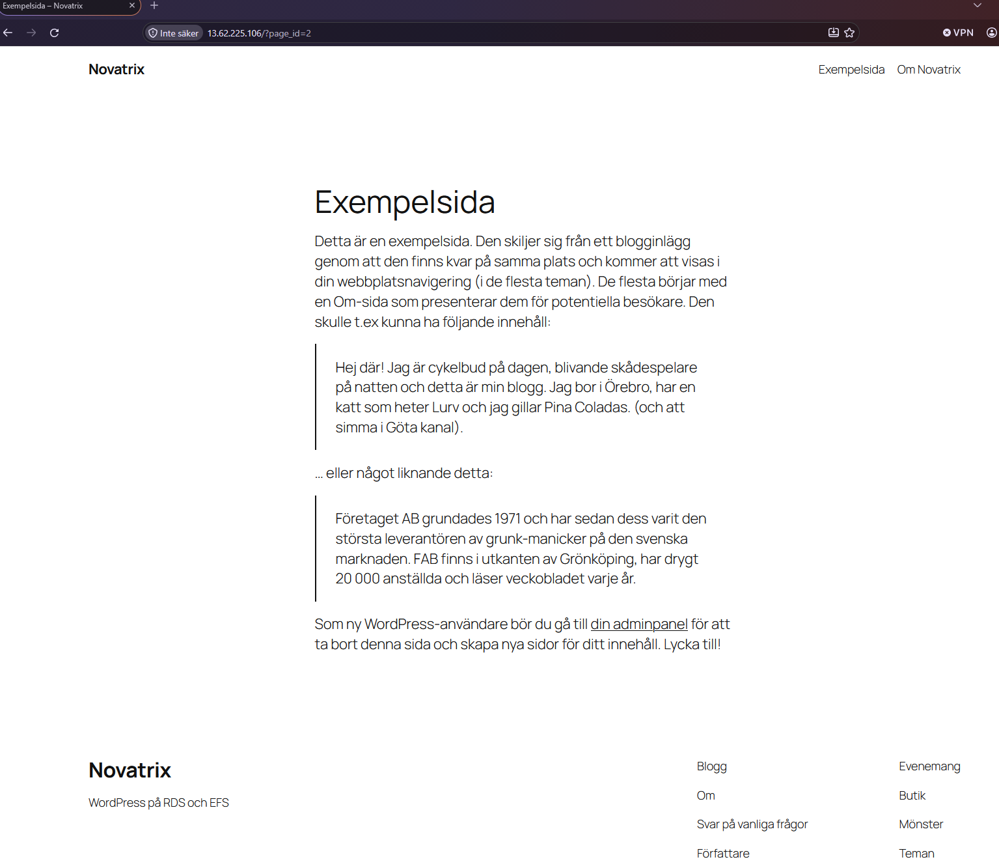

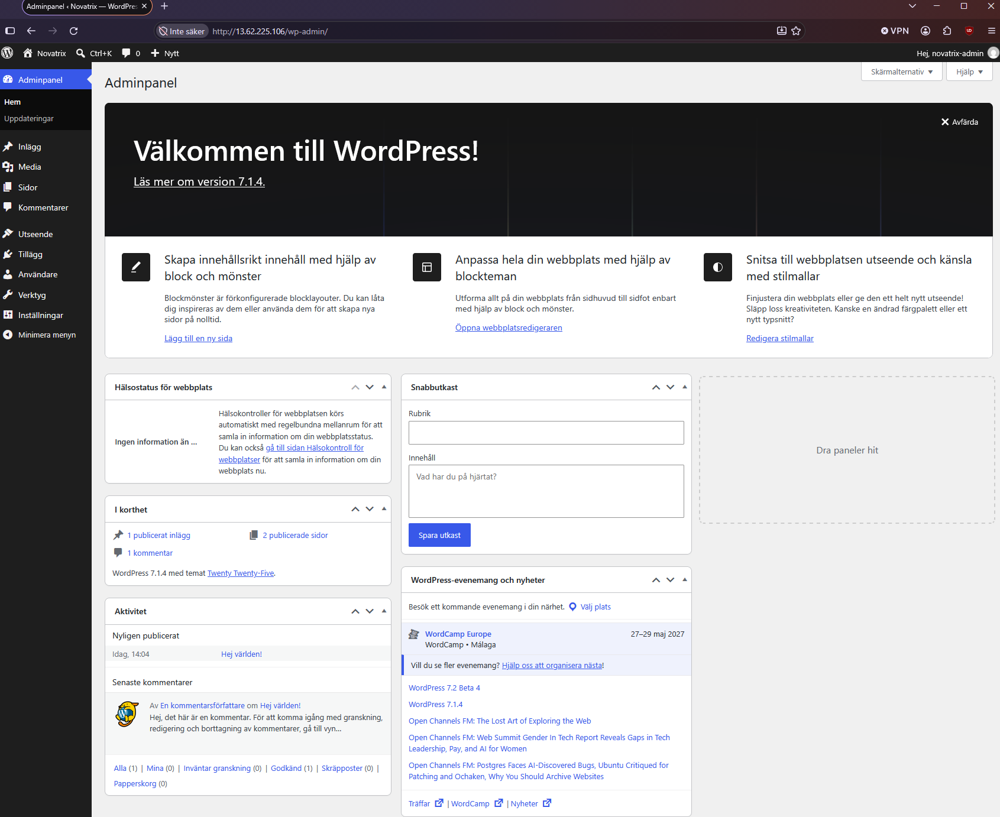

### *__Automatisk backup av databas__*

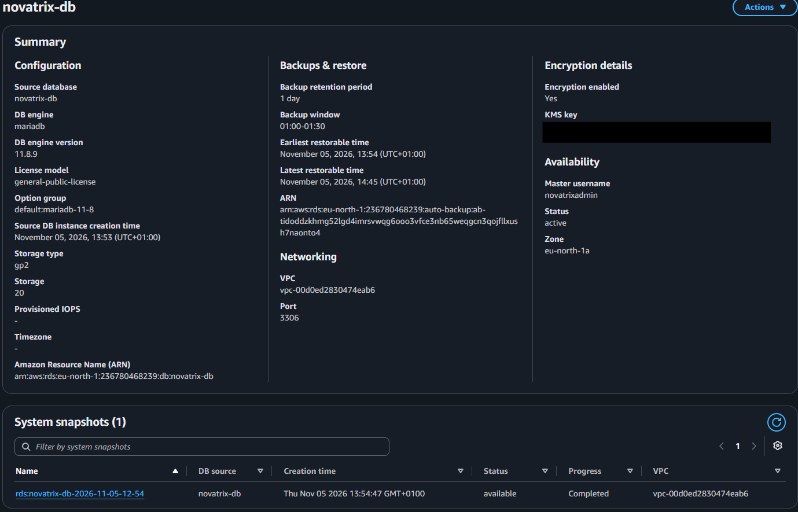

### *__WordPress-filerna finns på EFS__*

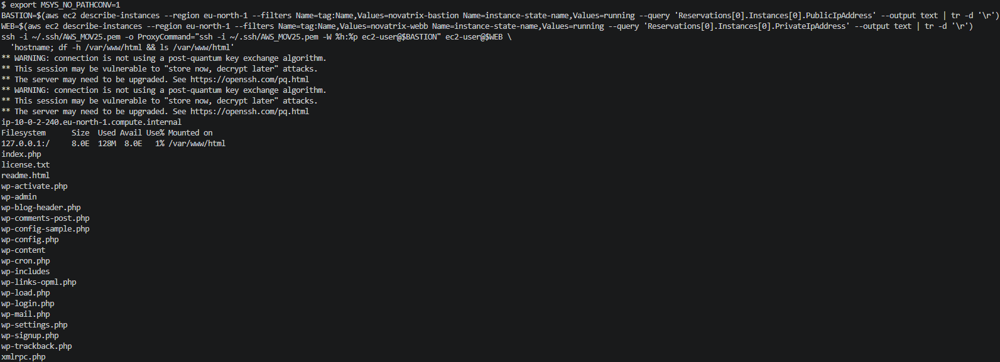

### *__Delad lagring i de privata subnäten__*

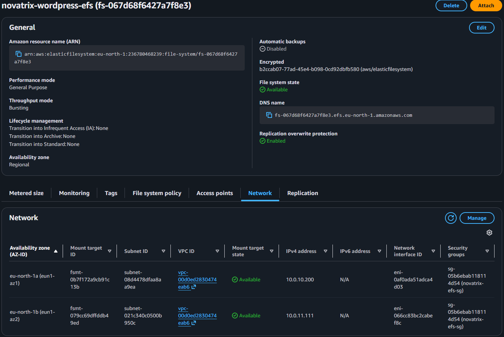

### *__Databas krypterad och privat__*

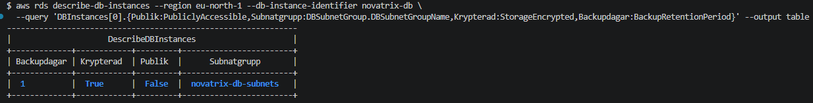

### *__Backuper av databas och filer i S3__*

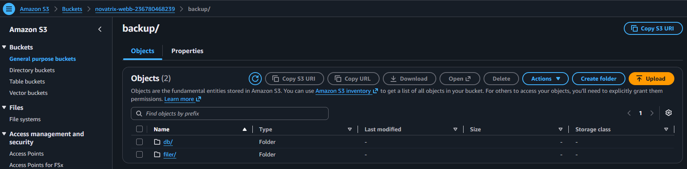

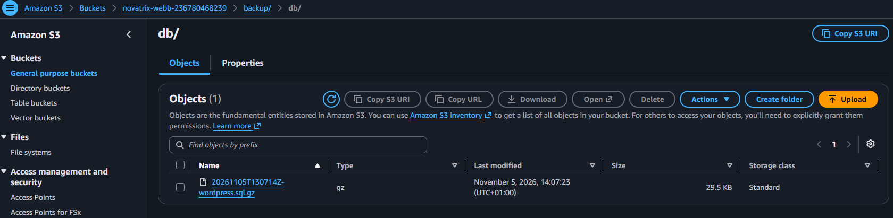

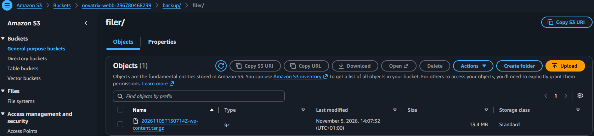

### *__Backuper raderas efter 14 dagar__*

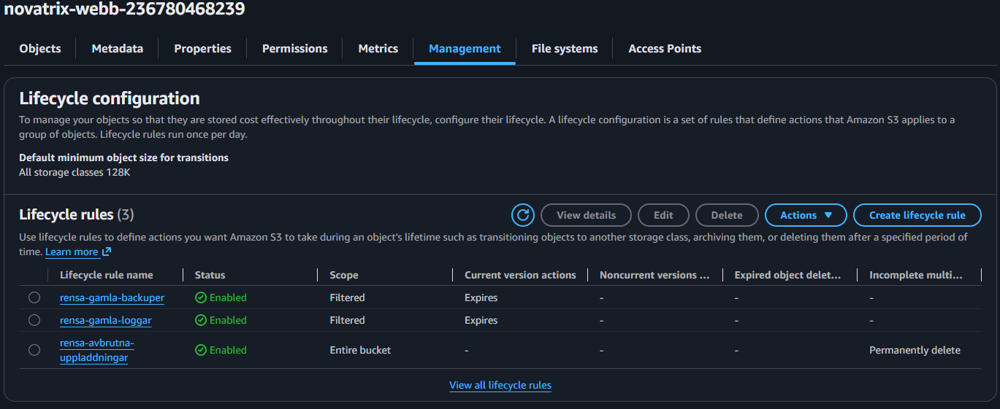

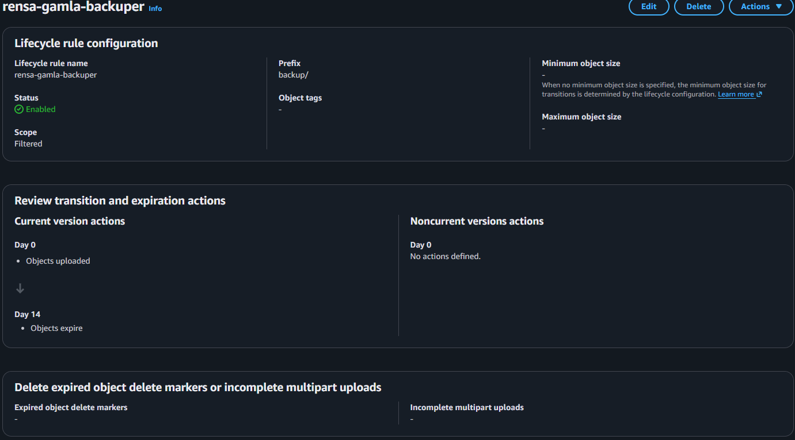

### *__Verifiering, alla tester OK__*

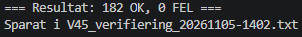