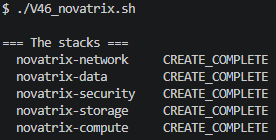
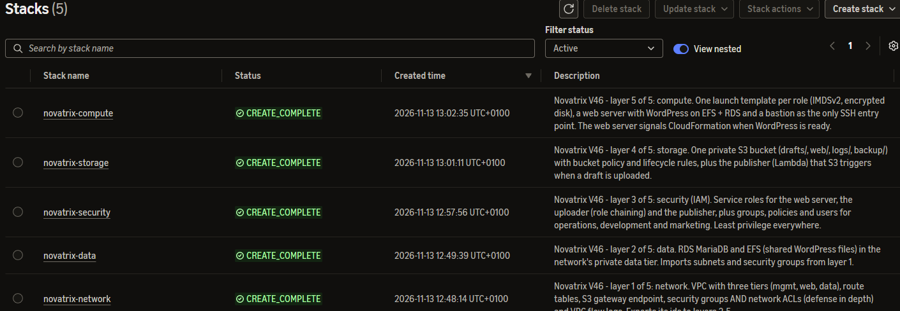
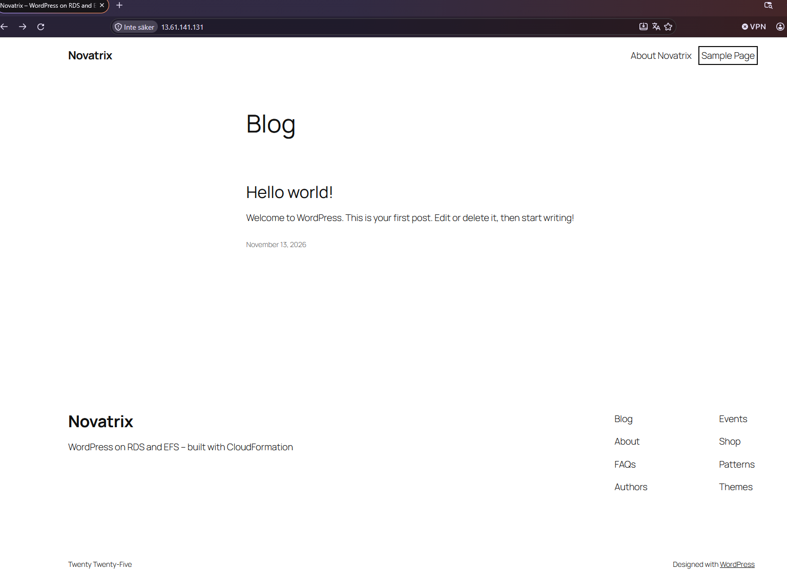
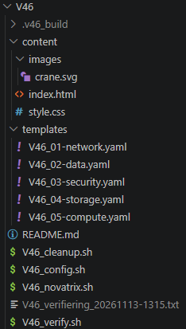
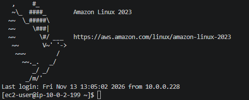
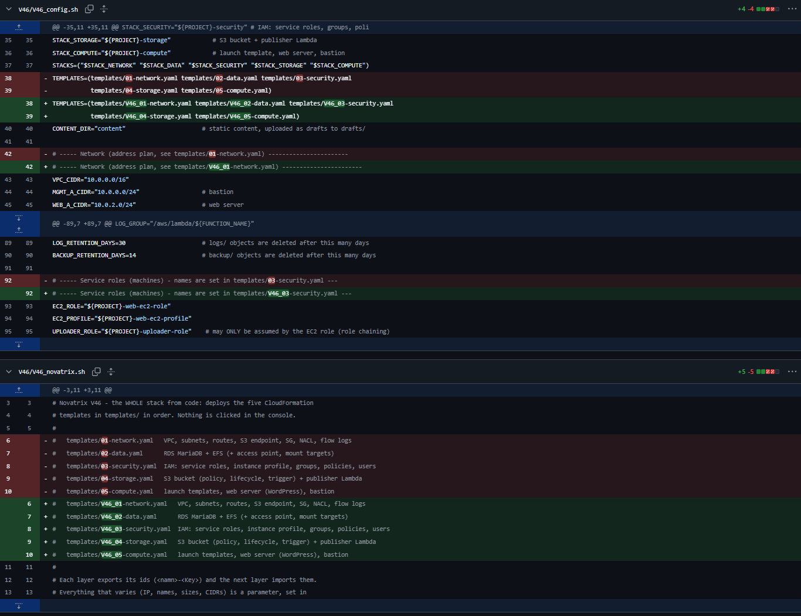
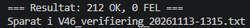

# __IaC med CloudFormation__

Repository: https://github.com/03timnor/AWS_MOV25

*Tim Noreliusson Lingestedt, 2026-11-13*

Veckans uppgift är att bygga det som gjorts de tidigare veckorna med *CloudFormation* mallar (kod), versionshanterat i *GitHub*. Infrastrukturen / miljön skall kunna återskapas utan manuellt klickande.

För Väl Godkänt hela infrastrukturen / miljön kunna skapas med kod och kunna återskapas från kod.

## *__1. Skapa infrastrukturen / miljön med CloudFormation mallar (Kod)__*

Infrastrukturen / miljön skapas med följande kod:

### *__V46_01-network.yaml__*

```yaml
AWSTemplateFormatVersion: "2010-09-09"
Description: >
  Novatrix V46 - layer 1 of 5: network. VPC with three tiers (mgmt, web, data),
  route tables, S3 gateway endpoint, security groups AND network ACLs (defense
  in depth) and VPC flow logs. Exports its ids to layers 2-5.

# =============================================================================
# Address plan (defaults, every CIDR is a parameter)
#
#   mgmt-a  10.0.0.0/24   public   bastion host (the only SSH entry point)
#   web-a   10.0.2.0/24   public   web server (Apache + WordPress)
#   web-b   10.0.3.0/24   public   reserved: second web server / load balancer
#   data-a  10.0.10.0/24  private  RDS MariaDB + EFS mount target, NO internet route
#   data-b  10.0.11.0/24  private  EFS mount target (the DB subnet group needs two AZs)
#
# Web tier = web-a + web-b (/23), data tier = data-a + data-b (/23), so one
# NACL rule covers both subnets of a tier.
# =============================================================================

Metadata:
  AWS::CloudFormation::Interface:
    ParameterGroups:
      - Label: { default: General }
        Parameters: [ProjectName, AdminCidr, SiteBucket, DbPort]
      - Label: { default: Address plan }
        Parameters: [VpcCidr, MgmtACidr, WebACidr, WebBCidr, WebTierCidr, DataACidr, DataBCidr, DataTierCidr]

Parameters:
  ProjectName:
    Type: String
    Default: novatrix
    AllowedPattern: '^[a-z][a-z0-9-]{1,20}$'
    Description: Prefix for resource names, tags and the exports the other layers import
  AdminCidr:
    Type: String
    Description: The only address allowed to SSH to the bastion (your public IP /32)
    AllowedPattern: '^(\d{1,3}\.){3}\d{1,3}/32$'
    ConstraintDescription: Must be a single host, e.g. 203.0.113.10/32
  SiteBucket:
    Type: String
    Description: The project bucket - the only bucket the S3 endpoint lets through
  DbPort:
    Type: Number
    Default: 3306
    Description: Database port (MariaDB 3306) - exported, the data layer uses the same value
  VpcCidr:      { Type: String, Default: 10.0.0.0/16,  AllowedPattern: '^(\d{1,3}\.){3}\d{1,3}/\d{1,2}$' }
  MgmtACidr:    { Type: String, Default: 10.0.0.0/24,  AllowedPattern: '^(\d{1,3}\.){3}\d{1,3}/\d{1,2}$' }
  WebACidr:     { Type: String, Default: 10.0.2.0/24,  AllowedPattern: '^(\d{1,3}\.){3}\d{1,3}/\d{1,2}$' }
  WebBCidr:     { Type: String, Default: 10.0.3.0/24,  AllowedPattern: '^(\d{1,3}\.){3}\d{1,3}/\d{1,2}$' }
  WebTierCidr:  { Type: String, Default: 10.0.2.0/23,  AllowedPattern: '^(\d{1,3}\.){3}\d{1,3}/\d{1,2}$', Description: Covers web-a + web-b }
  DataACidr:    { Type: String, Default: 10.0.10.0/24, AllowedPattern: '^(\d{1,3}\.){3}\d{1,3}/\d{1,2}$' }
  DataBCidr:    { Type: String, Default: 10.0.11.0/24, AllowedPattern: '^(\d{1,3}\.){3}\d{1,3}/\d{1,2}$' }
  DataTierCidr: { Type: String, Default: 10.0.10.0/23, AllowedPattern: '^(\d{1,3}\.){3}\d{1,3}/\d{1,2}$', Description: Covers data-a + data-b }

Mappings:
  # Ephemeral (client) ports. Our servers run Linux, which picks source ports
  # in 32768-60999, so return traffic TO our servers only needs that range.
  # Visitors and admins can be anything (Windows, NAT), so traffic FROM our
  # servers back to them uses the wide range 1024-65535.
  Ports:
    Linux: { From: 32768, To: 60999 }

Resources:
  # ===========================================================================
  # VPC + internet gateway
  # ===========================================================================
  Vpc:
    Type: AWS::EC2::VPC
    Properties:
      CidrBlock: !Ref VpcCidr
      EnableDnsSupport: true
      EnableDnsHostnames: true
      Tags:
        - { Key: Name, Value: !Sub "${ProjectName}-vpc" }
        - { Key: Project, Value: !Ref ProjectName }

  InternetGateway:
    Type: AWS::EC2::InternetGateway
    Properties:
      Tags:
        - { Key: Name, Value: !Sub "${ProjectName}-igw" }
        - { Key: Project, Value: !Ref ProjectName }

  InternetGatewayAttachment:
    Type: AWS::EC2::VPCGatewayAttachment
    Properties:
      VpcId: !Ref Vpc
      InternetGatewayId: !Ref InternetGateway

  # ===========================================================================
  # Subnets. MapPublicIpOnLaunch is OFF even in the public subnets: only an
  # instance that explicitly asks for a public IP gets one.
  # ===========================================================================
  MgmtSubnetA:
    Type: AWS::EC2::Subnet
    Properties:
      VpcId: !Ref Vpc
      CidrBlock: !Ref MgmtACidr
      AvailabilityZone: !Select [0, !GetAZs ""]
      MapPublicIpOnLaunch: false
      Tags:
        - { Key: Name, Value: !Sub "${ProjectName}-mgmt-a (public)" }
        - { Key: Tier, Value: mgmt }
        - { Key: Project, Value: !Ref ProjectName }

  WebSubnetA:
    Type: AWS::EC2::Subnet
    Properties:
      VpcId: !Ref Vpc
      CidrBlock: !Ref WebACidr
      AvailabilityZone: !Select [0, !GetAZs ""]
      MapPublicIpOnLaunch: false
      Tags:
        - { Key: Name, Value: !Sub "${ProjectName}-web-a (public)" }
        - { Key: Tier, Value: web }
        - { Key: Project, Value: !Ref ProjectName }

  WebSubnetB:
    Type: AWS::EC2::Subnet
    Properties:
      VpcId: !Ref Vpc
      CidrBlock: !Ref WebBCidr
      AvailabilityZone: !Select [1, !GetAZs ""]
      MapPublicIpOnLaunch: false
      Tags:
        - { Key: Name, Value: !Sub "${ProjectName}-web-b (public)" }
        - { Key: Tier, Value: web }
        - { Key: Project, Value: !Ref ProjectName }

  DataSubnetA:
    Type: AWS::EC2::Subnet
    Properties:
      VpcId: !Ref Vpc
      CidrBlock: !Ref DataACidr
      AvailabilityZone: !Select [0, !GetAZs ""]
      MapPublicIpOnLaunch: false
      Tags:
        - { Key: Name, Value: !Sub "${ProjectName}-data-a (private)" }
        - { Key: Tier, Value: data }
        - { Key: Project, Value: !Ref ProjectName }

  DataSubnetB:
    Type: AWS::EC2::Subnet
    Properties:
      VpcId: !Ref Vpc
      CidrBlock: !Ref DataBCidr
      AvailabilityZone: !Select [1, !GetAZs ""]
      MapPublicIpOnLaunch: false
      Tags:
        - { Key: Name, Value: !Sub "${ProjectName}-data-b (private)" }
        - { Key: Tier, Value: data }
        - { Key: Project, Value: !Ref ProjectName }

  # ===========================================================================
  # Route tables
  #   public : local + 0.0.0.0/0 -> IGW + S3 prefix list -> gateway endpoint
  #   private: local ONLY. No IGW, no NAT: the data tier cannot reach or be
  #            reached from the internet, whatever the firewalls say.
  # ===========================================================================
  PublicRouteTable:
    Type: AWS::EC2::RouteTable
    Properties:
      VpcId: !Ref Vpc
      Tags:
        - { Key: Name, Value: !Sub "${ProjectName}-rt-public" }
        - { Key: Project, Value: !Ref ProjectName }

  PublicDefaultRoute:
    Type: AWS::EC2::Route
    DependsOn: InternetGatewayAttachment
    Properties:
      RouteTableId: !Ref PublicRouteTable
      DestinationCidrBlock: 0.0.0.0/0
      GatewayId: !Ref InternetGateway

  PrivateRouteTable:
    Type: AWS::EC2::RouteTable
    Properties:
      VpcId: !Ref Vpc
      Tags:
        - { Key: Name, Value: !Sub "${ProjectName}-rt-private" }
        - { Key: Project, Value: !Ref ProjectName }

  MgmtSubnetARouteAssoc:
    Type: AWS::EC2::SubnetRouteTableAssociation
    Properties: { SubnetId: !Ref MgmtSubnetA, RouteTableId: !Ref PublicRouteTable }
  WebSubnetARouteAssoc:
    Type: AWS::EC2::SubnetRouteTableAssociation
    Properties: { SubnetId: !Ref WebSubnetA, RouteTableId: !Ref PublicRouteTable }
  WebSubnetBRouteAssoc:
    Type: AWS::EC2::SubnetRouteTableAssociation
    Properties: { SubnetId: !Ref WebSubnetB, RouteTableId: !Ref PublicRouteTable }
  DataSubnetARouteAssoc:
    Type: AWS::EC2::SubnetRouteTableAssociation
    Properties: { SubnetId: !Ref DataSubnetA, RouteTableId: !Ref PrivateRouteTable }
  DataSubnetBRouteAssoc:
    Type: AWS::EC2::SubnetRouteTableAssociation
    Properties: { SubnetId: !Ref DataSubnetB, RouteTableId: !Ref PrivateRouteTable }

  # ===========================================================================
  # S3 gateway endpoint (free). S3 traffic from the public subnets stays on the
  # AWS network, and the bucket policy (layer 4) demands that the instance
  # roles are only used from here (stolen credentials are useless outside).
  # The endpoint policy only lets through OUR bucket and the Amazon Linux
  # package repository - an attacker on the server can't copy data out to his
  # own bucket in this region.
  # ===========================================================================
  S3Endpoint:
    Type: AWS::EC2::VPCEndpoint
    Properties:
      VpcId: !Ref Vpc
      ServiceName: !Sub com.amazonaws.${AWS::Region}.s3
      VpcEndpointType: Gateway
      RouteTableIds: [!Ref PublicRouteTable]
      PolicyDocument:
        Version: "2012-10-17"
        Statement:
          - Sid: OnlyProjectBucket
            Effect: Allow
            Principal: "*"
            Action: "s3:*"
            Resource:
              - !Sub arn:aws:s3:::${SiteBucket}
              - !Sub arn:aws:s3:::${SiteBucket}/*
          - Sid: AmazonLinuxPackageRepos
            Effect: Allow
            Principal: "*"
            Action: s3:GetObject
            Resource: !Sub arn:aws:s3:::al2023-repos-${AWS::Region}-de612dc2/*

  # ===========================================================================
  # Security groups (stateful, per instance). Rules reference OTHER security
  # groups instead of IP addresses where possible: "only the bastion may SSH",
  # "only the web servers may reach the database".
  #
  # Defining SecurityGroupEgress inline replaces AWS's default "allow all out".
  # Rules that would create a reference loop are separate resources below.
  # ===========================================================================
  DbSecurityGroup:
    Type: AWS::EC2::SecurityGroup
    Properties:
      GroupName: !Sub "${ProjectName}-db-sg"
      GroupDescription: RDS database - only the web servers, on the DB port
      VpcId: !Ref Vpc
      SecurityGroupEgress:
        # A security group cannot be completely empty outbound in CloudFormation,
        # so the only rule points at loopback = the database can start nothing.
        - { IpProtocol: "-1", CidrIp: 127.0.0.1/32, Description: No outbound traffic }
      Tags:
        - { Key: Name, Value: !Sub "${ProjectName}-db-sg" }
        - { Key: Project, Value: !Ref ProjectName }

  EfsSecurityGroup:
    Type: AWS::EC2::SecurityGroup
    Properties:
      GroupName: !Sub "${ProjectName}-efs-sg"
      GroupDescription: EFS mount targets - only the web servers, NFS 2049
      VpcId: !Ref Vpc
      SecurityGroupEgress:
        - { IpProtocol: "-1", CidrIp: 127.0.0.1/32, Description: No outbound traffic }
      Tags:
        - { Key: Name, Value: !Sub "${ProjectName}-efs-sg" }
        - { Key: Project, Value: !Ref ProjectName }

  WebSecurityGroup:
    Type: AWS::EC2::SecurityGroup
    Properties:
      GroupName: !Sub "${ProjectName}-web-sg"
      GroupDescription: Web server - HTTP/HTTPS from everyone, SSH only from the bastion
      VpcId: !Ref Vpc
      SecurityGroupIngress:
        - { IpProtocol: tcp, FromPort: 80,  ToPort: 80,  CidrIp: 0.0.0.0/0, Description: HTTP from the internet }
        - { IpProtocol: tcp, FromPort: 443, ToPort: 443, CidrIp: 0.0.0.0/0, Description: HTTPS from the internet }
        - { IpProtocol: icmp, FromPort: 3, ToPort: 4, CidrIp: 0.0.0.0/0, Description: Path MTU Discovery }
      SecurityGroupEgress:
        - { IpProtocol: tcp, FromPort: 443, ToPort: 443, CidrIp: 0.0.0.0/0, Description: "HTTPS out: S3, STS, SSM, CloudFormation, package repos" }
        - IpProtocol: tcp
          FromPort: !Ref DbPort
          ToPort: !Ref DbPort
          DestinationSecurityGroupId: !Ref DbSecurityGroup
          Description: To the database (RDS)
        - IpProtocol: tcp
          FromPort: 2049
          ToPort: 2049
          DestinationSecurityGroupId: !Ref EfsSecurityGroup
          Description: To shared storage (EFS, NFS)
      Tags:
        - { Key: Name, Value: !Sub "${ProjectName}-web-sg" }
        - { Key: Project, Value: !Ref ProjectName }

  BastionSecurityGroup:
    Type: AWS::EC2::SecurityGroup
    Properties:
      GroupName: !Sub "${ProjectName}-bastion-sg"
      GroupDescription: Bastion - SSH only from the admin IP, out only SSH to the web servers
      VpcId: !Ref Vpc
      SecurityGroupIngress:
        - { IpProtocol: tcp, FromPort: 22, ToPort: 22, CidrIp: !Ref AdminCidr, Description: SSH from the admin IP }
      SecurityGroupEgress:
        - IpProtocol: tcp
          FromPort: 22
          ToPort: 22
          DestinationSecurityGroupId: !Ref WebSecurityGroup
          Description: SSH onward to the web servers
      Tags:
        - { Key: Name, Value: !Sub "${ProjectName}-bastion-sg" }
        - { Key: Project, Value: !Ref ProjectName }

  WebIngressSshFromBastion:
    Type: AWS::EC2::SecurityGroupIngress
    Properties:
      GroupId: !Ref WebSecurityGroup
      IpProtocol: tcp
      FromPort: 22
      ToPort: 22
      SourceSecurityGroupId: !Ref BastionSecurityGroup
      Description: SSH only from the bastion

  DbIngressFromWeb:
    Type: AWS::EC2::SecurityGroupIngress
    Properties:
      GroupId: !Ref DbSecurityGroup
      IpProtocol: tcp
      FromPort: !Ref DbPort
      ToPort: !Ref DbPort
      SourceSecurityGroupId: !Ref WebSecurityGroup
      Description: Database port only from the web servers

  EfsIngressFromWeb:
    Type: AWS::EC2::SecurityGroupIngress
    Properties:
      GroupId: !Ref EfsSecurityGroup
      IpProtocol: tcp
      FromPort: 2049
      ToPort: 2049
      SourceSecurityGroupId: !Ref WebSecurityGroup
      Description: NFS only from the web servers

  # ===========================================================================
  # Network ACLs (stateless, per subnet) - the second, independent firewall.
  # Stateless means return traffic must be allowed explicitly (ephemeral ports).
  # Everything not listed hits the implicit rule "*  DENY".
  # ===========================================================================

  # ----- mgmt tier (bastion) -------------------------------------------------
  MgmtNacl:
    Type: AWS::EC2::NetworkAcl
    Properties:
      VpcId: !Ref Vpc
      Tags:
        - { Key: Name, Value: !Sub "${ProjectName}-nacl-mgmt" }
        - { Key: Project, Value: !Ref ProjectName }
  MgmtNaclInSshAdmin:
    Type: AWS::EC2::NetworkAclEntry
    Properties:
      NetworkAclId: !Ref MgmtNacl
      RuleNumber: 100
      Egress: false
      Protocol: 6
      RuleAction: allow
      CidrBlock: !Ref AdminCidr
      PortRange: { From: 22, To: 22 }
  MgmtNaclInReturnFromWeb:
    Type: AWS::EC2::NetworkAclEntry
    Properties:
      NetworkAclId: !Ref MgmtNacl
      RuleNumber: 110
      Egress: false
      Protocol: 6
      RuleAction: allow
      CidrBlock: !Ref WebTierCidr
      PortRange: { From: !FindInMap [Ports, Linux, From], To: !FindInMap [Ports, Linux, To] }
  MgmtNaclOutReturnToAdmin:
    Type: AWS::EC2::NetworkAclEntry
    Properties:
      NetworkAclId: !Ref MgmtNacl
      RuleNumber: 100
      Egress: true
      Protocol: 6
      RuleAction: allow
      CidrBlock: !Ref AdminCidr
      PortRange: { From: 1024, To: 65535 }
  MgmtNaclOutSshToWeb:
    Type: AWS::EC2::NetworkAclEntry
    Properties:
      NetworkAclId: !Ref MgmtNacl
      RuleNumber: 110
      Egress: true
      Protocol: 6
      RuleAction: allow
      CidrBlock: !Ref WebTierCidr
      PortRange: { From: 22, To: 22 }
  MgmtNaclAssocA:
    Type: AWS::EC2::SubnetNetworkAclAssociation
    Properties: { SubnetId: !Ref MgmtSubnetA, NetworkAclId: !Ref MgmtNacl }

  # ----- web tier ---------------------------------------------------------------
  WebNacl:
    Type: AWS::EC2::NetworkAcl
    Properties:
      VpcId: !Ref Vpc
      Tags:
        - { Key: Name, Value: !Sub "${ProjectName}-nacl-web" }
        - { Key: Project, Value: !Ref ProjectName }
  WebNaclInHttp:
    Type: AWS::EC2::NetworkAclEntry
    Properties:
      NetworkAclId: !Ref WebNacl
      RuleNumber: 100
      Egress: false
      Protocol: 6
      RuleAction: allow
      CidrBlock: 0.0.0.0/0
      PortRange: { From: 80, To: 80 }
  WebNaclInHttps:
    Type: AWS::EC2::NetworkAclEntry
    Properties:
      NetworkAclId: !Ref WebNacl
      RuleNumber: 110
      Egress: false
      Protocol: 6
      RuleAction: allow
      CidrBlock: 0.0.0.0/0
      PortRange: { From: 443, To: 443 }
  WebNaclInSshFromMgmt:
    Type: AWS::EC2::NetworkAclEntry
    Properties:
      NetworkAclId: !Ref WebNacl
      RuleNumber: 120
      Egress: false
      Protocol: 6
      RuleAction: allow
      CidrBlock: !Ref MgmtACidr
      PortRange: { From: 22, To: 22 }
  WebNaclInReturn:
    # Answers to the server's OWN outbound connections (S3, STS, SSM, packages,
    # wordpress.org, CloudFormation, DB, EFS). Linux range only, so e.g. 3306,
    # 8080 and 9200 from the internet are stopped here already.
    Type: AWS::EC2::NetworkAclEntry
    Properties:
      NetworkAclId: !Ref WebNacl
      RuleNumber: 130
      Egress: false
      Protocol: 6
      RuleAction: allow
      CidrBlock: 0.0.0.0/0
      PortRange: { From: !FindInMap [Ports, Linux, From], To: !FindInMap [Ports, Linux, To] }
  WebNaclInPmtud:
    Type: AWS::EC2::NetworkAclEntry
    Properties:
      NetworkAclId: !Ref WebNacl
      RuleNumber: 140
      Egress: false
      Protocol: 1
      RuleAction: allow
      CidrBlock: 0.0.0.0/0
      Icmp: { Type: 3, Code: 4 }
  WebNaclOutReturn:
    # Answers to visitors (any client OS) and to the bastion.
    Type: AWS::EC2::NetworkAclEntry
    Properties:
      NetworkAclId: !Ref WebNacl
      RuleNumber: 100
      Egress: true
      Protocol: 6
      RuleAction: allow
      CidrBlock: 0.0.0.0/0
      PortRange: { From: 1024, To: 65535 }
  WebNaclOutHttps:
    Type: AWS::EC2::NetworkAclEntry
    Properties:
      NetworkAclId: !Ref WebNacl
      RuleNumber: 110
      Egress: true
      Protocol: 6
      RuleAction: allow
      CidrBlock: 0.0.0.0/0
      PortRange: { From: 443, To: 443 }
  WebNaclOutDb:
    Type: AWS::EC2::NetworkAclEntry
    Properties:
      NetworkAclId: !Ref WebNacl
      RuleNumber: 120
      Egress: true
      Protocol: 6
      RuleAction: allow
      CidrBlock: !Ref DataTierCidr
      PortRange: { From: !Ref DbPort, To: !Ref DbPort }
  WebNaclOutNfs:
    Type: AWS::EC2::NetworkAclEntry
    Properties:
      NetworkAclId: !Ref WebNacl
      RuleNumber: 130
      Egress: true
      Protocol: 6
      RuleAction: allow
      CidrBlock: !Ref DataTierCidr
      PortRange: { From: 2049, To: 2049 }
  WebNaclAssocA:
    Type: AWS::EC2::SubnetNetworkAclAssociation
    Properties: { SubnetId: !Ref WebSubnetA, NetworkAclId: !Ref WebNacl }
  WebNaclAssocB:
    Type: AWS::EC2::SubnetNetworkAclAssociation
    Properties: { SubnetId: !Ref WebSubnetB, NetworkAclId: !Ref WebNacl }

  # ----- data tier (database + EFS) ----------------------------------------------
  DataNacl:
    Type: AWS::EC2::NetworkAcl
    Properties:
      VpcId: !Ref Vpc
      Tags:
        - { Key: Name, Value: !Sub "${ProjectName}-nacl-data" }
        - { Key: Project, Value: !Ref ProjectName }
  DataNaclInDbFromWeb:
    Type: AWS::EC2::NetworkAclEntry
    Properties:
      NetworkAclId: !Ref DataNacl
      RuleNumber: 100
      Egress: false
      Protocol: 6
      RuleAction: allow
      CidrBlock: !Ref WebTierCidr
      PortRange: { From: !Ref DbPort, To: !Ref DbPort }
  DataNaclInNfsFromWeb:
    Type: AWS::EC2::NetworkAclEntry
    Properties:
      NetworkAclId: !Ref DataNacl
      RuleNumber: 110
      Egress: false
      Protocol: 6
      RuleAction: allow
      CidrBlock: !Ref WebTierCidr
      PortRange: { From: 2049, To: 2049 }
  DataNaclOutReturnToWeb:
    Type: AWS::EC2::NetworkAclEntry
    Properties:
      NetworkAclId: !Ref DataNacl
      RuleNumber: 100
      Egress: true
      Protocol: 6
      RuleAction: allow
      CidrBlock: !Ref WebTierCidr
      PortRange: { From: !FindInMap [Ports, Linux, From], To: !FindInMap [Ports, Linux, To] }
  DataNaclAssocA:
    Type: AWS::EC2::SubnetNetworkAclAssociation
    Properties: { SubnetId: !Ref DataSubnetA, NetworkAclId: !Ref DataNacl }
  DataNaclAssocB:
    Type: AWS::EC2::SubnetNetworkAclAssociation
    Properties: { SubnetId: !Ref DataSubnetB, NetworkAclId: !Ref DataNacl }

  # ===========================================================================
  # VPC flow logs: every accepted AND rejected connection attempt in the VPC,
  # 1-minute aggregation, kept 7 days.
  # ===========================================================================
  FlowLogGroup:
    Type: AWS::Logs::LogGroup
    Properties:
      LogGroupName: !Sub "/${ProjectName}/vpc-flow-logs"
      RetentionInDays: 7
      Tags:
        - { Key: Project, Value: !Ref ProjectName }

  FlowLogRole:
    Type: AWS::IAM::Role
    Properties:
      RoleName: !Sub "${ProjectName}-flow-log-role"
      Description: Lets the VPC flow log service write to the project's flow log group only
      AssumeRolePolicyDocument:
        Version: "2012-10-17"
        Statement:
          - Effect: Allow
            Principal: { Service: vpc-flow-logs.amazonaws.com }
            Action: sts:AssumeRole
            Condition:   # confused deputy protection: only for OUR account
              StringEquals: { "aws:SourceAccount": !Ref AWS::AccountId }
              ArnLike: { "aws:SourceArn": !Sub "arn:aws:ec2:${AWS::Region}:${AWS::AccountId}:vpc-flow-log/*" }
      Policies:
        - PolicyName: !Sub "${ProjectName}-flow-log-access"
          PolicyDocument:
            Version: "2012-10-17"
            Statement:
              - Effect: Allow
                Action: [logs:CreateLogStream, logs:PutLogEvents, logs:DescribeLogStreams]
                Resource: !GetAtt FlowLogGroup.Arn
              - Effect: Allow
                Action: logs:DescribeLogGroups
                Resource: "*"
      Tags:
        - { Key: Project, Value: !Ref ProjectName }

  VpcFlowLog:
    Type: AWS::EC2::FlowLog
    Properties:
      ResourceType: VPC
      ResourceId: !Ref Vpc
      TrafficType: ALL
      LogDestinationType: cloud-watch-logs
      LogGroupName: !Ref FlowLogGroup
      DeliverLogsPermissionArn: !GetAtt FlowLogRole.Arn
      MaxAggregationInterval: 60
      Tags:
        - { Key: Name, Value: !Sub "${ProjectName}-flow-log" }
        - { Key: Project, Value: !Ref ProjectName }

# Exports (<ProjectName>-<Key>) are what layers 2-5 import. An export that is in use
# can't be changed or deleted - CloudFormation protects the dependency.
Outputs:
  VpcId:
    Value: !Ref Vpc
    Export: { Name: !Sub "${ProjectName}-VpcId" }
  DefaultSecurityGroupId:
    Value: !GetAtt Vpc.DefaultSecurityGroup
  MgmtSubnetAId:
    Value: !Ref MgmtSubnetA
    Export: { Name: !Sub "${ProjectName}-MgmtSubnetAId" }
  WebSubnetAId:
    Value: !Ref WebSubnetA
    Export: { Name: !Sub "${ProjectName}-WebSubnetAId" }
  WebSubnetBId:
    Value: !Ref WebSubnetB
    Export: { Name: !Sub "${ProjectName}-WebSubnetBId" }
  DataSubnetAId:
    Value: !Ref DataSubnetA
    Export: { Name: !Sub "${ProjectName}-DataSubnetAId" }
  DataSubnetBId:
    Value: !Ref DataSubnetB
    Export: { Name: !Sub "${ProjectName}-DataSubnetBId" }
  WebTierCidr:
    Value: !Ref WebTierCidr
    Export: { Name: !Sub "${ProjectName}-WebTierCidr" }
  DbPort:
    Value: !Ref DbPort
    Export: { Name: !Sub "${ProjectName}-DbPort" }
  PublicRouteTableId:   { Value: !Ref PublicRouteTable }
  PrivateRouteTableId:  { Value: !Ref PrivateRouteTable }
  BastionSgId:
    Value: !Ref BastionSecurityGroup
    Export: { Name: !Sub "${ProjectName}-BastionSgId" }
  WebSgId:
    Value: !Ref WebSecurityGroup
    Export: { Name: !Sub "${ProjectName}-WebSgId" }
  DbSgId:
    Value: !Ref DbSecurityGroup
    Export: { Name: !Sub "${ProjectName}-DbSgId" }
  EfsSgId:
    Value: !Ref EfsSecurityGroup
    Export: { Name: !Sub "${ProjectName}-EfsSgId" }
  MgmtNaclId:           { Value: !Ref MgmtNacl }
  WebNaclId:            { Value: !Ref WebNacl }
  DataNaclId:           { Value: !Ref DataNacl }
  S3EndpointId:
    Value: !Ref S3Endpoint
    Export: { Name: !Sub "${ProjectName}-S3EndpointId" }
  FlowLogGroupName:
    Value: !Ref FlowLogGroup
    Export: { Name: !Sub "${ProjectName}-FlowLogGroupName" }
```

### *__V46_02-data.yaml__*

```yaml
AWSTemplateFormatVersion: "2010-09-09"
Description: >
  Novatrix V46 - layer 2 of 5: data. RDS MariaDB and EFS (shared WordPress
  files) in the network's private data tier. Imports subnets and security
  groups from layer 1.

Parameters:
  ProjectName:
    Type: String
    Default: novatrix
    AllowedPattern: '^[a-z][a-z0-9-]{1,20}$'
    Description: Same prefix as the network layer (its exports are imported)
  DbInstanceClass:
    Type: String
    Default: db.t4g.micro
    AllowedValues: [db.t4g.micro, db.t3.micro]
    Description: Free tier / Free plan classes only - a typo can't create an expensive database
  DbAllocatedStorage:
    Type: Number
    Default: 20
    MinValue: 20
    MaxValue: 20
    Description: GiB of gp2 storage (20 = free tier allowance and RDS minimum)
  DbBackupRetentionDays:
    Type: Number
    Default: 1
    MinValue: 1
    MaxValue: 1
    Description: Days of automated RDS backups (Free plan allows at most 1)
  DbName:
    Type: String
    Default: wordpress
    AllowedPattern: '^[a-zA-Z][a-zA-Z0-9_]{0,63}$'
  DbMasterUsername:
    Type: String
    Default: novatrixadmin
    NoEcho: true
    AllowedPattern: '^[a-zA-Z][a-zA-Z0-9_]{0,15}$'
  DbMasterPasswordParam:
    Type: String
    Default: /novatrix/db/master-password
    AllowedPattern: '^/[a-zA-Z0-9_./-]+$'
    Description: NAME of the SSM SecureString holding the master password (the value never passes through the template)
  WebRoleName:
    Type: String
    Default: novatrix-web-ec2-role
    Description: The web server's instance role (layer 3) - the only principal EFS lets mount

Resources:
  # ===========================================================================
  # Database: RDS MariaDB in the private data tier.
  # ===========================================================================
  DbSubnetGroup:
    Type: AWS::RDS::DBSubnetGroup
    Properties:
      DBSubnetGroupName: !Sub "${ProjectName}-db-subnets"
      DBSubnetGroupDescription: Private subnets data-a + data-b (no internet route)
      SubnetIds:
        - Fn::ImportValue: !Sub "${ProjectName}-DataSubnetAId"
        - Fn::ImportValue: !Sub "${ProjectName}-DataSubnetBId"
      Tags:
        - { Key: Project, Value: !Ref ProjectName }

  # Choices (cost first, see the documentation):
  #   db.t4g.micro, 20 GiB gp2, Single-AZ  - all inside the free tier / Free plan
  #   same AZ as the web server            - no cross-AZ data transfer charges
  #   PubliclyAccessible false             - no public IP, and the subnet has no
  #                                          internet route anyway
  #   StorageEncrypted (aws/rds key)       - encryption at rest, free
  #   BackupRetentionPeriod 1              - automated backups + point-in-time
  #                                          restore for the last day (Free plan max)
  # The master password is never in this file or on the command line:
  # CloudFormation reads it from SSM Parameter Store (dynamic reference).
  Database:
    Type: AWS::RDS::DBInstance
    DeletionPolicy: Delete          # lab: cleanup removes everything (default would leave a paid snapshot)
    UpdateReplacePolicy: Snapshot   # but never lose data if a change forces a replacement
    Properties:
      DBInstanceIdentifier: !Sub "${ProjectName}-db"
      Engine: mariadb
      DBInstanceClass: !Ref DbInstanceClass
      AllocatedStorage: !Ref DbAllocatedStorage
      StorageType: gp2
      StorageEncrypted: true
      MultiAZ: false
      AvailabilityZone: !Select [0, !GetAZs ""]
      DBSubnetGroupName: !Ref DbSubnetGroup
      VPCSecurityGroups:
        - Fn::ImportValue: !Sub "${ProjectName}-DbSgId"
      PubliclyAccessible: false
      Port:
        Fn::ImportValue: !Sub "${ProjectName}-DbPort"
      DBName: !Ref DbName
      MasterUsername: !Ref DbMasterUsername
      MasterUserPassword: !Sub "{{resolve:ssm-secure:${DbMasterPasswordParam}}}"
      BackupRetentionPeriod: !Ref DbBackupRetentionDays
      PreferredBackupWindow: "01:00-01:30"              # UTC, after the S3 backup at 00:00
      PreferredMaintenanceWindow: "sun:02:00-sun:02:30"
      AutoMinorVersionUpgrade: true
      CopyTagsToSnapshot: true
      DeleteAutomatedBackups: true
      DeletionProtection: false
      EnablePerformanceInsights: false
      MonitoringInterval: 0
      Tags:
        - { Key: Name, Value: !Sub "${ProjectName}-db" }
        - { Key: Project, Value: !Ref ProjectName }

  # ===========================================================================
  # Shared storage: EFS for the WordPress files. Every web server mounts the
  # same file system, so a second server in web-b serves the same site - and a
  # replaced web server (new AMI, new launch template) loses nothing.
  #
  # Three locks besides the network:
  #   1. file system policy: only encrypted (TLS) connections, only the web
  #      server's role, only through an access point
  #   2. access point: every client is forced to uid/gid 48 (apache) in
  #      /wordpress - not even root on the server can act as root on EFS
  #   3. encryption at rest (aws/elasticfilesystem key)
  # ===========================================================================
  FileSystem:
    Type: AWS::EFS::FileSystem
    DeletionPolicy: Delete
    UpdateReplacePolicy: Retain
    Properties:
      Encrypted: true
      PerformanceMode: generalPurpose
      ThroughputMode: bursting       # no charge per GB read/written (elastic charges per GB)
      BackupPolicy: { Status: DISABLED }   # AWS Backup costs extra; wp-content goes to S3 backup/ daily
      FileSystemPolicy:
        Version: "2012-10-17"
        Statement:
          - Sid: OnlyEncryptedTransport
            Effect: Deny
            Principal: { AWS: "*" }
            Action: "*"
            Condition:
              Bool: { "aws:SecureTransport": "false" }
          - Sid: OnlyWebRoleViaAccessPoint
            Effect: Allow
            Principal: { AWS: "*" }
            Action: [elasticfilesystem:ClientMount, elasticfilesystem:ClientWrite]
            Condition:
              ArnEquals: { "aws:PrincipalArn": !Sub "arn:aws:iam::${AWS::AccountId}:role/${WebRoleName}" }
              StringLike: { "elasticfilesystem:AccessPointArn": !Sub "arn:aws:elasticfilesystem:${AWS::Region}:${AWS::AccountId}:access-point/*" }
      FileSystemTags:
        - { Key: Name, Value: !Sub "${ProjectName}-wordpress-efs" }
        - { Key: Project, Value: !Ref ProjectName }

  WordpressAccessPoint:
    Type: AWS::EFS::AccessPoint
    Properties:
      FileSystemId: !Ref FileSystem
      PosixUser: { Uid: "48", Gid: "48" }          # apache on Amazon Linux 2023
      RootDirectory:
        Path: /wordpress
        CreationInfo: { OwnerUid: "48", OwnerGid: "48", Permissions: "0755" }
      AccessPointTags:
        - { Key: Name, Value: !Sub "${ProjectName}-wordpress-ap" }
        - { Key: Project, Value: !Ref ProjectName }

  # Mount targets in the PRIVATE data subnets, one per AZ (the web server uses
  # the one in its own AZ: no cross-AZ traffic).
  EfsMountTargetA:
    Type: AWS::EFS::MountTarget
    Properties:
      FileSystemId: !Ref FileSystem
      SubnetId:
        Fn::ImportValue: !Sub "${ProjectName}-DataSubnetAId"
      SecurityGroups:
        - Fn::ImportValue: !Sub "${ProjectName}-EfsSgId"
  EfsMountTargetB:
    Type: AWS::EFS::MountTarget
    Properties:
      FileSystemId: !Ref FileSystem
      SubnetId:
        Fn::ImportValue: !Sub "${ProjectName}-DataSubnetBId"
      SecurityGroups:
        - Fn::ImportValue: !Sub "${ProjectName}-EfsSgId"

Outputs:
  DbInstanceId:
    Value: !Ref Database
  DbEndpoint:
    Value: !GetAtt Database.Endpoint.Address
    Export: { Name: !Sub "${ProjectName}-DbEndpoint" }
  DbSubnetGroupName:
    Value: !Ref DbSubnetGroup
  FileSystemId:
    Value: !Ref FileSystem
    Export: { Name: !Sub "${ProjectName}-FileSystemId" }
  FileSystemArn:
    Value: !GetAtt FileSystem.Arn
    Export: { Name: !Sub "${ProjectName}-FileSystemArn" }
  AccessPointId:
    Value: !Ref WordpressAccessPoint
    Export: { Name: !Sub "${ProjectName}-AccessPointId" }
  AccessPointArn:
    Value: !GetAtt WordpressAccessPoint.Arn
    Export: { Name: !Sub "${ProjectName}-AccessPointArn" }
  EfsMountTargetAId:
    Value: !Ref EfsMountTargetA
```

### *__V46_03-security.yaml__*

```yaml
AWSTemplateFormatVersion: "2010-09-09"
Description: >
  Novatrix V46 - layer 3 of 5: security (IAM). Service roles for the web
  server, the uploader (role chaining) and the publisher, plus groups, policies
  and users for operations, development and marketing. Least privilege everywhere.

Metadata:
  AWS::CloudFormation::Interface:
    ParameterGroups:
      - Label: { default: General }
        Parameters: [ProjectName, SiteBucket]
      - Label: { default: Secrets in SSM (names only) }
        Parameters: [DbMasterPasswordParam, DbAppPasswordParam, WpAdminPasswordParam]
      - Label: { default: Users }
        Parameters: [OpsUserName, DevUserName, MarketingUserName]

Parameters:
  ProjectName:
    Type: String
    Default: novatrix
    AllowedPattern: '^[a-z][a-z0-9-]{1,20}$'
  SiteBucket:
    Type: String
    Description: The project bucket (created in layer 4 - policies only need its name)
  DbMasterPasswordParam: { Type: String, Default: /novatrix/db/master-password, AllowedPattern: '^/[a-zA-Z0-9_./-]+$' }
  DbAppPasswordParam:    { Type: String, Default: /novatrix/db/wordpress-password, AllowedPattern: '^/[a-zA-Z0-9_./-]+$' }
  WpAdminPasswordParam:  { Type: String, Default: /novatrix/wordpress/admin-password, AllowedPattern: '^/[a-zA-Z0-9_./-]+$' }
  OpsUserName:        { Type: String, Default: anna.ops }
  DevUserName:   { Type: String, Default: erik.dev }
  MarketingUserName:      { Type: String, Default: maja.marketing }

Resources:
  # ===========================================================================
  # Web server (reader) role
  #   S3:   read-only, and only the published static content (web/). It writes
  #         NOTHING to S3 itself - logs and backups go through the uploader role.
  #   SSM:  read exactly the three project secrets (the master password is
  #         needed once, at first boot, to create the WordPress DB user).
  #   EFS:  mount and write - only through the WordPress access point.
  # ===========================================================================
  Ec2Role:
    Type: AWS::IAM::Role
    Properties:
      RoleName: !Sub "${ProjectName}-web-ec2-role"
      Description: Web server - WordPress on EFS, read static content in S3
      AssumeRolePolicyDocument:
        Version: "2012-10-17"
        Statement:
          - Effect: Allow
            Principal: { Service: ec2.amazonaws.com }
            Action: sts:AssumeRole
      Policies:
        - PolicyName: !Sub "${ProjectName}-web-ec2-access"
          PolicyDocument:
            Version: "2012-10-17"
            Statement:
              - Sid: ListPublishedSite
                Effect: Allow
                Action: s3:ListBucket
                Resource: !Sub "arn:aws:s3:::${SiteBucket}"
                Condition: { StringLike: { "s3:prefix": ["web/*"] } }
              - Sid: ReadPublishedSite
                Effect: Allow
                Action: s3:GetObject
                Resource: !Sub "arn:aws:s3:::${SiteBucket}/web/*"
              - Sid: AssumeUploaderRole
                Effect: Allow
                Action: sts:AssumeRole
                Resource: !Sub "arn:aws:iam::${AWS::AccountId}:role/${ProjectName}-uploader-role"
              - Sid: ReadProjectSecrets
                Effect: Allow
                Action: ssm:GetParameter
                Resource:
                  - !Sub "arn:aws:ssm:${AWS::Region}:${AWS::AccountId}:parameter${DbMasterPasswordParam}"
                  - !Sub "arn:aws:ssm:${AWS::Region}:${AWS::AccountId}:parameter${DbAppPasswordParam}"
                  - !Sub "arn:aws:ssm:${AWS::Region}:${AWS::AccountId}:parameter${WpAdminPasswordParam}"
              - Sid: MountWordpressViaAccessPoint
                Effect: Allow
                Action: [elasticfilesystem:ClientMount, elasticfilesystem:ClientWrite]
                Resource:
                  Fn::ImportValue: !Sub "${ProjectName}-FileSystemArn"
                Condition:
                  StringEquals:
                    "elasticfilesystem:AccessPointArn":
                      Fn::ImportValue: !Sub "${ProjectName}-AccessPointArn"
      Tags:
        - { Key: Project, Value: !Ref ProjectName }

  Ec2InstanceProfile:
    Type: AWS::IAM::InstanceProfile
    Properties:
      InstanceProfileName: !Sub "${ProjectName}-web-ec2-profile"
      Roles: [!Ref Ec2Role]

  # ===========================================================================
  # Uploader role: ONLY a session running with the web server's role may assume
  # it (role chaining). Not the EC2 service, not users, not even administrators.
  # Write-only, only logs/ and backup/: a hacked web server can add a backup
  # but never read, list or delete the old ones.
  # ===========================================================================
  UploaderRole:
    Type: AWS::IAM::Role
    Properties:
      RoleName: !Sub "${ProjectName}-uploader-role"
      Description: Upload logs and backups - assumable only by the web server role
      AssumeRolePolicyDocument:
        Version: "2012-10-17"
        Statement:
          - Sid: OnlyReaderRole
            Effect: Allow
            Principal: { AWS: !GetAtt Ec2Role.Arn }
            Action: sts:AssumeRole
      Policies:
        - PolicyName: !Sub "${ProjectName}-uploader-access"
          PolicyDocument:
            Version: "2012-10-17"
            Statement:
              - Sid: UploadLogsAndBackups
                Effect: Allow
                Action: s3:PutObject
                Resource:
                  - !Sub "arn:aws:s3:::${SiteBucket}/logs/*"
                  - !Sub "arn:aws:s3:::${SiteBucket}/backup/*"
      Tags:
        - { Key: Project, Value: !Ref ProjectName }

  # ===========================================================================
  # Publisher (Lambda) role: read drafts, write published files, log to its own
  # log group. Nothing else - not even logs:CreateLogGroup (layer 4 creates it).
  # ===========================================================================
  LambdaRole:
    Type: AWS::IAM::Role
    Properties:
      RoleName: !Sub "${ProjectName}-publisher-role"
      Description: Publisher - S3 drafts/ -> web/
      AssumeRolePolicyDocument:
        Version: "2012-10-17"
        Statement:
          - Effect: Allow
            Principal: { Service: lambda.amazonaws.com }
            Action: sts:AssumeRole
      Policies:
        - PolicyName: !Sub "${ProjectName}-publisher-access"
          PolicyDocument:
            Version: "2012-10-17"
            Statement:
              - Sid: ReadDrafts
                Effect: Allow
                Action: s3:GetObject
                Resource: !Sub "arn:aws:s3:::${SiteBucket}/drafts/*"
              - Sid: Publish
                Effect: Allow
                Action: s3:PutObject
                Resource: !Sub "arn:aws:s3:::${SiteBucket}/web/*"
              - Sid: WriteOwnLogs
                Effect: Allow
                Action: [logs:CreateLogStream, logs:PutLogEvents]
                Resource: !Sub "arn:aws:logs:${AWS::Region}:${AWS::AccountId}:log-group:/aws/lambda/${ProjectName}-publisher:*"
      Tags:
        - { Key: Project, Value: !Ref ProjectName }

  # ===========================================================================
  # Humans: permissions ONLY through groups - never directly on a user.
  # No passwords or access keys are created here.
  # ===========================================================================
  OpsGroup:
    Type: AWS::IAM::Group
    Properties: { GroupName: !Sub "${ProjectName}-operations" }
  DevGroup:
    Type: AWS::IAM::Group
    Properties: { GroupName: !Sub "${ProjectName}-development" }
  MarketingGroup:
    Type: AWS::IAM::Group
    Properties: { GroupName: !Sub "${ProjectName}-marketing" }

  # Operations: operate the project's servers, read logs/metrics/network/database/EFS
  # setup and download backups (to restore). No content, no code, no network or
  # database changes, no secrets, no stack changes.
  OpsPolicy:
    Type: AWS::IAM::ManagedPolicy
    Properties:
      ManagedPolicyName: !Sub "${ProjectName}-operations-policy"
      Groups: [!Ref OpsGroup]
      PolicyDocument:
        Version: "2012-10-17"
        Statement:
          - Sid: ReadOnlyOverview
            Effect: Allow
            Action:
              - ec2:DescribeInstances
              - ec2:DescribeInstanceStatus
              - ec2:DescribeSecurityGroups
              - ec2:DescribeSecurityGroupRules
              - ec2:DescribeNetworkAcls
              - ec2:DescribeVpcs
              - ec2:DescribeSubnets
              - ec2:DescribeRouteTables
              - ec2:DescribeVpcEndpoints
              - ec2:DescribeFlowLogs
              - rds:DescribeDBInstances
              - rds:DescribeDBSnapshots
              - rds:DescribeDBSubnetGroups
              - elasticfilesystem:DescribeFileSystems
              - elasticfilesystem:DescribeMountTargets
              - elasticfilesystem:DescribeAccessPoints
              - cloudwatch:GetMetricData
              - cloudwatch:GetMetricStatistics
              - cloudwatch:ListMetrics
              - logs:DescribeLogGroups
              - cloudformation:DescribeStacks
              - cloudformation:DescribeStackEvents
              - cloudformation:DescribeStackResources
            Resource: "*"
          - Sid: ReadFlowLogs
            Effect: Allow
            Action: [logs:DescribeLogStreams, logs:GetLogEvents, logs:FilterLogEvents]
            Resource: !Sub
              - "arn:aws:logs:${AWS::Region}:${AWS::AccountId}:log-group:${Grupp}:*"
              - Grupp:
                  Fn::ImportValue: !Sub "${ProjectName}-FlowLogGroupName"
          - Sid: ControlOnlyProjectInstances
            Effect: Allow
            Action: [ec2:StartInstances, ec2:StopInstances, ec2:RebootInstances]
            Resource: !Sub "arn:aws:ec2:${AWS::Region}:${AWS::AccountId}:instance/*"
            Condition: { StringEquals: { "aws:ResourceTag/Project": !Ref ProjectName } }
          - Sid: ReadPublisherLogs
            Effect: Allow
            Action: [logs:DescribeLogStreams, logs:GetLogEvents, logs:FilterLogEvents]
            Resource: !Sub "arn:aws:logs:${AWS::Region}:${AWS::AccountId}:log-group:/aws/lambda/${ProjectName}-publisher:*"
          - Sid: ListLogsAndBackups
            Effect: Allow
            Action: s3:ListBucket
            Resource: !Sub "arn:aws:s3:::${SiteBucket}"
            Condition: { StringLike: { "s3:prefix": ["logs/*", "backup/*"] } }
          - Sid: ReadLogsAndBackups
            Effect: Allow
            Action: s3:GetObject
            Resource:
              - !Sub "arn:aws:s3:::${SiteBucket}/logs/*"
              - !Sub "arn:aws:s3:::${SiteBucket}/backup/*"

  # Development: upload any draft, read the published site, deploy publisher code.
  # Can NOT write web/ directly - everything goes through the publisher's checks.
  DevPolicy:
    Type: AWS::IAM::ManagedPolicy
    Properties:
      ManagedPolicyName: !Sub "${ProjectName}-development-policy"
      Groups: [!Ref DevGroup]
      PolicyDocument:
        Version: "2012-10-17"
        Statement:
          - Sid: ListSite
            Effect: Allow
            Action: s3:ListBucket
            Resource: !Sub "arn:aws:s3:::${SiteBucket}"
            Condition: { StringLike: { "s3:prefix": ["drafts/*", "web/*"] } }
          - Sid: ManageDrafts
            Effect: Allow
            Action: [s3:GetObject, s3:PutObject, s3:DeleteObject]
            Resource: !Sub "arn:aws:s3:::${SiteBucket}/drafts/*"
          - Sid: ReadPublishedSite
            Effect: Allow
            Action: s3:GetObject
            Resource: !Sub "arn:aws:s3:::${SiteBucket}/web/*"
          - Sid: DeployPublisherCode
            Effect: Allow
            Action: [lambda:GetFunction, lambda:UpdateFunctionCode]
            Resource: !Sub "arn:aws:lambda:${AWS::Region}:${AWS::AccountId}:function:${ProjectName}-publisher"
          - Sid: ReadPublisherLogs
            Effect: Allow
            Action: [logs:DescribeLogStreams, logs:GetLogEvents, logs:FilterLogEvents]
            Resource: !Sub "arn:aws:logs:${AWS::Region}:${AWS::AccountId}:log-group:/aws/lambda/${ProjectName}-publisher:*"
          - Sid: ListLogGroups
            Effect: Allow
            Action: logs:DescribeLogGroups
            Resource: "*"

  # Marketing: upload images to drafts/images/ only. Cannot delete, cannot touch pages.
  MarketingPolicy:
    Type: AWS::IAM::ManagedPolicy
    Properties:
      ManagedPolicyName: !Sub "${ProjectName}-marketing-policy"
      Groups: [!Ref MarketingGroup]
      PolicyDocument:
        Version: "2012-10-17"
        Statement:
          - Sid: ListOwnImages
            Effect: Allow
            Action: s3:ListBucket
            Resource: !Sub "arn:aws:s3:::${SiteBucket}"
            Condition: { StringLike: { "s3:prefix": ["drafts/images/*"] } }
          - Sid: UploadImages
            Effect: Allow
            Action: [s3:GetObject, s3:PutObject]
            Resource: !Sub "arn:aws:s3:::${SiteBucket}/drafts/images/*"

  OpsUser:
    Type: AWS::IAM::User
    Properties:
      UserName: !Ref OpsUserName
      Groups: [!Ref OpsGroup]
      Tags: [{ Key: Project, Value: !Ref ProjectName }]
  DevUser:
    Type: AWS::IAM::User
    Properties:
      UserName: !Ref DevUserName
      Groups: [!Ref DevGroup]
      Tags: [{ Key: Project, Value: !Ref ProjectName }]
  MarketingUser:
    Type: AWS::IAM::User
    Properties:
      UserName: !Ref MarketingUserName
      Groups: [!Ref MarketingGroup]
      Tags: [{ Key: Project, Value: !Ref ProjectName }]

Outputs:
  Ec2RoleArn:
    Value: !GetAtt Ec2Role.Arn
    Export: { Name: !Sub "${ProjectName}-Ec2RoleArn" }
  Ec2InstanceProfileName:
    Value: !Ref Ec2InstanceProfile
    Export: { Name: !Sub "${ProjectName}-Ec2InstanceProfileName" }
  UploaderRoleArn:
    Value: !GetAtt UploaderRole.Arn
    Export: { Name: !Sub "${ProjectName}-UploaderRoleArn" }
  LambdaRoleArn:
    Value: !GetAtt LambdaRole.Arn
    Export: { Name: !Sub "${ProjectName}-LambdaRoleArn" }
```

### *__V46_04-storage.yaml__*

```yaml
AWSTemplateFormatVersion: "2010-09-09"
Description: >
  Novatrix V46 - layer 4 of 5: storage. One private S3 bucket (drafts/, web/,
  logs/, backup/) with bucket policy and lifecycle rules, plus the publisher
  (Lambda) that S3 triggers when a draft is uploaded.

Parameters:
  ProjectName:
    Type: String
    Default: novatrix
    AllowedPattern: '^[a-z][a-z0-9-]{1,20}$'
  SiteBucket:
    Type: String
    AllowedPattern: '^[a-z0-9][a-z0-9.-]{1,61}[a-z0-9]$'
    Description: Bucket name (globally unique - the deploy script appends the account id)
  BackupRetentionDays:
    Type: Number
    Default: 14
    MinValue: 1
    Description: backup/ objects (DB dumps + wp-content) are deleted after this many days
  LogRetentionDays:
    Type: Number
    Default: 30
    MinValue: 1
    Description: logs/ objects (Apache logs) are deleted after this many days

Resources:
  # Created here (not by Lambda) so the Lambda role needs no logs:CreateLogGroup.
  PublisherLogGroup:
    Type: AWS::Logs::LogGroup
    Properties:
      LogGroupName: !Sub "/aws/lambda/${ProjectName}-publisher"
      RetentionInDays: 7
      Tags:
        - { Key: Project, Value: !Ref ProjectName }

  # ===========================================================================
  # Publisher: copies approved drafts from drafts/ to web/. The code lives in
  # the template itself (inline, < 4 KB), so it is versioned with everything else.
  # ===========================================================================
  PublisherFunction:
    Type: AWS::Lambda::Function
    DependsOn: PublisherLogGroup
    Properties:
      FunctionName: !Sub "${ProjectName}-publisher"
      Description: Publishes approved drafts drafts/ -> web/
      Runtime: python3.12
      Handler: index.lambda_handler
      Role:
        Fn::ImportValue: !Sub "${ProjectName}-LambdaRoleArn"
      Timeout: 15
      MemorySize: 128
      Tags:
        - { Key: Project, Value: !Ref ProjectName }
      Code:
        ZipFile: |
          """Publisher: copies approved drafts from drafts/ to web/.

          Only web file types are published, and with a correct Content-Type, so a
          draft can never put e.g. a script or an executable on the website.
          """
          import json
          import os
          import urllib.parse

          import boto3

          s3 = boto3.client("s3")

          ALLOWED = {
              ".html": "text/html; charset=utf-8",
              ".css": "text/css; charset=utf-8",
              ".js": "text/javascript; charset=utf-8",
              ".txt": "text/plain; charset=utf-8",
              ".svg": "image/svg+xml",
              ".png": "image/png",
              ".jpg": "image/jpeg",
              ".jpeg": "image/jpeg",
              ".webp": "image/webp",
              ".ico": "image/x-icon",
          }
          MAX_BYTES = 5 * 1024 * 1024


          def log(**fields):
              print(json.dumps(fields, ensure_ascii=False))


          def lambda_handler(event, context):
              for record in event["Records"]:
                  bucket = record["s3"]["bucket"]["name"]
                  key = urllib.parse.unquote_plus(record["s3"]["object"]["key"])
                  size = record["s3"]["object"].get("size", 0)
                  rel = key[len("drafts/"):] if key.startswith("drafts/") else ""
                  ext = os.path.splitext(rel)[1].lower()

                  if not rel or ".." in rel or rel.endswith("/"):
                      log(rejected=key, reason="invalid path")
                  elif ext not in ALLOWED:
                      log(rejected=key, reason=f"file type {ext or '(none)'} is not published")
                  elif size > MAX_BYTES:
                      log(rejected=key, reason="file is larger than 5 MB")
                  else:
                      body = s3.get_object(Bucket=bucket, Key=key)["Body"].read()
                      s3.put_object(Bucket=bucket, Key=f"web/{rel}", Body=body,
                                    ContentType=ALLOWED[ext], CacheControl="max-age=300")
                      log(published=f"web/{rel}", bytes=len(body))
              return {"ok": True}

  # Resource-based policy on the Lambda: only S3, only from OUR bucket and OUR
  # account may invoke it (protects against the confused deputy problem).
  # The bucket ARN is built from the name, which breaks the circular
  # dependency bucket -> function -> permission -> bucket.
  PublisherPermission:
    Type: AWS::Lambda::Permission
    Properties:
      FunctionName: !Ref PublisherFunction
      Action: lambda:InvokeFunction
      Principal: s3.amazonaws.com
      SourceArn: !Sub "arn:aws:s3:::${SiteBucket}"
      SourceAccount: !Ref AWS::AccountId

  # ===========================================================================
  # The bucket. Private: visitors reach the site through EC2, never S3 directly.
  # ===========================================================================
  Bucket:
    Type: AWS::S3::Bucket
    DependsOn: PublisherPermission     # S3 tests the trigger when it is created
    UpdateReplacePolicy: Retain
    Properties:
      BucketName: !Ref SiteBucket
      BucketEncryption:
        ServerSideEncryptionConfiguration:
          - ServerSideEncryptionByDefault: { SSEAlgorithm: AES256 }
      PublicAccessBlockConfiguration:
        BlockPublicAcls: true
        IgnorePublicAcls: true
        BlockPublicPolicy: true
        RestrictPublicBuckets: true
      OwnershipControls:
        Rules: [{ ObjectOwnership: BucketOwnerEnforced }]
      # Storage (and cost) never grows without limit.
      LifecycleConfiguration:
        Rules:
          - Id: expire-old-backups
            Status: Enabled
            Prefix: backup/
            ExpirationInDays: !Ref BackupRetentionDays
          - Id: expire-old-logs
            Status: Enabled
            Prefix: logs/
            ExpirationInDays: !Ref LogRetentionDays
          - Id: abort-incomplete-uploads
            Status: Enabled
            AbortIncompleteMultipartUpload: { DaysAfterInitiation: 1 }
      # Trigger only on drafts/ - the Lambda writes to web/, so it can never
      # trigger itself.
      NotificationConfiguration:
        LambdaConfigurations:
          - Event: s3:ObjectCreated:*
            Function: !GetAtt PublisherFunction.Arn
            Filter:
              S3Key:
                Rules: [{ Name: prefix, Value: drafts/ }]
      Tags:
        - { Key: Project, Value: !Ref ProjectName }

  # Resource policy:
  #  1. refuse every request that is not encrypted in transit (TLS)
  #  2. the web server's roles only work from inside the VPC, through the S3
  #     endpoint. Stolen instance credentials are useless anywhere else.
  BucketPolicy:
    Type: AWS::S3::BucketPolicy
    Properties:
      Bucket: !Ref Bucket
      PolicyDocument:
        Version: "2012-10-17"
        Statement:
          - Sid: OnlyTLS
            Effect: Deny
            Principal: "*"
            Action: "s3:*"
            Resource:
              - !GetAtt Bucket.Arn
              - !Sub "${Bucket.Arn}/*"
            Condition: { Bool: { "aws:SecureTransport": "false" } }
          - Sid: InstanceRolesOnlyViaVpcEndpoint
            Effect: Deny
            Principal: "*"
            Action: "s3:*"
            Resource:
              - !GetAtt Bucket.Arn
              - !Sub "${Bucket.Arn}/*"
            Condition:
              ArnEquals:
                "aws:PrincipalArn":
                  - Fn::ImportValue: !Sub "${ProjectName}-Ec2RoleArn"
                  - Fn::ImportValue: !Sub "${ProjectName}-UploaderRoleArn"
              StringNotEquals:
                "aws:SourceVpce":
                  Fn::ImportValue: !Sub "${ProjectName}-S3EndpointId"

Outputs:
  SiteBucketName:
    Value: !Ref Bucket
    Export: { Name: !Sub "${ProjectName}-SiteBucketName" }
  PublisherFunctionName:
    Value: !Ref PublisherFunction
  PublisherLogGroupName:
    Value: !Ref PublisherLogGroup
```

### *__V46_05-compute.yaml__*

```yaml
AWSTemplateFormatVersion: "2010-09-09"
Description: >
  Novatrix V46 - layer 5 of 5: compute. One launch template per role (IMDSv2,
  encrypted disk), a web server with WordPress on EFS + RDS and a bastion as the
  only SSH entry point. The web server signals CloudFormation when WordPress is ready.

Metadata:
  AWS::CloudFormation::Interface:
    ParameterGroups:
      - Label: { default: Instances }
        Parameters: [ProjectName, AmiId, InstanceType, KeyName, SyncInterval]
      - Label: { default: Database and secrets (names only) }
        Parameters: [DbName, DbMasterUsername, DbAppUsername, DbMasterPasswordParam, DbAppPasswordParam, WpAdminPasswordParam]
      - Label: { default: WordPress }
        Parameters: [WpTitle, WpAdminUser, WpAdminEmail, WpLocale]

Parameters:
  ProjectName:
    Type: String
    Default: novatrix
    AllowedPattern: '^[a-z][a-z0-9-]{1,20}$'
  AmiId:
    # A plain image id, NOT the SSM path: the deploy script resolves the latest
    # Amazon Linux 2023 the first time and keeps it, so a routine re-deploy never
    # replaces the servers. A new AMI is a deliberate change (NEW_AMI=1).
    Type: AWS::EC2::Image::Id
  InstanceType:
    Type: String
    Default: t3.micro
    AllowedValues: [t3.micro, t3.small]
    Description: t3.micro is free tier eligible in eu-north-1
  KeyName:
    Type: AWS::EC2::KeyPair::KeyName
    Description: Existing key pair (CloudFormation checks that it exists)
  SyncInterval:
    Type: String
    Default: 30min
    Description: How often the web server pulls web/ from S3 (systemd time span)
  DbName:                { Type: String, Default: wordpress }
  DbMasterUsername:      { Type: String, Default: novatrixadmin, NoEcho: true }
  DbAppUsername:         { Type: String, Default: wordpress }
  DbMasterPasswordParam: { Type: String, Default: /novatrix/db/master-password }
  DbAppPasswordParam:    { Type: String, Default: /novatrix/db/wordpress-password }
  WpAdminPasswordParam:  { Type: String, Default: /novatrix/wordpress/admin-password }
  WpTitle:               { Type: String, Default: Novatrix, AllowedPattern: "^[^']+$" }
  WpAdminUser:           { Type: String, Default: novatrix-admin }
  WpAdminEmail:          { Type: String, Default: admin@novatrix.example }
  WpLocale:              { Type: String, Default: sv_SE }

Resources:
  # ===========================================================================
  # One launch template per role. All configuration lives in the template, so
  # ANY change (new AMI, new user data, new hardening) becomes a new template
  # version - and a new version REPLACES the instance (immutable servers). The
  # web server is stateless (WordPress lives on EFS + RDS), so nothing is lost.
  #
  # Hardening shared by both (kept identical on purpose):
  #   IMDSv2 only (blocks SSRF-style credential theft with a plain GET),
  #   encrypted gp3 root disk, CpuCredits=standard (no surplus CPU charges).
  # ===========================================================================
  WebLaunchTemplate:
    Type: AWS::EC2::LaunchTemplate
    Properties:
      LaunchTemplateName: !Sub "${ProjectName}-web"
      LaunchTemplateData:
        ImageId: !Ref AmiId
        InstanceType: !Ref InstanceType
        KeyName: !Ref KeyName
        MetadataOptions:
          HttpTokens: required
          HttpEndpoint: enabled
          HttpPutResponseHopLimit: 1
        BlockDeviceMappings:
          - DeviceName: /dev/xvda
            Ebs: { Encrypted: true, VolumeType: gp3, DeleteOnTermination: true }
        CreditSpecification: { CpuCredits: standard }
        IamInstanceProfile:
          Name:
            Fn::ImportValue: !Sub "${ProjectName}-Ec2InstanceProfileName"
        # Part 1 (Fn::Sub): this server's settings, written to an env file.
        # Part 2 (plain text, no substitution): the installation, which only reads
        # the env file - so bash's own ${...} needs no escaping.
        UserData:
          Fn::Base64: !Join
            - ""
            - - !Sub
                - |
                  #!/bin/bash
                  set -euo pipefail
                  mkdir -p /etc/novatrix
                  cat > /etc/novatrix/wordpress.env <<'ENV'
                  REGION=${AWS::Region}
                  CFN_STACK=${AWS::StackName}
                  CFN_RESOURCE=WebServer
                  BUCKET=${Bucket}
                  FS_ID=${FsId}
                  AP_ID=${ApId}
                  DB_HOST=${DbHost}
                  DB_PORT=${DbPort}
                  DB_NAME=${DbName}
                  DB_MASTER_USER=${DbMasterUsername}
                  DB_APP_USER=${DbAppUsername}
                  DB_MASTER_PW_PARAM=${DbMasterPasswordParam}
                  DB_APP_PW_PARAM=${DbAppPasswordParam}
                  WP_ADMIN_PW_PARAM=${WpAdminPasswordParam}
                  WEB_TIER_CIDR=${WebTier}
                  UPLOADER_ARN=${UploaderArn}
                  SYNC_INTERVAL=${SyncInterval}
                  WP_ROOT=/var/www/html
                  WP_LOCALE=${WpLocale}
                  WP_TITLE='${WpTitle}'
                  WP_ADMIN_USER='${WpAdminUser}'
                  WP_ADMIN_EMAIL='${WpAdminEmail}'
                  ENV
                  chmod 644 /etc/novatrix/wordpress.env
                - Bucket:      { "Fn::ImportValue": !Sub "${ProjectName}-SiteBucketName" }
                  FsId:        { "Fn::ImportValue": !Sub "${ProjectName}-FileSystemId" }
                  ApId:        { "Fn::ImportValue": !Sub "${ProjectName}-AccessPointId" }
                  DbHost:      { "Fn::ImportValue": !Sub "${ProjectName}-DbEndpoint" }
                  DbPort:      { "Fn::ImportValue": !Sub "${ProjectName}-DbPort" }
                  WebTier:     { "Fn::ImportValue": !Sub "${ProjectName}-WebTierCidr" }
                  UploaderArn: { "Fn::ImportValue": !Sub "${ProjectName}-UploaderRoleArn" }
              - |
                source /etc/novatrix/wordpress.env

                # --- Report the result to CloudFormation (CreationPolicy) -----------
                # Runs on EVERY exit: 0 = done, anything else fails the stack at once
                # instead of after the 20-minute timeout.
                signal() {
                  [ -x /opt/aws/bin/cfn-signal ] && /opt/aws/bin/cfn-signal -e "$1" \
                    --stack "$CFN_STACK" --resource "$CFN_RESOURCE" --region "$REGION" || true
                }
                trap 'rc=$?; signal "$rc"; exit "$rc"' EXIT

                # --- Packages: required ones must install, extras are best effort ----
                dnf install -y aws-cfn-bootstrap httpd mod_ssl php php-fpm php-mysqlnd mariadb105 amazon-efs-utils
                dnf install -y --setopt=strict=0 php-gd php-mbstring php-xml php-opcache php-intl || true

                # --- TLS to the database: RDS requires it --------------------------------
                # Trust Amazon RDS's CA, so both the mysql client and PHP verify that
                # they really talk to OUR database (no man-in-the-middle).
                curl -fsSL -o /etc/pki/ca-trust/source/anchors/rds-$REGION.pem \
                  "https://truststore.pki.rds.amazonaws.com/$REGION/$REGION-bundle.pem"
                update-ca-trust extract

                # --- SSH hardening: reachable only from the bastion, no forwarding ---
                cat > /etc/ssh/sshd_config.d/10-novatrix.conf <<'SSHD'
                PermitRootLogin no
                PasswordAuthentication no
                KbdInteractiveAuthentication no
                X11Forwarding no
                AllowAgentForwarding no
                MaxAuthTries 3
                LoginGraceTime 30
                ClientAliveInterval 300
                ClientAliveCountMax 2
                AllowTcpForwarding no
                SSHD
                # Validate before reloading: a typo must never lock us out of the server.
                if sshd -t; then systemctl reload sshd
                else echo "sshd rejected 10-novatrix.conf - removed it" >&2; rm -f /etc/ssh/sshd_config.d/10-novatrix.conf; fi

                # --- HTTPS: self-signed certificate (no domain yet) ------------------
                openssl req -x509 -nodes -newkey rsa:2048 -days 365 -subj "/CN=novatrix-web" \
                  -keyout /etc/pki/tls/private/localhost.key -out /etc/pki/tls/certs/localhost.crt
                chmod 600 /etc/pki/tls/private/localhost.key

                # --- Apache + PHP hardening -------------------------------------------
                # CSP/X-Frame-Options allow same-origin framing: WordPress's editor needs it.
                cat > /etc/httpd/conf.d/10-novatrix-security.conf <<'CONF'
                ServerTokens Prod
                ServerSignature Off
                TraceEnable Off
                Header always set X-Content-Type-Options "nosniff"
                Header always set X-Frame-Options "SAMEORIGIN"
                Header always set Referrer-Policy "strict-origin-when-cross-origin"
                Header always set Content-Security-Policy "frame-ancestors 'self'"

                <Directory "/var/www/html">
                    Options -Indexes +FollowSymLinks
                    AllowOverride All
                    Require all granted
                </Directory>
                # XML-RPC: old remote API, a favourite for password guessing. Not used here.
                <Files "xmlrpc.php">
                    Require all denied
                </Files>
                # Uploaded files are data, never code: no PHP runs from the uploads folder.
                <Directory "/var/www/html/wp-content/uploads">
                    <FilesMatch "\.(php|phtml|phar)$">
                        Require all denied
                    </FilesMatch>
                </Directory>

                # Static content published from S3 web/ (the Lambda chain)
                Alias /static/ /var/www/static/
                <Directory "/var/www/static">
                    Options -Indexes
                    AllowOverride None
                    Require all granted
                </Directory>
                CONF
                cat > /etc/php.d/90-novatrix.ini <<'INI'
                expose_php = Off
                upload_max_filesize = 16M
                post_max_size = 16M
                INI

                # --- EFS: WordPress files on shared storage ----------------------------
                # tls = encrypted NFS, iam = the instance role authenticates, accesspoint
                # = forced to uid/gid 48 (apache). nofail: a missing EFS must never stop
                # the server from booting (we would lose SSH).
                mkdir -p "$WP_ROOT"
                echo "$FS_ID:/ $WP_ROOT efs _netdev,nofail,tls,iam,accesspoint=$AP_ID 0 0" >> /etc/fstab
                for i in $(seq 1 18); do
                  mount "$WP_ROOT" 2>/dev/null && break
                  echo "waiting for EFS / the instance role ($i/18)"; sleep 10
                done
                mountpoint -q "$WP_ROOT"
                # Apache and PHP must never start on the empty local folder underneath.
                for svc in httpd php-fpm; do
                  mkdir -p /etc/systemd/system/$svc.service.d
                  printf '[Unit]\nRequiresMountsFor=%s\n' "$WP_ROOT" > /etc/systemd/system/$svc.service.d/10-novatrix-efs.conf
                done

                # --- s3-curl: reach S3 with nothing but curl and the instance role ----
                cat > /usr/local/bin/s3-curl <<'SH'
                #!/bin/bash
                set -euo pipefail
                source /etc/novatrix/wordpress.env
                IMDS="http://169.254.169.254/latest"
                TOKEN=$(curl -sf -X PUT "$IMDS/api/token" -H "X-aws-ec2-metadata-token-ttl-seconds: 300")
                ROLE=$(curl -sf -H "X-aws-ec2-metadata-token: $TOKEN" "$IMDS/meta-data/iam/security-credentials/")
                CREDS=$(curl -sf -H "X-aws-ec2-metadata-token: $TOKEN" "$IMDS/meta-data/iam/security-credentials/$ROLE")
                field() { python3 -c "import json,sys; print(json.load(sys.stdin)['$1'])" <<<"$CREDS"; }
                URL="https://${BUCKET}.s3.${REGION}.amazonaws.com/$1"
                ARGS=(--silent --show-error --fail-with-body
                      --aws-sigv4 "aws:amz:${REGION}:s3"
                      --user "$(field AccessKeyId):$(field SecretAccessKey)"
                      -H "x-amz-security-token: $(field Token)"
                      -H "x-amz-content-sha256: UNSIGNED-PAYLOAD")
                if [[ $# -ge 2 ]]; then curl "${ARGS[@]}" -T "$2" "$URL"; else curl "${ARGS[@]}" "$URL"; fi
                SH
                chmod 755 /usr/local/bin/s3-curl

                # --- novatrix-sync: static content S3 web/ -> /var/www/static -------
                mkdir -p /var/www/static
                cat > /usr/local/bin/novatrix-sync <<'SH'
                #!/bin/bash
                source /etc/novatrix/wordpress.env
                aws s3 sync "s3://$BUCKET/web/" /var/www/static/ --region "$REGION" --only-show-errors
                SH
                chmod 755 /usr/local/bin/novatrix-sync

                # --- as-uploader: role chaining (reader -> uploader) ---------------
                cat > /usr/local/bin/as-uploader <<'SH'
                #!/bin/bash
                set -euo pipefail
                source /etc/novatrix/wordpress.env
                CREDS=$(aws sts assume-role --region "$REGION" \
                  --role-arn "$UPLOADER_ARN" \
                  --role-session-name "uploader-$(hostname -s)" \
                  --duration-seconds 900 \
                  --query '[Credentials.AccessKeyId,Credentials.SecretAccessKey,Credentials.SessionToken]' \
                  --output text)
                read -r AK SK ST <<<"$CREDS"
                AWS_ACCESS_KEY_ID=$AK AWS_SECRET_ACCESS_KEY=$SK AWS_SESSION_TOKEN=$ST exec "$@"
                SH
                chmod 755 /usr/local/bin/as-uploader

                # --- novatrix-logs: archive Apache logs via the uploader role -------
                cat > /usr/local/bin/novatrix-logs <<'SH'
                #!/bin/bash
                set -euo pipefail
                source /etc/novatrix/wordpress.env
                IMDS="http://169.254.169.254/latest"
                TOKEN=$(curl -sf -X PUT "$IMDS/api/token" -H "X-aws-ec2-metadata-token-ttl-seconds: 60")
                IID=$(curl -sf -H "X-aws-ec2-metadata-token: $TOKEN" "$IMDS/meta-data/instance-id")
                STAMP=$(date -u +%Y%m%dT%H%M%SZ)
                for f in access_log error_log; do
                  [[ -s "/var/log/httpd/$f" ]] || continue
                  gzip -c "/var/log/httpd/$f" > "/tmp/$f.gz"
                  /usr/local/bin/as-uploader aws s3 cp "/tmp/$f.gz" \
                    "s3://$BUCKET/logs/$IID/$STAMP-$f.gz" --region "$REGION" --only-show-errors
                  rm -f "/tmp/$f.gz"
                  echo "Uploaded $f -> logs/$IID/$STAMP-$f.gz"
                done
                SH
                chmod 755 /usr/local/bin/novatrix-logs

                # --- novatrix-db: mysql client, password from SSM (never on disk) -----
                # Usage: novatrix-db app|master [args]   (NOVATRIX_DUMP=1 -> mysqldump)
                cat > /usr/local/bin/novatrix-db <<'SH'
                #!/bin/bash
                set -euo pipefail
                source /etc/novatrix/wordpress.env
                case "${1:-}" in
                  app)    user=$DB_APP_USER;    param=$DB_APP_PW_PARAM ;;
                  master) user=$DB_MASTER_USER; param=$DB_MASTER_PW_PARAM ;;
                  *) echo "usage: novatrix-db app|master [args]" >&2; exit 2 ;;
                esac
                shift
                pw=$(aws ssm get-parameter --region "$REGION" --name "$param" --with-decryption \
                       --query Parameter.Value --output text)
                cnf=$(mktemp); trap 'rm -f "$cnf"' EXIT
                printf '[client]\nhost=%s\nport=%s\nuser=%s\npassword=%s\nssl-ca=/etc/pki/ca-trust/source/anchors/rds-%s.pem\nssl-verify-server-cert\n' \
                  "$DB_HOST" "$DB_PORT" "$user" "$pw" "$REGION" > "$cnf"
                if [[ -n "${NOVATRIX_DUMP:-}" ]]; then mysqldump --defaults-extra-file="$cnf" "$@"
                else mysql --defaults-extra-file="$cnf" "$@"; fi
                SH
                chmod 750 /usr/local/bin/novatrix-db

                # --- novatrix-backup: DB dump + wp-content -> S3 backup/ (uploader) ---
                cat > /usr/local/bin/novatrix-backup <<'SH'
                #!/bin/bash
                set -euo pipefail
                source /etc/novatrix/wordpress.env
                STAMP=$(date -u +%Y%m%dT%H%M%SZ)
                DUMP=$(mktemp /tmp/novatrix-db-XXXXXX.sql.gz); trap 'rm -f "$DUMP"' EXIT
                # Dump first, upload after: a failed dump never becomes an empty "backup".
                NOVATRIX_DUMP=1 /usr/local/bin/novatrix-db app --single-transaction --no-tablespaces "$DB_NAME" | gzip > "$DUMP"
                /usr/local/bin/as-uploader aws s3 cp "$DUMP" \
                  "s3://$BUCKET/backup/db/$STAMP-$DB_NAME.sql.gz" --region "$REGION" --only-show-errors
                echo "Uploaded backup/db/$STAMP-$DB_NAME.sql.gz"
                tar -czf - -C "$WP_ROOT" wp-content | /usr/local/bin/as-uploader aws s3 cp - \
                  "s3://$BUCKET/backup/files/$STAMP-wp-content.tar.gz" --region "$REGION" --only-show-errors
                echo "Uploaded backup/files/$STAMP-wp-content.tar.gz"
                SH
                chmod 750 /usr/local/bin/novatrix-backup

                # --- systemd: sync (interval), logs + backup (daily), wp-cron (5 min) --
                unit() {   # name description exec-start [user]
                  printf '[Unit]\nDescription=%s\nAfter=network-online.target\nWants=network-online.target\n[Service]\nType=oneshot\nExecStart=%s\n' \
                    "$2" "$3" > /etc/systemd/system/$1.service
                  [[ -n "${4:-}" ]] && echo "User=$4" >> /etc/systemd/system/$1.service
                  return 0
                }
                timer() {  # name description timer-lines
                  printf '[Unit]\nDescription=%s\n[Timer]\n%s\n[Install]\nWantedBy=timers.target\n' "$2" "$3" \
                    > /etc/systemd/system/$1.timer
                }
                unit  novatrix-sync   "Pull the published static content from S3" /usr/local/bin/novatrix-sync
                timer novatrix-sync   "Pull static content periodically" "OnBootSec=2min
                OnUnitActiveSec=$SYNC_INTERVAL"
                unit  novatrix-logs "Archive Apache logs to S3 via the uploader role" /usr/local/bin/novatrix-logs
                timer novatrix-logs "Archive Apache logs daily" "OnCalendar=daily
                Persistent=true"
                unit  novatrix-backup "Back up WordPress (database + wp-content) to S3" /usr/local/bin/novatrix-backup
                timer novatrix-backup "Back up WordPress daily" "OnCalendar=*-*-* 00:00:00
                Persistent=true"
                # WordPress's own cron is triggered by an HTTP call to the site itself -
                # the web security group (correctly) doesn't allow that, so systemd runs it.
                unit  novatrix-wpcron "WordPress scheduled tasks" "/usr/bin/php $WP_ROOT/wp-cron.php" apache
                timer novatrix-wpcron "WordPress scheduled tasks every 5 minutes" "OnBootSec=5min
                OnUnitActiveSec=5min"

                # --- Database: WordPress's own user (master password only used here) ---
                for i in $(seq 1 30); do
                  /usr/local/bin/novatrix-db master -e "SELECT 1" >/dev/null 2>&1 && break
                  echo "waiting for the database ($i/30)"; sleep 10
                done
                APP_PW=$(aws ssm get-parameter --region "$REGION" --name "$DB_APP_PW_PARAM" --with-decryption \
                           --query Parameter.Value --output text)
                # Host part = the web tier (CIDR from layer 1, as MariaDB's net/mask):
                # the user can't log in from anywhere else.
                bits=${WEB_TIER_CIDR#*/}
                m=$(( (0xffffffff << (32 - bits)) & 0xffffffff ))
                DB_USER_HOST="${WEB_TIER_CIDR%/*}/$(( m >> 24 & 255 )).$(( m >> 16 & 255 )).$(( m >> 8 & 255 )).$(( m & 255 ))"
                /usr/local/bin/novatrix-db master <<SQL
                CREATE DATABASE IF NOT EXISTS $DB_NAME CHARACTER SET utf8mb4 COLLATE utf8mb4_unicode_ci;
                CREATE USER IF NOT EXISTS '$DB_APP_USER'@'$DB_USER_HOST' IDENTIFIED BY '$APP_PW';
                ALTER USER '$DB_APP_USER'@'$DB_USER_HOST' IDENTIFIED BY '$APP_PW';
                GRANT ALL PRIVILEGES ON $DB_NAME.* TO '$DB_APP_USER'@'$DB_USER_HOST';
                SQL

                # --- WordPress on EFS (WP-CLI). Idempotent: a replaced web server finds
                # WordPress already installed on EFS/RDS and just serves it. --------------
                curl -fsSL -o /usr/local/bin/wp https://raw.githubusercontent.com/wp-cli/builds/gh-pages/phar/wp-cli.phar
                chmod 755 /usr/local/bin/wp
                # 512 MB: PHP's default 128 MB is too little to unpack the WordPress archive.
                WP=(/usr/bin/php -d memory_limit=512M /usr/local/bin/wp --path="$WP_ROOT" --allow-root)
                [[ -f "$WP_ROOT/wp-includes/version.php" ]] || "${WP[@]}" core download --locale="$WP_LOCALE"
                if [[ ! -f "$WP_ROOT/wp-config.php" ]]; then
                  "${WP[@]}" config create --dbname="$DB_NAME" --dbuser="$DB_APP_USER" --dbpass="$APP_PW" \
                    --dbhost="$DB_HOST:$DB_PORT" --locale="$WP_LOCALE" --skip-check --extra-php <<'PHP'
                // Novatrix: the site address follows the address the visitor used, because
                // the public IP changes when the instance is stopped/started (no domain yet).
                if (isset($_SERVER['HTTP_HOST'])) {
                    $novatrix_scheme = (!empty($_SERVER['HTTPS']) && $_SERVER['HTTPS'] !== 'off') ? 'https' : 'http';
                    define('WP_HOME', $novatrix_scheme . '://' . $_SERVER['HTTP_HOST']);
                    define('WP_SITEURL', WP_HOME);
                }
                define('MYSQL_CLIENT_FLAGS', MYSQLI_CLIENT_SSL);   // TLS to RDS (CA in the system trust store)
                define('DISABLE_WP_CRON', true);      // runs from systemd (novatrix-wpcron.timer)
                define('DISALLOW_FILE_EDIT', true);   // no PHP editing from the admin panel
                define('FS_METHOD', 'direct');
                define('WP_AUTO_UPDATE_CORE', 'minor');
                PHP
                fi
                if ! "${WP[@]}" core is-installed 2>/dev/null; then
                  TOKEN=$(curl -sf -X PUT http://169.254.169.254/latest/api/token -H "X-aws-ec2-metadata-token-ttl-seconds: 60")
                  PUBLIC_IP=$(curl -sf -H "X-aws-ec2-metadata-token: $TOKEN" http://169.254.169.254/latest/meta-data/public-ipv4)
                  ADMIN_PW=$(aws ssm get-parameter --region "$REGION" --name "$WP_ADMIN_PW_PARAM" --with-decryption \
                               --query Parameter.Value --output text)
                  "${WP[@]}" core install --url="http://$PUBLIC_IP" --title="$WP_TITLE" \
                    --admin_user="$WP_ADMIN_USER" --admin_password="$ADMIN_PW" \
                    --admin_email="$WP_ADMIN_EMAIL" --skip-email
                  "${WP[@]}" option update blogdescription "WordPress on RDS and EFS - built with CloudFormation"
                  "${WP[@]}" post create --post_type=page --post_status=publish --post_title="About Novatrix" \
                    --post_content="This whole environment - network, servers, database, storage and permissions - is created from CloudFormation templates in Git."
                fi
                mkdir -p "$WP_ROOT/wp-content/uploads"

                # --- First static sync (retry while the role's credentials arrive) ----
                for i in $(seq 1 12); do
                  /usr/local/bin/novatrix-sync && [[ -f /var/www/static/index.html ]] && break
                  sleep 5
                done

                systemctl daemon-reload
                systemctl enable --now php-fpm httpd novatrix-sync.timer novatrix-logs.timer \
                  novatrix-backup.timer novatrix-wpcron.timer
                # Prove the site answers before telling CloudFormation we're done.
                curl -sf -o /dev/null http://localhost/
                echo "Novatrix WordPress ready"

  # ===========================================================================
  # Web server: public subnet web-a, web security group, reader role.
  # CreationPolicy: CloudFormation waits until the server itself reports that
  # WordPress is installed (cfn-signal at the end of user data). A failed
  # installation fails the deploy - "the stack is green" means "the site works".
  # ===========================================================================
  WebServer:
    Type: AWS::EC2::Instance
    CreationPolicy:
      ResourceSignal: { Count: 1, Timeout: PT20M }
    Properties:
      LaunchTemplate:
        LaunchTemplateId: !Ref WebLaunchTemplate
        Version: !GetAtt WebLaunchTemplate.LatestVersionNumber
      NetworkInterfaces:
        - DeviceIndex: "0"
          AssociatePublicIpAddress: true
          SubnetId:
            Fn::ImportValue: !Sub "${ProjectName}-WebSubnetAId"
          GroupSet:
            - Fn::ImportValue: !Sub "${ProjectName}-WebSgId"
      Tags:
        - { Key: Name, Value: !Sub "${ProjectName}-web" }
        - { Key: Role, Value: web }
        - { Key: Project, Value: !Ref ProjectName }

  # ===========================================================================
  # Bastion: public subnet mgmt-a, bastion security group, NO IAM role.
  # User data installs NOTHING (its security group doesn't even let it reach
  # the internet). It only hardens SSH: forward SSH (port 22) and nothing else,
  # so it can't be used as a tunnel to the database.
  # ===========================================================================
  BastionLaunchTemplate:
    Type: AWS::EC2::LaunchTemplate
    Properties:
      LaunchTemplateName: !Sub "${ProjectName}-bastion"
      LaunchTemplateData:
        ImageId: !Ref AmiId
        InstanceType: !Ref InstanceType
        KeyName: !Ref KeyName
        MetadataOptions:
          HttpTokens: required
          HttpEndpoint: enabled
          HttpPutResponseHopLimit: 1
        BlockDeviceMappings:
          - DeviceName: /dev/xvda
            Ebs: { Encrypted: true, VolumeType: gp3, DeleteOnTermination: true }
        CreditSpecification: { CpuCredits: standard }
        UserData:
          Fn::Base64: |
            #!/bin/bash
            set -e
            cat > /etc/ssh/sshd_config.d/10-novatrix.conf <<'SSHD'
            PermitRootLogin no
            PasswordAuthentication no
            KbdInteractiveAuthentication no
            X11Forwarding no
            AllowAgentForwarding no
            MaxAuthTries 3
            LoginGraceTime 30
            ClientAliveInterval 300
            ClientAliveCountMax 2
            AllowTcpForwarding local
            PermitOpen *:22
            SSHD
            # Validate before reloading: a typo must never lock us out of the server.
            if sshd -t; then systemctl reload sshd
            else echo "sshd rejected 10-novatrix.conf - removed it" >&2; rm -f /etc/ssh/sshd_config.d/10-novatrix.conf; fi

  Bastion:
    Type: AWS::EC2::Instance
    Properties:
      LaunchTemplate:
        LaunchTemplateId: !Ref BastionLaunchTemplate
        Version: !GetAtt BastionLaunchTemplate.LatestVersionNumber
      NetworkInterfaces:
        - DeviceIndex: "0"
          AssociatePublicIpAddress: true
          SubnetId:
            Fn::ImportValue: !Sub "${ProjectName}-MgmtSubnetAId"
          GroupSet:
            - Fn::ImportValue: !Sub "${ProjectName}-BastionSgId"
      Tags:
        - { Key: Name, Value: !Sub "${ProjectName}-bastion" }
        - { Key: Role, Value: bastion }
        - { Key: Project, Value: !Ref ProjectName }

Outputs:
  AmiId:            { Value: !Ref AmiId }
  WebLaunchTemplateVersion:     { Value: !GetAtt WebLaunchTemplate.LatestVersionNumber }
  BastionLaunchTemplateVersion: { Value: !GetAtt BastionLaunchTemplate.LatestVersionNumber }
  WebServerId:      { Value: !Ref WebServer }
  BastionId:        { Value: !Ref Bastion }
  # Public IPs change when an instance is stopped/started - the scripts always
  # ask EC2 for the current one. These show the address at deploy time.
  WebServerPrivateIp: { Value: !GetAtt WebServer.PrivateIp }
  BastionPrivateIp:   { Value: !GetAtt Bastion.PrivateIp }
```

### *__V46_novatrix.sh__*

```bash
#!/usr/bin/env bash
# =============================================================================
# Novatrix V46 - the WHOLE stack from code: deploys the five CloudFormation
# templates in templates/ in order. Nothing is clicked in the console.
#
#   templates/V46_01-network.yaml   VPC, subnets, routes, S3 endpoint, SG, NACL, flow logs
#   templates/V46_02-data.yaml      RDS MariaDB + EFS (+ access point, mount targets)
#   templates/V46_03-security.yaml  IAM: service roles, instance profile, groups, policies, users
#   templates/V46_04-storage.yaml   S3 bucket (policy, lifecycle, trigger) + publisher Lambda
#   templates/V46_05-compute.yaml   launch templates, web server (WordPress), bastion
#
# Each layer exports its ids (<project>-<Key>) and the next layer imports them.
# Everything that varies (IP, names, sizes, CIDRs) is a parameter, set in
# V46_config.sh. Only two things are deliberately NOT in CloudFormation:
#   - the secrets (CloudFormation can't create SSM SecureStrings, and a password
#     must never be in a template or in Git) - created here, read by the stacks
#   - emptying the VPC's default security group (CloudFormation can't manage it)
#
# Requirements: AWS CLI v2 with admin credentials, existing key pair, git (optional).
# Run:          ./V46_novatrix.sh           create / update everything (safe to re-run;
#                                           re-run if your IP changes)
#               ./V46_novatrix.sh --plan    show what WOULD change (change sets), change nothing
#               NEW_AMI=1 ./V46_novatrix.sh  also move the servers to the latest Amazon Linux
# Verify:       ./V46_verify.sh
# Clean up:     ./V46_cleanup.sh
# =============================================================================
set -euo pipefail
cd "$(dirname "$0")"
source ./V46_config.sh

PLAN=no
case "${1:-}" in
  --plan) PLAN=yes ;;
  "")     ;;
  *)      echo "Usage: $0 [--plan]" >&2; exit 2 ;;
esac

# ----- Helpers ---------------------------------------------------------------
step() { echo; echo "=== $* ==="; }

# 32 random letters/digits. Only [A-Za-z0-9]: valid for RDS (which forbids
# / @ " and spaces) and safe inside SQL and PHP strings.
random_password() {
  local pw
  pw=$(head -c 600 /dev/urandom | LC_ALL=C tr -dc 'A-Za-z0-9' | cut -c1-32)
  [[ ${#pw} -eq 32 ]] || { echo "Could not generate a password." >&2; exit 1; }
  echo "$pw"
}

# Create an SSM SecureString with a random password - only if it doesn't exist,
# so a re-run never changes a password the database already uses.
ensure_secret() {
  local name=$1 description=$2
  if aws ssm get-parameter --region "$REGION" --name "$name" >/dev/null 2>&1; then
    echo "Secret exists:  $name"
  else
    aws ssm put-parameter --region "$REGION" --name "$name" --type SecureString \
      --value "$(random_password)" --description "$description" \
      --tags "Key=${TAG_KEY},Value=${TAG_VALUE}" >/dev/null
    echo "Secret created: $name"
  fi
}

# deploy <stack> <template> Key=Value...
#   normal: create the stack, or apply ONLY the differences (a change set)
#   --plan: create the change set, print it, delete it - nothing changes.
#           "Replacement True" = that resource is deleted and recreated.
deploy() {
  local stack=$1 template=$2; shift 2
  local args=(--region "$REGION" --stack-name "$stack" --template-file "$template"
              --capabilities CAPABILITY_NAMED_IAM --no-fail-on-empty-changeset
              --parameter-overrides "$@" --tags "${TAG_KEY}=${TAG_VALUE}")
  echo "Stack $stack  <-  $template"
  if [[ "$PLAN" == no ]]; then
    aws cloudformation deploy "${args[@]}"
    load_outputs
    return
  fi
  if ! stack_exists "$stack"; then
    echo "  (does not exist - created with everything in it on a real run)"
    return
  fi
  local out arn
  out=$(aws cloudformation deploy "${args[@]}" --no-execute-changeset 2>&1) || { echo "$out" >&2; return 1; }
  arn=$(grep -oE 'arn:aws:cloudformation:[^ ]+:changeSet/[^ ]+' <<<"$out" | head -n 1 || true)
  if [[ -z "$arn" ]]; then
    echo "  No changes."
    return
  fi
  aws cloudformation describe-change-set --region "$REGION" --change-set-name "$arn" \
    --query 'Changes[].ResourceChange.[Action, LogicalResourceId, ResourceType, Replacement]' \
    --output table
  aws cloudformation delete-change-set --region "$REGION" --change-set-name "$arn"
}

# Which stack (if any) owns a resource? Empty = created outside CloudFormation.
owner_of() {
  local s
  s=$(aws cloudformation describe-stack-resources --region "$REGION" --physical-resource-id "$1" \
        --query 'StackResources[0].StackName' --output text 2>/dev/null) || s=""
  [[ "$s" == None ]] && s=""
  echo "$s"
}
BLOCKERS=0
must_be_free() {   # description physical-id command-that-succeeds-if-it-exists...
  local what=$1 id=$2; shift 2
  "$@" >/dev/null 2>&1 || return 0          # doesn't exist: fine
  [[ -n "$(owner_of "$id")" ]] && return 0  # exists, but belongs to a stack (ours): fine
  echo "  already exists, created outside CloudFormation: $what $id" >&2
  BLOCKERS=$((BLOCKERS + 1))
}
log_group_exists() {
  [[ "$(aws logs describe-log-groups --region "$REGION" --log-group-name-prefix "$1" \
          --query "logGroups[?logGroupName=='$1'] | [0].logGroupName" --output text)" == "$1" ]]
}

# =============================================================================
# 1. Which version of the code is being deployed
# =============================================================================
step "Version: what is being deployed"
if command -v git >/dev/null 2>&1 && git rev-parse --is-inside-work-tree >/dev/null 2>&1; then
  echo "Commit: $(git log -1 --date=short --format='%h  %ad  %an  %s' 2>/dev/null || echo '(no commits yet)')"
  DIRTY=$(git status --porcelain -- templates "$CONTENT_DIR" V46_config.sh)
  if [[ -n "$DIRTY" ]]; then
    echo "NOTE: uncommitted changes - what is deployed is not in the history yet:"
    sed 's/^/    /' <<<"$DIRTY"
  else
    echo "Working tree is clean: AWS gets exactly what is in this commit."
  fi
else
  echo "(not a Git repo - put the folder in the course repo to get version history)"
fi
[[ "$PLAN" == yes ]] && echo "PLAN mode: shows the changes, changes nothing."

# =============================================================================
# 2. Pre-checks
# =============================================================================
step "Pre-checks"
for t in "${TEMPLATES[@]}"; do
  [[ -f "$t" ]] || { echo "Missing $t" >&2; exit 1; }
  (( $(wc -c < "$t") <= 51200 )) || { echo "$t is larger than 51,200 bytes (the limit without S3)" >&2; exit 1; }
  aws cloudformation validate-template --region "$REGION" --template-body "file://$t" >/dev/null
  echo "Valid template: $t"
done

# V45 kept network + RDS + EFS in the stack "<project>-natverk" and built the
# rest with the CLI. Its resources use the same names as V46 - remove V45 first.
V45_STACK="${PROJECT}-natverk"
if stack_exists "$V45_STACK"; then
  echo "The V45 stack $V45_STACK still exists." >&2
  echo "Run ./V45_cleanup.sh first, then this script again." >&2
  exit 1
fi

# Names CloudFormation must create: anything left over from the CLI-built V45
# would make a stack fail halfway. Check up front, read-only.
must_be_free "S3 bucket"       "$SITE_BUCKET"   aws s3api head-bucket --bucket "$SITE_BUCKET"
must_be_free "RDS database"     "$DB_INSTANCE_ID" aws rds describe-db-instances --region "$REGION" --db-instance-identifier "$DB_INSTANCE_ID"
must_be_free "DB subnet group" "${PROJECT}-db-subnets" aws rds describe-db-subnet-groups --region "$REGION" --db-subnet-group-name "${PROJECT}-db-subnets"
must_be_free "Lambda"          "$FUNCTION_NAME" aws lambda get-function --region "$REGION" --function-name "$FUNCTION_NAME"
must_be_free "log group"       "$LOG_GROUP"     log_group_exists "$LOG_GROUP"
must_be_free "log group"       "$FLOW_LOG_GROUP" log_group_exists "$FLOW_LOG_GROUP"
must_be_free "instance profile"   "$EC2_PROFILE"   aws iam get-instance-profile --instance-profile-name "$EC2_PROFILE"
for r in "$EC2_ROLE" "$UPLOADER_ROLE" "$LAMBDA_ROLE" "$FLOW_LOG_ROLE"; do
  must_be_free "IAM role" "$r" aws iam get-role --role-name "$r"
done
for g in "$OPS_GROUP" "$DEV_GROUP" "$MARKETING_GROUP"; do
  must_be_free "IAM group" "$g" aws iam get-group --group-name "$g"
done
for p in operations development marketing; do
  arn="arn:aws:iam::${ACCOUNT_ID}:policy/${PROJECT}-${p}-policy"
  must_be_free "IAM policy" "$arn" aws iam get-policy --policy-arn "$arn"
done
for entry in "${USERS[@]}"; do
  must_be_free "IAM user" "${entry%%:*}" aws iam get-user --user-name "${entry%%:*}"
done
if (( BLOCKERS > 0 )); then
  echo "$BLOCKERS resource(s) in the way - remove them (V45: ./V45_cleanup.sh) and run again." >&2
  exit 1
fi
echo "No leftovers from earlier labs in the way."

MY_IP=$(curl -s https://checkip.amazonaws.com | tr -d '[:space:]')
[[ "$MY_IP" =~ ^[0-9]+\.[0-9]+\.[0-9]+\.[0-9]+$ ]] || { echo "Could not read your public IP." >&2; exit 1; }
echo "Admin access (SSH to the bastion) only from: ${MY_IP}/32"

# =============================================================================
# 3. Secrets - the only values that never touch a template or the repo
# =============================================================================
if [[ "$PLAN" == no ]]; then
  step "Secrets in SSM Parameter Store (SecureString)"
  ensure_secret "$DB_MASTER_PW_PARAM" "${PROJECT} RDS master password (only used to create the WordPress DB user)"
  ensure_secret "$DB_APP_PW_PARAM"    "${PROJECT} WordPress database user password"
  ensure_secret "$WP_ADMIN_PW_PARAM"  "${PROJECT} WordPress admin password"
fi

# =============================================================================
# 4. Layer 1: network
# =============================================================================
step "Layer 1/5: network"
deploy "$STACK_NETWORK" "${TEMPLATES[0]}" \
  ProjectName="$PROJECT" AdminCidr="${MY_IP}/32" SiteBucket="$SITE_BUCKET" DbPort="$DB_PORT" \
  VpcCidr="$VPC_CIDR" MgmtACidr="$MGMT_A_CIDR" WebACidr="$WEB_A_CIDR" WebBCidr="$WEB_B_CIDR" \
  WebTierCidr="$WEB_TIER_CIDR" DataACidr="$DATA_A_CIDR" DataBCidr="$DATA_B_CIDR" \
  DataTierCidr="$DATA_TIER_CIDR"

if [[ "$PLAN" == no ]]; then
  # Every VPC gets a "default" security group that lets its members talk to
  # each other freely. CloudFormation can't manage it, so empty it here:
  # anything launched by mistake without our groups gets no access at all.
  DEFAULT_SG=$(stack_output DefaultSecurityGroupId)
  default_sg_rules() {   # false = inbound rules, true = outbound rules
    aws ec2 describe-security-group-rules --region "$REGION" \
      --filters Name=group-id,Values="$DEFAULT_SG" \
      --query "SecurityGroupRules[?IsEgress==\`$1\`].SecurityGroupRuleId" --output text
  }
  IN_RULES=$(default_sg_rules false)
  OUT_RULES=$(default_sg_rules true)
  [[ -n "$IN_RULES" ]] && aws ec2 revoke-security-group-ingress --region "$REGION" --group-id "$DEFAULT_SG" \
    --security-group-rule-ids $IN_RULES >/dev/null
  [[ -n "$OUT_RULES" ]] && aws ec2 revoke-security-group-egress --region "$REGION" --group-id "$DEFAULT_SG" \
    --security-group-rule-ids $OUT_RULES >/dev/null
  echo "Default security group $DEFAULT_SG emptied (no rules in, no rules out)"
fi

# =============================================================================
# 5. Layer 2: database + shared storage
# =============================================================================
step "Layer 2/5: data (RDS + EFS)"
stack_exists "$STACK_DATA" || [[ "$PLAN" == yes ]] || echo "The first time, RDS takes 5-15 minutes - the script waits."
deploy "$STACK_DATA" "${TEMPLATES[1]}" \
  ProjectName="$PROJECT" DbInstanceClass="$DB_INSTANCE_CLASS" DbAllocatedStorage="$DB_STORAGE_GB" \
  DbBackupRetentionDays="$DB_BACKUP_RETENTION_DAYS" DbName="$DB_NAME" \
  DbMasterUsername="$DB_MASTER_USER" DbMasterPasswordParam="$DB_MASTER_PW_PARAM" \
  WebRoleName="$EC2_ROLE"

# =============================================================================
# 6. Layer 3: IAM
# =============================================================================
step "Layer 3/5: security (IAM)"
deploy "$STACK_SECURITY" "${TEMPLATES[2]}" \
  ProjectName="$PROJECT" SiteBucket="$SITE_BUCKET" \
  DbMasterPasswordParam="$DB_MASTER_PW_PARAM" DbAppPasswordParam="$DB_APP_PW_PARAM" \
  WpAdminPasswordParam="$WP_ADMIN_PW_PARAM" \
  OpsUserName="${USERS[0]%%:*}" DevUserName="${USERS[1]%%:*}" MarketingUserName="${USERS[2]%%:*}"

# =============================================================================
# 7. Layer 4: S3 + publisher, then the static content (from the repo)
# =============================================================================
step "Layer 4/5: storage (S3 + publisher)"
deploy "$STACK_STORAGE" "${TEMPLATES[3]}" \
  ProjectName="$PROJECT" SiteBucket="$SITE_BUCKET" \
  BackupRetentionDays="$BACKUP_RETENTION_DAYS" LogRetentionDays="$LOG_RETENTION_DAYS"

if [[ "$PLAN" == no ]]; then
  step "Static content: $CONTENT_DIR/ -> s3://$SITE_BUCKET/drafts/ -> (Lambda) -> web/"
  # sync uploads only new/changed files; each upload triggers the publisher.
  aws s3 sync "$CONTENT_DIR/" "s3://${SITE_BUCKET}/drafts/" --region "$REGION" --only-show-errors
  PUBLISHED=no
  for i in $(seq 1 24); do
    if aws s3api head-object --bucket "$SITE_BUCKET" --key web/index.html --region "$REGION" >/dev/null 2>&1; then
      PUBLISHED=yes; break
    fi
    sleep 5
  done
  [[ "$PUBLISHED" == yes ]] && echo "Published: web/index.html" \
    || echo "WARNING: web/index.html not published yet - check: aws logs tail $LOG_GROUP --region $REGION"
fi

# =============================================================================
# 8. Layer 5: servers
# =============================================================================
step "Layer 5/5: compute (web server + bastion)"
# The AMI is chosen ONCE and then kept: a routine re-deploy never replaces the
# servers behind your back. NEW_AMI=1 moves them to the latest Amazon Linux
# (the web server is replaced - WordPress lives on EFS/RDS, so nothing is lost).
AMI_ARGS=()
if [[ "${NEW_AMI:-0}" == 1 ]] || ! stack_exists "$STACK_COMPUTE"; then
  AMI_ID=$(aws ssm get-parameter --region "$REGION" --name "$AMI_SSM_PATH" --query Parameter.Value --output text)
  AMI_ARGS=(AmiId="$AMI_ID")
  echo "AMI: $AMI_ID (latest Amazon Linux 2023)"
else
  echo "AMI: $(stack_output AmiId) (kept - NEW_AMI=1 to update)"
fi
[[ "$PLAN" == no ]] && ! stack_exists "$STACK_COMPUTE" \
  && echo "The web server installs WordPress at first boot - the stack waits for its signal (3-6 min)."
deploy "$STACK_COMPUTE" "${TEMPLATES[4]}" \
  ProjectName="$PROJECT" "${AMI_ARGS[@]}" InstanceType="$INSTANCE_TYPE" KeyName="$KEY_NAME" \
  SyncInterval="$SYNC_INTERVAL" DbName="$DB_NAME" DbMasterUsername="$DB_MASTER_USER" \
  DbAppUsername="$DB_APP_USER" DbMasterPasswordParam="$DB_MASTER_PW_PARAM" \
  DbAppPasswordParam="$DB_APP_PW_PARAM" WpAdminPasswordParam="$WP_ADMIN_PW_PARAM" \
  WpTitle="$WP_TITLE" WpAdminUser="$WP_ADMIN_USER" WpAdminEmail="$WP_ADMIN_EMAIL" WpLocale="$WP_LOCALE"

if [[ "$PLAN" == yes ]]; then
  echo
  echo "Plan done - nothing was changed. Run without --plan to apply."
  exit 0
fi

# =============================================================================
# 9. Summary
# =============================================================================
step "The stacks"
for s in "${STACKS[@]}"; do
  printf '  %-20s %s\n' "$s" "$(aws cloudformation describe-stacks --region "$REGION" --stack-name "$s" \
                                 --query 'Stacks[0].StackStatus' --output text)"
done

INSTANCE_ID=$(stack_output WebServerId)
BASTION_ID=$(stack_output BastionId)
read -r PUBLIC_IP PRIVATE_IP < <(aws ec2 describe-instances --region "$REGION" --instance-ids "$INSTANCE_ID" \
  --query 'Reservations[0].Instances[0].[PublicIpAddress,PrivateIpAddress]' --output text)
BASTION_IP=$(aws ec2 describe-instances --region "$REGION" --instance-ids "$BASTION_ID" \
  --query 'Reservations[0].Instances[0].PublicIpAddress' --output text)

echo
echo "Done! WordPress is installed (the web server signalled CloudFormation)."
echo "  WordPress:  http://$PUBLIC_IP   and   https://$PUBLIC_IP  (self-signed certificate)"
echo "  Admin:      http://$PUBLIC_IP/wp-admin   user: $WP_ADMIN_USER"
echo "              password (copy into Git Bash):"
echo "              MSYS_NO_PATHCONV=1 aws ssm get-parameter --region $REGION --name $WP_ADMIN_PW_PARAM --with-decryption --query Parameter.Value --output text"
echo "  Static:     http://$PUBLIC_IP$STATIC_URL_PATH/   (from $CONTENT_DIR/ in the repo, published via S3)"
echo "  Bastion:    ssh -i $KEY_FILE ec2-user@$BASTION_IP"
echo "  Web (only via the bastion):"
echo "              ssh -i $KEY_FILE -o ProxyCommand=\"ssh -i $KEY_FILE -W %h:%p ec2-user@$BASTION_IP\" ec2-user@$PRIVATE_IP"
echo
echo "Change something: edit a template, ./V46_novatrix.sh --plan, commit, ./V46_novatrix.sh"
echo "Tip:      stop the bastion when you are not administering - nothing else needs it:"
echo "            aws ec2 stop-instances --instance-ids $BASTION_ID --region $REGION"
echo "Next:     ./V46_verify.sh     (stacks vs repo, drift, permissions, WordPress, backups, network)"
echo "Clean up: ./V46_cleanup.sh"
```

### *__V46_config.sh__*

```bash
# =============================================================================
# Novatrix V46 - shared settings. Sourced by the other V46 scripts, not run.
#
# Everything that VARIES between environments lives here and is passed to the
# CloudFormation templates as parameters. The templates themselves contain no
# account ids, IP addresses or passwords.
# =============================================================================

# Stop Git Bash on Windows from rewriting paths like /aws/lambda/... into C:\...
export MSYS_NO_PATHCONV=1

# aws.exe on Windows ends its text output lines with \r\n. Bash only strips the
# \n, so values arrive as e.g. "True\r" and comparisons silently fail. Strip
# every \r from AWS CLI output (pipefail in the scripts keeps aws's exit code).
aws() { command aws "$@" | tr -d '\r'; }

REGION="eu-north-1"                        # Stockholm
PROJECT="novatrix"                            # prefix for stacks, exports and resource names
TAG_KEY="Project"
TAG_VALUE="$PROJECT"

ACCOUNT_ID=$(aws sts get-caller-identity --query Account --output text)
if [[ -z "$ACCOUNT_ID" ]]; then
  echo "Could not read account id - is the AWS CLI configured (aws configure)?" >&2
  exit 1
fi

# ----- Infrastructure as code: five stacks, deployed in this order ------------
# Each layer exports its values (Export name: <PROJECT>-<Key>) and the next layer
# imports them. CloudFormation then refuses to delete a layer that another
# layer still uses - the cleanup script deletes them in reverse order.
STACK_NETWORK="${PROJECT}-network"            # VPC, subnets, routes, SG, NACL, S3 endpoint, flow logs
STACK_DATA="${PROJECT}-data"                  # RDS MariaDB + EFS
STACK_SECURITY="${PROJECT}-security"          # IAM: service roles, groups, policies, users
STACK_STORAGE="${PROJECT}-storage"            # S3 bucket + publisher Lambda
STACK_COMPUTE="${PROJECT}-compute"            # launch template, web server, bastion
STACKS=("$STACK_NETWORK" "$STACK_DATA" "$STACK_SECURITY" "$STACK_STORAGE" "$STACK_COMPUTE")
TEMPLATES=(templates/V46_01-network.yaml templates/V46_02-data.yaml templates/V46_03-security.yaml
           templates/V46_04-storage.yaml templates/V46_05-compute.yaml)
CONTENT_DIR="content"                      # static content, uploaded as drafts to drafts/

# ----- Network (address plan, see templates/V46_01-network.yaml) -----------------------
VPC_CIDR="10.0.0.0/16"
MGMT_A_CIDR="10.0.0.0/24"                  # bastion
WEB_A_CIDR="10.0.2.0/24"                   # web server
WEB_B_CIDR="10.0.3.0/24"                   # reserved: second web server / load balancer
WEB_TIER_CIDR="10.0.2.0/23"                # web-a + web-b (one NACL rule covers both)
DATA_A_CIDR="10.0.10.0/24"                 # RDS + EFS mount target
DATA_B_CIDR="10.0.11.0/24"                 # EFS mount target (DB subnet group needs two AZs)
DATA_TIER_CIDR="10.0.10.0/23"
FLOW_LOG_GROUP="/${PROJECT}/vpc-flow-logs"
FLOW_LOG_GROUP_ARN="arn:aws:logs:${REGION}:${ACCOUNT_ID}:log-group:${FLOW_LOG_GROUP}"

# ----- Database (RDS MariaDB, private subnets data-a/data-b) -------------------
DB_INSTANCE_ID="${PROJECT}-db"
DB_INSTANCE_CLASS="db.t4g.micro"           # smallest Graviton class, free tier / Free plan
DB_STORAGE_GB=20                           # gp2, the free tier allowance (and RDS minimum)
DB_BACKUP_RETENTION_DAYS=1                 # Free plan maximum (see the documentation)
DB_PORT=3306                               # MariaDB
DB_NAME="wordpress"
DB_MASTER_USER="${PROJECT}admin"              # only used once, to create the WordPress user
DB_APP_USER="wordpress"                    # WordPress's own user: ONLY the wordpress database

# Secrets live in SSM Parameter Store as SecureString (free standard tier,
# encrypted with the AWS managed key aws/ssm). CloudFormation can't create
# SecureString parameters, so V46_novatrix.sh creates them - the templates only
# get the parameter NAMES and read the values at deploy/boot time.
DB_MASTER_PW_PARAM="/${PROJECT}/db/master-password"
DB_APP_PW_PARAM="/${PROJECT}/db/wordpress-password"
WP_ADMIN_PW_PARAM="/${PROJECT}/wordpress/admin-password"
SECRET_PARAMS=("$DB_MASTER_PW_PARAM" "$DB_APP_PW_PARAM" "$WP_ADMIN_PW_PARAM")

# ----- WordPress ----------------------------------------------------------------
WP_TITLE="Novatrix"
WP_ADMIN_USER="novatrix-admin"
WP_ADMIN_EMAIL="admin@novatrix.example"
WP_LOCALE="en_US"
WP_ROOT="/var/www/html"                    # EFS mount point on the web server
STATIC_URL_PATH="/static"                # static content from S3 web/ is served here

# ----- Storage: ONE bucket, four prefixes ----------------------------------------
#   drafts/  drafts uploaded by people    (writes trigger the publisher Lambda)
#   web/     published static content     (written only by the Lambda, read by EC2)
#   logs/  Apache log archive           (written only via the uploader role)
#   backup/  database dumps + wp-content  (written only via the uploader role)
SITE_BUCKET="${PROJECT}-web-${ACCOUNT_ID}"
FUNCTION_NAME="${PROJECT}-publisher"
LOG_GROUP="/aws/lambda/${FUNCTION_NAME}"
LOG_RETENTION_DAYS=30                      # logs/ objects are deleted after this many days
BACKUP_RETENTION_DAYS=14                   # backup/ objects are deleted after this many days

# ----- Service roles (machines) - names are set in templates/V46_03-security.yaml ---
EC2_ROLE="${PROJECT}-web-ec2-role"
EC2_PROFILE="${PROJECT}-web-ec2-profile"
UPLOADER_ROLE="${PROJECT}-uploader-role"    # may ONLY be assumed by the EC2 role (role chaining)
LAMBDA_ROLE="${PROJECT}-publisher-role"
FLOW_LOG_ROLE="${PROJECT}-flow-log-role"

# ----- Human access: groups and users (user:group) --------------------------
OPS_GROUP="${PROJECT}-operations"
DEV_GROUP="${PROJECT}-development"
MARKETING_GROUP="${PROJECT}-marketing"
USERS=(
  "anna.ops:${OPS_GROUP}"
  "erik.dev:${DEV_GROUP}"
  "maja.marketing:${MARKETING_GROUP}"
)

# ----- EC2 --------------------------------------------------------------------
INSTANCE_TYPE="t3.micro"                   # free tier eligible in eu-north-1 (CpuCredits=standard)
AMI_SSM_PATH="/aws/service/ami-amazon-linux-latest/al2023-ami-kernel-default-x86_64"
KEY_NAME="AWS_MOV25"
KEY_FILE="$HOME/.ssh/${KEY_NAME}.pem"
INSTANCE_NAME="${PROJECT}-web"               # web server (WordPress), public subnet web-a
BASTION_NAME="${PROJECT}-bastion"             # jump host, public subnet mgmt-a
SYNC_INTERVAL="30min"                      # how often EC2 pulls web/ (keeps S3 requests in free tier)

# ----- Derived ARNs -------------------------------------------------------------
BUCKET_ARN="arn:aws:s3:::${SITE_BUCKET}"
FUNCTION_ARN="arn:aws:lambda:${REGION}:${ACCOUNT_ID}:function:${FUNCTION_NAME}"
LOG_GROUP_ARN="arn:aws:logs:${REGION}:${ACCOUNT_ID}:log-group:${LOG_GROUP}"
EC2_ROLE_ARN="arn:aws:iam::${ACCOUNT_ID}:role/${EC2_ROLE}"
UPLOADER_ROLE_ARN="arn:aws:iam::${ACCOUNT_ID}:role/${UPLOADER_ROLE}"
LAMBDA_ROLE_ARN="arn:aws:iam::${ACCOUNT_ID}:role/${LAMBDA_ROLE}"
SSM_ARN_PREFIX="arn:aws:ssm:${REGION}:${ACCOUNT_ID}:parameter"   # + name (which starts with /)
DB_ARN="arn:aws:rds:${REGION}:${ACCOUNT_ID}:db:${DB_INSTANCE_ID}"

# ----- Stack outputs ------------------------------------------------------------
# Every output key is unique across the five stacks, so one lookup table works.
# load_outputs fills it (call it again after a deploy); stack_output reads it.
declare -A STACK_OUTPUTS=()
load_outputs() {
  local s k v
  STACK_OUTPUTS=()
  for s in "${STACKS[@]}"; do
    while read -r k v; do
      [[ -n "${k:-}" && "$k" != None ]] && STACK_OUTPUTS[$k]=$v
    done < <(aws cloudformation describe-stacks --region "$REGION" --stack-name "$s" \
               --query 'Stacks[0].Outputs[].[OutputKey,OutputValue]' --output text 2>/dev/null)
  done
  return 0
}
stack_output() {   # key -> value (empty if the stack or output is missing)
  [[ ${#STACK_OUTPUTS[@]} -eq 0 ]] && load_outputs
  echo "${STACK_OUTPUTS[$1]:-}"
}
stack_exists() {
  aws cloudformation describe-stacks --region "$REGION" --stack-name "$1" >/dev/null 2>&1
}

# Local scratch folder (relative, so it also works with aws.exe on Windows)
WORK_DIR=".v46_build"
mkdir -p "$WORK_DIR"
```

### *__V46_verify.sh__*

```bash
#!/usr/bin/env bash
# =============================================================================
# Novatrix V46 - verifies that the stack built from the templates in the repo
# is what runs in AWS, and that it works: WordPress on RDS + EFS, backups, IAM
# and the network.
#
#   Del 0: CloudFormation - all five stacks complete, the template in AWS is
#          byte-for-byte the one in the repo, no drift (nobody has changed
#          anything by hand), and the central resources are owned by a stack
#   Del 1: IAM policy simulator - every user and role, allowed AND denied
#          (now also secrets in SSM, EFS mount, backups, the database)
#   Del 2: the website - WordPress over HTTP/HTTPS, hardening, static content
#          from S3 and the publishing chain draft -> Lambda -> web/
#   Del 3: inside the web server (ONLY via the bastion) - S3 with curl and the
#          role, role chaining reader -> uploader
#   Del 4: WordPress against the database (RDS) and the shared storage (EFS):
#          writes through WordPress, reads them back over the web, proves the
#          DB user and the EFS access point are locked down
#   Del 5: backups - DB dump + wp-content to S3, 14-day lifecycle rule,
#          RDS automated backup (1 day)
#   Del 6: the network - tiers, every SG and NACL rule, real connection
#          attempts from the internet, the bastion and the web server, and
#          the VPC flow logs' own ACCEPT/REJECT records as proof.
#
# All output is also saved to V46_verifiering_<date>.txt for the report.
# =============================================================================
set -uo pipefail
cd "$(dirname "$0")"
source ./V46_config.sh

OUT="V46_verifiering_$(date +%Y%m%d-%H%M).txt"
exec > >(tee "$OUT") 2>&1

PASS=0
FAIL=0
U="arn:aws:iam::${ACCOUNT_ID}:user"
START_MS=$(( ($(date +%s) - 120) * 1000 ))   # flow log search window starts here
STAMP=$(date +%H%M%S)

record() {   # expected got description
  if [[ "$1" == "$2" ]]; then PASS=$((PASS + 1)); printf 'OK   '; else FAIL=$((FAIL + 1)); printf 'FEL  '; fi
  printf 'förväntat %-5s fick %-5s %s\n' "$1" "$2" "$3"
}

# check <principal-arn> <action> <resource-arn> <ALLOW|DENY> <description> [context-json]
check() {
  local args=(iam simulate-principal-policy --policy-source-arn "$1" --action-names "$2"
              --resource-arns "$3" --query 'EvaluationResults[0].EvalDecision' --output text)
  [[ -n "${6:-}" ]] && args+=(--context-entries "$6")
  local decision got
  decision=$(aws "${args[@]}" 2>&1)
  case "$decision" in
    allowed)                   got=ALLOW ;;
    implicitDeny|explicitDeny) got=DENY ;;
    *)                         got=ERROR; echo "     $decision" ;;
  esac
  record "$4" "$got" "$2  -  $5"
}

ctx()        { echo "[{\"ContextKeyName\":\"$1\",\"ContextKeyValues\":[\"$2\"],\"ContextKeyType\":\"string\"}]"; }
tag_ctx()    { ctx "aws:ResourceTag/${TAG_KEY}" "$1"; }
prefix_ctx() { ctx "s3:prefix" "$1"; }

# Run a command, kill it after <seconds>. Portable (Git Bash/macOS lack a
# reliable `timeout`). Returns the command's status, or 124 on timeout.
with_timeout() {
  local secs=$1 pid i; shift
  "$@" & pid=$!
  for (( i = 0; i < secs * 2; i++ )); do
    kill -0 "$pid" 2>/dev/null || { wait "$pid"; return $?; }
    sleep 0.5
  done
  kill "$pid" 2>/dev/null; wait "$pid" 2>/dev/null
  return 124
}
# TCP connection attempt from THIS computer: 0 = port answered, else blocked.
probe() { with_timeout 5 bash -c "exec 3<>/dev/tcp/$1/$2" 2>/dev/null; }
http_code() { curl -sk -m 10 -o /dev/null -w '%{http_code}' "$1"; }

# Values from the five stacks (empty if a stack doesn't exist)
load_outputs
VPC_ID=$(stack_output VpcId)
DB_HOST=$(stack_output DbEndpoint)
FS_ID=$(stack_output FileSystemId)
AP_ARN=$(stack_output AccessPointArn)
FS_ARN="arn:aws:elasticfilesystem:${REGION}:${ACCOUNT_ID}:file-system/${FS_ID:-fs-00000000}"

INSTANCE_ARN="arn:aws:ec2:${REGION}:${ACCOUNT_ID}:instance/i-0123456789abcdef0"
SG_ARN="arn:aws:ec2:${REGION}:${ACCOUNT_ID}:security-group/sg-0123456789abcdef0"
NACL_ARN="arn:aws:ec2:${REGION}:${ACCOUNT_ID}:network-acl/acl-0123456789abcdef0"
STACK_ARN="arn:aws:cloudformation:${REGION}:${ACCOUNT_ID}:stack/${STACK_NETWORK}/*"
DRAFT="${BUCKET_ARN}/drafts/index.html"
DRAFT_IMG="${BUCKET_ARN}/drafts/images/logo.png"
WEB="${BUCKET_ARN}/web/index.html"
WEB_IMG="${BUCKET_ARN}/web/images/logo.png"
LOGG="${BUCKET_ARN}/logs/i-0123456789abcdef0/access_log.gz"
BACKUP="${BUCKET_ARN}/backup/db/20261105T000000Z-wordpress.sql.gz"
SECRET_MASTER="${SSM_ARN_PREFIX}${DB_MASTER_PW_PARAM}"
SECRET_APP="${SSM_ARN_PREFIX}${DB_APP_PW_PARAM}"
SECRET_OTHER="${SSM_ARN_PREFIX}/other-project/password"

echo "Novatrix V46 - verifiering $(date '+%Y-%m-%d %H:%M')   konto $ACCOUNT_ID   region $REGION"

# =============================================================================
echo; echo "=== Del 0: CloudFormation - stacken i AWS är koden i repot ==="
# =============================================================================
if command -v git >/dev/null 2>&1 && git rev-parse --is-inside-work-tree >/dev/null 2>&1; then
  echo "Repo:  $(git log -1 --date=short --format='%h  %ad  %s' 2>/dev/null)"
  echo "Mallarnas historik (senaste commits som rör templates/):"
  git log -8 --date=short --format='    %h  %ad  %an  %s' -- templates 2>/dev/null
  dirty=$(git status --porcelain -- templates "$CONTENT_DIR" V46_config.sh)
  [[ -n "$dirty" ]] && { echo "INFO ocommittade ändringar (syns som skillnad nedan om de är deployade):"; sed 's/^/       /' <<<"$dirty"; }
else
  echo "INFO inte ett Git-repo - ingen historik att visa"
fi
echo

# Blank lines and \r (Git on Windows) don't count as a difference.
norm() { tr -d '\r' | grep -v '^[[:space:]]*$'; }
DRIFT_IDS=()
for i in "${!STACKS[@]}"; do
  s=${STACKS[$i]}; t=${TEMPLATES[$i]}
  status=$(aws cloudformation describe-stacks --region "$REGION" --stack-name "$s" \
             --query 'Stacks[0].StackStatus' --output text 2>/dev/null)
  [[ "$status" == CREATE_COMPLETE || "$status" == UPDATE_COMPLETE ]] && got=ALLOW || got=DENY
  record ALLOW "$got" "stack $s klar (${status:-saknas})"
  if [[ -z "$status" ]]; then DRIFT_IDS+=(""); continue; fi
  if diff -q <(aws cloudformation get-template --region "$REGION" --stack-name "$s" \
                 --query TemplateBody --output text | norm) <(norm < "$t") >/dev/null; then
    got=ALLOW
  else
    got=DENY
  fi
  record ALLOW "$got" "mallen i AWS = $t i repot (inget odeployat, inget ändrat bredvid)"
  # Start drift detection for every stack now, collect the results below.
  DRIFT_IDS+=("$(aws cloudformation detect-stack-drift --region "$REGION" --stack-name "$s" \
                   --query StackDriftDetectionId --output text 2>/dev/null)")
done

echo; echo "Driftdetektering - AWS jämför varje resurs med mallen (ändrat för hand i konsolen?):"
for i in "${!STACKS[@]}"; do
  s=${STACKS[$i]}; id=${DRIFT_IDS[$i]:-}
  [[ -z "$id" || "$id" == None ]] && continue
  st=""; drift=""
  for n in $(seq 1 40); do
    read -r st drift <<<"$(aws cloudformation describe-stack-drift-detection-status --region "$REGION" \
      --stack-drift-detection-id "$id" --query '[DetectionStatus, StackDriftStatus]' --output text 2>/dev/null)"
    [[ "$st" != DETECTION_IN_PROGRESS ]] && break
    sleep 5
  done
  [[ "$st" == DETECTION_FAILED ]] && echo "INFO $s: vissa resurstyper kan inte driftkontrolleras (resten är kontrollerade)"
  record IN_SYNC "${drift:-?}" "drift: $s"
  if [[ "$drift" == DRIFTED ]]; then
    aws cloudformation describe-stack-resource-drifts --region "$REGION" --stack-name "$s" \
      --stack-resource-drift-status-filters MODIFIED DELETED \
      --query 'StackResourceDrifts[].[StackResourceDriftStatus, LogicalResourceId, ResourceType]' \
      --output text | sed 's/^/       /'
  fi
done

echo; echo "Ägarskap - de centrala resurserna är skapade av en stack, inte för hand:"
owned() {   # physical-id description
  local s=""
  [[ -n "$1" ]] && s=$(aws cloudformation describe-stack-resources --region "$REGION" --physical-resource-id "$1" \
                         --query 'StackResources[0].StackName' --output text 2>/dev/null)
  [[ -n "$s" && "$s" != None ]] && got=ALLOW || { got=DENY; s="ingen"; }
  record ALLOW "$got" "$2 ($1) -> stack $s"
}
owned "$VPC_ID"                       "VPC"
owned "$(stack_output WebSgId)"       "security group web-sg"
owned "$(stack_output DataNaclId)"    "NACL data-nivån"
owned "$DB_INSTANCE_ID"               "RDS-databasen"
owned "$FS_ID"                        "EFS"
owned "$SITE_BUCKET"                  "S3-bucketen"
owned "$FUNCTION_NAME"                "publicerar-Lambdan"
owned "$EC2_ROLE"                     "IAM-roll webbserver"
owned "$UPLOADER_ROLE"                "IAM-roll uppladdare"
owned "arn:aws:iam::${ACCOUNT_ID}:policy/${PROJECT}-operations-policy" "IAM-policy drift"
owned "${USERS[0]%%:*}"               "IAM-användare"
owned "$(stack_output WebServerId)"   "EC2 webbserver"
owned "$(stack_output BastionId)"     "EC2 bastion"
n=0
for p in "${SECRET_PARAMS[@]}"; do
  aws ssm get-parameter --region "$REGION" --name "$p" >/dev/null 2>&1 && n=$((n + 1))
done
echo "INFO hemligheterna ($n av ${#SECRET_PARAMS[@]} i SSM) skapas avsiktligt utanför mallarna - lösenord hör inte hemma i Git"

# =============================================================================
echo; echo "=== Del 1: IAM policy simulator ==="
# =============================================================================
echo; echo "--- anna.ops (grupp $OPS_GROUP) ---"
check "$U/anna.ops" ec2:DescribeInstances "*" ALLOW "se alla instanser"
check "$U/anna.ops" ec2:StopInstances "$INSTANCE_ARN" ALLOW "stoppa instans taggad ${TAG_KEY}=${TAG_VALUE}" "$(tag_ctx "$TAG_VALUE")"
check "$U/anna.ops" ec2:StartInstances "$INSTANCE_ARN" ALLOW "starta bastionen när den behövs (taggad ${TAG_KEY}=${TAG_VALUE})" "$(tag_ctx "$TAG_VALUE")"
check "$U/anna.ops" ec2:StopInstances "$INSTANCE_ARN" DENY  "stoppa instans från annat projekt" "$(tag_ctx annat)"
check "$U/anna.ops" ec2:TerminateInstances "$INSTANCE_ARN" DENY "terminera Novatrix-instansen" "$(tag_ctx "$TAG_VALUE")"
check "$U/anna.ops" logs:FilterLogEvents "${LOG_GROUP_ARN}:*" ALLOW "läsa publiceringsloggen"
check "$U/anna.ops" logs:FilterLogEvents "${FLOW_LOG_GROUP_ARN}:*" ALLOW "läsa VPC-flödesloggarna"
check "$U/anna.ops" ec2:DescribeNetworkAcls "*" ALLOW "se nätverkets NACL:er"
check "$U/anna.ops" rds:DescribeDBInstances "*" ALLOW "se databasens status"
check "$U/anna.ops" elasticfilesystem:DescribeFileSystems "*" ALLOW "se den delade lagringen"
check "$U/anna.ops" rds:ModifyDBInstance "$DB_ARN" DENY "ändra databasen"
check "$U/anna.ops" rds:DeleteDBInstance "$DB_ARN" DENY "radera databasen"
check "$U/anna.ops" ssm:GetParameter "$SECRET_MASTER" DENY "läsa databasens masterlösenord"
check "$U/anna.ops" s3:GetObject "$BACKUP" ALLOW "hämta backup för återställning"
check "$U/anna.ops" s3:DeleteObject "$BACKUP" DENY "radera backuper"
check "$U/anna.ops" ec2:AuthorizeSecurityGroupIngress "$SG_ARN" DENY "öppna en port i en security group"
check "$U/anna.ops" ec2:CreateNetworkAclEntry "$NACL_ARN" DENY "lägga till en NACL-regel"
check "$U/anna.ops" cloudformation:DescribeStacks "$STACK_ARN" ALLOW "se stackarnas status"
check "$U/anna.ops" cloudformation:UpdateStack "$STACK_ARN" DENY "ändra infrastrukturstacken"
check "$U/anna.ops" cloudformation:DeleteStack "$STACK_ARN" DENY "radera infrastrukturstacken"
check "$U/anna.ops" s3:GetObject "$LOGG" ALLOW "läsa arkiverad Apache-logg"
check "$U/anna.ops" s3:PutObject "$LOGG" DENY "skriva i loggarkivet"
check "$U/anna.ops" sts:AssumeRole "$UPLOADER_ROLE_ARN" DENY "anta uppladdarrollen"
check "$U/anna.ops" s3:PutObject "$DRAFT" DENY "ändra det statiska innehållet"
check "$U/anna.ops" lambda:UpdateFunctionCode "$FUNCTION_ARN" DENY "ändra publicerarens kod"
check "$U/anna.ops" iam:CreateUser "*" DENY "skapa IAM-användare"

echo; echo "--- erik.dev (grupp $DEV_GROUP) ---"
check "$U/erik.dev" s3:PutObject "$DRAFT" ALLOW "ladda upp utkast"
check "$U/erik.dev" s3:GetObject "$WEB" ALLOW "läsa publicerad sida"
check "$U/erik.dev" s3:PutObject "$WEB" DENY "publicera förbi publiceraren"
check "$U/erik.dev" lambda:UpdateFunctionCode "$FUNCTION_ARN" ALLOW "driftsätta ny publicerarkod"
check "$U/erik.dev" lambda:UpdateFunctionConfiguration "$FUNCTION_ARN" DENY "byta roll/inställningar på Lambda"
check "$U/erik.dev" iam:PassRole "$LAMBDA_ROLE_ARN" DENY "skicka vidare Lambdarollen"
check "$U/erik.dev" ec2:StopInstances "$INSTANCE_ARN" DENY "stoppa servern" "$(tag_ctx "$TAG_VALUE")"
check "$U/erik.dev" s3:GetObject "$LOGG" DENY "läsa besökarloggar"
check "$U/erik.dev" s3:GetObject "$BACKUP" DENY "ladda ner databasbackup"
check "$U/erik.dev" ssm:GetParameter "$SECRET_APP" DENY "läsa WordPress databaslösenord"
check "$U/erik.dev" logs:FilterLogEvents "${FLOW_LOG_GROUP_ARN}:*" DENY "läsa VPC-flödesloggarna"
check "$U/erik.dev" ec2:AuthorizeSecurityGroupIngress "$SG_ARN" DENY "öppna en port i en security group"

echo; echo "--- maja.marketing (grupp $MARKETING_GROUP) ---"
check "$U/maja.marketing" s3:PutObject "$DRAFT_IMG" ALLOW "ladda upp bild"
check "$U/maja.marketing" s3:ListBucket "$BUCKET_ARN" ALLOW "lista sina bilder" "$(prefix_ctx drafts/images/)"
check "$U/maja.marketing" s3:ListBucket "$BUCKET_ARN" DENY  "lista hela bucketen" "$(prefix_ctx drafts/)"
check "$U/maja.marketing" s3:PutObject "$DRAFT" DENY "ändra sidans HTML"
check "$U/maja.marketing" s3:PutObject "$WEB_IMG" DENY "publicera förbi publiceraren"
check "$U/maja.marketing" s3:DeleteObject "$DRAFT_IMG" DENY "radera bilder"
check "$U/maja.marketing" s3:GetObject "$BACKUP" DENY "ladda ner databasbackup"
check "$U/maja.marketing" lambda:UpdateFunctionCode "$FUNCTION_ARN" DENY "ändra publicerarens kod"

echo; echo "--- roll $EC2_ROLE (webbservern) ---"
check "$EC2_ROLE_ARN" s3:GetObject "$WEB" ALLOW "läsa statiskt innehåll"
check "$EC2_ROLE_ARN" s3:ListBucket "$BUCKET_ARN" ALLOW "lista web/" "$(prefix_ctx web/)"
check "$EC2_ROLE_ARN" s3:ListBucket "$BUCKET_ARN" DENY  "lista drafts/" "$(prefix_ctx drafts/)"
check "$EC2_ROLE_ARN" s3:GetObject "$DRAFT" DENY "läsa opublicerade utkast"
check "$EC2_ROLE_ARN" s3:PutObject "$WEB" DENY "skriva över det statiska innehållet"
check "$EC2_ROLE_ARN" s3:ListAllMyBuckets "*" DENY "lista kontots buckets"
check "$EC2_ROLE_ARN" s3:PutObject "$LOGG" DENY "skriva loggar själv (utan att byta roll)"
check "$EC2_ROLE_ARN" s3:PutObject "$BACKUP" DENY "skriva backup själv (utan att byta roll)"
check "$EC2_ROLE_ARN" s3:GetObject "$BACKUP" DENY "läsa backuper"
check "$EC2_ROLE_ARN" ssm:GetParameter "$SECRET_APP" ALLOW "läsa WordPress databaslösenord"
check "$EC2_ROLE_ARN" ssm:GetParameter "$SECRET_MASTER" ALLOW "läsa masterlösenordet (skapar DB-användaren vid första start)"
check "$EC2_ROLE_ARN" ssm:GetParameter "$SECRET_OTHER" DENY "läsa andra hemligheter i kontot"
check "$EC2_ROLE_ARN" ssm:PutParameter "$SECRET_APP" DENY "byta databaslösenordet"
check "$EC2_ROLE_ARN" elasticfilesystem:ClientMount "$FS_ARN" ALLOW "montera EFS via WordPress access point" "$(ctx elasticfilesystem:AccessPointArn "${AP_ARN:-none}")"
check "$EC2_ROLE_ARN" elasticfilesystem:ClientMount "$FS_ARN" DENY "montera EFS UTAN access point (som root)"
check "$EC2_ROLE_ARN" elasticfilesystem:ClientRootAccess "$FS_ARN" DENY "root-åtkomst till EFS"
check "$EC2_ROLE_ARN" rds:DeleteDBInstance "$DB_ARN" DENY "radera databasen"
check "$EC2_ROLE_ARN" sts:AssumeRole "$UPLOADER_ROLE_ARN" ALLOW "begära uppladdarrollen"
check "$EC2_ROLE_ARN" sts:AssumeRole "$LAMBDA_ROLE_ARN" DENY "begära publicerarrollen"
check "$EC2_ROLE_ARN" ec2:AuthorizeSecurityGroupIngress "$SG_ARN" DENY "öppna sin egen brandvägg"

echo; echo "--- roll $UPLOADER_ROLE (antas av EC2-rollen) ---"
check "$UPLOADER_ROLE_ARN" s3:PutObject "$LOGG" ALLOW "ladda upp logg"
check "$UPLOADER_ROLE_ARN" s3:PutObject "$BACKUP" ALLOW "ladda upp backup"
check "$UPLOADER_ROLE_ARN" s3:GetObject "$BACKUP" DENY "läsa backuper"
check "$UPLOADER_ROLE_ARN" s3:DeleteObject "$BACKUP" DENY "radera backuper"
check "$UPLOADER_ROLE_ARN" s3:GetObject "$LOGG" DENY "läsa loggar"
check "$UPLOADER_ROLE_ARN" s3:GetObject "$WEB" DENY "läsa statiskt innehåll"
check "$UPLOADER_ROLE_ARN" s3:PutObject "$WEB" DENY "skriva över det statiska innehållet"
check "$UPLOADER_ROLE_ARN" s3:PutObject "$DRAFT" DENY "lägga utkast (starta publicering)"
check "$UPLOADER_ROLE_ARN" s3:ListBucket "$BUCKET_ARN" DENY "lista bucketen" "$(prefix_ctx backup/)"
check "$UPLOADER_ROLE_ARN" ssm:GetParameter "$SECRET_APP" DENY "läsa databaslösenordet"

echo; echo "--- roll $LAMBDA_ROLE (publiceraren) ---"
check "$LAMBDA_ROLE_ARN" s3:GetObject "$DRAFT" ALLOW "läsa utkast"
check "$LAMBDA_ROLE_ARN" s3:PutObject "$WEB" ALLOW "publicera till web/"
check "$LAMBDA_ROLE_ARN" logs:PutLogEvents "${LOG_GROUP_ARN}:*" ALLOW "skriva till egen logggrupp"
check "$LAMBDA_ROLE_ARN" logs:PutLogEvents "arn:aws:logs:${REGION}:${ACCOUNT_ID}:log-group:annan-grupp:*" DENY "skriva till annan logggrupp"
check "$LAMBDA_ROLE_ARN" s3:PutObject "$DRAFT" DENY "skriva utkast (kan inte trigga sig själv)"
check "$LAMBDA_ROLE_ARN" s3:GetObject "$WEB" DENY "läsa publicerad sajt"
check "$LAMBDA_ROLE_ARN" s3:DeleteObject "$WEB" DENY "radera publicerade filer"
check "$LAMBDA_ROLE_ARN" s3:ListBucket "$BUCKET_ARN" DENY "lista bucketen" "$(prefix_ctx web/)"
check "$LAMBDA_ROLE_ARN" s3:GetObject "$BACKUP" DENY "läsa backuper"
check "$LAMBDA_ROLE_ARN" ec2:DescribeInstances "*" DENY "se EC2-instanser"

# =============================================================================
echo; echo "=== Del 2: webbplatsen (WordPress, statiskt innehåll, publiceringskedjan) ==="
# =============================================================================
instance_info() {   # name -> "public-ip private-ip id" of the running instance in our VPC
  aws ec2 describe-instances --region "$REGION" \
    --filters Name=tag:Name,Values="$1" Name=vpc-id,Values="${VPC_ID:-none}" Name=instance-state-name,Values=running \
    --query 'Reservations[0].Instances[0].[PublicIpAddress,PrivateIpAddress,InstanceId]' --output text 2>/dev/null
}
read -r IP WEB_PRIV WEB_ID <<<"$(instance_info "$INSTANCE_NAME")"
read -r BASTION_IP BASTION_PRIV BASTION_ID <<<"$(instance_info "$BASTION_NAME")"
[[ "${IP:-None}" == "None" ]] && IP=""
[[ "${BASTION_IP:-None}" == "None" ]] && BASTION_IP=""

if [[ -z "$IP" ]]; then
  echo "Ingen körande webbserver i ${PROJECT}-VPC:n hittades - hoppar över webbplatstesterna."
else
  echo "WordPress: http://$IP  och  https://$IP   (webbserver $WEB_ID, privat IP $WEB_PRIV)"
  # A fresh server installs WordPress at first boot (3-5 min): wait for it.
  for i in $(seq 1 30); do
    PAGE=$(curl -s -m 10 -w '\n%{http_code}' "http://$IP/")
    [[ "$(tail -n1 <<<"$PAGE")" == 200 ]] && grep -q "wp-content" <<<"$PAGE" && break
    [[ $i -eq 1 ]] && echo "Väntar på att WordPress ska bli klart (upp till 5 minuter)..."
    sleep 10
  done
  record 200 "$(tail -n1 <<<"$PAGE")" "startsidan svarar över HTTP (port 80)"
  grep -qi '<meta name="generator" content="WordPress' <<<"$PAGE" && got=ALLOW || got=DENY
  record ALLOW "$got" "startsidan genereras av WordPress"
  grep -q "$WP_TITLE" <<<"$PAGE" && got=ALLOW || got=DENY
  record ALLOW "$got" "webbplatsens titel ($WP_TITLE) kommer från databasen"
  record 200 "$(http_code "https://$IP/")" "startsidan svarar över HTTPS (port 443, självsignerat certifikat)"
  code=$(http_code "http://$IP/wp-login.php")
  record 200 "$code" "inloggningssidan /wp-login.php finns (lösenord ligger i SSM)"
  HEADERS=$(curl -skI -m 10 "https://$IP/")
  grep -qi '^x-frame-options: *SAMEORIGIN' <<<"$HEADERS" && grep -qi '^x-content-type-options: *nosniff' <<<"$HEADERS" \
    && got=ALLOW || got=DENY
  record ALLOW "$got" "säkerhetshuvuden skickas (X-Frame-Options, nosniff, CSP)"
  grep -qiE '^server: *apache/[0-9]' <<<"$HEADERS" && got=ALLOW || got=DENY
  record DENY "$got" "Server-huvudet avslöjar Apache-version"
  grep -qi '^x-powered-by: *php' <<<"$HEADERS" && got=ALLOW || got=DENY
  record DENY "$got" "X-Powered-By avslöjar PHP-version"
  [[ "$(http_code "http://$IP/xmlrpc.php")" == 403 ]] && got=DENY || got=ALLOW
  record DENY "$got" "xmlrpc.php (gammalt API för lösenordsgissning) är åtkomligt"
  grep -qi "Index of" <<<"$(curl -s -m 10 "http://$IP/wp-content/uploads/")" && got=ALLOW || got=DENY
  record DENY "$got" "kataloglistning av /wp-content/uploads/ (Options -Indexes)"
  grep -qi "static page" <<<"$(curl -s -m 10 "http://$IP$STATIC_URL_PATH/")" && got=ALLOW || got=DENY
  record ALLOW "$got" "statiskt innehåll från S3 under $STATIC_URL_PATH/"
fi

TEST_OK="v46-test-${STAMP}.html"
TEST_BAD="v46-test-${STAMP}.php"
echo "<p>Publicerad av V46-verifieringen ${STAMP}</p>" > "$WORK_DIR/$TEST_OK"
echo "<?php echo 'ska aldrig publiceras'; ?>" > "$WORK_DIR/$TEST_BAD"
aws s3 cp "$WORK_DIR/$TEST_OK"  "s3://$SITE_BUCKET/drafts/$TEST_OK"  --region "$REGION" --only-show-errors
aws s3 cp "$WORK_DIR/$TEST_BAD" "s3://$SITE_BUCKET/drafts/$TEST_BAD" --region "$REGION" --only-show-errors

published() { aws s3api head-object --bucket "$SITE_BUCKET" --key "web/$1" --region "$REGION" >/dev/null 2>&1; }
got=DENY
for i in $(seq 1 12); do published "$TEST_OK" && { got=ALLOW; break; }; sleep 5; done
record ALLOW "$got" "drafts/$TEST_OK publiceras till web/ av Lambdan"
published "$TEST_BAD" && got=ALLOW || got=DENY
record DENY "$got" "drafts/$TEST_BAD (otillåten filtyp) publiceras inte"

echo; echo "Senaste publiceringsloggen (väntar tills testets rader har levererats till CloudWatch):"
for i in $(seq 1 12); do
  LAMBDA_LOG=$(aws logs tail "$LOG_GROUP" --region "$REGION" --since 10m 2>&1 | grep -E "published|rejected")
  grep -q "web/$TEST_OK" <<<"$LAMBDA_LOG" && grep -q "$TEST_BAD" <<<"$LAMBDA_LOG" && break
  sleep 5
done
tail -n 6 <<<"$LAMBDA_LOG"
grep -q "web/$TEST_OK" <<<"$LAMBDA_LOG" && got=ALLOW || got=DENY
record ALLOW "$got" "Lambdan skriver sin logg med sin egen roll (raden ovan)"

# Even an administrator may NOT assume the uploader role: its trust policy
# only names the EC2 reader role.
echo
if out=$(aws sts assume-role --role-arn "$UPLOADER_ROLE_ARN" --role-session-name v46-admin-test 2>&1); then
  got=ALLOW
elif grep -qiE "AccessDenied|not authorized" <<<"$out"; then
  got=DENY
else
  got=ERROR; echo "     $out" | head -n 2
fi
record DENY "$got" "du själv (admin, utan läsarrollen) antar uppladdarrollen"

# =============================================================================
echo; echo "=== Del 3: inifrån webbservern - via bastionen (S3 med curl och instansrollen) ==="
# =============================================================================
# Every SSH session goes laptop -> bastion (public, only your IP) -> web server
# (private IP, only from the bastion's security group). A fresh known_hosts per
# run: trust-on-first-use without clashing with other labs' private IPs.
KNOWN="$WORK_DIR/known_hosts_verify"
rm -f "$KNOWN"
SSH_BASE=(-i "$KEY_FILE" -o StrictHostKeyChecking=accept-new -o UserKnownHostsFile="$KNOWN"
          -o ConnectTimeout=10 -o LogLevel=ERROR -o BatchMode=yes)
JUMP="ssh -i '$KEY_FILE' -o StrictHostKeyChecking=accept-new -o UserKnownHostsFile='$KNOWN' -o ConnectTimeout=10 -o LogLevel=ERROR -o BatchMode=yes -W %h:%p ec2-user@${BASTION_IP}"

bastion()    { ssh "${SSH_BASE[@]}" ec2-user@"$BASTION_IP" "$1" 2>&1; }
remote()     { ssh "${SSH_BASE[@]}" -o "ProxyCommand=$JUMP" ec2-user@"$WEB_PRIV" "$1" 2>&1; }          # stdout+stderr
remote_out() { ssh "${SSH_BASE[@]}" -o "ProxyCommand=$JUMP" ec2-user@"$WEB_PRIV" "$1" 2>/dev/null; }   # stdout only
remote_check() {   # expected description command
  local output got
  if output=$(remote "$3"); then
    got=ALLOW
  elif grep -qiE "AccessDenied|Access denied|command denied|not authorized|Forbidden|\(403\)| 403" <<<"$output"; then
    got=DENY
  else
    got=ERROR; echo "     $output" | head -n 3
  fi
  record "$1" "$got" "$2"
}
# Network test run ON a server: the marker tells "blocked" apart from "SSH failed".
net_check() {   # expected description bastion|remote command
  local output got
  output=$(with_timeout 30 "$3" "($4) >/dev/null 2>&1 && echo __OPPEN__ || echo __STANGD__")
  case "$output" in
    *__OPPEN__*)  got=ALLOW ;;
    *__STANGD__*) got=DENY ;;
    *)            got=ERROR; echo "     $output" | head -n 3 ;;
  esac
  record "$1" "$got" "$2"
}

SSH_OK=no
if [[ -z "$IP" || -z "$BASTION_IP" ]]; then
  echo "Hoppar över (webbserver eller bastion saknas/är stoppad)."
elif [[ ! -f "$KEY_FILE" ]]; then
  echo "Hittar inte $KEY_FILE - hoppar över SSH-testerna."
else
  echo "Bastion: $BASTION_IP ($BASTION_ID)  ->  webbserver $WEB_PRIV ($WEB_ID)"
  remote_check ALLOW "SSH till webbservern via bastionen" "true"
  remote "true" >/dev/null && SSH_OK=yes
fi

R="--region $REGION"
if [[ "$SSH_OK" == yes ]]; then
  echo "Instansen kör som: $(remote_out "aws sts get-caller-identity --query Arn --output text")"
  remote_check ALLOW "SSH-härdning aktiv (inga lösenord, ingen root, ingen tunnling)" \
    "sudo sshd -T | grep -qx 'passwordauthentication no' && sudo sshd -T | grep -qx 'permitrootlogin no' && sudo sshd -T | grep -qx 'allowtcpforwarding no'"
  remote_check ALLOW "curl: läsa web/index.html"      "s3-curl web/index.html | grep -qi 'static page'"
  remote_check DENY  "curl: läsa drafts/index.html"   "s3-curl drafts/index.html"
  remote_check DENY  "curl: skriva till web/"         "echo hack > /tmp/h.html && s3-curl web/hack.html /tmp/h.html"
  remote_check DENY  "cli: lista kontots buckets"     "aws s3 ls $R"
  remote_check DENY  "cli: lista IAM-användare"       "aws iam list-users"
  remote_check ALLOW "ny publicering syns under $STATIC_URL_PATH/" \
    "sudo systemctl start novatrix-sync && curl -sf http://localhost$STATIC_URL_PATH/$TEST_OK | grep -q V46"

  echo; echo "--- Role chaining: läsarrollen -> uppladdarrollen ---"
  echo "Identitet före rollbytet:  $(remote_out "aws sts get-caller-identity --query Arn --output text")"
  echo "Identitet efter rollbytet: $(remote_out "as-uploader aws sts get-caller-identity --query Arn --output text")"
  echo
  LT="logs/verifiering-${STAMP}"
  remote_check DENY  "läsarrollen: skriva logg själv" \
    "echo test | aws s3 cp - s3://$SITE_BUCKET/$LT/direkt.txt $R"
  remote_check ALLOW "läsarrollen antar uppladdarrollen" \
    "as-uploader aws sts get-caller-identity --query Arn --output text | grep -q assumed-role/$UPLOADER_ROLE/"
  remote_check ALLOW "uppladdaren: skriva till logs/" \
    "echo test | as-uploader aws s3 cp - s3://$SITE_BUCKET/$LT/via-roll.txt $R"
  remote_check DENY  "uppladdaren: läsa web/" \
    "as-uploader aws s3 cp s3://$SITE_BUCKET/web/index.html - $R"
  remote_check DENY  "uppladdaren: skriva till web/" \
    "echo hack | as-uploader aws s3 cp - s3://$SITE_BUCKET/web/hack.html $R"
  remote_check DENY  "uppladdaren: lägga utkast" \
    "echo hack | as-uploader aws s3 cp - s3://$SITE_BUCKET/drafts/hack.html $R"
  remote_check ALLOW "loggjobbet arkiverar Apache-loggarna" \
    "curl -s -o /dev/null http://localhost/ && sudo systemctl start novatrix-logs"
  n=$(aws s3api list-objects-v2 --bucket "$SITE_BUCKET" --prefix logs/i- --region "$REGION" \
        --query 'length(Contents || `[]`)' --output text 2>/dev/null)
  [[ "${n:-0}" =~ ^[0-9]+$ && "${n:-0}" -gt 0 ]] && got=ALLOW || got=DENY
  record ALLOW "$got" "arkiverade loggar finns i s3://$SITE_BUCKET/logs/ ($n st)"
  aws s3 rm "s3://$SITE_BUCKET/$LT/" --recursive --region "$REGION" --only-show-errors 2>/dev/null
fi

# =============================================================================
echo; echo "=== Del 4: WordPress mot databasen (RDS) och den delade lagringen (EFS) ==="
# =============================================================================
DB_PRIV=""
POST_ID=""
DBCLI="sudo /usr/local/bin/novatrix-db app"
WPCLI="sudo /usr/bin/php -d memory_limit=512M /usr/local/bin/wp --path=$WP_ROOT --allow-root"
if [[ "$SSH_OK" != yes ]]; then
  echo "Hoppar över (ingen SSH till webbservern)."
else
  echo "--- 4.1 Delad lagring (EFS) ---"
  echo "Monterat på $WP_ROOT:  $(remote_out "findmnt -no FSTYPE,SOURCE,OPTIONS $WP_ROOT | cut -c1-110")"
  echo "                       $(remote_out "df -h $WP_ROOT | tail -n1")"
  remote_check ALLOW "EFS monterad på $WP_ROOT, krypterad i transit (TLS-tunnel via 127.0.0.1)" \
    "findmnt -no FSTYPE,SOURCE $WP_ROOT | grep -qE '^nfs4 +127\.0\.0\.1:'"
  remote_check ALLOW "WordPress-filerna ligger på EFS (wp-config.php, wp-includes/)" \
    "test -f $WP_ROOT/wp-config.php && test -d $WP_ROOT/wp-includes"
  remote_check ALLOW "access point: root på servern skriver som apache (uid 48) på EFS" \
    "sudo touch $WP_ROOT/.v46-uid && u=\$(stat -c %u $WP_ROOT/.v46-uid); sudo rm -f $WP_ROOT/.v46-uid; [ \"\$u\" = 48 ]"
  EFS_FILE="wp-content/uploads/v46-efs-${STAMP}.txt"
  remote "echo 'V46 EFS-test $STAMP' | sudo tee $WP_ROOT/$EFS_FILE >/dev/null" >/dev/null
  grep -q "V46 EFS-test $STAMP" <<<"$(curl -s -m 10 "http://$IP/$EFS_FILE")" && got=ALLOW || got=DENY
  record ALLOW "$got" "fil skriven på EFS serveras av WordPress (/$EFS_FILE)"
  PHP_FILE="wp-content/uploads/v46-${STAMP}.php"
  remote "echo '<?php echo 6*7;' | sudo tee $WP_ROOT/$PHP_FILE >/dev/null" >/dev/null
  [[ "$(curl -s -m 10 "http://$IP/$PHP_FILE")" == 42 ]] && got=ALLOW || got=DENY
  record DENY "$got" "PHP-kod i uppladdningsmappen körs (uppladdat skal)"

  echo; echo "--- 4.2 Databasen (RDS) ---"
  DB_PRIV=$(remote_out "getent hosts $DB_HOST | awk '{print \$1}' | head -n1")
  echo "Databas: $DB_HOST -> $DB_PRIV"
  # Which subnet does that address live in? Must be one of the private data subnets.
  DB_SUBNET=$(aws ec2 describe-network-interfaces --region "$REGION" \
    --filters Name=addresses.private-ip-address,Values="${DB_PRIV:-none}" Name=vpc-id,Values="${VPC_ID:-none}" \
    --query 'NetworkInterfaces[0].SubnetId' --output text 2>/dev/null)
  [[ -n "$DB_SUBNET" && ( "$DB_SUBNET" == "$(stack_output DataSubnetAId)" || "$DB_SUBNET" == "$(stack_output DataSubnetBId)" ) ]] \
    && got=ALLOW || got=DENY
  record ALLOW "$got" "databasens namn pekar på en privat adress i data-nivån ($DB_PRIV i ${DB_SUBNET:-?})"
  echo "WordPress-användarens rättigheter:"
  remote_out "$DBCLI -N -e 'SHOW GRANTS'" | sed 's/IDENTIFIED BY PASSWORD .*//; s/^/    /'
  echo "Krypterad anslutning: $(remote_out "$DBCLI -N -e \"SHOW SESSION STATUS LIKE 'Ssl_version'\"" | tr '\t' ' ')"
  remote_check ALLOW "anslutningen till databasen är krypterad (TLS, servercertifikatet verifieras)" \
    "$DBCLI -N -e \"SHOW SESSION STATUS LIKE 'Ssl_cipher'\" | grep -qE 'Ssl_cipher[[:space:]]+[A-Z0-9_-]+'"
  remote_check ALLOW "WordPress-användaren läser sin databas ($DB_NAME.wp_posts)" \
    "$DBCLI -N -e 'SELECT COUNT(*) FROM $DB_NAME.wp_posts'"
  remote_check DENY  "WordPress-användaren skapar en annan databas" \
    "$DBCLI -e 'CREATE DATABASE v46_intrang'"
  remote_check DENY  "WordPress-användaren läser mysql.user (andra konton och lösenord)" \
    "$DBCLI -e 'SELECT user, host FROM mysql.user'"

  echo; echo "--- 4.3 Hela vägen: WordPress -> RDS -> webbplatsen ---"
  POST_ID=$(remote_out "$WPCLI post create --post_title='V46-test $STAMP' --post_content='Skrivet av V46-verifieringen.' --post_status=publish --porcelain" | tr -dc '0-9')
  echo "WordPress skapade inlägg ID ${POST_ID:-?}"
  remote_check ALLOW "inlägget ligger i RDS-tabellen $DB_NAME.wp_posts" \
    "$DBCLI -N -e 'SELECT post_title FROM $DB_NAME.wp_posts WHERE ID=${POST_ID:-0}' | grep -q 'V46-test $STAMP'"
  grep -q "V46-test $STAMP" <<<"$(curl -sL -m 10 "http://$IP/?p=${POST_ID:-0}")" && got=ALLOW || got=DENY
  record ALLOW "$got" "inlägget visas på webbplatsen (http://$IP/?p=${POST_ID:-0})"
fi

# =============================================================================
echo; echo "=== Del 5: backup ==="
# =============================================================================
echo "--- 5.1 S3: databasdump + wp-content, raderas automatiskt efter $BACKUP_RETENTION_DAYS dagar ---"
days=$(aws s3api get-bucket-lifecycle-configuration --bucket "$SITE_BUCKET" --region "$REGION" \
         --query "Rules[?(Filter.Prefix=='backup/' || Prefix=='backup/') && Status=='Enabled'].Expiration.Days | [0]" --output text 2>/dev/null)
record "$BACKUP_RETENTION_DAYS" "${days:-saknas}" "livscykelregel: objekt under backup/ raderas efter (dagar)"
if [[ "$SSH_OK" == yes ]]; then
  remote_check ALLOW "backupjobbet laddar upp databasdump + wp-content via uppladdarrollen" \
    "sudo systemctl start novatrix-backup"
  LATEST_DB=$(aws s3api list-objects-v2 --bucket "$SITE_BUCKET" --prefix backup/db/ --region "$REGION" \
                --query 'sort_by(Contents || `[]`, &LastModified)[-1].Key' --output text 2>/dev/null)
  LATEST_FILES=$(aws s3api list-objects-v2 --bucket "$SITE_BUCKET" --prefix backup/files/ --region "$REGION" \
                --query 'sort_by(Contents || `[]`, &LastModified)[-1].Key' --output text 2>/dev/null)
  echo "Backuper i s3://$SITE_BUCKET/backup/ (nyaste sist):"
  aws s3 ls "s3://$SITE_BUCKET/backup/" --recursive --region "$REGION" 2>/dev/null | tail -n 4 | sed 's/^/    /'
  [[ "$LATEST_DB" == backup/db/* ]] && got=ALLOW || got=DENY
  record ALLOW "$got" "databasdump finns ($LATEST_DB)"
  [[ "$LATEST_FILES" == backup/files/* ]] && got=ALLOW || got=DENY
  record ALLOW "$got" "wp-content-arkiv finns ($LATEST_FILES)"
  # Binary download: bypass the \r-stripping aws() wrapper.
  n=$(command aws s3 cp "s3://$SITE_BUCKET/$LATEST_DB" - --region "$REGION" 2>/dev/null | gzip -dc 2>/dev/null | grep -c 'CREATE TABLE')
  [[ "${n:-0}" -ge 10 ]] && got=ALLOW || got=DENY
  record ALLOW "$got" "dumpen innehåller WordPress-tabellerna ($n CREATE TABLE)"
  remote_check DENY "läsarrollen (webbservern) laddar ner en backup" \
    "aws s3 cp s3://$SITE_BUCKET/$LATEST_DB /tmp/b.gz $R"
  remote_check DENY "uppladdaren raderar en backup (en angripare kan inte förstöra dem)" \
    "as-uploader aws s3 rm s3://$SITE_BUCKET/$LATEST_DB $R"
fi

echo; echo "--- 5.2 RDS automatisk backup ---"
read -r ret window latest <<<"$(aws rds describe-db-instances --region "$REGION" --db-instance-identifier "$DB_INSTANCE_ID" \
  --query 'DBInstances[0].[BackupRetentionPeriod, PreferredBackupWindow, LatestRestorableTime]' --output text 2>/dev/null)"
echo "Lagringstid: ${ret:-?} dag(ar)   backupfönster (UTC): ${window:-?}   senaste återställningspunkt: ${latest:-?}"
record "$DB_BACKUP_RETENTION_DAYS" "${ret:-saknas}" "RDS automatisk backup: lagringstid (dagar)"
n=$(aws rds describe-db-snapshots --region "$REGION" --db-instance-identifier "$DB_INSTANCE_ID" \
      --snapshot-type automated --query 'length(DBSnapshots)' --output text 2>/dev/null)
[[ "${n:-0}" =~ ^[0-9]+$ && "${n:-0}" -ge 1 ]] && got=ALLOW || got=DENY
record ALLOW "$got" "RDS har automatiska snapshots ($n st)"
[[ -n "${latest:-}" && "$latest" != None ]] && got=ALLOW || got=DENY
record ALLOW "$got" "point-in-time restore möjlig (senaste återställningspunkt finns)"

# =============================================================================
echo; echo "=== Del 6: nätverket och lagren runt databasen ==="
# =============================================================================
if [[ -z "$VPC_ID" ]]; then
  echo "Stacken $STACK_NETWORK finns inte - kör ./V46_novatrix.sh först."
else
MY_IP=$(curl -s https://checkip.amazonaws.com | tr -d '[:space:]')
declare -A NAMES   # resource id -> readable name, used in the tables
for k in MgmtSubnetAId:mgmt-a WebSubnetAId:web-a WebSubnetBId:web-b DataSubnetAId:data-a DataSubnetBId:data-b \
         BastionSgId:bastion-sg WebSgId:web-sg DbSgId:db-sg EfsSgId:efs-sg S3EndpointId:s3-endpoint; do
  id=$(stack_output "${k%%:*}")
  [[ -n "$id" ]] && NAMES[$id]=${k##*:}
done
name_of() { local id=$1; [[ -z "$id" ]] && { echo "-"; return; }; echo "${NAMES[$id]:-$id}"; }

echo; echo "--- 6.1 Segmentering: subnät och route tables (som AWS ser dem) ---"
printf '%-8s %-15s %-12s %-24s %s\n' SUBNÄT CIDR AZ "ROUTE TABLE" "VÄG TILL INTERNET"
for key in MgmtSubnetAId WebSubnetAId WebSubnetBId DataSubnetAId DataSubnetBId; do
  sid=$(stack_output "$key")
  read -r cidr az <<<"$(aws ec2 describe-subnets --region "$REGION" --subnet-ids "$sid" \
      --query 'Subnets[0].[CidrBlock,AvailabilityZone]' --output text)"
  read -r rt igw <<<"$(aws ec2 describe-route-tables --region "$REGION" \
      --filters Name=association.subnet-id,Values="$sid" \
      --query 'RouteTables[0].[RouteTableId, Routes[?DestinationCidrBlock==`0.0.0.0/0`].GatewayId | [0]]' --output text)"
  printf '%-8s %-15s %-12s %-24s %s\n' "$(name_of "$sid")" "$cidr" "$az" "$rt" "$([[ "$igw" == igw-* ]] && echo "ja -> $igw" || echo "NEJ (endast lokalt)")"
done
echo
PUB_RT=$(stack_output PublicRouteTableId); PRIV_RT=$(stack_output PrivateRouteTableId)
for rt in "$PUB_RT" "$PRIV_RT"; do
  echo "Rutter i $rt:"
  aws ec2 describe-route-tables --region "$REGION" --route-table-ids "$rt" \
    --query 'RouteTables[0].Routes[].[DestinationCidrBlock || DestinationPrefixListId, GatewayId, State]' --output text \
    | awk '{ printf "    %-22s -> %-24s %s\n", $1, $2, $3 }'
done
n=$(aws ec2 describe-route-tables --region "$REGION" --route-table-ids "$PRIV_RT" \
      --query 'length(RouteTables[0].Routes[?DestinationCidrBlock==`0.0.0.0/0`])' --output text)
[[ "$n" == "0" ]] && got=DENY || got=ALLOW
record DENY "$got" "privata subnät (RDS, EFS) har en väg till internet"
n=$(aws ec2 describe-route-tables --region "$REGION" --route-table-ids "$PUB_RT" \
      --query "length(RouteTables[0].Routes[?GatewayId=='$(stack_output S3EndpointId)'])" --output text)
[[ "$n" -ge 1 ]] 2>/dev/null && got=ALLOW || got=DENY
record ALLOW "$got" "publika subnät når S3 via gateway endpoint (inte via internet)"
n=$(aws ec2 describe-security-group-rules --region "$REGION" \
      --filters Name=group-id,Values="$(stack_output DefaultSecurityGroupId)" \
      --query 'length(SecurityGroupRules)' --output text)
[[ "$n" == "0" ]] && got=DENY || got=ALLOW
record DENY "$got" "VPC:ns default security group har några regler ($n st)"

echo; echo "--- 6.2 Databasen och den delade lagringen (som AWS ser dem) ---"
read -r engine ver class storage stype enc multiaz public dbaz <<<"$(aws rds describe-db-instances --region "$REGION" \
  --db-instance-identifier "$DB_INSTANCE_ID" \
  --query 'DBInstances[0].[Engine, EngineVersion, DBInstanceClass, AllocatedStorage, StorageType, StorageEncrypted, MultiAZ, PubliclyAccessible, AvailabilityZone]' \
  --output text 2>/dev/null)"
echo "RDS $DB_INSTANCE_ID: $engine $ver, $class, ${storage} GiB $stype, krypterad=$enc, Multi-AZ=$multiaz, publik=$public, AZ $dbaz"
[[ "$public" == True ]] && got=ALLOW || got=DENY
record DENY "$got" "databasen är publikt åtkomlig (PubliclyAccessible)"
[[ "$enc" == True ]] && got=ALLOW || got=DENY
record ALLOW "$got" "databasen är krypterad i vila"
DBSG=$(aws rds describe-db-subnet-groups --region "$REGION" --db-subnet-group-name "$(stack_output DbSubnetGroupName)" \
         --query 'DBSubnetGroups[0].Subnets[].SubnetIdentifier' --output text 2>/dev/null)
[[ "$DBSG" == *"$(stack_output DataSubnetAId)"* && "$DBSG" == *"$(stack_output DataSubnetBId)"* && $(wc -w <<<"$DBSG") -eq 2 ]] && got=ALLOW || got=DENY
record ALLOW "$got" "databasens subnet group består bara av de privata subnäten data-a + data-b"
DB_SGS=$(aws rds describe-db-instances --region "$REGION" --db-instance-identifier "$DB_INSTANCE_ID" \
           --query 'DBInstances[0].VpcSecurityGroups[].VpcSecurityGroupId' --output text 2>/dev/null)
[[ "$DB_SGS" == "$(stack_output DbSgId)" ]] && got=ALLOW || got=DENY
record ALLOW "$got" "databasen har bara security group db-sg"

read -r fs_enc fs_mode fs_tp fs_size <<<"$(aws efs describe-file-systems --region "$REGION" --file-system-id "$FS_ID" \
  --query 'FileSystems[0].[Encrypted, PerformanceMode, ThroughputMode, SizeInBytes.Value]' --output text 2>/dev/null)"
echo "EFS $FS_ID: krypterad=$fs_enc, $fs_mode, $fs_tp, $(( ${fs_size:-0} / 1024 / 1024 )) MiB använt"
[[ "$fs_enc" == True ]] && got=ALLOW || got=DENY
record ALLOW "$got" "EFS är krypterad i vila"
echo "Mount targets:"
EFS_IP_A=""; EFS_IP_B=""; mt_ok=yes
while read -r sid mip maz; do
  [[ -z "${sid:-}" ]] && continue
  printf '    %-8s %-15s %s\n' "$(name_of "$sid")" "$mip" "$maz"
  case "$(name_of "$sid")" in data-a) EFS_IP_A=$mip ;; data-b) EFS_IP_B=$mip ;; *) mt_ok=no ;; esac
done <<<"$(aws efs describe-mount-targets --region "$REGION" --file-system-id "$FS_ID" \
             --query 'MountTargets[].[SubnetId, IpAddress, AvailabilityZoneName]' --output text 2>/dev/null)"
[[ "$mt_ok" == yes && -n "$EFS_IP_A" ]] && got=ALLOW || got=DENY
record ALLOW "$got" "EFS mount targets finns bara i de privata subnäten"
POLICY=$(aws efs describe-file-system-policy --region "$REGION" --file-system-id "$FS_ID" --query Policy --output text 2>/dev/null)
grep -q 'aws:SecureTransport' <<<"$POLICY" && grep -q "$EC2_ROLE" <<<"$POLICY" && got=ALLOW || got=DENY
record ALLOW "$got" "EFS-policyn kräver TLS och tillåter bara webbserverrollen"

echo; echo "--- 6.3 Security groups (stateful - svarstrafik släpps automatiskt) ---"
fmt_proto() { case "$1" in -1) echo alla ;; *) echo "$1" ;; esac; }
for key in BastionSgId WebSgId DbSgId EfsSgId; do
  sg=$(stack_output "$key")
  echo "$(name_of "$sg") ($sg):"
  aws ec2 describe-security-group-rules --region "$REGION" --filters Name=group-id,Values="$sg" \
    --query 'SecurityGroupRules[].[IsEgress, IpProtocol, FromPort, ToPort, CidrIpv4 || ReferencedGroupInfo.GroupId || PrefixListId]' \
    --output text | sort | while read -r egress proto from to peer; do
      if [[ "$proto" == icmp ]]; then ports="typ $from kod $to"
      elif [[ "$from" == "-1" ]]; then ports="alla"
      elif [[ "$from" == "$to" ]]; then ports="$from"
      else ports="$from-$to"; fi
      [[ "$egress" == "True" ]] && dir="UT  till" || dir="IN  från"
      printf '    TILLÅT %s %-28s %-5s port %s\n' "$dir" "$(name_of "$peer")" "$(fmt_proto "$proto")" "$ports"
    done
  echo "    (allt annat: BLOCKERAS)"
done

echo; echo "--- 6.4 Network ACL:er (stateless - regler prövas i nummerordning, första träff gäller) ---"
for key in MgmtNaclId WebNaclId DataNaclId; do
  acl=$(stack_output "$key")
  label=${key%NaclId}; label=$(tr '[:upper:]' '[:lower:]' <<<"$label")
  echo "nacl-$label ($acl):"
  aws ec2 describe-network-acls --region "$REGION" --network-acl-ids "$acl" \
    --query 'NetworkAcls[0].Entries[].[Egress, RuleNumber, RuleAction, Protocol, CidrBlock, PortRange.From, PortRange.To, IcmpTypeCode.Type, IcmpTypeCode.Code]' \
    --output text | sort -k1,1 -k2,2n | while read -r egress nr action proto cidr from to itype icode; do
      case "$proto" in 6) p=tcp ;; 17) p=udp ;; 1) p=icmp ;; -1) p=alla ;; *) p=$proto ;; esac
      if [[ "$p" == icmp ]]; then ports="typ $itype kod $icode"
      elif [[ "$from" == "None" ]]; then ports="alla"
      elif [[ "$from" == "$to" ]]; then ports="$from"
      else ports="$from-$to"; fi
      [[ "$nr" == "32767" ]] && nr="*"
      [[ "$egress" == "True" ]] && dir="UT " || dir="IN "
      printf '    %s %5s  %-6s %-4s %-18s port %s\n' "$dir" "$nr" "$(tr '[:lower:]' '[:upper:]' <<<"$action")" "$p" "$cidr" "$ports"
    done
done

echo; echo "--- 6.5 Från internet (den här datorn, $MY_IP) ---"
if [[ -n "$IP" ]]; then
  for t in "80:ALLOW:HTTP" "443:ALLOW:HTTPS" "22:DENY:SSH direkt till webbservern" \
           "${DB_PORT}:DENY:databasporten" "2049:DENY:NFS" "8080:DENY:alternativ webbport" "3389:DENY:RDP"; do
    port=${t%%:*}; rest=${t#*:}; exp=${rest%%:*}; desc=${rest#*:}
    probe "$IP" "$port" && got=ALLOW || got=DENY
    record "$exp" "$got" "webbserver $IP:$port  ($desc)"
  done
fi
if [[ -n "$BASTION_IP" ]]; then
  for t in "22:ALLOW:SSH från din IP" "80:DENY:HTTP" "443:DENY:HTTPS"; do
    port=${t%%:*}; rest=${t#*:}; exp=${rest%%:*}; desc=${rest#*:}
    probe "$BASTION_IP" "$port" && got=ALLOW || got=DENY
    record "$exp" "$got" "bastion $BASTION_IP:$port  ($desc)"
  done
fi
echo "    (databasen och EFS har ingen publik IP och deras subnät ingen väg till internet - de kan inte"
echo "     ens adresseras härifrån; se 6.1-6.2)"

if [[ "$SSH_OK" == yes ]]; then
  echo; echo "--- 6.6 Från bastionen (hoppserver: får bara vidarebefordra SSH) ---"
  net_check ALLOW "bastion -> webbserver $WEB_PRIV:22 (SSH)"   bastion "timeout 5 bash -c '</dev/tcp/$WEB_PRIV/22'"
  net_check DENY  "bastion -> webbserver $WEB_PRIV:80 (HTTP)"  bastion "timeout 5 bash -c '</dev/tcp/$WEB_PRIV/80'"
  net_check DENY  "bastion -> databasen $DB_HOST:$DB_PORT"     bastion "timeout 5 bash -c '</dev/tcp/$DB_HOST/$DB_PORT'"
  [[ -n "$EFS_IP_A" ]] && net_check DENY "bastion -> EFS $EFS_IP_A:2049" bastion "timeout 5 bash -c '</dev/tcp/$EFS_IP_A/2049'"
  net_check DENY  "bastion -> internet :443 (ladda ner verktyg/exfiltrera)" bastion "curl -s -m 6 -o /dev/null https://checkip.amazonaws.com"
  out=$(bastion "sudo sshd -T | grep -x 'permitopen \*:22' && sudo sshd -T | grep -x 'passwordauthentication no'")
  [[ $(grep -c . <<<"$out") -eq 2 ]] && got=ALLOW || got=DENY
  record ALLOW "$got" "bastionens SSH-härdning aktiv (PermitOpen *:22, inga lösenord)"
  # sshd on the bastion only forwards to port 22 (PermitOpen *:22): it can't be
  # used as a tunnel to the web server's port 80 or the database. ssh prints the
  # refusal ("administratively prohibited") at INFO level. The first tunnel, to
  # the allowed port 22, proves the test can tell "open" from "refused".
  tunnel_check() {   # expected description host:port
    local out got
    out=$(with_timeout 20 ssh -i "$KEY_FILE" -o StrictHostKeyChecking=accept-new -o UserKnownHostsFile="$KNOWN" \
            -o ConnectTimeout=10 -o BatchMode=yes -o LogLevel=INFO \
            -W "$3" ec2-user@"$BASTION_IP" </dev/null 2>&1)
    if grep -qi "administratively prohibited" <<<"$out"; then got=DENY
    elif grep -q "SSH-2.0" <<<"$out"; then got=ALLOW
    else got=ERROR; echo "     $(head -n 3 <<<"$out")"; fi
    record "$1" "$got" "$2"
  }
  tunnel_check ALLOW "SSH-tunnel genom bastionen till port 22 (kontroll: tillåten port)" "127.0.0.1:22"
  tunnel_check DENY  "SSH-tunnel genom bastionen till $WEB_PRIV:80 (sshd PermitOpen)" "$WEB_PRIV:80"
  tunnel_check DENY  "SSH-tunnel genom bastionen till databasen $DB_HOST:$DB_PORT" "$DB_HOST:$DB_PORT"

  echo; echo "--- 6.7 Från webbservern (det en angripare som tagit över WordPress skulle försöka) ---"
  net_check ALLOW "webb -> databasen $DB_HOST:$DB_PORT (WordPress)" remote "timeout 5 bash -c '</dev/tcp/$DB_HOST/$DB_PORT'"
  [[ -n "$EFS_IP_A" ]] && net_check ALLOW "webb -> EFS $EFS_IP_A:2049 (samma AZ)" remote "timeout 5 bash -c '</dev/tcp/$EFS_IP_A/2049'"
  net_check ALLOW "webb -> internet :443 (S3, STS, SSM, wordpress.org)" remote "curl -s -m 8 -o /dev/null https://checkip.amazonaws.com"
  net_check DENY  "webb -> internet :80 (okrypterad trafik ut)"    remote "curl -s -m 6 -o /dev/null http://checkip.amazonaws.com"
  net_check DENY  "webb -> internet :22 (SSH ut till angriparens server)" remote "timeout 5 bash -c '</dev/tcp/github.com/22'"
  net_check DENY  "webb -> internet :$DB_PORT (databasdump ut till angriparens server)" remote "timeout 5 bash -c '</dev/tcp/portquiz.net/$DB_PORT'"
  net_check DENY  "webb -> bastion $BASTION_PRIV:22 (bakåt mot admin-zonen)" remote "timeout 5 bash -c '</dev/tcp/$BASTION_PRIV/22'"
  net_check ALLOW "webb -> S3 via endpoint (statiskt innehåll)"   remote "s3-curl web/index.html"

  echo; echo "--- 6.8 Stulna nycklar: instansrollens credentials används UTANFÖR VPC:n ---"
  # Simulates credential theft (e.g. SSRF against the metadata service): read the
  # role's temporary keys on the server and use them from this computer instead.
  # The keys are never printed.
  CREDS=$(ssh "${SSH_BASE[@]}" -o "ProxyCommand=$JUMP" ec2-user@"$WEB_PRIV" 'bash -s' 2>/dev/null <<'EOF'
TOKEN=$(curl -sf -X PUT http://169.254.169.254/latest/api/token -H "X-aws-ec2-metadata-token-ttl-seconds: 60")
ROLE=$(curl -sf -H "X-aws-ec2-metadata-token: $TOKEN" http://169.254.169.254/latest/meta-data/iam/security-credentials/)
curl -sf -H "X-aws-ec2-metadata-token: $TOKEN" "http://169.254.169.254/latest/meta-data/iam/security-credentials/$ROLE" \
  | python3 -c 'import json,sys; d=json.load(sys.stdin); print(d["AccessKeyId"], d["SecretAccessKey"], d["Token"])'
EOF
)
  read -r AK SK ST <<<"$CREDS"
  stolen() { env -u AWS_PROFILE AWS_ACCESS_KEY_ID="$AK" AWS_SECRET_ACCESS_KEY="$SK" AWS_SESSION_TOKEN="$ST" "$@"; }
  if [[ -z "${ST:-}" ]]; then
    record ALLOW ERROR "kunde inte hämta instansrollens nycklar för testet"
  else
    out=$(stolen aws sts get-caller-identity --query Arn --output text 2>&1)
    [[ "$out" == *"assumed-role/$EC2_ROLE/"* ]] && got=ALLOW || got=DENY
    record ALLOW "$got" "de stulna nycklarna är giltiga (sts get-caller-identity)"
    if out=$(stolen aws s3 cp "s3://$SITE_BUCKET/web/index.html" - --region "$REGION" 2>&1); then got=ALLOW
    elif grep -qi "AccessDenied\|Forbidden\|403" <<<"$out"; then got=DENY
    else got=ERROR; echo "     $(head -n 2 <<<"$out")"; fi
    record DENY "$got" "...men S3 nekar dem utanför VPC:n (bucket policy aws:SourceVpce)"
    # Honest limit: SSM is reached over the internet (an interface endpoint
    # costs money), so the stolen keys CAN read the DB password - but the
    # database is only reachable from the web tier, so it is useless out here.
    if stolen aws ssm get-parameter --region "$REGION" --name "$DB_APP_PW_PARAM" --with-decryption >/dev/null 2>&1; then
      echo "INFO ...de kan läsa DB-lösenordet i SSM (ingen VPC-endpoint för SSM), men databasen nås bara"
      echo "     från web-sg/$(stack_output WebTierCidr): utan fotfäste i VPC:n är lösenordet oanvändbart (se 6.2 och 6.5)."
    fi
  fi
  unset AK SK ST CREDS
fi

echo; echo "--- 6.9 VPC flow logs: AWS:s egen logg över släppt (ACCEPT) och blockerad (REJECT) trafik ---"
# Flow logs are aggregated per minute and delivered to CloudWatch a few
# minutes later, so poll for the records of the attempts made above.
flow() {   # src dst dstport action -> matching records
  aws logs filter-log-events --region "$REGION" --log-group-name "$FLOW_LOG_GROUP" --start-time "$START_MS" \
    --filter-pattern "[version, account, eni, src=\"$1\", dst=\"$2\", srcport, dstport=$3, protocol=6, packets, bytes, start, end, action=\"$4\", status]" \
    --query 'events[].message' --output text 2>/dev/null | tr '\t' '\n' | grep -v '^$'
}
if [[ -n "$IP" && -n "$BASTION_IP" ]]; then
  echo "Format: version konto ENI källa mål källport målport protokoll paket bytes start slut BESLUT status"
  echo "Väntar på leverans (upp till 6 minuter)..."
  WANT=("$MY_IP $WEB_PRIV 443 ACCEPT HTTPS till webbservern"
        "$MY_IP $WEB_PRIV 22 REJECT SSH direkt till webbservern"
        "$MY_IP $WEB_PRIV $DB_PORT REJECT databasporten på webbservern"
        "$MY_IP $BASTION_PRIV 22 ACCEPT SSH till bastionen")
  [[ -n "$DB_PRIV" ]]  && WANT+=("$WEB_PRIV $DB_PRIV $DB_PORT ACCEPT webbserver -> databasen (RDS)")
  [[ -n "$EFS_IP_A" && "$SSH_OK" == yes ]] && WANT+=("$WEB_PRIV $EFS_IP_A 2049 ACCEPT webbserver -> EFS")
  declare -A FOUND=()
  for i in $(seq 1 24); do
    for w in "${WANT[@]}"; do
      read -r s d p a _ <<<"$w"
      [[ -n "${FOUND[$w]:-}" ]] && continue
      line=$(flow "$s" "$d" "$p" "$a" | head -n 1)
      [[ -n "$line" ]] && FOUND[$w]=$line
    done
    [[ ${#FOUND[@]} -eq ${#WANT[@]} ]] && break
    sleep 15
  done
  for w in "${WANT[@]}"; do
    read -r s d p a desc <<<"$w"
    if [[ -n "${FOUND[$w]:-}" ]]; then
      record "$a" "$a" "flödeslogg: $desc"
      echo "       ${FOUND[$w]}"
    else
      echo "INFO flödeslogg: $desc - ingen post levererad ännu (kör testet igen om en stund)"
    fi
  done
fi
fi   # end: stack exists

# Remove the test data again (backups from the run are kept - the lifecycle rule removes them)
for k in "drafts/$TEST_OK" "drafts/$TEST_BAD" "web/$TEST_OK"; do
  aws s3 rm "s3://$SITE_BUCKET/$k" --region "$REGION" --only-show-errors 2>/dev/null
done
rm -f "$WORK_DIR/$TEST_OK" "$WORK_DIR/$TEST_BAD"
if [[ "$SSH_OK" == yes ]]; then
  remote "sudo rm -f /var/www/static/$TEST_OK $WP_ROOT/wp-content/uploads/v46-*-${STAMP}.txt $WP_ROOT/wp-content/uploads/v46-${STAMP}.php" >/dev/null || true
  [[ -n "$POST_ID" ]] && remote "$WPCLI post delete $POST_ID --force" >/dev/null || true
fi

echo
echo "=== Resultat: $PASS OK, $FAIL FEL ==="
echo "Sparat i $OUT"
[[ $FAIL -eq 0 ]]
```

### *__V46_cleanup.sh__*

```bash
#!/usr/bin/env bash
# =============================================================================
# Novatrix V46 - removes everything V46_novatrix.sh created: the five stacks
# (in REVERSE order - CloudFormation refuses to delete a layer whose exports
# another layer still imports) and the secrets in SSM.
#
# NOTE: the database, its automated backups, the EFS file system and the S3
# backups are deleted too - nothing is kept (and nothing keeps costing money).
# The repo is untouched: ./V46_novatrix.sh recreates the whole stack from it.
# =============================================================================
set -uo pipefail
cd "$(dirname "$0")"
source ./V46_config.sh

read -r -p "This deletes ALL ${PROJECT} V46 resources (incl. the database and all backups) in account $ACCOUNT_ID. Type JA: " answer
[[ "$answer" == "JA" ]] || { echo "Aborted."; exit 1; }

quiet() { "$@" >/dev/null 2>&1 || true; }
FAILED=0

delete_stack() {   # stack
  local s=$1
  if ! stack_exists "$s"; then
    echo "  $s: does not exist"
    return
  fi
  aws cloudformation delete-stack --region "$REGION" --stack-name "$s"
  if aws cloudformation wait stack-delete-complete --region "$REGION" --stack-name "$s"; then
    echo "  $s: deleted"
  else
    echo "  WARNING: $s could not be deleted - see its Events tab in the CloudFormation console."
    aws cloudformation describe-stack-events --region "$REGION" --stack-name "$s" \
      --query "StackEvents[?ResourceStatus=='DELETE_FAILED'] | [:3].[LogicalResourceId, ResourceStatusReason]" \
      --output text 2>/dev/null | sed 's/^/      /'
    FAILED=$((FAILED + 1))
  fi
}

echo "Layer 5: compute (web server + bastion)..."
delete_stack "$STACK_COMPUTE"

# CloudFormation can't delete a bucket that still holds objects. The servers
# are gone now, so nothing writes new logs or backups while we empty it.
echo "Layer 4: storage - emptying the bucket first (static content, logs, backups)..."
quiet aws s3 rm "s3://$SITE_BUCKET" --recursive --region "$REGION"
delete_stack "$STACK_STORAGE"

# CloudFormation can't delete an IAM user that has things it didn't create
# (a console password or access keys added by hand for testing).
echo "Layer 3: security (IAM) - first removing passwords/keys added by hand..."
for entry in "${USERS[@]}"; do
  user=${entry%%:*}
  quiet aws iam delete-login-profile --user-name "$user"
  for key in $(aws iam list-access-keys --user-name "$user" \
                 --query 'AccessKeyMetadata[].AccessKeyId' --output text 2>/dev/null); do
    quiet aws iam delete-access-key --user-name "$user" --access-key-id "$key"
  done
done
delete_stack "$STACK_SECURITY"

echo "Layer 2: data (RDS + EFS) - RDS takes 5-10 minutes..."
delete_stack "$STACK_DATA"

echo "Layer 1: network..."
delete_stack "$STACK_NETWORK"

echo "Secrets in SSM Parameter Store..."
for p in "${SECRET_PARAMS[@]}"; do
  quiet aws ssm delete-parameter --region "$REGION" --name "$p"
done

rm -rf "$WORK_DIR"
if (( FAILED > 0 )); then
  echo "Done, but $FAILED stack(s) remain - fix the cause above and run the script again."
  exit 1
fi
echo "Done. Recreate everything from the repo with: ./V46_novatrix.sh"
```

## *__2. Dokumentation__*

### *__Hur scripten / mallarna körs__*

#### *__Skapa infrastrukturen / miljön:__*

```bash
chmod +x *.sh
```

```bash
./V46_novatrix.sh
```

#### *__Verifiera funktionalitet:__*

```bash
./V46_verify.sh
```

#### *__Ta bort hela infrastrukturen / miljön:__*

```bash
./V46_cleanup.sh
```

### *__Stackar__*
 
| # | Stack | Mall | Innehåll | Importerar från |
|---|---|---|---|---|
| 1 | `novatrix-network` | `templates/V46_01-network.yaml` | VPC, subnät, route tables, internet gateway, S3 gateway endpoint, security groups, NACL:er, VPC flow logs | – |
| 2 | `novatrix-data` | `templates/V46_02-data.yaml` | RDS MariaDB, EFS (access point, mount targets), DB subnet group | 1 |
| 3 | `novatrix-security` | `templates/V46_03-security.yaml` | IAM-roller, instance profile, grupper, policyer, användare | 1, 2 |
| 4 | `novatrix-storage` | `templates/V46_04-storage.yaml` | S3-bucket (policy, livscykel, trigger), publicerar-Lambda, logggrupp | 1, 3 |
| 5 | `novatrix-compute` | `templates/V46_05-compute.yaml` | Launch templates, webbserver (WordPress), bastion | 1, 2, 3, 4 |
 
Utanför mallarna (avsiktligt): lösenorden i SSM Parameter Store och tömningen av VPC:ns default security group. Båda sköts av `V46_novatrix.sh`.
 
### *__Script__*
 
| Script | Körs | Gör |
|---|---|---|
| `V46_config.sh` | Körs inte själv, läses in av de andra | Alla värden som varierar (region, namn, CIDR, storlekar, nyckelpar) och hjälpfunktioner för stackarnas outputs |
| `V46_novatrix.sh` | `./V46_novatrix.sh` | Validerar mallarna, kontrollerar att inget från V45 är i vägen, skapar lösenorden i SSM, deployar de fem stackarna i ordning och laddar upp `content/` |
| | `./V46_novatrix.sh --plan` | Visar vad som skulle ändras (change sets) utan att ändra något |
| | `NEW_AMI=1 ./V46_novatrix.sh` | Uppdaterar servrarna till senaste Amazon Linux (de ersätts) |
| `V46_verify.sh` | `./V46_verify.sh` | Del 0: stackar, repo = AWS, drift och ägarskap. Del 1: IAM. Del 2: webbplatsen. Del 3: S3 och role chaining. Del 4: RDS och EFS. Del 5: backup. Del 6: nätverket. Sparar resultatet i `V46_verifiering_<datum>.txt` |
| `V46_cleanup.sh` | `./V46_cleanup.sh` | Tömmer bucketen, raderar stackarna i omvänd ordning och tar bort lösenorden i SSM |
 
### *__Script på webbservern__*
 
Skapas av användardatan i `V46_05-compute.yaml`. Schemalagda jobb körs av systemd-timers, övriga körs manuellt eller av jobben.

| Script | Körs | Gör |
|---|---|---|
| `novatrix-sync` | Var 30:e minut | Hämtar `web/` från S3 till `/var/www/static` |
| `novatrix-logs` | Dagligen | Arkiverar Apache-loggarna till `logs/` via uppladdarrollen |
| `novatrix-backup` | Dagligen 00:00 UTC | Databasdump + wp-content till `backup/` via uppladdarrollen |
| `novatrix-wpcron` | Var 5:e minut | WordPress schemalagda uppgifter |
| `novatrix-db` | Manuellt / backup | MariaDB-klient mot RDS med TLS, lösenordet hämtas från SSM |
| `as-uploader` | Används av de andra | Byter till uppladdarrollen (role chaining) och kör ett kommando |
| `s3-curl` | Manuellt / verify | Läser S3 med bara curl och instansrollen |
 
### *__Nätverk (`10.0.0.0/16`, eu-north-1)__*
 
| Subnät | CIDR | AZ | Typ | Innehåll |
|---|---|---|---|---|
| `mgmt-a` | `10.0.0.0/24` | a | Publikt | Bastion (enda SSH-ingången) |
| `web-a` | `10.0.2.0/24` | a | Publikt | Webbserver (Apache + WordPress) |
| `web-b` | `10.0.3.0/24` | b | Publikt | Reserverat (andra webbserver / lastbalanserare) |
| `data-a` | `10.0.10.0/24` | a | Privat | RDS, EFS mount target |
| `data-b` | `10.0.11.0/24` | b | Privat | EFS mount target |
 
Privata subnät har bara lokal route: ingen internet gateway, ingen NAT.
 
### *__Resurser__*
 
| Resurs | Namn | Konfiguration |
|---|---|---|
| Webbserver | `novatrix-web` | t3.micro, Amazon Linux 2023, IMDSv2, krypterad gp3, publik IP |
| Bastion | `novatrix-bastion` | t3.micro, ingen IAM-roll, SSH vidare bara till port 22 |
| Databas | `novatrix-db` | RDS MariaDB, db.t4g.micro, 20 GiB gp2, Single-AZ, krypterad, inte publik, anslutning med TLS (certifikatet verifieras), backup 1 dag |
| Delad lagring | `novatrix-wordpress-efs` | EFS, krypterad, bursting, åtkomst bara via access point (uid/gid 48) och TLS |
| Bucket | `novatrix-web-<konto-id>` | Privat, SSE-S3, endast TLS, instansroller bara via VPC-endpoint |
| Lambda | `novatrix-publisher` | Python 3.12, publicerar godkända filer från `drafts/` till `web/` |
| Flödesloggar | `/novatrix/vpc-flow-logs` | Alla accepterade och blockerade anslutningar, sparas 7 dagar |
| Hemligheter | `/novatrix/db/master-password`, `/novatrix/db/wordpress-password`, `/novatrix/wordpress/admin-password` | SSM SecureString |
 
### *__S3-prefix__*
 
| Prefix | Innehåll | Skrivs av | Läses av | Raderas efter |
|---|---|---|---|---|
| `drafts/` | Utkast (triggar Lambdan) | Utveckling, marknad (`drafts/images/`) | Lambdan | – |
| `web/` | Publicerat statiskt innehåll | Lambdan | Webbservern | – |
| `logs/` | Apache-loggar | Uppladdarrollen | Drift | 30 dagar |
| `backup/` | Databasdump + wp-content | Uppladdarrollen | Drift | 14 dagar |
 
### *__Security groups__*
 
| SG | In | Ut |
|---|---|---|
| `novatrix-bastion-sg` | 22 från din IP | 22 till `web-sg` |
| `novatrix-web-sg` | 80, 443 från internet, 22 från `bastion-sg`, ICMP typ 3 kod 4 (Path MTU Discovery) | 443 till internet, 3306 till `db-sg`, 2049 till `efs-sg` |
| `novatrix-db-sg` | 3306 från `web-sg` | Ingenting |
| `novatrix-efs-sg` | 2049 från `web-sg` | Ingenting |
 
NACL:er per nivå (mgmt, web, data) ger motsvarande skydd per subnät som ett andra, oberoende lager. De är tillståndslösa, så returtrafiken måste tillåtas uttryckligen.
 
### *__IAM__*
 
| Roll / grupp | Används av | Får |
|---|---|---|
| `novatrix-web-ec2-role` | Webbservern | Läsa `web/`, läsa de tre hemligheterna, montera EFS via access point, anta uppladdarrollen |
| `novatrix-uploader-role` | Bara webbserverns roll (role chaining) | Bara skriva till `logs/` och `backup/` |
| `novatrix-publisher-role` | Lambdan | Läsa `drafts/`, skriva `web/`, skriva till sin egen logggrupp |
| `novatrix-flow-log-role` | VPC flow logs | Skriva till flödesloggruppen |
| `novatrix-operations` (`anna.ops`) | Drift | Se status för servrar, nätverk, databas, EFS och stackar, starta/stoppa projektets instanser, läsa loggar och backuper |
| `novatrix-development` (`erik.dev`) | Utveckling | Hantera utkast, läsa `web/`, driftsätta Lambdakod |
| `novatrix-marketing` (`maja.marketing`) | Marknad | Ladda upp bilder till `drafts/images/` |

### *__Mappstruktur__*

```
AWS_MOV25/
├── V42/
│   ├── images/
│   ├── README.md
│   └── V42_novatrix-ec2.sh
├── V43/
│   ├── pictures/
│   ├── README.md
│   ├── V43_cleanup.sh
│   ├── V43_config.sh
│   ├── V43_novatrix-iam.sh
│   └── V43_verify.sh
├── V44/
│   ├── pictures/
│   ├── README.md
│   ├── V44_cleanup.sh
│   ├── V44_config.sh
│   ├── V44_network.yaml
│   ├── V44_novatrix.sh
│   └── V44_verify.sh
├── V45/
│   ├── pictures/
│   ├── README.md
│   ├── V45_cleanup.sh
│   ├── V45_config.sh
│   ├── V45_infra.yaml
│   ├── V45_novatrix.sh
│   └── V45_verify.sh
├── V46/                            # The whole stack as code (CloudFormation)
│   ├── content/                    # Static content: S3 drafts/ -> Lambda -> web/ -> web server
│   │   ├── images/
│   │   │   └── crane.svg
│   │   ├── index.html
│   │   └── style.css
│   ├── pictures/                   # Screenshots for the README
│   ├── templates/                  # CloudFormation templates, deployed in this order
│   │   ├── V46_01-network.yaml     # VPC, subnets, routes, S3 endpoint, SG, NACL, flow logs
│   │   ├── V46_02-data.yaml        # RDS MariaDB + EFS
│   │   ├── V46_03-security.yaml    # IAM roles, groups, policies, users
│   │   ├── V46_04-storage.yaml     # S3 bucket + publisher Lambda
│   │   └── V46_05-compute.yaml     # Launch templates, web server, bastion
│   ├── README.md
│   ├── V46_cleanup.sh              # Deletes all stacks and secrets
│   ├── V46_config.sh               # All values that vary (sourced by the other scripts)
│   ├── V46_novatrix.sh             # Deploys the whole stack (--plan = preview)
│   └── V46_verify.sh               # Verifies stacks, drift, IAM, WordPress, backups, network
├── V47/
│   └── README.md
├── V48/
│   └── README.md
├── V49_Examination/
│   └── README.md
├── .gitignore
└── README.md
```

### *__Hur infrastrukturen / miljön återskapas från repository__*

Klona repository till ens dator om det inte redan finns. Kräver AWS CLI inloggad mot kontot och nyckelparet `AWS_MOV25` i eu-north-1. Kör `./V46_novatrix.sh`. Infrastrukturen / miljön återskapas helt från koden. Data återskapas inte, behövs det behöver man återställa det ifrån backup.

### *__Hur versionshantering hjälper drift och samarbete__*

#### *__Drift:__*

- __Spårbarhet__

Man kan se vem som ändrade något, varför och när det skedde.

- __Återställning__

En felaktig ändring kan backas då man har tillgång till de tidigare versionerna.

- __Återskapa__

Infrastrukturen / miljön kan återskapas ifrån repository med ett kommando.

#### *__Samarbete:__*

- *__En källa / gemensam yta__*

Alla ändrar i samma kod, inte var för sig. Man kan se varandras ändringar enklare.

- __Spårbarhet__

Man kan se vem som ändrade något, varför och när det skedde. Vilket är bra även för samarbete.

- *__Dokumentation__*

Commit-meddelanden kan beskriva varför en ändring gjordes.

## *__3. Verifiering__*

### *__Stackar skapade:__*





### *__Webbsidan fungerar:__*



### *__Templates (yaml):__*



### *__SSH fungerar:__*



### *__Versionshistorik:__*



### *__Verifiering OK:__*


