# Skalbarhet och tillgänglighet

Repository: https://github.com/03timnor/AWS_MOV25

*Tim Noreliusson Lingestedt, 2026-11-22*

Veckans uppgift går ut på att göra lösningen ifrån *V47* skalbar och högtillgänglig med en *Application Load Balancer* och *Auto Scaling*-grupp som sprider lasten över flera *Availability Zones*.

## *__1. Skapa infrastrukturen / miljön med CloudFormation-mallar (Kod)__*

### *__V47_01-network.yaml__*

```yaml
AWSTemplateFormatVersion: "2010-09-09"
Description: >
  Novatrix V47 - layer 1 of 5: network. VPC with three tiers (mgmt, web, data),
  route tables, S3 gateway endpoint, security groups (incl. the load balancer's)
  AND network ACLs (defense in depth) and VPC flow logs. Exports its ids to
  layers 2-5.

# =============================================================================
# Address plan (defaults, every CIDR is a parameter)
#
#   mgmt-a  10.0.0.0/24   public   bastion host (the only SSH entry point)
#   web-a   10.0.2.0/24   public   web servers (Auto Scaling, AZ a) + ALB node
#   web-b   10.0.3.0/24   public   web servers (Auto Scaling, AZ b) + ALB node
#   data-a  10.0.10.0/24  private  RDS MariaDB + EFS mount target, NO internet route
#   data-b  10.0.11.0/24  private  EFS mount target (the DB subnet group needs two AZs)
#
# Web tier = web-a + web-b (/23), data tier = data-a + data-b (/23), so one
# NACL rule covers both subnets of a tier.
# =============================================================================

Metadata:
  AWS::CloudFormation::Interface:
    ParameterGroups:
      - Label: { default: General }
        Parameters: [ProjectName, AdminCidr, SiteBucket, DbPort]
      - Label: { default: Address plan }
        Parameters: [VpcCidr, MgmtACidr, WebACidr, WebBCidr, WebTierCidr, DataACidr, DataBCidr, DataTierCidr]

Parameters:
  ProjectName:
    Type: String
    Default: novatrix
    AllowedPattern: '^[a-z][a-z0-9-]{1,20}$'
    Description: Prefix for resource names, tags and the exports the other layers import
  AdminCidr:
    Type: String
    Description: The only address allowed to SSH to the bastion (your public IP /32)
    AllowedPattern: '^(\d{1,3}\.){3}\d{1,3}/32$'
    ConstraintDescription: Must be a single host, e.g. 203.0.113.10/32
  SiteBucket:
    Type: String
    Description: The project bucket - the only bucket the S3 endpoint lets through
  DbPort:
    Type: Number
    Default: 3306
    Description: Database port (MariaDB 3306) - exported, the data layer uses the same value
  VpcCidr:      { Type: String, Default: 10.0.0.0/16,  AllowedPattern: '^(\d{1,3}\.){3}\d{1,3}/\d{1,2}$' }
  MgmtACidr:    { Type: String, Default: 10.0.0.0/24,  AllowedPattern: '^(\d{1,3}\.){3}\d{1,3}/\d{1,2}$' }
  WebACidr:     { Type: String, Default: 10.0.2.0/24,  AllowedPattern: '^(\d{1,3}\.){3}\d{1,3}/\d{1,2}$' }
  WebBCidr:     { Type: String, Default: 10.0.3.0/24,  AllowedPattern: '^(\d{1,3}\.){3}\d{1,3}/\d{1,2}$' }
  WebTierCidr:  { Type: String, Default: 10.0.2.0/23,  AllowedPattern: '^(\d{1,3}\.){3}\d{1,3}/\d{1,2}$', Description: Covers web-a + web-b }
  DataACidr:    { Type: String, Default: 10.0.10.0/24, AllowedPattern: '^(\d{1,3}\.){3}\d{1,3}/\d{1,2}$' }
  DataBCidr:    { Type: String, Default: 10.0.11.0/24, AllowedPattern: '^(\d{1,3}\.){3}\d{1,3}/\d{1,2}$' }
  DataTierCidr: { Type: String, Default: 10.0.10.0/23, AllowedPattern: '^(\d{1,3}\.){3}\d{1,3}/\d{1,2}$', Description: Covers data-a + data-b }

Mappings:
  # Ephemeral (client) ports. Our servers run Linux, which picks source ports
  # in 32768-60999, so return traffic TO our servers only needs that range.
  # Visitors and admins can be anything (Windows, NAT), so traffic FROM our
  # servers back to them uses the wide range 1024-65535.
  Ports:
    Linux: { From: 32768, To: 60999 }

Resources:
  # ===========================================================================
  # VPC + internet gateway
  # ===========================================================================
  Vpc:
    Type: AWS::EC2::VPC
    Properties:
      CidrBlock: !Ref VpcCidr
      EnableDnsSupport: true
      EnableDnsHostnames: true
      Tags:
        - { Key: Name, Value: !Sub "${ProjectName}-vpc" }
        - { Key: Project, Value: !Ref ProjectName }

  InternetGateway:
    Type: AWS::EC2::InternetGateway
    Properties:
      Tags:
        - { Key: Name, Value: !Sub "${ProjectName}-igw" }
        - { Key: Project, Value: !Ref ProjectName }

  InternetGatewayAttachment:
    Type: AWS::EC2::VPCGatewayAttachment
    Properties:
      VpcId: !Ref Vpc
      InternetGatewayId: !Ref InternetGateway

  # ===========================================================================
  # Subnets. MapPublicIpOnLaunch is OFF even in the public subnets: only an
  # instance that explicitly asks for a public IP gets one.
  # ===========================================================================
  MgmtSubnetA:
    Type: AWS::EC2::Subnet
    Properties:
      VpcId: !Ref Vpc
      CidrBlock: !Ref MgmtACidr
      AvailabilityZone: !Select [0, !GetAZs ""]
      MapPublicIpOnLaunch: false
      Tags:
        - { Key: Name, Value: !Sub "${ProjectName}-mgmt-a (public)" }
        - { Key: Tier, Value: mgmt }
        - { Key: Project, Value: !Ref ProjectName }

  WebSubnetA:
    Type: AWS::EC2::Subnet
    Properties:
      VpcId: !Ref Vpc
      CidrBlock: !Ref WebACidr
      AvailabilityZone: !Select [0, !GetAZs ""]
      MapPublicIpOnLaunch: false
      Tags:
        - { Key: Name, Value: !Sub "${ProjectName}-web-a (public)" }
        - { Key: Tier, Value: web }
        - { Key: Project, Value: !Ref ProjectName }

  WebSubnetB:
    Type: AWS::EC2::Subnet
    Properties:
      VpcId: !Ref Vpc
      CidrBlock: !Ref WebBCidr
      AvailabilityZone: !Select [1, !GetAZs ""]
      MapPublicIpOnLaunch: false
      Tags:
        - { Key: Name, Value: !Sub "${ProjectName}-web-b (public)" }
        - { Key: Tier, Value: web }
        - { Key: Project, Value: !Ref ProjectName }

  DataSubnetA:
    Type: AWS::EC2::Subnet
    Properties:
      VpcId: !Ref Vpc
      CidrBlock: !Ref DataACidr
      AvailabilityZone: !Select [0, !GetAZs ""]
      MapPublicIpOnLaunch: false
      Tags:
        - { Key: Name, Value: !Sub "${ProjectName}-data-a (private)" }
        - { Key: Tier, Value: data }
        - { Key: Project, Value: !Ref ProjectName }

  DataSubnetB:
    Type: AWS::EC2::Subnet
    Properties:
      VpcId: !Ref Vpc
      CidrBlock: !Ref DataBCidr
      AvailabilityZone: !Select [1, !GetAZs ""]
      MapPublicIpOnLaunch: false
      Tags:
        - { Key: Name, Value: !Sub "${ProjectName}-data-b (private)" }
        - { Key: Tier, Value: data }
        - { Key: Project, Value: !Ref ProjectName }

  # ===========================================================================
  # Route tables
  #   public : local + 0.0.0.0/0 -> IGW + S3 prefix list -> gateway endpoint
  #   private: local ONLY. No IGW, no NAT: the data tier cannot reach or be
  #            reached from the internet, whatever the firewalls say.
  # ===========================================================================
  PublicRouteTable:
    Type: AWS::EC2::RouteTable
    Properties:
      VpcId: !Ref Vpc
      Tags:
        - { Key: Name, Value: !Sub "${ProjectName}-rt-public" }
        - { Key: Project, Value: !Ref ProjectName }

  PublicDefaultRoute:
    Type: AWS::EC2::Route
    DependsOn: InternetGatewayAttachment
    Properties:
      RouteTableId: !Ref PublicRouteTable
      DestinationCidrBlock: 0.0.0.0/0
      GatewayId: !Ref InternetGateway

  PrivateRouteTable:
    Type: AWS::EC2::RouteTable
    Properties:
      VpcId: !Ref Vpc
      Tags:
        - { Key: Name, Value: !Sub "${ProjectName}-rt-private" }
        - { Key: Project, Value: !Ref ProjectName }

  MgmtSubnetARouteAssoc:
    Type: AWS::EC2::SubnetRouteTableAssociation
    Properties: { SubnetId: !Ref MgmtSubnetA, RouteTableId: !Ref PublicRouteTable }
  WebSubnetARouteAssoc:
    Type: AWS::EC2::SubnetRouteTableAssociation
    Properties: { SubnetId: !Ref WebSubnetA, RouteTableId: !Ref PublicRouteTable }
  WebSubnetBRouteAssoc:
    Type: AWS::EC2::SubnetRouteTableAssociation
    Properties: { SubnetId: !Ref WebSubnetB, RouteTableId: !Ref PublicRouteTable }
  DataSubnetARouteAssoc:
    Type: AWS::EC2::SubnetRouteTableAssociation
    Properties: { SubnetId: !Ref DataSubnetA, RouteTableId: !Ref PrivateRouteTable }
  DataSubnetBRouteAssoc:
    Type: AWS::EC2::SubnetRouteTableAssociation
    Properties: { SubnetId: !Ref DataSubnetB, RouteTableId: !Ref PrivateRouteTable }

  # ===========================================================================
  # S3 gateway endpoint (free). S3 traffic from the public subnets stays on the
  # AWS network, and the bucket policy (layer 4) demands that the instance
  # roles are only used from here (stolen credentials are useless outside).
  # The endpoint policy only lets through OUR bucket and the Amazon Linux
  # package repository - an attacker on the server can't copy data out to his
  # own bucket in this region.
  # ===========================================================================
  S3Endpoint:
    Type: AWS::EC2::VPCEndpoint
    Properties:
      VpcId: !Ref Vpc
      ServiceName: !Sub com.amazonaws.${AWS::Region}.s3
      VpcEndpointType: Gateway
      RouteTableIds: [!Ref PublicRouteTable]
      PolicyDocument:
        Version: "2012-10-17"
        Statement:
          - Sid: OnlyProjectBucket
            Effect: Allow
            Principal: "*"
            Action: "s3:*"
            Resource:
              - !Sub arn:aws:s3:::${SiteBucket}
              - !Sub arn:aws:s3:::${SiteBucket}/*
          - Sid: AmazonLinuxPackageRepos
            Effect: Allow
            Principal: "*"
            Action: s3:GetObject
            Resource: !Sub arn:aws:s3:::al2023-repos-${AWS::Region}-de612dc2/*

  # ===========================================================================
  # Security groups (stateful, per instance). Rules reference OTHER security
  # groups instead of IP addresses where possible: "only the bastion may SSH",
  # "only the web servers may reach the database".
  #
  # Defining SecurityGroupEgress inline replaces AWS's default "allow all out".
  # Rules that would create a reference loop are separate resources below.
  # ===========================================================================
  DbSecurityGroup:
    Type: AWS::EC2::SecurityGroup
    Properties:
      GroupName: !Sub "${ProjectName}-db-sg"
      GroupDescription: RDS database - only the web servers, on the DB port
      VpcId: !Ref Vpc
      SecurityGroupEgress:
        # A security group cannot be completely empty outbound in CloudFormation,
        # so the only rule points at loopback = the database can start nothing.
        - { IpProtocol: "-1", CidrIp: 127.0.0.1/32, Description: No outbound traffic }
      Tags:
        - { Key: Name, Value: !Sub "${ProjectName}-db-sg" }
        - { Key: Project, Value: !Ref ProjectName }

  EfsSecurityGroup:
    Type: AWS::EC2::SecurityGroup
    Properties:
      GroupName: !Sub "${ProjectName}-efs-sg"
      GroupDescription: EFS mount targets - only the web servers, NFS 2049
      VpcId: !Ref Vpc
      SecurityGroupEgress:
        - { IpProtocol: "-1", CidrIp: 127.0.0.1/32, Description: No outbound traffic }
      Tags:
        - { Key: Name, Value: !Sub "${ProjectName}-efs-sg" }
        - { Key: Project, Value: !Ref ProjectName }

  # The load balancer: the ONLY thing the internet can reach on 80/443. It
  # terminates TLS and may only talk to the web servers, on port 80.
  AlbSecurityGroup:
    Type: AWS::EC2::SecurityGroup
    Properties:
      GroupName: !Sub "${ProjectName}-alb-sg"
      GroupDescription: Application Load Balancer - HTTP/HTTPS from everyone, out only to the web servers
      VpcId: !Ref Vpc
      SecurityGroupIngress:
        - { IpProtocol: tcp, FromPort: 80,  ToPort: 80,  CidrIp: 0.0.0.0/0, Description: HTTP from the internet }
        - { IpProtocol: tcp, FromPort: 443, ToPort: 443, CidrIp: 0.0.0.0/0, Description: HTTPS from the internet }
      SecurityGroupEgress:
        - IpProtocol: tcp
          FromPort: 80
          ToPort: 80
          DestinationSecurityGroupId: !Ref WebSecurityGroup
          Description: Requests and health checks to the web servers
      Tags:
        - { Key: Name, Value: !Sub "${ProjectName}-alb-sg" }
        - { Key: Project, Value: !Ref ProjectName }

  # Web servers: NOT reachable from the internet any more - only the ALB may
  # send them HTTP (the rule is a separate resource below). They keep a public
  # IP only for their OWN outbound traffic (packages, STS, Secrets Manager):
  # a NAT gateway would cost ~35 USD/month.
  WebSecurityGroup:
    Type: AWS::EC2::SecurityGroup
    Properties:
      GroupName: !Sub "${ProjectName}-web-sg"
      GroupDescription: Web servers - HTTP only from the load balancer, SSH only from the bastion
      VpcId: !Ref Vpc
      SecurityGroupIngress:
        - { IpProtocol: icmp, FromPort: 3, ToPort: 4, CidrIp: 0.0.0.0/0, Description: Path MTU Discovery }
      SecurityGroupEgress:
        - { IpProtocol: tcp, FromPort: 443, ToPort: 443, CidrIp: 0.0.0.0/0, Description: "HTTPS out: S3, STS, Secrets Manager, CloudFormation, package repos" }
        - IpProtocol: tcp
          FromPort: !Ref DbPort
          ToPort: !Ref DbPort
          DestinationSecurityGroupId: !Ref DbSecurityGroup
          Description: To the database (RDS)
        - IpProtocol: tcp
          FromPort: 2049
          ToPort: 2049
          DestinationSecurityGroupId: !Ref EfsSecurityGroup
          Description: To shared storage (EFS, NFS)
      Tags:
        - { Key: Name, Value: !Sub "${ProjectName}-web-sg" }
        - { Key: Project, Value: !Ref ProjectName }

  BastionSecurityGroup:
    Type: AWS::EC2::SecurityGroup
    Properties:
      GroupName: !Sub "${ProjectName}-bastion-sg"
      GroupDescription: Bastion - SSH only from the admin IP, out only SSH to the web servers
      VpcId: !Ref Vpc
      SecurityGroupIngress:
        - { IpProtocol: tcp, FromPort: 22, ToPort: 22, CidrIp: !Ref AdminCidr, Description: SSH from the admin IP }
      SecurityGroupEgress:
        - IpProtocol: tcp
          FromPort: 22
          ToPort: 22
          DestinationSecurityGroupId: !Ref WebSecurityGroup
          Description: SSH onward to the web servers
      Tags:
        - { Key: Name, Value: !Sub "${ProjectName}-bastion-sg" }
        - { Key: Project, Value: !Ref ProjectName }

  WebIngressHttpFromAlb:
    Type: AWS::EC2::SecurityGroupIngress
    Properties:
      GroupId: !Ref WebSecurityGroup
      IpProtocol: tcp
      FromPort: 80
      ToPort: 80
      SourceSecurityGroupId: !Ref AlbSecurityGroup
      Description: HTTP only from the load balancer (visitors + health checks)

  WebIngressSshFromBastion:
    Type: AWS::EC2::SecurityGroupIngress
    Properties:
      GroupId: !Ref WebSecurityGroup
      IpProtocol: tcp
      FromPort: 22
      ToPort: 22
      SourceSecurityGroupId: !Ref BastionSecurityGroup
      Description: SSH only from the bastion

  DbIngressFromWeb:
    Type: AWS::EC2::SecurityGroupIngress
    Properties:
      GroupId: !Ref DbSecurityGroup
      IpProtocol: tcp
      FromPort: !Ref DbPort
      ToPort: !Ref DbPort
      SourceSecurityGroupId: !Ref WebSecurityGroup
      Description: Database port only from the web servers

  EfsIngressFromWeb:
    Type: AWS::EC2::SecurityGroupIngress
    Properties:
      GroupId: !Ref EfsSecurityGroup
      IpProtocol: tcp
      FromPort: 2049
      ToPort: 2049
      SourceSecurityGroupId: !Ref WebSecurityGroup
      Description: NFS only from the web servers

  # ===========================================================================
  # Network ACLs (stateless, per subnet) - the second, independent firewall.
  # Stateless means return traffic must be allowed explicitly (ephemeral ports).
  # Everything not listed hits the implicit rule "*  DENY".
  # ===========================================================================

  # ----- mgmt tier (bastion) -------------------------------------------------
  MgmtNacl:
    Type: AWS::EC2::NetworkAcl
    Properties:
      VpcId: !Ref Vpc
      Tags:
        - { Key: Name, Value: !Sub "${ProjectName}-nacl-mgmt" }
        - { Key: Project, Value: !Ref ProjectName }
  MgmtNaclInSshAdmin:
    Type: AWS::EC2::NetworkAclEntry
    Properties:
      NetworkAclId: !Ref MgmtNacl
      RuleNumber: 100
      Egress: false
      Protocol: 6
      RuleAction: allow
      CidrBlock: !Ref AdminCidr
      PortRange: { From: 22, To: 22 }
  MgmtNaclInReturnFromWeb:
    Type: AWS::EC2::NetworkAclEntry
    Properties:
      NetworkAclId: !Ref MgmtNacl
      RuleNumber: 110
      Egress: false
      Protocol: 6
      RuleAction: allow
      CidrBlock: !Ref WebTierCidr
      PortRange: { From: !FindInMap [Ports, Linux, From], To: !FindInMap [Ports, Linux, To] }
  MgmtNaclOutReturnToAdmin:
    Type: AWS::EC2::NetworkAclEntry
    Properties:
      NetworkAclId: !Ref MgmtNacl
      RuleNumber: 100
      Egress: true
      Protocol: 6
      RuleAction: allow
      CidrBlock: !Ref AdminCidr
      PortRange: { From: 1024, To: 65535 }
  MgmtNaclOutSshToWeb:
    Type: AWS::EC2::NetworkAclEntry
    Properties:
      NetworkAclId: !Ref MgmtNacl
      RuleNumber: 110
      Egress: true
      Protocol: 6
      RuleAction: allow
      CidrBlock: !Ref WebTierCidr
      PortRange: { From: 22, To: 22 }
  MgmtNaclAssocA:
    Type: AWS::EC2::SubnetNetworkAclAssociation
    Properties: { SubnetId: !Ref MgmtSubnetA, NetworkAclId: !Ref MgmtNacl }

  # ----- web tier ---------------------------------------------------------------
  WebNacl:
    Type: AWS::EC2::NetworkAcl
    Properties:
      VpcId: !Ref Vpc
      Tags:
        - { Key: Name, Value: !Sub "${ProjectName}-nacl-web" }
        - { Key: Project, Value: !Ref ProjectName }
  WebNaclInHttp:
    Type: AWS::EC2::NetworkAclEntry
    Properties:
      NetworkAclId: !Ref WebNacl
      RuleNumber: 100
      Egress: false
      Protocol: 6
      RuleAction: allow
      CidrBlock: 0.0.0.0/0
      PortRange: { From: 80, To: 80 }
  WebNaclInHttps:
    Type: AWS::EC2::NetworkAclEntry
    Properties:
      NetworkAclId: !Ref WebNacl
      RuleNumber: 110
      Egress: false
      Protocol: 6
      RuleAction: allow
      CidrBlock: 0.0.0.0/0
      PortRange: { From: 443, To: 443 }
  WebNaclInSshFromMgmt:
    Type: AWS::EC2::NetworkAclEntry
    Properties:
      NetworkAclId: !Ref WebNacl
      RuleNumber: 120
      Egress: false
      Protocol: 6
      RuleAction: allow
      CidrBlock: !Ref MgmtACidr
      PortRange: { From: 22, To: 22 }
  WebNaclInReturn:
    # Answers to the server's OWN outbound connections (S3, STS, Secrets Manager, packages,
    # wordpress.org, CloudFormation, DB, EFS). Linux range only, so e.g. 3306,
    # 8080 and 9200 from the internet are stopped here already.
    Type: AWS::EC2::NetworkAclEntry
    Properties:
      NetworkAclId: !Ref WebNacl
      RuleNumber: 130
      Egress: false
      Protocol: 6
      RuleAction: allow
      CidrBlock: 0.0.0.0/0
      PortRange: { From: !FindInMap [Ports, Linux, From], To: !FindInMap [Ports, Linux, To] }
  WebNaclInFromWebTier:
    # The ALB has a node in web-a AND web-b and sends to servers in BOTH subnets.
    # Its answers come back to the ALB's own source ports (1024-65535, not only
    # the Linux range) - allowed only from inside the web tier.
    Type: AWS::EC2::NetworkAclEntry
    Properties:
      NetworkAclId: !Ref WebNacl
      RuleNumber: 135
      Egress: false
      Protocol: 6
      RuleAction: allow
      CidrBlock: !Ref WebTierCidr
      PortRange: { From: 1024, To: 65535 }
  WebNaclInPmtud:
    Type: AWS::EC2::NetworkAclEntry
    Properties:
      NetworkAclId: !Ref WebNacl
      RuleNumber: 140
      Egress: false
      Protocol: 1
      RuleAction: allow
      CidrBlock: 0.0.0.0/0
      Icmp: { Type: 3, Code: 4 }
  WebNaclOutReturn:
    # Answers to visitors (any client OS) and to the bastion.
    Type: AWS::EC2::NetworkAclEntry
    Properties:
      NetworkAclId: !Ref WebNacl
      RuleNumber: 100
      Egress: true
      Protocol: 6
      RuleAction: allow
      CidrBlock: 0.0.0.0/0
      PortRange: { From: 1024, To: 65535 }
  WebNaclOutHttps:
    Type: AWS::EC2::NetworkAclEntry
    Properties:
      NetworkAclId: !Ref WebNacl
      RuleNumber: 110
      Egress: true
      Protocol: 6
      RuleAction: allow
      CidrBlock: 0.0.0.0/0
      PortRange: { From: 443, To: 443 }
  WebNaclOutDb:
    Type: AWS::EC2::NetworkAclEntry
    Properties:
      NetworkAclId: !Ref WebNacl
      RuleNumber: 120
      Egress: true
      Protocol: 6
      RuleAction: allow
      CidrBlock: !Ref DataTierCidr
      PortRange: { From: !Ref DbPort, To: !Ref DbPort }
  WebNaclOutNfs:
    Type: AWS::EC2::NetworkAclEntry
    Properties:
      NetworkAclId: !Ref WebNacl
      RuleNumber: 130
      Egress: true
      Protocol: 6
      RuleAction: allow
      CidrBlock: !Ref DataTierCidr
      PortRange: { From: 2049, To: 2049 }
  WebNaclOutHttpToWebTier:
    # The ALB's node in web-a sends requests AND health checks to servers in
    # web-b (and the other way round): that traffic leaves the subnet on port 80.
    # Without this rule every ALB node could only reach servers in its own AZ.
    Type: AWS::EC2::NetworkAclEntry
    Properties:
      NetworkAclId: !Ref WebNacl
      RuleNumber: 140
      Egress: true
      Protocol: 6
      RuleAction: allow
      CidrBlock: !Ref WebTierCidr
      PortRange: { From: 80, To: 80 }
  WebNaclAssocA:
    Type: AWS::EC2::SubnetNetworkAclAssociation
    Properties: { SubnetId: !Ref WebSubnetA, NetworkAclId: !Ref WebNacl }
  WebNaclAssocB:
    Type: AWS::EC2::SubnetNetworkAclAssociation
    Properties: { SubnetId: !Ref WebSubnetB, NetworkAclId: !Ref WebNacl }

  # ----- data tier (database + EFS) ----------------------------------------------
  DataNacl:
    Type: AWS::EC2::NetworkAcl
    Properties:
      VpcId: !Ref Vpc
      Tags:
        - { Key: Name, Value: !Sub "${ProjectName}-nacl-data" }
        - { Key: Project, Value: !Ref ProjectName }
  DataNaclInDbFromWeb:
    Type: AWS::EC2::NetworkAclEntry
    Properties:
      NetworkAclId: !Ref DataNacl
      RuleNumber: 100
      Egress: false
      Protocol: 6
      RuleAction: allow
      CidrBlock: !Ref WebTierCidr
      PortRange: { From: !Ref DbPort, To: !Ref DbPort }
  DataNaclInNfsFromWeb:
    Type: AWS::EC2::NetworkAclEntry
    Properties:
      NetworkAclId: !Ref DataNacl
      RuleNumber: 110
      Egress: false
      Protocol: 6
      RuleAction: allow
      CidrBlock: !Ref WebTierCidr
      PortRange: { From: 2049, To: 2049 }
  DataNaclOutReturnToWeb:
    Type: AWS::EC2::NetworkAclEntry
    Properties:
      NetworkAclId: !Ref DataNacl
      RuleNumber: 100
      Egress: true
      Protocol: 6
      RuleAction: allow
      CidrBlock: !Ref WebTierCidr
      PortRange: { From: !FindInMap [Ports, Linux, From], To: !FindInMap [Ports, Linux, To] }
  DataNaclAssocA:
    Type: AWS::EC2::SubnetNetworkAclAssociation
    Properties: { SubnetId: !Ref DataSubnetA, NetworkAclId: !Ref DataNacl }
  DataNaclAssocB:
    Type: AWS::EC2::SubnetNetworkAclAssociation
    Properties: { SubnetId: !Ref DataSubnetB, NetworkAclId: !Ref DataNacl }

  # ===========================================================================
  # VPC flow logs: every accepted AND rejected connection attempt in the VPC,
  # 1-minute aggregation, kept 7 days.
  # ===========================================================================
  FlowLogGroup:
    Type: AWS::Logs::LogGroup
    Properties:
      LogGroupName: !Sub "/${ProjectName}/vpc-flow-logs"
      RetentionInDays: 7
      Tags:
        - { Key: Project, Value: !Ref ProjectName }

  FlowLogRole:
    Type: AWS::IAM::Role
    Properties:
      RoleName: !Sub "${ProjectName}-flow-log-role"
      Description: Lets the VPC flow log service write to the project's flow log group only
      AssumeRolePolicyDocument:
        Version: "2012-10-17"
        Statement:
          - Effect: Allow
            Principal: { Service: vpc-flow-logs.amazonaws.com }
            Action: sts:AssumeRole
            Condition:   # confused deputy protection: only for OUR account
              StringEquals: { "aws:SourceAccount": !Ref AWS::AccountId }
              ArnLike: { "aws:SourceArn": !Sub "arn:aws:ec2:${AWS::Region}:${AWS::AccountId}:vpc-flow-log/*" }
      Policies:
        - PolicyName: !Sub "${ProjectName}-flow-log-access"
          PolicyDocument:
            Version: "2012-10-17"
            Statement:
              - Effect: Allow
                Action: [logs:CreateLogStream, logs:PutLogEvents, logs:DescribeLogStreams]
                Resource: !GetAtt FlowLogGroup.Arn
              - Effect: Allow
                Action: logs:DescribeLogGroups
                Resource: "*"
      Tags:
        - { Key: Project, Value: !Ref ProjectName }

  VpcFlowLog:
    Type: AWS::EC2::FlowLog
    Properties:
      ResourceType: VPC
      ResourceId: !Ref Vpc
      TrafficType: ALL
      LogDestinationType: cloud-watch-logs
      LogGroupName: !Ref FlowLogGroup
      DeliverLogsPermissionArn: !GetAtt FlowLogRole.Arn
      MaxAggregationInterval: 60
      Tags:
        - { Key: Name, Value: !Sub "${ProjectName}-flow-log" }
        - { Key: Project, Value: !Ref ProjectName }

# Exports (<ProjectName>-<Key>) are what layers 2-5 import. An export that is in use
# can't be changed or deleted - CloudFormation protects the dependency.
Outputs:
  VpcId:
    Value: !Ref Vpc
    Export: { Name: !Sub "${ProjectName}-VpcId" }
  DefaultSecurityGroupId:
    Value: !GetAtt Vpc.DefaultSecurityGroup
  MgmtSubnetAId:
    Value: !Ref MgmtSubnetA
    Export: { Name: !Sub "${ProjectName}-MgmtSubnetAId" }
  WebSubnetAId:
    Value: !Ref WebSubnetA
    Export: { Name: !Sub "${ProjectName}-WebSubnetAId" }
  WebSubnetBId:
    Value: !Ref WebSubnetB
    Export: { Name: !Sub "${ProjectName}-WebSubnetBId" }
  DataSubnetAId:
    Value: !Ref DataSubnetA
    Export: { Name: !Sub "${ProjectName}-DataSubnetAId" }
  DataSubnetBId:
    Value: !Ref DataSubnetB
    Export: { Name: !Sub "${ProjectName}-DataSubnetBId" }
  WebTierCidr:
    Value: !Ref WebTierCidr
    Export: { Name: !Sub "${ProjectName}-WebTierCidr" }
  DbPort:
    Value: !Ref DbPort
    Export: { Name: !Sub "${ProjectName}-DbPort" }
  PublicRouteTableId:   { Value: !Ref PublicRouteTable }
  PrivateRouteTableId:  { Value: !Ref PrivateRouteTable }
  BastionSgId:
    Value: !Ref BastionSecurityGroup
    Export: { Name: !Sub "${ProjectName}-BastionSgId" }
  WebSgId:
    Value: !Ref WebSecurityGroup
    Export: { Name: !Sub "${ProjectName}-WebSgId" }
  AlbSgId:
    Value: !Ref AlbSecurityGroup
    Export: { Name: !Sub "${ProjectName}-AlbSgId" }
  DbSgId:
    Value: !Ref DbSecurityGroup
    Export: { Name: !Sub "${ProjectName}-DbSgId" }
  EfsSgId:
    Value: !Ref EfsSecurityGroup
    Export: { Name: !Sub "${ProjectName}-EfsSgId" }
  MgmtNaclId:           { Value: !Ref MgmtNacl }
  WebNaclId:            { Value: !Ref WebNacl }
  DataNaclId:           { Value: !Ref DataNacl }
  S3EndpointId:
    Value: !Ref S3Endpoint
    Export: { Name: !Sub "${ProjectName}-S3EndpointId" }
  FlowLogGroupName:
    Value: !Ref FlowLogGroup
    Export: { Name: !Sub "${ProjectName}-FlowLogGroupName" }
```

### *__V47_02-data.yaml__*

```yaml
AWSTemplateFormatVersion: "2010-09-09"
Description: >
  Novatrix V47 - layer 2 of 5: data. RDS MariaDB, EFS (shared WordPress
  files for every web server in both AZs) and the passwords in AWS Secrets
  Manager. Imports subnets and security groups from layer 1.

Parameters:
  ProjectName:
    Type: String
    Default: novatrix
    AllowedPattern: '^[a-z][a-z0-9-]{1,20}$'
    Description: Same prefix as the network layer (its exports are imported)
  DbInstanceClass:
    Type: String
    Default: db.t4g.micro
    AllowedValues: [db.t4g.micro, db.t3.micro]
    Description: Free tier / Free plan classes only - a typo can't create an expensive database
  DbAllocatedStorage:
    Type: Number
    Default: 20
    MinValue: 20
    MaxValue: 20
    Description: GiB of gp2 storage (20 = free tier allowance and RDS minimum)
  DbBackupRetentionDays:
    Type: Number
    Default: 1
    MinValue: 1
    MaxValue: 1
    Description: Days of automated RDS backups (Free plan allows at most 1)
  DbName:
    Type: String
    Default: wordpress
    AllowedPattern: '^[a-zA-Z][a-zA-Z0-9_]{0,63}$'
  DbMasterUsername:
    Type: String
    Default: novatrixadmin
    NoEcho: true
    AllowedPattern: '^[a-zA-Z][a-zA-Z0-9_]{0,15}$'
  DbMultiAz:
    Type: String
    Default: "false"
    AllowedValues: ["false", "true"]
    Description: true = synchronous standby in the second AZ (automatic failover, about double the DB cost)
  DbAppSecretName:
    Type: String
    Default: novatrix/db/wordpress-password
    AllowedPattern: '^[a-zA-Z0-9_./+=@-]+$'
    Description: Secrets Manager name for the WordPress database user's password
  WpAdminSecretName:
    Type: String
    Default: novatrix/wordpress/admin-password
    AllowedPattern: '^[a-zA-Z0-9_./+=@-]+$'
    Description: Secrets Manager name for the WordPress admin password
  WebRoleName:
    Type: String
    Default: novatrix-web-ec2-role
    Description: The web server's instance role (layer 3) - the only principal EFS lets mount

Conditions:
  MultiAz: !Equals [!Ref DbMultiAz, "true"]

Resources:
  # ===========================================================================
  # Secrets (AWS Secrets Manager, encrypted with the AWS managed key
  # aws/secretsmanager). CloudFormation GENERATES the passwords itself, so no
  # password is ever typed, passed on a command line or stored in Git. Only
  # letters and digits: safe in SQL, PHP and shell strings.
  # The RDS master password is not here: RDS creates and rotates that secret
  # itself (ManageMasterUserPassword below).
  # When the stack is deleted CloudFormation deletes them without the usual
  # 7-30 day recovery window, so the same names can be created again at once
  # (the cleanup script force-deletes them too, just in case).
  # ===========================================================================
  DbAppSecret:
    Type: AWS::SecretsManager::Secret
    Properties:
      Name: !Ref DbAppSecretName
      Description: !Sub "${ProjectName} - password of the WordPress database user (ONLY the WordPress database)"
      GenerateSecretString: { PasswordLength: 32, ExcludePunctuation: true }
      Tags:
        - { Key: Project, Value: !Ref ProjectName }

  WpAdminSecret:
    Type: AWS::SecretsManager::Secret
    Properties:
      Name: !Ref WpAdminSecretName
      Description: !Sub "${ProjectName} - WordPress admin password (user in the compute layer)"
      GenerateSecretString: { PasswordLength: 32, ExcludePunctuation: true }
      Tags:
        - { Key: Project, Value: !Ref ProjectName }

  # ===========================================================================
  # Database: RDS MariaDB in the private data tier.
  # ===========================================================================
  DbSubnetGroup:
    Type: AWS::RDS::DBSubnetGroup
    Properties:
      DBSubnetGroupName: !Sub "${ProjectName}-db-subnets"
      DBSubnetGroupDescription: Private subnets data-a + data-b (no internet route)
      SubnetIds:
        - Fn::ImportValue: !Sub "${ProjectName}-DataSubnetAId"
        - Fn::ImportValue: !Sub "${ProjectName}-DataSubnetBId"
      Tags:
        - { Key: Project, Value: !Ref ProjectName }

  # Choices (cost first, see the documentation):
  #   db.t4g.micro, 20 GiB gp2, Single-AZ  - all inside the free tier / Free plan
  #                                          (DbMultiAz=true adds a standby in AZ b:
  #                                          the web tier is multi-AZ either way)
  #   AZ a                                 - web servers in AZ b reach it across AZs
  #                                          (cents per GB, see the cost estimate)
  #   PubliclyAccessible false             - no public IP, and the subnet has no
  #                                          internet route anyway
  #   StorageEncrypted (aws/rds key)       - encryption at rest, free
  #   BackupRetentionPeriod 1              - automated backups + point-in-time
  #                                          restore for the last day (Free plan max)
  #   ManageMasterUserPassword             - RDS generates the master password,
  #                                          stores it in Secrets Manager and
  #                                          rotates it every 7 days. Nobody ever
  #                                          sees it; the web servers read it only
  #                                          to create/update the WordPress user.
  Database:
    Type: AWS::RDS::DBInstance
    DeletionPolicy: Delete          # lab: cleanup removes everything (default would leave a paid snapshot)
    UpdateReplacePolicy: Snapshot   # but never lose data if a change forces a replacement
    Properties:
      DBInstanceIdentifier: !Sub "${ProjectName}-db"
      Engine: mariadb
      DBInstanceClass: !Ref DbInstanceClass
      AllocatedStorage: !Ref DbAllocatedStorage
      StorageType: gp2
      StorageEncrypted: true
      MultiAZ: !If [MultiAz, true, false]
      AvailabilityZone: !If [MultiAz, !Ref AWS::NoValue, !Select [0, !GetAZs ""]]
      DBSubnetGroupName: !Ref DbSubnetGroup
      VPCSecurityGroups:
        - Fn::ImportValue: !Sub "${ProjectName}-DbSgId"
      PubliclyAccessible: false
      Port:
        Fn::ImportValue: !Sub "${ProjectName}-DbPort"
      DBName: !Ref DbName
      MasterUsername: !Ref DbMasterUsername
      ManageMasterUserPassword: true
      BackupRetentionPeriod: !Ref DbBackupRetentionDays
      PreferredBackupWindow: "01:00-01:30"              # UTC, after the S3 backup at 00:00
      PreferredMaintenanceWindow: "sun:02:00-sun:02:30"
      AutoMinorVersionUpgrade: true
      CopyTagsToSnapshot: true
      DeleteAutomatedBackups: true
      DeletionProtection: false
      EnablePerformanceInsights: false
      MonitoringInterval: 0
      Tags:
        - { Key: Name, Value: !Sub "${ProjectName}-db" }
        - { Key: Project, Value: !Ref ProjectName }

  # ===========================================================================
  # Shared storage: EFS for the WordPress files. Every web server mounts the
  # same file system (through the mount target in its own AZ), so all servers
  # in the Auto Scaling group serve the same site - and a replaced or newly
  # scaled-out server (new AMI, new launch template) loses nothing.
  #
  # Three locks besides the network:
  #   1. file system policy: only encrypted (TLS) connections, only the web
  #      server's role, only through an access point
  #   2. access point: every client is forced to uid/gid 48 (apache) in
  #      /wordpress - not even root on the server can act as root on EFS
  #   3. encryption at rest (aws/elasticfilesystem key)
  # ===========================================================================
  FileSystem:
    Type: AWS::EFS::FileSystem
    DeletionPolicy: Delete
    UpdateReplacePolicy: Retain
    Properties:
      Encrypted: true
      PerformanceMode: generalPurpose
      ThroughputMode: bursting       # no charge per GB read/written (elastic charges per GB)
      BackupPolicy: { Status: DISABLED }   # AWS Backup costs extra; wp-content goes to S3 backup/ daily
      FileSystemPolicy:
        Version: "2012-10-17"
        Statement:
          - Sid: OnlyEncryptedTransport
            Effect: Deny
            Principal: { AWS: "*" }
            Action: "*"
            Condition:
              Bool: { "aws:SecureTransport": "false" }
          - Sid: OnlyWebRoleViaAccessPoint
            Effect: Allow
            Principal: { AWS: "*" }
            Action: [elasticfilesystem:ClientMount, elasticfilesystem:ClientWrite]
            Condition:
              ArnEquals: { "aws:PrincipalArn": !Sub "arn:aws:iam::${AWS::AccountId}:role/${WebRoleName}" }
              StringLike: { "elasticfilesystem:AccessPointArn": !Sub "arn:aws:elasticfilesystem:${AWS::Region}:${AWS::AccountId}:access-point/*" }
      FileSystemTags:
        - { Key: Name, Value: !Sub "${ProjectName}-wordpress-efs" }
        - { Key: Project, Value: !Ref ProjectName }

  WordpressAccessPoint:
    Type: AWS::EFS::AccessPoint
    Properties:
      FileSystemId: !Ref FileSystem
      PosixUser: { Uid: "48", Gid: "48" }          # apache on Amazon Linux 2023
      RootDirectory:
        Path: /wordpress
        CreationInfo: { OwnerUid: "48", OwnerGid: "48", Permissions: "0755" }
      AccessPointTags:
        - { Key: Name, Value: !Sub "${ProjectName}-wordpress-ap" }
        - { Key: Project, Value: !Ref ProjectName }

  # Mount targets in the PRIVATE data subnets, one per AZ (the web server uses
  # the one in its own AZ: no cross-AZ traffic).
  EfsMountTargetA:
    Type: AWS::EFS::MountTarget
    Properties:
      FileSystemId: !Ref FileSystem
      SubnetId:
        Fn::ImportValue: !Sub "${ProjectName}-DataSubnetAId"
      SecurityGroups:
        - Fn::ImportValue: !Sub "${ProjectName}-EfsSgId"
  EfsMountTargetB:
    Type: AWS::EFS::MountTarget
    Properties:
      FileSystemId: !Ref FileSystem
      SubnetId:
        Fn::ImportValue: !Sub "${ProjectName}-DataSubnetBId"
      SecurityGroups:
        - Fn::ImportValue: !Sub "${ProjectName}-EfsSgId"

Outputs:
  DbInstanceId:
    Value: !Ref Database
  DbEndpoint:
    Value: !GetAtt Database.Endpoint.Address
    Export: { Name: !Sub "${ProjectName}-DbEndpoint" }
  DbSubnetGroupName:
    Value: !Ref DbSubnetGroup
  FileSystemId:
    Value: !Ref FileSystem
    Export: { Name: !Sub "${ProjectName}-FileSystemId" }
  FileSystemArn:
    Value: !GetAtt FileSystem.Arn
    Export: { Name: !Sub "${ProjectName}-FileSystemArn" }
  AccessPointId:
    Value: !Ref WordpressAccessPoint
    Export: { Name: !Sub "${ProjectName}-AccessPointId" }
  AccessPointArn:
    Value: !GetAtt WordpressAccessPoint.Arn
    Export: { Name: !Sub "${ProjectName}-AccessPointArn" }
  EfsMountTargetAId:
    Value: !Ref EfsMountTargetA
  DbMasterSecretArn:
    Description: Secret managed by RDS (JSON with username + password)
    Value: !GetAtt Database.MasterUserSecret.SecretArn
    Export: { Name: !Sub "${ProjectName}-DbMasterSecretArn" }
  DbAppSecretArn:
    Value: !Ref DbAppSecret
    Export: { Name: !Sub "${ProjectName}-DbAppSecretArn" }
  WpAdminSecretArn:
    Value: !Ref WpAdminSecret
    Export: { Name: !Sub "${ProjectName}-WpAdminSecretArn" }
```

### *__V47_03-security.yaml__*

```yaml
AWSTemplateFormatVersion: "2010-09-09"
Description: >
  Novatrix V47 - layer 3 of 5: security (IAM). Service roles for the web
  server, the uploader (role chaining) and the publisher, plus groups, policies
  and users for operations, development and marketing. Least privilege everywhere.

Metadata:
  AWS::CloudFormation::Interface:
    ParameterGroups:
      - Label: { default: General }
        Parameters: [ProjectName, SiteBucket]
      - Label: { default: Users }
        Parameters: [OpsUserName, DevUserName, MarketingUserName]

Parameters:
  ProjectName:
    Type: String
    Default: novatrix
    AllowedPattern: '^[a-z][a-z0-9-]{1,20}$'
  SiteBucket:
    Type: String
    Description: The project bucket (created in layer 4 - policies only need its name)
  OpsUserName:        { Type: String, Default: anna.ops }
  DevUserName:   { Type: String, Default: erik.dev }
  MarketingUserName:      { Type: String, Default: maja.marketing }

Resources:
  # ===========================================================================
  # Web server (reader) role - shared by EVERY server in the Auto Scaling group
  #   S3:   read-only, and only the published static content (web/). It writes
  #         NOTHING to S3 itself - logs and backups go through the uploader role.
  #   Secrets Manager: read exactly the three project secrets (ARNs imported
  #         from layer 2 - not a wildcard). The master password is only used at
  #         boot, to create/update the WordPress DB user.
  #   EFS:  mount and write - only through the WordPress access point.
  # ===========================================================================
  Ec2Role:
    Type: AWS::IAM::Role
    Properties:
      RoleName: !Sub "${ProjectName}-web-ec2-role"
      Description: Web server - WordPress on EFS, read static content in S3
      AssumeRolePolicyDocument:
        Version: "2012-10-17"
        Statement:
          - Effect: Allow
            Principal: { Service: ec2.amazonaws.com }
            Action: sts:AssumeRole
      Policies:
        - PolicyName: !Sub "${ProjectName}-web-ec2-access"
          PolicyDocument:
            Version: "2012-10-17"
            Statement:
              - Sid: ListPublishedSite
                Effect: Allow
                Action: s3:ListBucket
                Resource: !Sub "arn:aws:s3:::${SiteBucket}"
                Condition: { StringLike: { "s3:prefix": ["web/*"] } }
              - Sid: ReadPublishedSite
                Effect: Allow
                Action: s3:GetObject
                Resource: !Sub "arn:aws:s3:::${SiteBucket}/web/*"
              - Sid: AssumeUploaderRole
                Effect: Allow
                Action: sts:AssumeRole
                Resource: !Sub "arn:aws:iam::${AWS::AccountId}:role/${ProjectName}-uploader-role"
              - Sid: ReadProjectSecrets
                Effect: Allow
                Action: secretsmanager:GetSecretValue
                Resource:
                  - Fn::ImportValue: !Sub "${ProjectName}-DbMasterSecretArn"
                  - Fn::ImportValue: !Sub "${ProjectName}-DbAppSecretArn"
                  - Fn::ImportValue: !Sub "${ProjectName}-WpAdminSecretArn"
              - Sid: MountWordpressViaAccessPoint
                Effect: Allow
                Action: [elasticfilesystem:ClientMount, elasticfilesystem:ClientWrite]
                Resource:
                  Fn::ImportValue: !Sub "${ProjectName}-FileSystemArn"
                Condition:
                  StringEquals:
                    "elasticfilesystem:AccessPointArn":
                      Fn::ImportValue: !Sub "${ProjectName}-AccessPointArn"
      Tags:
        - { Key: Project, Value: !Ref ProjectName }

  Ec2InstanceProfile:
    Type: AWS::IAM::InstanceProfile
    Properties:
      InstanceProfileName: !Sub "${ProjectName}-web-ec2-profile"
      Roles: [!Ref Ec2Role]

  # ===========================================================================
  # Uploader role: ONLY a session running with the web server's role may assume
  # it (role chaining). Not the EC2 service, not users, not even administrators.
  # Write-only, only logs/ and backup/: a hacked web server can add a backup
  # but never read, list or delete the old ones.
  # ===========================================================================
  UploaderRole:
    Type: AWS::IAM::Role
    Properties:
      RoleName: !Sub "${ProjectName}-uploader-role"
      Description: Upload logs and backups - assumable only by the web server role
      AssumeRolePolicyDocument:
        Version: "2012-10-17"
        Statement:
          - Sid: OnlyReaderRole
            Effect: Allow
            Principal: { AWS: !GetAtt Ec2Role.Arn }
            Action: sts:AssumeRole
      Policies:
        - PolicyName: !Sub "${ProjectName}-uploader-access"
          PolicyDocument:
            Version: "2012-10-17"
            Statement:
              - Sid: UploadLogsAndBackups
                Effect: Allow
                Action: s3:PutObject
                Resource:
                  - !Sub "arn:aws:s3:::${SiteBucket}/logs/*"
                  - !Sub "arn:aws:s3:::${SiteBucket}/backup/*"
      Tags:
        - { Key: Project, Value: !Ref ProjectName }

  # ===========================================================================
  # Publisher (Lambda) role: read drafts, write published files, log to its own
  # log group. Nothing else - not even logs:CreateLogGroup (layer 4 creates it).
  # ===========================================================================
  LambdaRole:
    Type: AWS::IAM::Role
    Properties:
      RoleName: !Sub "${ProjectName}-publisher-role"
      Description: Publisher - S3 drafts/ -> web/
      AssumeRolePolicyDocument:
        Version: "2012-10-17"
        Statement:
          - Effect: Allow
            Principal: { Service: lambda.amazonaws.com }
            Action: sts:AssumeRole
      Policies:
        - PolicyName: !Sub "${ProjectName}-publisher-access"
          PolicyDocument:
            Version: "2012-10-17"
            Statement:
              - Sid: ReadDrafts
                Effect: Allow
                Action: s3:GetObject
                Resource: !Sub "arn:aws:s3:::${SiteBucket}/drafts/*"
              - Sid: Publish
                Effect: Allow
                Action: s3:PutObject
                Resource: !Sub "arn:aws:s3:::${SiteBucket}/web/*"
              - Sid: WriteOwnLogs
                Effect: Allow
                Action: [logs:CreateLogStream, logs:PutLogEvents]
                Resource: !Sub "arn:aws:logs:${AWS::Region}:${AWS::AccountId}:log-group:/aws/lambda/${ProjectName}-publisher:*"
      Tags:
        - { Key: Project, Value: !Ref ProjectName }

  # ===========================================================================
  # Humans: permissions ONLY through groups - never directly on a user.
  # No passwords or access keys are created here.
  # ===========================================================================
  OpsGroup:
    Type: AWS::IAM::Group
    Properties: { GroupName: !Sub "${ProjectName}-operations" }
  DevGroup:
    Type: AWS::IAM::Group
    Properties: { GroupName: !Sub "${ProjectName}-development" }
  MarketingGroup:
    Type: AWS::IAM::Group
    Properties: { GroupName: !Sub "${ProjectName}-marketing" }

  # Operations: operate the project's servers (bastion start/stop, web servers
  # through the Auto Scaling group: desired capacity, replace an instance, roll
  # out new servers), read logs/metrics/network/database/EFS/load balancer setup
  # and download backups (to restore). No content, no code, no network,
  # database, load balancer or scaling-limit changes, no secrets, no stack changes.
  OpsPolicy:
    Type: AWS::IAM::ManagedPolicy
    Properties:
      ManagedPolicyName: !Sub "${ProjectName}-operations-policy"
      Groups: [!Ref OpsGroup]
      PolicyDocument:
        Version: "2012-10-17"
        Statement:
          - Sid: ReadOnlyOverview
            Effect: Allow
            Action:
              - ec2:DescribeInstances
              - ec2:DescribeInstanceStatus
              - ec2:DescribeSecurityGroups
              - ec2:DescribeSecurityGroupRules
              - ec2:DescribeNetworkAcls
              - ec2:DescribeVpcs
              - ec2:DescribeSubnets
              - ec2:DescribeRouteTables
              - ec2:DescribeVpcEndpoints
              - ec2:DescribeFlowLogs
              - rds:DescribeDBInstances
              - rds:DescribeDBSnapshots
              - rds:DescribeDBSubnetGroups
              - elasticfilesystem:DescribeFileSystems
              - elasticfilesystem:DescribeMountTargets
              - elasticfilesystem:DescribeAccessPoints
              - cloudwatch:GetMetricData
              - cloudwatch:GetMetricStatistics
              - cloudwatch:ListMetrics
              - logs:DescribeLogGroups
              - cloudformation:DescribeStacks
              - cloudformation:DescribeStackEvents
              - cloudformation:DescribeStackResources
              - autoscaling:DescribeAutoScalingGroups
              - autoscaling:DescribeAutoScalingInstances
              - autoscaling:DescribeScalingActivities
              - autoscaling:DescribePolicies
              - autoscaling:DescribeInstanceRefreshes
              - elasticloadbalancing:DescribeLoadBalancers
              - elasticloadbalancing:DescribeListeners
              - elasticloadbalancing:DescribeTargetGroups
              - elasticloadbalancing:DescribeTargetHealth
              - ec2:DescribeLaunchTemplates
              - ec2:DescribeLaunchTemplateVersions
            Resource: "*"
          # Within the limits in the template (min/max): add a server before a
          # campaign, replace a sick one, roll out all servers again. Only the
          # project's own group (tag), and never change min/max or the policies.
          - Sid: OperateProjectAutoScalingGroup
            Effect: Allow
            Action:
              - autoscaling:SetDesiredCapacity
              - autoscaling:TerminateInstanceInAutoScalingGroup
              - autoscaling:StartInstanceRefresh
            Resource: !Sub "arn:aws:autoscaling:${AWS::Region}:${AWS::AccountId}:autoScalingGroup:*:autoScalingGroupName/${ProjectName}-*"
            Condition: { StringEquals: { "autoscaling:ResourceTag/Project": !Ref ProjectName } }
          - Sid: ReadFlowLogs
            Effect: Allow
            Action: [logs:DescribeLogStreams, logs:GetLogEvents, logs:FilterLogEvents]
            Resource: !Sub
              - "arn:aws:logs:${AWS::Region}:${AWS::AccountId}:log-group:${Grupp}:*"
              - Grupp:
                  Fn::ImportValue: !Sub "${ProjectName}-FlowLogGroupName"
          - Sid: ControlOnlyProjectInstances
            Effect: Allow
            Action: [ec2:StartInstances, ec2:StopInstances, ec2:RebootInstances]
            Resource: !Sub "arn:aws:ec2:${AWS::Region}:${AWS::AccountId}:instance/*"
            Condition: { StringEquals: { "aws:ResourceTag/Project": !Ref ProjectName } }
          - Sid: ReadPublisherLogs
            Effect: Allow
            Action: [logs:DescribeLogStreams, logs:GetLogEvents, logs:FilterLogEvents]
            Resource: !Sub "arn:aws:logs:${AWS::Region}:${AWS::AccountId}:log-group:/aws/lambda/${ProjectName}-publisher:*"
          - Sid: ListLogsAndBackups
            Effect: Allow
            Action: s3:ListBucket
            Resource: !Sub "arn:aws:s3:::${SiteBucket}"
            Condition: { StringLike: { "s3:prefix": ["logs/*", "backup/*"] } }
          - Sid: ReadLogsAndBackups
            Effect: Allow
            Action: s3:GetObject
            Resource:
              - !Sub "arn:aws:s3:::${SiteBucket}/logs/*"
              - !Sub "arn:aws:s3:::${SiteBucket}/backup/*"

  # Development: upload any draft, read the published site, deploy publisher code.
  # Can NOT write web/ directly - everything goes through the publisher's checks.
  DevPolicy:
    Type: AWS::IAM::ManagedPolicy
    Properties:
      ManagedPolicyName: !Sub "${ProjectName}-development-policy"
      Groups: [!Ref DevGroup]
      PolicyDocument:
        Version: "2012-10-17"
        Statement:
          - Sid: ListSite
            Effect: Allow
            Action: s3:ListBucket
            Resource: !Sub "arn:aws:s3:::${SiteBucket}"
            Condition: { StringLike: { "s3:prefix": ["drafts/*", "web/*"] } }
          - Sid: ManageDrafts
            Effect: Allow
            Action: [s3:GetObject, s3:PutObject, s3:DeleteObject]
            Resource: !Sub "arn:aws:s3:::${SiteBucket}/drafts/*"
          - Sid: ReadPublishedSite
            Effect: Allow
            Action: s3:GetObject
            Resource: !Sub "arn:aws:s3:::${SiteBucket}/web/*"
          - Sid: DeployPublisherCode
            Effect: Allow
            Action: [lambda:GetFunction, lambda:UpdateFunctionCode]
            Resource: !Sub "arn:aws:lambda:${AWS::Region}:${AWS::AccountId}:function:${ProjectName}-publisher"
          - Sid: ReadPublisherLogs
            Effect: Allow
            Action: [logs:DescribeLogStreams, logs:GetLogEvents, logs:FilterLogEvents]
            Resource: !Sub "arn:aws:logs:${AWS::Region}:${AWS::AccountId}:log-group:/aws/lambda/${ProjectName}-publisher:*"
          - Sid: ListLogGroups
            Effect: Allow
            Action: logs:DescribeLogGroups
            Resource: "*"

  # Marketing: upload images to drafts/images/ only. Cannot delete, cannot touch pages.
  MarketingPolicy:
    Type: AWS::IAM::ManagedPolicy
    Properties:
      ManagedPolicyName: !Sub "${ProjectName}-marketing-policy"
      Groups: [!Ref MarketingGroup]
      PolicyDocument:
        Version: "2012-10-17"
        Statement:
          - Sid: ListOwnImages
            Effect: Allow
            Action: s3:ListBucket
            Resource: !Sub "arn:aws:s3:::${SiteBucket}"
            Condition: { StringLike: { "s3:prefix": ["drafts/images/*"] } }
          - Sid: UploadImages
            Effect: Allow
            Action: [s3:GetObject, s3:PutObject]
            Resource: !Sub "arn:aws:s3:::${SiteBucket}/drafts/images/*"

  OpsUser:
    Type: AWS::IAM::User
    Properties:
      UserName: !Ref OpsUserName
      Groups: [!Ref OpsGroup]
      Tags: [{ Key: Project, Value: !Ref ProjectName }]
  DevUser:
    Type: AWS::IAM::User
    Properties:
      UserName: !Ref DevUserName
      Groups: [!Ref DevGroup]
      Tags: [{ Key: Project, Value: !Ref ProjectName }]
  MarketingUser:
    Type: AWS::IAM::User
    Properties:
      UserName: !Ref MarketingUserName
      Groups: [!Ref MarketingGroup]
      Tags: [{ Key: Project, Value: !Ref ProjectName }]

Outputs:
  Ec2RoleArn:
    Value: !GetAtt Ec2Role.Arn
    Export: { Name: !Sub "${ProjectName}-Ec2RoleArn" }
  Ec2InstanceProfileName:
    Value: !Ref Ec2InstanceProfile
    Export: { Name: !Sub "${ProjectName}-Ec2InstanceProfileName" }
  UploaderRoleArn:
    Value: !GetAtt UploaderRole.Arn
    Export: { Name: !Sub "${ProjectName}-UploaderRoleArn" }
  LambdaRoleArn:
    Value: !GetAtt LambdaRole.Arn
    Export: { Name: !Sub "${ProjectName}-LambdaRoleArn" }
```

### *__V47_04-storage.yaml__*

```yaml
AWSTemplateFormatVersion: "2010-09-09"
Description: >
  Novatrix V47 - layer 4 of 5: storage. One private S3 bucket (drafts/, web/,
  logs/, backup/) with bucket policy and lifecycle rules, plus the publisher
  (Lambda) that S3 triggers when a draft is uploaded.

Parameters:
  ProjectName:
    Type: String
    Default: novatrix
    AllowedPattern: '^[a-z][a-z0-9-]{1,20}$'
  SiteBucket:
    Type: String
    AllowedPattern: '^[a-z0-9][a-z0-9.-]{1,61}[a-z0-9]$'
    Description: Bucket name (globally unique - the deploy script appends the account id)
  BackupRetentionDays:
    Type: Number
    Default: 14
    MinValue: 1
    Description: backup/ objects (DB dumps + wp-content) are deleted after this many days
  LogRetentionDays:
    Type: Number
    Default: 30
    MinValue: 1
    Description: logs/ objects (Apache logs) are deleted after this many days

Resources:
  # Created here (not by Lambda) so the Lambda role needs no logs:CreateLogGroup.
  PublisherLogGroup:
    Type: AWS::Logs::LogGroup
    Properties:
      LogGroupName: !Sub "/aws/lambda/${ProjectName}-publisher"
      RetentionInDays: 7
      Tags:
        - { Key: Project, Value: !Ref ProjectName }

  # ===========================================================================
  # Publisher: copies approved drafts from drafts/ to web/. The code lives in
  # the template itself (inline, < 4 KB), so it is versioned with everything else.
  # ===========================================================================
  PublisherFunction:
    Type: AWS::Lambda::Function
    DependsOn: PublisherLogGroup
    Properties:
      FunctionName: !Sub "${ProjectName}-publisher"
      Description: Publishes approved drafts drafts/ -> web/
      Runtime: python3.12
      Handler: index.lambda_handler
      Role:
        Fn::ImportValue: !Sub "${ProjectName}-LambdaRoleArn"
      Timeout: 15
      MemorySize: 128
      Tags:
        - { Key: Project, Value: !Ref ProjectName }
      Code:
        ZipFile: |
          """Publisher: copies approved drafts from drafts/ to web/.

          Only web file types are published, and with a correct Content-Type, so a
          draft can never put e.g. a script or an executable on the website.
          """
          import json
          import os
          import urllib.parse

          import boto3

          s3 = boto3.client("s3")

          ALLOWED = {
              ".html": "text/html; charset=utf-8",
              ".css": "text/css; charset=utf-8",
              ".js": "text/javascript; charset=utf-8",
              ".txt": "text/plain; charset=utf-8",
              ".svg": "image/svg+xml",
              ".png": "image/png",
              ".jpg": "image/jpeg",
              ".jpeg": "image/jpeg",
              ".webp": "image/webp",
              ".ico": "image/x-icon",
          }
          MAX_BYTES = 5 * 1024 * 1024


          def log(**fields):
              print(json.dumps(fields, ensure_ascii=False))


          def lambda_handler(event, context):
              for record in event["Records"]:
                  bucket = record["s3"]["bucket"]["name"]
                  key = urllib.parse.unquote_plus(record["s3"]["object"]["key"])
                  size = record["s3"]["object"].get("size", 0)
                  rel = key[len("drafts/"):] if key.startswith("drafts/") else ""
                  ext = os.path.splitext(rel)[1].lower()

                  if not rel or ".." in rel or rel.endswith("/"):
                      log(rejected=key, reason="invalid path")
                  elif ext not in ALLOWED:
                      log(rejected=key, reason=f"file type {ext or '(none)'} is not published")
                  elif size > MAX_BYTES:
                      log(rejected=key, reason="file is larger than 5 MB")
                  else:
                      body = s3.get_object(Bucket=bucket, Key=key)["Body"].read()
                      s3.put_object(Bucket=bucket, Key=f"web/{rel}", Body=body,
                                    ContentType=ALLOWED[ext], CacheControl="max-age=300")
                      log(published=f"web/{rel}", bytes=len(body))
              return {"ok": True}

  # Resource-based policy on the Lambda: only S3, only from OUR bucket and OUR
  # account may invoke it (protects against the confused deputy problem).
  # The bucket ARN is built from the name, which breaks the circular
  # dependency bucket -> function -> permission -> bucket.
  PublisherPermission:
    Type: AWS::Lambda::Permission
    Properties:
      FunctionName: !Ref PublisherFunction
      Action: lambda:InvokeFunction
      Principal: s3.amazonaws.com
      SourceArn: !Sub "arn:aws:s3:::${SiteBucket}"
      SourceAccount: !Ref AWS::AccountId

  # ===========================================================================
  # The bucket. Private: visitors reach the site through EC2, never S3 directly.
  # ===========================================================================
  Bucket:
    Type: AWS::S3::Bucket
    DependsOn: PublisherPermission     # S3 tests the trigger when it is created
    UpdateReplacePolicy: Retain
    Properties:
      BucketName: !Ref SiteBucket
      BucketEncryption:
        ServerSideEncryptionConfiguration:
          - ServerSideEncryptionByDefault: { SSEAlgorithm: AES256 }
      PublicAccessBlockConfiguration:
        BlockPublicAcls: true
        IgnorePublicAcls: true
        BlockPublicPolicy: true
        RestrictPublicBuckets: true
      OwnershipControls:
        Rules: [{ ObjectOwnership: BucketOwnerEnforced }]
      # Storage (and cost) never grows without limit.
      LifecycleConfiguration:
        Rules:
          - Id: expire-old-backups
            Status: Enabled
            Prefix: backup/
            ExpirationInDays: !Ref BackupRetentionDays
          - Id: expire-old-logs
            Status: Enabled
            Prefix: logs/
            ExpirationInDays: !Ref LogRetentionDays
          - Id: abort-incomplete-uploads
            Status: Enabled
            AbortIncompleteMultipartUpload: { DaysAfterInitiation: 1 }
      # Trigger only on drafts/ - the Lambda writes to web/, so it can never
      # trigger itself.
      NotificationConfiguration:
        LambdaConfigurations:
          - Event: s3:ObjectCreated:*
            Function: !GetAtt PublisherFunction.Arn
            Filter:
              S3Key:
                Rules: [{ Name: prefix, Value: drafts/ }]
      Tags:
        - { Key: Project, Value: !Ref ProjectName }

  # Resource policy:
  #  1. refuse every request that is not encrypted in transit (TLS)
  #  2. the web server's roles only work from inside the VPC, through the S3
  #     endpoint. Stolen instance credentials are useless anywhere else.
  BucketPolicy:
    Type: AWS::S3::BucketPolicy
    Properties:
      Bucket: !Ref Bucket
      PolicyDocument:
        Version: "2012-10-17"
        Statement:
          - Sid: OnlyTLS
            Effect: Deny
            Principal: "*"
            Action: "s3:*"
            Resource:
              - !GetAtt Bucket.Arn
              - !Sub "${Bucket.Arn}/*"
            Condition: { Bool: { "aws:SecureTransport": "false" } }
          - Sid: InstanceRolesOnlyViaVpcEndpoint
            Effect: Deny
            Principal: "*"
            Action: "s3:*"
            Resource:
              - !GetAtt Bucket.Arn
              - !Sub "${Bucket.Arn}/*"
            Condition:
              ArnEquals:
                "aws:PrincipalArn":
                  - Fn::ImportValue: !Sub "${ProjectName}-Ec2RoleArn"
                  - Fn::ImportValue: !Sub "${ProjectName}-UploaderRoleArn"
              StringNotEquals:
                "aws:SourceVpce":
                  Fn::ImportValue: !Sub "${ProjectName}-S3EndpointId"

Outputs:
  SiteBucketName:
    Value: !Ref Bucket
    Export: { Name: !Sub "${ProjectName}-SiteBucketName" }
  PublisherFunctionName:
    Value: !Ref PublisherFunction
  PublisherLogGroupName:
    Value: !Ref PublisherLogGroup
```

### *__V47_05-compute.yaml__*

```yaml
AWSTemplateFormatVersion: "2010-09-09"
Description: >
  Novatrix V47 - layer 5 of 5: compute. A launch template for the WordPress
  servers (IMDSv2, encrypted disk), an Auto Scaling group across two
  Availability Zones behind an Application Load Balancer with health checks,
  target tracking scaling, rolling replacement on every change, and a bastion
  as the only SSH entry point.

Metadata:
  AWS::CloudFormation::Interface:
    ParameterGroups:
      - Label: { default: Instances }
        Parameters: [ProjectName, AmiId, InstanceType, KeyName, SyncInterval]
      - Label: { default: Auto Scaling and load balancer }
        Parameters: [AsgMinSize, AsgMaxSize, CpuTargetPercent, RequestsPerTargetPerMinute, HealthCheckPath, CertificateArn]
      - Label: { default: Database }
        Parameters: [DbName, DbAppUsername]
      - Label: { default: WordPress }
        Parameters: [WpTitle, WpAdminUser, WpAdminEmail, WpLocale]

Parameters:
  ProjectName:
    Type: String
    Default: novatrix
    AllowedPattern: '^[a-z][a-z0-9-]{1,20}$'
  AmiId:
    # A plain image id, NOT the SSM path: the deploy script resolves the latest
    # Amazon Linux 2023 the first time and keeps it, so a routine re-deploy never
    # replaces the servers. A new AMI is a deliberate change (NEW_AMI=1) - and
    # is then rolled out one server at a time (UpdatePolicy below).
    Type: AWS::EC2::Image::Id
  InstanceType:
    Type: String
    Default: t3.micro
    AllowedValues: [t3.micro, t3.small]
    Description: t3.micro is free tier eligible in eu-north-1
  KeyName:
    Type: AWS::EC2::KeyPair::KeyName
    Description: Existing key pair (CloudFormation checks that it exists)
  SyncInterval:
    Type: String
    Default: 30min
    Description: How often each web server pulls web/ from S3 (systemd time span)
  AsgMinSize:
    Type: Number
    Default: 2
    MinValue: 2
    MaxValue: 4
    Description: Never fewer servers than this - 2 = one per AZ, the site survives losing an AZ
  AsgMaxSize:
    Type: Number
    Default: 4
    MinValue: 3
    MaxValue: 6
    Description: Cost ceiling. Must be larger than AsgMinSize (a rolling update starts one extra server)
  CpuTargetPercent:
    Type: Number
    Default: 50
    MinValue: 20
    MaxValue: 90
    Description: Target tracking - keep the group's average CPU around this
  RequestsPerTargetPerMinute:
    Type: Number
    Default: 60
    MinValue: 10
    Description: Target tracking - keep ALB requests per server per minute around this. Set it BELOW a server's measured capacity (~100/min for t3.micro + WordPress on EFS)
  HealthCheckPath:
    Type: String
    Default: /healthz.php
    AllowedPattern: '^/[a-zA-Z0-9_./-]*$'
  CertificateArn:
    Type: String
    Default: ""
    Description: ACM certificate for the HTTPS listener (empty = HTTP only)
  DbName:                { Type: String, Default: wordpress }
  DbAppUsername:         { Type: String, Default: wordpress }
  WpTitle:               { Type: String, Default: Novatrix, AllowedPattern: "^[^']+$" }
  WpAdminUser:           { Type: String, Default: novatrix-admin }
  WpAdminEmail:          { Type: String, Default: admin@novatrix.example }
  WpLocale:              { Type: String, Default: en_US }

Conditions:
  HasCertificate: !Not [!Equals [!Ref CertificateArn, ""]]

Resources:
  # ===========================================================================
  # Application Load Balancer - the site's only public entrance. One node in
  # web-a and one in web-b (two AZs). It terminates TLS and forwards plain HTTP
  # to the web servers, which only accept traffic from the ALB's security group.
  # ===========================================================================
  Alb:
    Type: AWS::ElasticLoadBalancingV2::LoadBalancer
    Properties:
      Name: !Sub "${ProjectName}-alb"
      Type: application
      Scheme: internet-facing
      IpAddressType: ipv4
      Subnets:
        - Fn::ImportValue: !Sub "${ProjectName}-WebSubnetAId"
        - Fn::ImportValue: !Sub "${ProjectName}-WebSubnetBId"
      SecurityGroups:
        - Fn::ImportValue: !Sub "${ProjectName}-AlbSgId"
      LoadBalancerAttributes:
        - { Key: routing.http.drop_invalid_header_fields.enabled, Value: "true" }   # request smuggling protection
        - { Key: routing.http.desync_mitigation_mode, Value: defensive }
        - { Key: idle_timeout.timeout_seconds, Value: "60" }
        - { Key: deletion_protection.enabled, Value: "false" }                     # lab: cleanup must be able to delete it
      Tags:
        - { Key: Project, Value: !Ref ProjectName }

  # Health check = "can THIS server serve WordPress?": Apache + PHP-FPM answer
  # and the WordPress files on EFS are readable. The database is deliberately
  # NOT part of it: a database outage is not fixed by replacing web servers -
  # with HealthCheckType ELB the group would otherwise terminate every server
  # during e.g. a 2-minute RDS maintenance reboot.
  WebTargetGroup:
    Type: AWS::ElasticLoadBalancingV2::TargetGroup
    Properties:
      Name: !Sub "${ProjectName}-web-tg"
      VpcId:
        Fn::ImportValue: !Sub "${ProjectName}-VpcId"
      TargetType: instance
      Protocol: HTTP
      Port: 80
      HealthCheckProtocol: HTTP
      HealthCheckPath: !Ref HealthCheckPath
      HealthCheckIntervalSeconds: 15
      HealthCheckTimeoutSeconds: 5
      HealthyThresholdCount: 2       # healthy after 30 s
      UnhealthyThresholdCount: 3     # out of rotation after 45 s
      Matcher: { HttpCode: "200" }
      TargetGroupAttributes:
        - { Key: deregistration_delay.timeout_seconds, Value: "30" }   # finish ongoing requests before termination
      Tags:
        - { Key: Project, Value: !Ref ProjectName }

  HttpListener:
    Type: AWS::ElasticLoadBalancingV2::Listener
    Properties:
      LoadBalancerArn: !Ref Alb
      Port: 80
      Protocol: HTTP
      DefaultActions:
        - { Type: forward, TargetGroupArn: !Ref WebTargetGroup }

  # Self-signed certificate (no domain yet) -> browsers warn, but the traffic is
  # encrypted. With a domain: an ACM certificate here and a redirect on port 80.
  HttpsListener:
    Type: AWS::ElasticLoadBalancingV2::Listener
    Condition: HasCertificate
    Properties:
      LoadBalancerArn: !Ref Alb
      Port: 443
      Protocol: HTTPS
      SslPolicy: ELBSecurityPolicy-TLS13-1-2-2021-06     # TLS 1.2 + 1.3 only
      Certificates:
        - CertificateArn: !Ref CertificateArn
      DefaultActions:
        - { Type: forward, TargetGroupArn: !Ref WebTargetGroup }

  # ===========================================================================
  # Launch template for the web servers. ALL configuration lives here, so ANY
  # change (new AMI, new user data, new hardening) becomes a new template
  # version - which the Auto Scaling group rolls out one server at a time
  # (immutable servers). The servers are stateless (WordPress lives on EFS +
  # RDS), so a replaced or added server loses nothing.
  #
  # Hardening shared with the bastion (kept identical on purpose):
  #   IMDSv2 only (blocks SSRF-style credential theft with a plain GET),
  #   encrypted gp3 root disk, CpuCredits=standard (no surplus CPU charges).
  # ===========================================================================
  WebLaunchTemplate:
    Type: AWS::EC2::LaunchTemplate
    Properties:
      LaunchTemplateName: !Sub "${ProjectName}-web"
      LaunchTemplateData:
        ImageId: !Ref AmiId
        InstanceType: !Ref InstanceType
        KeyName: !Ref KeyName
        MetadataOptions:
          HttpTokens: required
          HttpEndpoint: enabled
          HttpPutResponseHopLimit: 1
        BlockDeviceMappings:
          - DeviceName: /dev/xvda
            Ebs: { Encrypted: true, VolumeType: gp3, DeleteOnTermination: true }
        CreditSpecification: { CpuCredits: standard }
        IamInstanceProfile:
          Name:
            Fn::ImportValue: !Sub "${ProjectName}-Ec2InstanceProfileName"
        # The subnet is chosen by the Auto Scaling group (web-a or web-b). Public
        # IP only for the server's own outbound traffic - inbound HTTP is only
        # allowed from the ALB (web-sg), SSH only from the bastion.
        NetworkInterfaces:
          - DeviceIndex: 0
            AssociatePublicIpAddress: true
            DeleteOnTermination: true
            Groups:
              - Fn::ImportValue: !Sub "${ProjectName}-WebSgId"
        TagSpecifications:
          - ResourceType: volume
            Tags:
              - { Key: Name, Value: !Sub "${ProjectName}-web" }
              - { Key: Project, Value: !Ref ProjectName }
        # Part 1 (Fn::Sub): this server's settings, written to an env file.
        # Part 2 (plain text, no substitution): the installation, which only reads
        # the env file - so bash's own ${...} needs no escaping.
        # What the user data does, in order (the comments live HERE, outside the
        # script: EC2 limits user data to 16 KB, and every comment line counted):
        #   1. env file /etc/novatrix/wordpress.env (Fn::Sub part) - the rest only reads it
        #   2. trap EXIT -> cfn-signal: success or failure is reported to CloudFormation at
        #      once (a server started later by scaling also signals - ignored then)
        #   3. packages; RDS CA in the trust store (mysql + PHP verify the database's TLS)
        #   4. SSH hardening (validated with sshd -t first - never lock ourselves out)
        #   5. Apache: HTTP only (TLS ends at the ALB, only the ALB may connect),
        #      security headers, no xmlrpc, no PHP in uploads, /.novatrix denied,
        #      /static/ (S3 content), /healthz.php (the ALB health check: PHP + EFS,
        #      NOT the database), mod_remoteip: the visitor's real IP from
        #      X-Forwarded-For, trusted only from the web tier where the ALB lives
        #   6. EFS mount: tls + iam + access point (uid/gid 48); the EFS DNS name gives
        #      the mount target in this server's own AZ; nofail so a missing EFS never
        #      stops the boot; httpd/php-fpm get RequiresMountsFor
        #   7. helpers in /usr/local/bin: novatrix-secret (Secrets Manager, never on
        #      disk), s3-curl, novatrix-sync, as-uploader (role chaining),
        #      novatrix-logs (per instance id), novatrix-db (master user + password from
        #      the secret RDS manages and rotates), novatrix-backup (ONE per day for
        #      the whole group: the first server to create today's marker on EFS with
        #      O_EXCL takes it; NOVATRIX_BACKUP_FORCE=1 always runs)
        #   8. systemd timers: sync, logs, backup, wp-cron (WordPress locks its cron)
        #   9. flock on EFS: at the first deploy two servers boot at once - the second
        #      waits until the first has created the DB user and installed WordPress
        #  10. DB user limited to the web tier CIDR; WordPress via WP-CLI (idempotent:
        #      a new server finds it installed); wp-config trusts X-Forwarded-Proto
        #      from the ALB (no mixed content) and follows the visitor's host name;
        #      DB_PASSWORD is re-synced from the secret on every boot
        #  11. first static sync, start services, prove http://localhost/ and
        #      /healthz.php answer - only then signal success
        UserData:
          Fn::Base64: !Join
            - ""
            - - !Sub
                - |
                  #!/bin/bash
                  set -euo pipefail
                  mkdir -p /etc/novatrix
                  cat > /etc/novatrix/wordpress.env <<'ENV'
                  REGION=${AWS::Region}
                  CFN_STACK=${AWS::StackName}
                  CFN_RESOURCE=WebAsg
                  BUCKET=${Bucket}
                  FS_ID=${FsId}
                  AP_ID=${ApId}
                  DB_HOST=${DbHost}
                  DB_PORT=${DbPort}
                  DB_NAME=${DbName}
                  DB_APP_USER=${DbAppUsername}
                  DB_MASTER_SECRET=${MasterSecret}
                  DB_APP_SECRET=${AppSecret}
                  WP_ADMIN_SECRET=${AdminSecret}
                  WEB_TIER_CIDR=${WebTier}
                  UPLOADER_ARN=${UploaderArn}
                  SYNC_INTERVAL=${SyncInterval}
                  ALB_DNS=${AlbDns}
                  WP_ROOT=/var/www/html
                  WP_LOCALE=${WpLocale}
                  WP_TITLE='${WpTitle}'
                  WP_ADMIN_USER='${WpAdminUser}'
                  WP_ADMIN_EMAIL='${WpAdminEmail}'
                  ENV
                  chmod 644 /etc/novatrix/wordpress.env
                - Bucket:       { "Fn::ImportValue": !Sub "${ProjectName}-SiteBucketName" }
                  FsId:         { "Fn::ImportValue": !Sub "${ProjectName}-FileSystemId" }
                  ApId:         { "Fn::ImportValue": !Sub "${ProjectName}-AccessPointId" }
                  DbHost:       { "Fn::ImportValue": !Sub "${ProjectName}-DbEndpoint" }
                  DbPort:       { "Fn::ImportValue": !Sub "${ProjectName}-DbPort" }
                  MasterSecret: { "Fn::ImportValue": !Sub "${ProjectName}-DbMasterSecretArn" }
                  AppSecret:    { "Fn::ImportValue": !Sub "${ProjectName}-DbAppSecretArn" }
                  AdminSecret:  { "Fn::ImportValue": !Sub "${ProjectName}-WpAdminSecretArn" }
                  WebTier:      { "Fn::ImportValue": !Sub "${ProjectName}-WebTierCidr" }
                  UploaderArn:  { "Fn::ImportValue": !Sub "${ProjectName}-UploaderRoleArn" }
                  AlbDns:       !GetAtt Alb.DNSName
              - |
                source /etc/novatrix/wordpress.env

                signal() {
                  [ -x /opt/aws/bin/cfn-signal ] && /opt/aws/bin/cfn-signal -e "$1" \
                    --stack "$CFN_STACK" --resource "$CFN_RESOURCE" --region "$REGION" || true
                }
                trap 'rc=$?; signal "$rc"; exit "$rc"' EXIT

                dnf install -y aws-cfn-bootstrap httpd php php-fpm php-mysqlnd mariadb105 amazon-efs-utils util-linux
                dnf install -y --setopt=strict=0 php-gd php-mbstring php-xml php-opcache php-intl || true

                curl -fsSL -o /etc/pki/ca-trust/source/anchors/rds-$REGION.pem \
                  "https://truststore.pki.rds.amazonaws.com/$REGION/$REGION-bundle.pem"
                update-ca-trust extract

                cat > /etc/ssh/sshd_config.d/10-novatrix.conf <<'SSHD'
                PermitRootLogin no
                PasswordAuthentication no
                KbdInteractiveAuthentication no
                X11Forwarding no
                AllowAgentForwarding no
                MaxAuthTries 3
                LoginGraceTime 30
                ClientAliveInterval 300
                ClientAliveCountMax 2
                AllowTcpForwarding no
                SSHD
                if sshd -t; then systemctl reload sshd
                else echo "sshd rejected 10-novatrix.conf - removed it" >&2; rm -f /etc/ssh/sshd_config.d/10-novatrix.conf; fi

                cat > /etc/httpd/conf.d/10-novatrix-security.conf <<'CONF'
                ServerTokens Prod
                ServerSignature Off
                TraceEnable Off
                Header always set X-Content-Type-Options "nosniff"
                Header always set X-Frame-Options "SAMEORIGIN"
                Header always set Referrer-Policy "strict-origin-when-cross-origin"
                Header always set Content-Security-Policy "frame-ancestors 'self'"

                <Directory "/var/www/html">
                    Options -Indexes +FollowSymLinks
                    AllowOverride All
                    Require all granted
                </Directory>
                <Files "xmlrpc.php">
                    Require all denied
                </Files>
                <Directory "/var/www/html/wp-content/uploads">
                    <FilesMatch "\.(php|phtml|phar)$">
                        Require all denied
                    </FilesMatch>
                </Directory>
                <DirectoryMatch "^/var/www/html/\.novatrix">
                    Require all denied
                </DirectoryMatch>

                Alias /static/ /var/www/static/
                <Directory "/var/www/static">
                    Options -Indexes
                    AllowOverride None
                    Require all granted
                </Directory>

                Alias /healthz.php /var/www/health/healthz.php
                <Directory "/var/www/health">
                    Options None
                    AllowOverride None
                    Require all granted
                </Directory>
                CONF
                printf '<IfModule remoteip_module>\nRemoteIPHeader X-Forwarded-For\nRemoteIPInternalProxy %s\n</IfModule>\n' \
                  "$WEB_TIER_CIDR" > /etc/httpd/conf.d/11-novatrix-remoteip.conf
                cat > /etc/php.d/90-novatrix.ini <<'INI'
                expose_php = Off
                upload_max_filesize = 16M
                post_max_size = 16M
                INI
                mkdir -p /var/www/health
                cat > /var/www/health/healthz.php <<'PHP'
                <?php
                header('Content-Type: text/plain');
                header('Cache-Control: no-store');
                if (is_file('/var/www/html/wp-config.php') && is_file('/var/www/html/wp-includes/version.php')) {
                    echo "ok\n";
                } else {
                    http_response_code(503);
                    echo "wordpress files missing\n";
                }
                PHP

                mkdir -p "$WP_ROOT"
                echo "$FS_ID:/ $WP_ROOT efs _netdev,nofail,tls,iam,accesspoint=$AP_ID 0 0" >> /etc/fstab
                for i in $(seq 1 18); do
                  mount "$WP_ROOT" 2>/dev/null && break
                  echo "waiting for EFS / the instance role ($i/18)"; sleep 10
                done
                mountpoint -q "$WP_ROOT"
                for svc in httpd php-fpm; do
                  mkdir -p /etc/systemd/system/$svc.service.d
                  printf '[Unit]\nRequiresMountsFor=%s\n' "$WP_ROOT" > /etc/systemd/system/$svc.service.d/10-novatrix-efs.conf
                done

                cat > /usr/local/bin/novatrix-secret <<'SH'
                #!/bin/bash
                set -euo pipefail
                source /etc/novatrix/wordpress.env
                v=$(aws secretsmanager get-secret-value --region "$REGION" --secret-id "$1" \
                      --query SecretString --output text)
                if [[ -n "${2:-}" ]]; then
                  python3 -c 'import json,sys; print(json.loads(sys.stdin.read())[sys.argv[1]])' "$2" <<<"$v"
                else
                  printf '%s\n' "$v"
                fi
                SH
                chmod 700 /usr/local/bin/novatrix-secret

                cat > /usr/local/bin/s3-curl <<'SH'
                #!/bin/bash
                set -euo pipefail
                source /etc/novatrix/wordpress.env
                IMDS="http://169.254.169.254/latest"
                TOKEN=$(curl -sf -X PUT "$IMDS/api/token" -H "X-aws-ec2-metadata-token-ttl-seconds: 300")
                ROLE=$(curl -sf -H "X-aws-ec2-metadata-token: $TOKEN" "$IMDS/meta-data/iam/security-credentials/")
                CREDS=$(curl -sf -H "X-aws-ec2-metadata-token: $TOKEN" "$IMDS/meta-data/iam/security-credentials/$ROLE")
                field() { python3 -c "import json,sys; print(json.load(sys.stdin)['$1'])" <<<"$CREDS"; }
                URL="https://${BUCKET}.s3.${REGION}.amazonaws.com/$1"
                ARGS=(--silent --show-error --fail-with-body
                      --aws-sigv4 "aws:amz:${REGION}:s3"
                      --user "$(field AccessKeyId):$(field SecretAccessKey)"
                      -H "x-amz-security-token: $(field Token)"
                      -H "x-amz-content-sha256: UNSIGNED-PAYLOAD")
                if [[ $# -ge 2 ]]; then curl "${ARGS[@]}" -T "$2" "$URL"; else curl "${ARGS[@]}" "$URL"; fi
                SH
                chmod 755 /usr/local/bin/s3-curl

                mkdir -p /var/www/static
                cat > /usr/local/bin/novatrix-sync <<'SH'
                #!/bin/bash
                source /etc/novatrix/wordpress.env
                aws s3 sync "s3://$BUCKET/web/" /var/www/static/ --region "$REGION" --only-show-errors
                SH
                chmod 755 /usr/local/bin/novatrix-sync

                cat > /usr/local/bin/as-uploader <<'SH'
                #!/bin/bash
                set -euo pipefail
                source /etc/novatrix/wordpress.env
                CREDS=$(aws sts assume-role --region "$REGION" \
                  --role-arn "$UPLOADER_ARN" \
                  --role-session-name "uploader-$(hostname -s)" \
                  --duration-seconds 900 \
                  --query '[Credentials.AccessKeyId,Credentials.SecretAccessKey,Credentials.SessionToken]' \
                  --output text)
                read -r AK SK ST <<<"$CREDS"
                AWS_ACCESS_KEY_ID=$AK AWS_SECRET_ACCESS_KEY=$SK AWS_SESSION_TOKEN=$ST exec "$@"
                SH
                chmod 755 /usr/local/bin/as-uploader

                cat > /usr/local/bin/novatrix-logs <<'SH'
                #!/bin/bash
                set -euo pipefail
                source /etc/novatrix/wordpress.env
                IMDS="http://169.254.169.254/latest"
                TOKEN=$(curl -sf -X PUT "$IMDS/api/token" -H "X-aws-ec2-metadata-token-ttl-seconds: 60")
                IID=$(curl -sf -H "X-aws-ec2-metadata-token: $TOKEN" "$IMDS/meta-data/instance-id")
                STAMP=$(date -u +%Y%m%dT%H%M%SZ)
                for f in access_log error_log; do
                  [[ -s "/var/log/httpd/$f" ]] || continue
                  gzip -c "/var/log/httpd/$f" > "/tmp/$f.gz"
                  /usr/local/bin/as-uploader aws s3 cp "/tmp/$f.gz" \
                    "s3://$BUCKET/logs/$IID/$STAMP-$f.gz" --region "$REGION" --only-show-errors
                  rm -f "/tmp/$f.gz"
                  echo "Uploaded $f -> logs/$IID/$STAMP-$f.gz"
                done
                SH
                chmod 755 /usr/local/bin/novatrix-logs

                cat > /usr/local/bin/novatrix-db <<'SH'
                #!/bin/bash
                set -euo pipefail
                source /etc/novatrix/wordpress.env
                case "${1:-}" in
                  app)    user=$DB_APP_USER
                          pw=$(/usr/local/bin/novatrix-secret "$DB_APP_SECRET") ;;
                  master) user=$(/usr/local/bin/novatrix-secret "$DB_MASTER_SECRET" username)
                          pw=$(/usr/local/bin/novatrix-secret "$DB_MASTER_SECRET" password) ;;
                  *) echo "usage: novatrix-db app|master [args]" >&2; exit 2 ;;
                esac
                shift
                pw=${pw//\\/\\\\}    # option file: value in "", backslash escaped
                cnf=$(mktemp); trap 'rm -f "$cnf"' EXIT
                printf '[client]\nhost=%s\nport=%s\nuser=%s\npassword="%s"\nssl-ca=/etc/pki/ca-trust/source/anchors/rds-%s.pem\nssl-verify-server-cert\n' \
                  "$DB_HOST" "$DB_PORT" "$user" "$pw" "$REGION" > "$cnf"
                if [[ -n "${NOVATRIX_DUMP:-}" ]]; then mysqldump --defaults-extra-file="$cnf" "$@"
                else mysql --defaults-extra-file="$cnf" "$@"; fi
                SH
                chmod 750 /usr/local/bin/novatrix-db

                cat > /usr/local/bin/novatrix-backup <<'SH'
                #!/bin/bash
                set -euo pipefail
                source /etc/novatrix/wordpress.env
                MARKERS="$WP_ROOT/.novatrix"
                mkdir -p "$MARKERS"
                find "$MARKERS" -name 'backup-*' -mtime +7 -delete 2>/dev/null || true
                if [[ -z "${NOVATRIX_BACKUP_FORCE:-}" ]]; then
                  MARK="$MARKERS/backup-$(date -u +%Y%m%d)"
                  if ! (set -o noclobber; hostname -s > "$MARK") 2>/dev/null; then
                    echo "Today's backup is already taken by $(cat "$MARK" 2>/dev/null) - skipping."
                    exit 0
                  fi
                fi
                STAMP=$(date -u +%Y%m%dT%H%M%SZ)
                DUMP=$(mktemp /tmp/novatrix-db-XXXXXX.sql.gz); trap 'rm -f "$DUMP"' EXIT
                NOVATRIX_DUMP=1 /usr/local/bin/novatrix-db app --single-transaction --no-tablespaces "$DB_NAME" | gzip > "$DUMP"
                /usr/local/bin/as-uploader aws s3 cp "$DUMP" \
                  "s3://$BUCKET/backup/db/$STAMP-$DB_NAME.sql.gz" --region "$REGION" --only-show-errors
                echo "Uploaded backup/db/$STAMP-$DB_NAME.sql.gz"
                tar -czf - -C "$WP_ROOT" wp-content | /usr/local/bin/as-uploader aws s3 cp - \
                  "s3://$BUCKET/backup/files/$STAMP-wp-content.tar.gz" --region "$REGION" --only-show-errors
                echo "Uploaded backup/files/$STAMP-wp-content.tar.gz"
                SH
                chmod 750 /usr/local/bin/novatrix-backup

                unit() {   # name description exec-start [user]
                  printf '[Unit]\nDescription=%s\nAfter=network-online.target\nWants=network-online.target\n[Service]\nType=oneshot\nExecStart=%s\n' \
                    "$2" "$3" > /etc/systemd/system/$1.service
                  [[ -n "${4:-}" ]] && echo "User=$4" >> /etc/systemd/system/$1.service
                  return 0
                }
                timer() {  # name description timer-lines
                  printf '[Unit]\nDescription=%s\n[Timer]\n%s\n[Install]\nWantedBy=timers.target\n' "$2" "$3" \
                    > /etc/systemd/system/$1.timer
                }
                unit  novatrix-sync   "Pull the published static content from S3" /usr/local/bin/novatrix-sync
                timer novatrix-sync   "Pull static content periodically" "OnBootSec=2min
                OnUnitActiveSec=$SYNC_INTERVAL"
                unit  novatrix-logs "Archive Apache logs to S3 via the uploader role" /usr/local/bin/novatrix-logs
                timer novatrix-logs "Archive Apache logs daily" "OnCalendar=daily
                Persistent=true"
                unit  novatrix-backup "Back up WordPress (database + wp-content) to S3" /usr/local/bin/novatrix-backup
                timer novatrix-backup "Back up WordPress daily" "OnCalendar=*-*-* 00:00:00
                Persistent=true"
                unit  novatrix-wpcron "WordPress scheduled tasks" "/usr/bin/php $WP_ROOT/wp-cron.php" apache
                timer novatrix-wpcron "WordPress scheduled tasks every 5 minutes" "OnBootSec=5min
                OnUnitActiveSec=5min"

                mkdir -p "$WP_ROOT/.novatrix"
                exec 9>"$WP_ROOT/.novatrix/setup.lock"
                flock -w 900 9

                for i in $(seq 1 30); do
                  /usr/local/bin/novatrix-db master -e "SELECT 1" >/dev/null 2>&1 && break
                  echo "waiting for the database ($i/30)"; sleep 10
                done
                APP_PW=$(/usr/local/bin/novatrix-secret "$DB_APP_SECRET")
                bits=${WEB_TIER_CIDR#*/}
                m=$(( (0xffffffff << (32 - bits)) & 0xffffffff ))
                DB_USER_HOST="${WEB_TIER_CIDR%/*}/$(( m >> 24 & 255 )).$(( m >> 16 & 255 )).$(( m >> 8 & 255 )).$(( m & 255 ))"
                /usr/local/bin/novatrix-db master <<SQL
                CREATE DATABASE IF NOT EXISTS $DB_NAME CHARACTER SET utf8mb4 COLLATE utf8mb4_unicode_ci;
                CREATE USER IF NOT EXISTS '$DB_APP_USER'@'$DB_USER_HOST' IDENTIFIED BY '$APP_PW';
                ALTER USER '$DB_APP_USER'@'$DB_USER_HOST' IDENTIFIED BY '$APP_PW';
                GRANT ALL PRIVILEGES ON $DB_NAME.* TO '$DB_APP_USER'@'$DB_USER_HOST';
                SQL

                curl -fsSL -o /usr/local/bin/wp https://raw.githubusercontent.com/wp-cli/builds/gh-pages/phar/wp-cli.phar
                chmod 755 /usr/local/bin/wp
                WP=(/usr/bin/php -d memory_limit=512M /usr/local/bin/wp --path="$WP_ROOT" --allow-root)
                [[ -f "$WP_ROOT/wp-includes/version.php" ]] || "${WP[@]}" core download --locale="$WP_LOCALE"
                if [[ ! -f "$WP_ROOT/wp-config.php" ]]; then
                  "${WP[@]}" config create --dbname="$DB_NAME" --dbuser="$DB_APP_USER" --dbpass="$APP_PW" \
                    --dbhost="$DB_HOST:$DB_PORT" --locale="$WP_LOCALE" --skip-check --extra-php <<'PHP'
                if (isset($_SERVER['HTTP_X_FORWARDED_PROTO']) && $_SERVER['HTTP_X_FORWARDED_PROTO'] === 'https') {
                    $_SERVER['HTTPS'] = 'on';
                }
                if (isset($_SERVER['HTTP_HOST'])) {
                    $novatrix_scheme = (!empty($_SERVER['HTTPS']) && $_SERVER['HTTPS'] !== 'off') ? 'https' : 'http';
                    define('WP_HOME', $novatrix_scheme . '://' . $_SERVER['HTTP_HOST']);
                    define('WP_SITEURL', WP_HOME);
                }
                define('MYSQL_CLIENT_FLAGS', MYSQLI_CLIENT_SSL);   // TLS to RDS (CA in the system trust store)
                define('DISABLE_WP_CRON', true);      // runs from systemd (novatrix-wpcron.timer)
                define('DISALLOW_FILE_EDIT', true);   // no PHP editing from the admin panel
                define('FS_METHOD', 'direct');
                define('WP_AUTO_UPDATE_CORE', 'minor');
                PHP
                fi
                "${WP[@]}" config set DB_PASSWORD "$APP_PW" --quiet
                if ! "${WP[@]}" core is-installed 2>/dev/null; then
                  ADMIN_PW=$(/usr/local/bin/novatrix-secret "$WP_ADMIN_SECRET")
                  "${WP[@]}" core install --url="http://$ALB_DNS" --title="$WP_TITLE" \
                    --admin_user="$WP_ADMIN_USER" --admin_password="$ADMIN_PW" \
                    --admin_email="$WP_ADMIN_EMAIL" --skip-email
                  "${WP[@]}" option update blogdescription "WordPress on RDS and EFS - load balanced and auto scaled, built with CloudFormation"
                  "${WP[@]}" post create --post_type=page --post_status=publish --post_title="About Novatrix" \
                    --post_content="This whole environment - network, load balancer, auto scaled servers, database, storage and permissions - is created from CloudFormation templates in Git."
                fi
                mkdir -p "$WP_ROOT/wp-content/uploads"
                exec 9>&-      # release the setup lock: the next server may continue

                for i in $(seq 1 12); do
                  /usr/local/bin/novatrix-sync && [[ -f /var/www/static/index.html ]] && break
                  sleep 5
                done

                systemctl daemon-reload
                systemctl enable --now php-fpm httpd novatrix-sync.timer novatrix-logs.timer \
                  novatrix-backup.timer novatrix-wpcron.timer
                curl -sf -o /dev/null http://localhost/
                curl -sf -o /dev/null "http://localhost/healthz.php"
                echo "Novatrix WordPress ready"

  # ===========================================================================
  # Auto Scaling group: the web servers, spread over web-a (AZ a) and web-b
  # (AZ b). The group keeps at least AsgMinSize servers running:
  #   - HealthCheckType ELB: a server the load balancer marks unhealthy (or that
  #     EC2 reports broken) is terminated and replaced automatically
  #   - an AZ outage: the group launches the replacements in the other AZ
  #   - load: two target tracking policies below add/remove servers
  # DesiredCapacity is deliberately NOT set: a re-deploy must not reset what
  # the scaling policies have decided.
  #
  # CreationPolicy: the first deploy waits until AsgMinSize servers have
  # reported "WordPress works" (cfn-signal) - "the stack is green" means "the
  # site works".
  # UpdatePolicy: a new launch template version (new AMI, new user data) is
  # rolled out ONE server at a time. A new server is started first, it must
  # signal success, then an old one is terminated (after the ALB has drained
  # it). At least AsgMinSize servers stay in service the whole time; a failing
  # new version stops the rollout and CloudFormation rolls back.
  # ===========================================================================
  WebAsg:
    Type: AWS::AutoScaling::AutoScalingGroup
    CreationPolicy:
      ResourceSignal: { Count: !Ref AsgMinSize, Timeout: PT20M }
      AutoScalingCreationPolicy: { MinSuccessfulInstancesPercent: 100 }
    UpdatePolicy:
      AutoScalingRollingUpdate:
        MinInstancesInService: !Ref AsgMinSize
        MaxBatchSize: 1
        PauseTime: PT20M
        WaitOnResourceSignals: true
        SuspendProcesses: [HealthCheck, ReplaceUnhealthy, AZRebalance, AlarmNotification, ScheduledActions]
    Properties:
      AutoScalingGroupName: !Sub "${ProjectName}-web-asg"
      LaunchTemplate:
        LaunchTemplateId: !Ref WebLaunchTemplate
        Version: !GetAtt WebLaunchTemplate.LatestVersionNumber
      MinSize: !Ref AsgMinSize
      MaxSize: !Ref AsgMaxSize
      VPCZoneIdentifier:
        - Fn::ImportValue: !Sub "${ProjectName}-WebSubnetAId"
        - Fn::ImportValue: !Sub "${ProjectName}-WebSubnetBId"
      TargetGroupARNs: [!Ref WebTargetGroup]
      HealthCheckType: ELB
      HealthCheckGracePeriod: 600       # first boot installs packages (+ WordPress): 3-6 min
      DefaultInstanceWarmup: 300        # a new server's metrics count only after 5 min
      MetricsCollection:
        - Granularity: 1Minute          # group metrics in CloudWatch (free)
      Tags:
        - { Key: Name, Value: !Sub "${ProjectName}-web", PropagateAtLaunch: true }
        - { Key: Role, Value: web, PropagateAtLaunch: true }
        - { Key: Project, Value: !Ref ProjectName, PropagateAtLaunch: true }

  # Target tracking = "keep the metric near this value": AWS creates the
  # CloudWatch alarms itself. Two policies: the group scales OUT when EITHER is
  # above its target and IN only when BOTH are below (the safe combination).
  #   CPU      - heavy pages (PHP) on the servers we have
  #   requests - many visitors; ALB metrics are per minute (free), so this one
  #              reacts in ~3 minutes, before the CPU average (5-minute) does
  CpuScalingPolicy:
    Type: AWS::AutoScaling::ScalingPolicy
    Properties:
      AutoScalingGroupName: !Ref WebAsg
      PolicyType: TargetTrackingScaling
      TargetTrackingConfiguration:
        PredefinedMetricSpecification: { PredefinedMetricType: ASGAverageCPUUtilization }
        TargetValue: !Ref CpuTargetPercent

  RequestScalingPolicy:
    Type: AWS::AutoScaling::ScalingPolicy
    DependsOn: HttpListener            # the target group must be attached to the ALB
    Properties:
      AutoScalingGroupName: !Ref WebAsg
      PolicyType: TargetTrackingScaling
      TargetTrackingConfiguration:
        PredefinedMetricSpecification:
          PredefinedMetricType: ALBRequestCountPerTarget
          ResourceLabel: !Sub "${Alb.LoadBalancerFullName}/${WebTargetGroup.TargetGroupFullName}"
        TargetValue: !Ref RequestsPerTargetPerMinute

  # ===========================================================================
  # Bastion: public subnet mgmt-a, bastion security group, NO IAM role.
  # User data installs NOTHING (its security group doesn't even let it reach
  # the internet). It only hardens SSH: forward SSH (port 22) and nothing else,
  # so it can't be used as a tunnel to the database. Not in an Auto Scaling
  # group: it is only needed while someone administers (stop it otherwise).
  # ===========================================================================
  BastionLaunchTemplate:
    Type: AWS::EC2::LaunchTemplate
    Properties:
      LaunchTemplateName: !Sub "${ProjectName}-bastion"
      LaunchTemplateData:
        ImageId: !Ref AmiId
        InstanceType: !Ref InstanceType
        KeyName: !Ref KeyName
        MetadataOptions:
          HttpTokens: required
          HttpEndpoint: enabled
          HttpPutResponseHopLimit: 1
        BlockDeviceMappings:
          - DeviceName: /dev/xvda
            Ebs: { Encrypted: true, VolumeType: gp3, DeleteOnTermination: true }
        CreditSpecification: { CpuCredits: standard }
        UserData:
          Fn::Base64: |
            #!/bin/bash
            set -e
            cat > /etc/ssh/sshd_config.d/10-novatrix.conf <<'SSHD'
            PermitRootLogin no
            PasswordAuthentication no
            KbdInteractiveAuthentication no
            X11Forwarding no
            AllowAgentForwarding no
            MaxAuthTries 3
            LoginGraceTime 30
            ClientAliveInterval 300
            ClientAliveCountMax 2
            AllowTcpForwarding local
            PermitOpen *:22
            SSHD
            # Validate before reloading: a typo must never lock us out of the server.
            if sshd -t; then systemctl reload sshd
            else echo "sshd rejected 10-novatrix.conf - removed it" >&2; rm -f /etc/ssh/sshd_config.d/10-novatrix.conf; fi

  Bastion:
    Type: AWS::EC2::Instance
    Properties:
      LaunchTemplate:
        LaunchTemplateId: !Ref BastionLaunchTemplate
        Version: !GetAtt BastionLaunchTemplate.LatestVersionNumber
      NetworkInterfaces:
        - DeviceIndex: "0"
          AssociatePublicIpAddress: true
          SubnetId:
            Fn::ImportValue: !Sub "${ProjectName}-MgmtSubnetAId"
          GroupSet:
            - Fn::ImportValue: !Sub "${ProjectName}-BastionSgId"
      Tags:
        - { Key: Name, Value: !Sub "${ProjectName}-bastion" }
        - { Key: Role, Value: bastion }
        - { Key: Project, Value: !Ref ProjectName }

Outputs:
  AmiId:            { Value: !Ref AmiId }
  AlbDnsName:
    Description: The site's address (no domain yet)
    Value: !GetAtt Alb.DNSName
  AlbArn:           { Value: !Ref Alb }
  AlbFullName:      { Value: !GetAtt Alb.LoadBalancerFullName }
  WebTargetGroupArn: { Value: !Ref WebTargetGroup }
  AsgName:          { Value: !Ref WebAsg }
  WebLaunchTemplateId:          { Value: !Ref WebLaunchTemplate }
  WebLaunchTemplateVersion:     { Value: !GetAtt WebLaunchTemplate.LatestVersionNumber }
  BastionLaunchTemplateVersion: { Value: !GetAtt BastionLaunchTemplate.LatestVersionNumber }
  BastionId:        { Value: !Ref Bastion }
  # Public IPs change when an instance is stopped/started - the scripts always
  # ask EC2 for the current one. This shows the address at deploy time.
  BastionPrivateIp: { Value: !GetAtt Bastion.PrivateIp }
  HttpsEnabled:     { Value: !If [HasCertificate, "yes", "no"] }
```

### *__V47_novatrix.sh__*

```bash
#!/usr/bin/env bash
# =============================================================================
# Novatrix V47 - the WHOLE stack from code: deploys the five CloudFormation
# templates in templates/ in order. Nothing is clicked in the console.
#
#   templates/V47_01-network.yaml   VPC, subnets, routes, S3 endpoint, SGs (incl. ALB), NACL, flow logs
#   templates/V47_02-data.yaml      RDS MariaDB + EFS + secrets in Secrets Manager
#   templates/V47_03-security.yaml  IAM: service roles, instance profile, groups, policies, users
#   templates/V47_04-storage.yaml   S3 bucket (policy, lifecycle, trigger) + publisher Lambda
#   templates/V47_05-compute.yaml   launch template, ALB + target group, Auto Scaling group
#                                   (two AZs, target tracking, rolling updates), bastion
#
# Each layer exports its ids (<project>-<Key>) and the next layer imports them.
# Everything that varies (IP, names, sizes, CIDRs, scaling limits) is a
# parameter, set in V47_config.sh. Only two things are deliberately NOT in
# CloudFormation:
#   - the self-signed HTTPS certificate: CloudFormation can't import into ACM,
#     so it is created (openssl) and imported here - once, then reused
#   - emptying the VPC's default security group (CloudFormation can't manage it)
# The passwords ARE in CloudFormation now: Secrets Manager generates them.
#
# Requirements: AWS CLI v2 with admin credentials, existing key pair, openssl
#               (Git Bash has it), git (optional).
# Run:          ./V47_novatrix.sh           create / update everything (safe to re-run;
#                                           re-run if your IP changes)
#               ./V47_novatrix.sh --plan    show what WOULD change (change sets), change nothing
#               NEW_AMI=1 ./V47_novatrix.sh  roll all web servers over to the latest Amazon
#                                           Linux - one at a time, the site stays up
# Verify:       ./V47_verify.sh   [--failover] [--selfheal] [--load] [--all]
# Clean up:     ./V47_cleanup.sh
# =============================================================================
set -euo pipefail
cd "$(dirname "$0")"
source ./V47_config.sh

PLAN=no
case "${1:-}" in
  --plan) PLAN=yes ;;
  "")     ;;
  *)      echo "Usage: $0 [--plan]" >&2; exit 2 ;;
esac

# ----- Helpers ---------------------------------------------------------------
step() { echo; echo "=== $* ==="; }

# deploy <stack> <template> Key=Value...
#   normal: create the stack, or apply ONLY the differences (a change set)
#   --plan: create the change set, print it, delete it - nothing changes.
#           "Replacement True" = that resource is deleted and recreated.
deploy() {
  local stack=$1 template=$2; shift 2
  local args=(--region "$REGION" --stack-name "$stack" --template-file "$template"
              --capabilities CAPABILITY_NAMED_IAM --no-fail-on-empty-changeset
              --parameter-overrides "$@" --tags "${TAG_KEY}=${TAG_VALUE}")
  echo "Stack $stack  <-  $template"
  if [[ "$PLAN" == no ]]; then
    aws cloudformation deploy "${args[@]}"
    load_outputs
    return
  fi
  if ! stack_exists "$stack"; then
    echo "  (does not exist - created with everything in it on a real run)"
    return
  fi
  local out arn
  out=$(aws cloudformation deploy "${args[@]}" --no-execute-changeset 2>&1) || { echo "$out" >&2; return 1; }
  arn=$(grep -oE 'arn:aws:cloudformation:[^ ]+:changeSet/[^ ]+' <<<"$out" | head -n 1 || true)
  if [[ -z "$arn" ]]; then
    echo "  No changes."
    return
  fi
  aws cloudformation describe-change-set --region "$REGION" --change-set-name "$arn" \
    --query 'Changes[].ResourceChange.[Action, LogicalResourceId, ResourceType, Replacement]' \
    --output table
  aws cloudformation delete-change-set --region "$REGION" --change-set-name "$arn"
}

# Which stack (if any) owns a resource? Empty = created outside CloudFormation.
owner_of() {
  local s
  s=$(aws cloudformation describe-stack-resources --region "$REGION" --physical-resource-id "$1" \
        --query 'StackResources[0].StackName' --output text 2>/dev/null) || s=""
  [[ "$s" == None ]] && s=""
  echo "$s"
}
BLOCKERS=0
must_be_free() {   # description physical-id command-that-succeeds-if-it-exists...
  local what=$1 id=$2; shift 2
  "$@" >/dev/null 2>&1 || return 0          # doesn't exist: fine
  [[ -n "$(owner_of "$id")" ]] && return 0  # exists, but belongs to a stack (ours): fine
  echo "  already exists, created outside CloudFormation: $what $id" >&2
  BLOCKERS=$((BLOCKERS + 1))
}
log_group_exists() {
  [[ "$(aws logs describe-log-groups --region "$REGION" --log-group-name-prefix "$1" \
          --query "logGroups[?logGroupName=='$1'] | [0].logGroupName" --output text)" == "$1" ]]
}
is_arn() { [[ "$1" == arn:* ]]; }

# =============================================================================
# 1. Which version of the code is being deployed
# =============================================================================
step "Version: what is being deployed"
if command -v git >/dev/null 2>&1 && git rev-parse --is-inside-work-tree >/dev/null 2>&1; then
  echo "Commit: $(git log -1 --date=short --format='%h  %ad  %an  %s' 2>/dev/null || echo '(no commits yet)')"
  DIRTY=$(git status --porcelain -- templates "$CONTENT_DIR" V47_config.sh)
  if [[ -n "$DIRTY" ]]; then
    echo "NOTE: uncommitted changes - what is deployed is not in the history yet:"
    sed 's/^/    /' <<<"$DIRTY"
  else
    echo "Working tree is clean: AWS gets exactly what is in this commit."
  fi
else
  echo "(not a Git repo - put the folder in the course repo to get version history)"
fi
[[ "$PLAN" == yes ]] && echo "PLAN mode: shows the changes, changes nothing."

# =============================================================================
# 2. Pre-checks
# =============================================================================
step "Pre-checks"
for t in "${TEMPLATES[@]}"; do
  [[ -f "$t" ]] || { echo "Missing $t" >&2; exit 1; }
  (( $(wc -c < "$t") <= 51200 )) || { echo "$t is larger than 51,200 bytes (the limit without S3)" >&2; exit 1; }
  aws cloudformation validate-template --region "$REGION" --template-body "file://$t" >/dev/null
  echo "Valid template: $t"
done
[[ -d "$CONTENT_DIR" ]] || { echo "Missing $CONTENT_DIR/ (the static site: index.html, style.css ...)" >&2; exit 1; }
# EC2 refuses user data over 16,384 bytes - and only when the stack is created,
# after the earlier layers. Estimate it here: the web server's user data block
# without YAML indentation, plus ~1,200 bytes for the values CloudFormation fills in.
UD_BYTES=$(awk '/^  WebLaunchTemplate:/ { lt = 1 } lt && /UserData:/ { on = 1; next }
                on && /^  [A-Za-z]/ { exit } on && !/^ *#/ { sub(/^ +/, ""); n += length($0) + 1 }
                END { print n + 1200 }' "${TEMPLATES[4]}")
(( UD_BYTES <= 16384 )) || { echo "Web server user data ~${UD_BYTES} bytes > EC2's limit 16,384 - shorten it." >&2; exit 1; }
echo "Web server user data: ~${UD_BYTES} of 16,384 bytes"

# V45 kept network + RDS + EFS in the stack "<project>-natverk" and built the
# rest with the CLI. Its resources use the same names - remove V45 first.
V45_STACK="${PROJECT}-natverk"
if stack_exists "$V45_STACK"; then
  echo "The V45 stack $V45_STACK still exists." >&2
  echo "Run ./V45_cleanup.sh first, then this script again." >&2
  exit 1
fi
# V46 used the SAME five stack names, but with a single web server and the
# passwords in SSM Parameter Store. Updating it in place would change every
# password under a running WordPress - start from a clean account instead.
V46_FOUND=""
if stack_exists "$STACK_COMPUTE" && aws cloudformation describe-stack-resource --region "$REGION" \
     --stack-name "$STACK_COMPUTE" --logical-resource-id WebServer >/dev/null 2>&1; then
  V46_FOUND="the stack $STACK_COMPUTE has V46's single WebServer"
elif aws ssm get-parameter --region "$REGION" --name "/${PROJECT}/db/master-password" >/dev/null 2>&1; then
  V46_FOUND="V46's secrets are still in SSM Parameter Store (/${PROJECT}/...)"
fi
if [[ -n "$V46_FOUND" ]]; then
  echo "V46 is still deployed: $V46_FOUND." >&2
  echo "Run ./V46_cleanup.sh first (V47 creates everything again from the repo), then this script." >&2
  exit 1
fi

# Names CloudFormation must create: anything left over from earlier labs
# would make a stack fail halfway. Check up front, read-only.
must_be_free "S3 bucket"       "$SITE_BUCKET"   aws s3api head-bucket --bucket "$SITE_BUCKET"
must_be_free "RDS database"    "$DB_INSTANCE_ID" aws rds describe-db-instances --region "$REGION" --db-instance-identifier "$DB_INSTANCE_ID"
must_be_free "DB subnet group" "${PROJECT}-db-subnets" aws rds describe-db-subnet-groups --region "$REGION" --db-subnet-group-name "${PROJECT}-db-subnets"
must_be_free "Lambda"          "$FUNCTION_NAME" aws lambda get-function --region "$REGION" --function-name "$FUNCTION_NAME"
must_be_free "log group"       "$LOG_GROUP"     log_group_exists "$LOG_GROUP"
must_be_free "log group"       "$FLOW_LOG_GROUP" log_group_exists "$FLOW_LOG_GROUP"
must_be_free "instance profile" "$EC2_PROFILE"  aws iam get-instance-profile --instance-profile-name "$EC2_PROFILE"
for r in "$EC2_ROLE" "$UPLOADER_ROLE" "$LAMBDA_ROLE" "$FLOW_LOG_ROLE"; do
  must_be_free "IAM role" "$r" aws iam get-role --role-name "$r"
done
for g in "$OPS_GROUP" "$DEV_GROUP" "$MARKETING_GROUP"; do
  must_be_free "IAM group" "$g" aws iam get-group --group-name "$g"
done
for p in operations development marketing; do
  arn="arn:aws:iam::${ACCOUNT_ID}:policy/${PROJECT}-${p}-policy"
  must_be_free "IAM policy" "$arn" aws iam get-policy --policy-arn "$arn"
done
for entry in "${USERS[@]}"; do
  must_be_free "IAM user" "${entry%%:*}" aws iam get-user --user-name "${entry%%:*}"
done
# Load balancer, target group, Auto Scaling group: CloudFormation knows them by
# ARN (ALB, TG) or name (ASG) - look the ARN up first.
a=$(aws elbv2 describe-load-balancers --region "$REGION" --names "$ALB_NAME" \
      --query 'LoadBalancers[0].LoadBalancerArn' --output text 2>/dev/null || true)
is_arn "$a" && must_be_free "load balancer" "$a" true
a=$(aws elbv2 describe-target-groups --region "$REGION" --names "$TG_NAME" \
      --query 'TargetGroups[0].TargetGroupArn' --output text 2>/dev/null || true)
is_arn "$a" && must_be_free "target group" "$a" true
n=$(aws autoscaling describe-auto-scaling-groups --region "$REGION" --auto-scaling-group-names "$ASG_NAME" \
      --query 'length(AutoScalingGroups)' --output text 2>/dev/null || echo 0)
[[ "$n" == 1 ]] && must_be_free "Auto Scaling group" "$ASG_NAME" true
# Secrets: CloudFormation's physical id is the ARN. A secret that is only
# SCHEDULED for deletion still blocks its name (7-30 days) - say how to free it.
for s in "${SECRET_NAMES[@]}"; do
  read -r a deleted <<<"$(aws secretsmanager describe-secret --region "$REGION" --secret-id "$s" \
                           --query '[ARN, DeletedDate]' --output text 2>/dev/null || true)"
  is_arn "${a:-}" || continue
  if [[ -n "${deleted:-}" && "$deleted" != None ]]; then
    echo "  secret $s is scheduled for deletion and blocks the name - free it with:" >&2
    echo "    aws secretsmanager delete-secret --region $REGION --secret-id $s --force-delete-without-recovery" >&2
    BLOCKERS=$((BLOCKERS + 1))
  else
    must_be_free "secret" "$a" true
  fi
done
if (( BLOCKERS > 0 )); then
  echo "$BLOCKERS resource(s) in the way - remove them (earlier labs: their cleanup script) and run again." >&2
  exit 1
fi
echo "No leftovers from earlier labs in the way."

MY_IP=$(curl -s https://checkip.amazonaws.com | tr -d '[:space:]')
[[ "$MY_IP" =~ ^[0-9]+\.[0-9]+\.[0-9]+\.[0-9]+$ ]] || { echo "Could not read your public IP." >&2; exit 1; }
echo "Admin access (SSH to the bastion) only from: ${MY_IP}/32"

# =============================================================================
# 3. HTTPS certificate for the load balancer (self-signed, no domain yet)
# =============================================================================
step "HTTPS certificate for the load balancer (ACM)"
CERT_ARN=$(cert_arn)
if [[ -n "$CERT_ARN" ]]; then
  echo "Certificate exists: $CERT_ARN ($CERT_DOMAIN)"
elif [[ "$PLAN" == yes ]]; then
  echo "  (no certificate - a real run creates a self-signed one for $CERT_DOMAIN)"
elif ! command -v openssl >/dev/null 2>&1; then
  echo "WARNING: openssl not found - the load balancer gets HTTP only (no HTTPS listener)."
else
  # The private key exists only for the import and is deleted right after.
  openssl req -x509 -nodes -newkey rsa:2048 -days 365 -subj "/CN=${CERT_DOMAIN}" \
    -addext "subjectAltName=DNS:${CERT_DOMAIN}" \
    -keyout "$WORK_DIR/alb.key" -out "$WORK_DIR/alb.crt" 2>"$WORK_DIR/openssl.log" \
    || { cat "$WORK_DIR/openssl.log" >&2; echo "openssl could not create the certificate." >&2; exit 1; }
  CERT_ARN=$(aws acm import-certificate --region "$REGION" \
    --certificate "fileb://$WORK_DIR/alb.crt" --private-key "fileb://$WORK_DIR/alb.key" \
    --tags "Key=${TAG_KEY},Value=${TAG_VALUE}" --query CertificateArn --output text)
  rm -f "$WORK_DIR/alb.key" "$WORK_DIR/alb.crt"
  echo "Certificate imported: $CERT_ARN (self-signed, valid 365 days)"
fi

# =============================================================================
# 4. Layer 1: network
# =============================================================================
step "Layer 1/5: network"
deploy "$STACK_NETWORK" "${TEMPLATES[0]}" \
  ProjectName="$PROJECT" AdminCidr="${MY_IP}/32" SiteBucket="$SITE_BUCKET" DbPort="$DB_PORT" \
  VpcCidr="$VPC_CIDR" MgmtACidr="$MGMT_A_CIDR" WebACidr="$WEB_A_CIDR" WebBCidr="$WEB_B_CIDR" \
  WebTierCidr="$WEB_TIER_CIDR" DataACidr="$DATA_A_CIDR" DataBCidr="$DATA_B_CIDR" \
  DataTierCidr="$DATA_TIER_CIDR"

if [[ "$PLAN" == no ]]; then
  # Every VPC gets a "default" security group that lets its members talk to
  # each other freely. CloudFormation can't manage it, so empty it here:
  # anything launched by mistake without our groups gets no access at all.
  DEFAULT_SG=$(stack_output DefaultSecurityGroupId)
  default_sg_rules() {   # false = inbound rules, true = outbound rules
    aws ec2 describe-security-group-rules --region "$REGION" \
      --filters Name=group-id,Values="$DEFAULT_SG" \
      --query "SecurityGroupRules[?IsEgress==\`$1\`].SecurityGroupRuleId" --output text
  }
  IN_RULES=$(default_sg_rules false)
  OUT_RULES=$(default_sg_rules true)
  [[ -n "$IN_RULES" ]] && aws ec2 revoke-security-group-ingress --region "$REGION" --group-id "$DEFAULT_SG" \
    --security-group-rule-ids $IN_RULES >/dev/null
  [[ -n "$OUT_RULES" ]] && aws ec2 revoke-security-group-egress --region "$REGION" --group-id "$DEFAULT_SG" \
    --security-group-rule-ids $OUT_RULES >/dev/null
  echo "Default security group $DEFAULT_SG emptied (no rules in, no rules out)"
fi

# =============================================================================
# 5. Layer 2: database + shared storage + secrets
# =============================================================================
step "Layer 2/5: data (RDS + EFS + Secrets Manager)"
stack_exists "$STACK_DATA" || [[ "$PLAN" == yes ]] || echo "The first time, RDS takes 5-15 minutes - the script waits."
deploy "$STACK_DATA" "${TEMPLATES[1]}" \
  ProjectName="$PROJECT" DbInstanceClass="$DB_INSTANCE_CLASS" DbAllocatedStorage="$DB_STORAGE_GB" \
  DbBackupRetentionDays="$DB_BACKUP_RETENTION_DAYS" DbMultiAz="$DB_MULTI_AZ" DbName="$DB_NAME" \
  DbMasterUsername="$DB_MASTER_USER" DbAppSecretName="$DB_APP_SECRET" WpAdminSecretName="$WP_ADMIN_SECRET" \
  WebRoleName="$EC2_ROLE"

# =============================================================================
# 6. Layer 3: IAM
# =============================================================================
step "Layer 3/5: security (IAM)"
deploy "$STACK_SECURITY" "${TEMPLATES[2]}" \
  ProjectName="$PROJECT" SiteBucket="$SITE_BUCKET" \
  OpsUserName="${USERS[0]%%:*}" DevUserName="${USERS[1]%%:*}" MarketingUserName="${USERS[2]%%:*}"

# =============================================================================
# 7. Layer 4: S3 + publisher, then the static content (from the repo)
# =============================================================================
step "Layer 4/5: storage (S3 + publisher)"
deploy "$STACK_STORAGE" "${TEMPLATES[3]}" \
  ProjectName="$PROJECT" SiteBucket="$SITE_BUCKET" \
  BackupRetentionDays="$BACKUP_RETENTION_DAYS" LogRetentionDays="$LOG_RETENTION_DAYS"

if [[ "$PLAN" == no ]]; then
  step "Static content: $CONTENT_DIR/ -> s3://$SITE_BUCKET/drafts/ -> (Lambda) -> web/"
  # sync uploads only new/changed files; each upload triggers the publisher.
  aws s3 sync "$CONTENT_DIR/" "s3://${SITE_BUCKET}/drafts/" --region "$REGION" --only-show-errors
  PUBLISHED=no
  for i in $(seq 1 24); do
    if aws s3api head-object --bucket "$SITE_BUCKET" --key web/index.html --region "$REGION" >/dev/null 2>&1; then
      PUBLISHED=yes; break
    fi
    sleep 5
  done
  [[ "$PUBLISHED" == yes ]] && echo "Published: web/index.html" \
    || echo "WARNING: web/index.html not published yet - check: aws logs tail $LOG_GROUP --region $REGION"
fi

# =============================================================================
# 8. Layer 5: load balancer + Auto Scaling group + bastion
# =============================================================================
step "Layer 5/5: compute (ALB + Auto Scaling group + bastion)"
# The AMI is chosen ONCE and then kept: a routine re-deploy never replaces the
# servers behind your back. NEW_AMI=1 moves them to the latest Amazon Linux -
# a new launch template version, rolled out one server at a time while the
# load balancer keeps serving from the others (WordPress lives on EFS/RDS).
AMI_ARGS=()
if [[ "${NEW_AMI:-0}" == 1 ]] || ! stack_exists "$STACK_COMPUTE"; then
  AMI_ID=$(aws ssm get-parameter --region "$REGION" --name "$AMI_SSM_PATH" --query Parameter.Value --output text)
  AMI_ARGS=(AmiId="$AMI_ID")
  echo "AMI: $AMI_ID (latest Amazon Linux 2023)"
else
  echo "AMI: $(stack_output AmiId) (kept - NEW_AMI=1 to roll out a new one)"
fi
if [[ "$PLAN" == no ]]; then
  if stack_exists "$STACK_COMPUTE"; then
    echo "A changed launch template is rolled out one server at a time (a few minutes per server)."
  else
    echo "$ASG_MIN web servers start in two AZs; the first installs WordPress on EFS, the others"
    echo "wait for it. The stack waits for every server's signal (5-10 min)."
  fi
fi
deploy "$STACK_COMPUTE" "${TEMPLATES[4]}" \
  ProjectName="$PROJECT" "${AMI_ARGS[@]}" InstanceType="$INSTANCE_TYPE" KeyName="$KEY_NAME" \
  SyncInterval="$SYNC_INTERVAL" AsgMinSize="$ASG_MIN" AsgMaxSize="$ASG_MAX" \
  CpuTargetPercent="$CPU_TARGET" RequestsPerTargetPerMinute="$REQUESTS_PER_TARGET" \
  HealthCheckPath="$HEALTH_CHECK_PATH" CertificateArn="${CERT_ARN:-}" \
  DbName="$DB_NAME" DbAppUsername="$DB_APP_USER" \
  WpTitle="$WP_TITLE" WpAdminUser="$WP_ADMIN_USER" WpAdminEmail="$WP_ADMIN_EMAIL" WpLocale="$WP_LOCALE"

if [[ "$PLAN" == yes ]]; then
  echo
  echo "Plan done - nothing was changed. Run without --plan to apply."
  exit 0
fi

# =============================================================================
# 9. Summary
# =============================================================================
step "The stacks"
for s in "${STACKS[@]}"; do
  printf '  %-20s %s\n' "$s" "$(aws cloudformation describe-stacks --region "$REGION" --stack-name "$s" \
                                 --query 'Stacks[0].StackStatus' --output text)"
done

ALB_DNS=$(stack_output AlbDnsName)
ASG=$(stack_output AsgName)
TG_ARN=$(stack_output WebTargetGroupArn)
BASTION_ID=$(stack_output BastionId)
BASTION_IP=$(aws ec2 describe-instances --region "$REGION" --instance-ids "$BASTION_ID" \
  --query 'Reservations[0].Instances[0].PublicIpAddress' --output text)

step "Web servers (Auto Scaling group $ASG) and the load balancer's view of them"
IDS=$(aws autoscaling describe-auto-scaling-groups --region "$REGION" --auto-scaling-group-names "$ASG" \
        --query 'AutoScalingGroups[0].Instances[].InstanceId' --output text)
printf '  %-20s %-12s %-14s %s\n' INSTANCE AZ "PRIVATE IP" "ALB HEALTH"
for id in $IDS; do
  read -r az ip <<<"$(aws ec2 describe-instances --region "$REGION" --instance-ids "$id" \
    --query 'Reservations[0].Instances[0].[Placement.AvailabilityZone, PrivateIpAddress]' --output text)"
  h=$(aws elbv2 describe-target-health --region "$REGION" --target-group-arn "$TG_ARN" \
        --targets Id="$id" --query 'TargetHealthDescriptions[0].TargetHealth.State' --output text)
  printf '  %-20s %-12s %-14s %s\n' "$id" "$az" "$ip" "$h"
done
FIRST_PRIV=$(aws ec2 describe-instances --region "$REGION" --instance-ids $IDS \
  --query 'Reservations[0].Instances[0].PrivateIpAddress' --output text)

echo
echo "Done! WordPress runs on $(wc -w <<<"$IDS") servers in two AZs behind the load balancer."
echo "  WordPress:  http://$ALB_DNS"
[[ -n "${CERT_ARN:-}" ]] && echo "              https://$ALB_DNS  (self-signed certificate - the browser warns)"
echo "  Admin:      http://$ALB_DNS/wp-admin   user: $WP_ADMIN_USER"
echo "              password (copy into Git Bash):"
echo "              aws secretsmanager get-secret-value --region $REGION --secret-id $WP_ADMIN_SECRET --query SecretString --output text"
echo "  Static:     http://$ALB_DNS$STATIC_URL_PATH/   (from $CONTENT_DIR/ in the repo, published via S3)"
echo "  Bastion:    ssh -i $KEY_FILE ec2-user@$BASTION_IP"
echo "  A web server (only via the bastion; private IPs in the table above):"
echo "              ssh -i $KEY_FILE -o ProxyCommand=\"ssh -i $KEY_FILE -W %h:%p ec2-user@$BASTION_IP\" ec2-user@$FIRST_PRIV"
echo
echo "Change something: edit a template, ./V47_novatrix.sh --plan, commit, ./V47_novatrix.sh"
echo "Tip:      stop the bastion when you are not administering - nothing else needs it:"
echo "            aws ec2 stop-instances --instance-ids $BASTION_ID --region $REGION"
echo "Next:     ./V47_verify.sh          (stacks vs repo, drift, permissions, WordPress, backups, network, HA)"
echo "          ./V47_verify.sh --all    (also: kill a server, break a server, load test -> scaling)"
echo "Clean up: ./V47_cleanup.sh"
```

### *__V47_config.sh__*

```bash
# =============================================================================
# Novatrix V47 - shared settings. Sourced by the other V47 scripts, not run.
#
# Everything that VARIES between environments lives here and is passed to the
# CloudFormation templates as parameters. The templates themselves contain no
# account ids, IP addresses or passwords.
#
# New in V47: the single web server is replaced by an Auto Scaling group in two
# Availability Zones behind an Application Load Balancer, and the passwords
# live in AWS Secrets Manager (created by CloudFormation, not by the script).
# =============================================================================

# Stop Git Bash on Windows from rewriting paths like /aws/lambda/... into C:\...
export MSYS_NO_PATHCONV=1

# aws.exe on Windows ends its text output lines with \r\n. Bash only strips the
# \n, so values arrive as e.g. "True\r" and comparisons silently fail. Strip
# every \r from AWS CLI output (pipefail in the scripts keeps aws's exit code).
aws() { command aws "$@" | tr -d '\r'; }

REGION="eu-north-1"                        # Stockholm
PROJECT="novatrix"                         # prefix for stacks, exports and resource names
TAG_KEY="Project"
TAG_VALUE="$PROJECT"

ACCOUNT_ID=$(aws sts get-caller-identity --query Account --output text)
if [[ -z "$ACCOUNT_ID" ]]; then
  echo "Could not read account id - is the AWS CLI configured (aws configure)?" >&2
  exit 1
fi

# ----- Infrastructure as code: five stacks, deployed in this order ------------
# Each layer exports its values (Export name: <PROJECT>-<Key>) and the next layer
# imports them. CloudFormation then refuses to delete a layer that another
# layer still uses - the cleanup script deletes them in reverse order.
STACK_NETWORK="${PROJECT}-network"         # VPC, subnets, routes, SGs (incl. ALB), NACL, S3 endpoint, flow logs
STACK_DATA="${PROJECT}-data"               # RDS MariaDB + EFS + secrets (Secrets Manager)
STACK_SECURITY="${PROJECT}-security"       # IAM: service roles, groups, policies, users
STACK_STORAGE="${PROJECT}-storage"         # S3 bucket + publisher Lambda
STACK_COMPUTE="${PROJECT}-compute"         # launch template, ALB, Auto Scaling group, bastion
STACKS=("$STACK_NETWORK" "$STACK_DATA" "$STACK_SECURITY" "$STACK_STORAGE" "$STACK_COMPUTE")
TEMPLATES=(templates/V47_01-network.yaml templates/V47_02-data.yaml templates/V47_03-security.yaml
           templates/V47_04-storage.yaml templates/V47_05-compute.yaml)
CONTENT_DIR="content"                      # static content, uploaded as drafts to drafts/

# ----- Network (address plan, see templates/V47_01-network.yaml) ---------------
VPC_CIDR="10.0.0.0/16"
MGMT_A_CIDR="10.0.0.0/24"                  # bastion
WEB_A_CIDR="10.0.2.0/24"                   # web servers (AZ a) + ALB node
WEB_B_CIDR="10.0.3.0/24"                   # web servers (AZ b) + ALB node
WEB_TIER_CIDR="10.0.2.0/23"                # web-a + web-b (one NACL rule covers both)
DATA_A_CIDR="10.0.10.0/24"                 # RDS + EFS mount target (AZ a)
DATA_B_CIDR="10.0.11.0/24"                 # EFS mount target (AZ b)
DATA_TIER_CIDR="10.0.10.0/23"
FLOW_LOG_GROUP="/${PROJECT}/vpc-flow-logs"
FLOW_LOG_GROUP_ARN="arn:aws:logs:${REGION}:${ACCOUNT_ID}:log-group:${FLOW_LOG_GROUP}"

# ----- Database (RDS MariaDB, private subnets data-a/data-b) -------------------
DB_INSTANCE_ID="${PROJECT}-db"
DB_INSTANCE_CLASS="db.t4g.micro"           # smallest Graviton class, free tier / Free plan
DB_STORAGE_GB=20                           # gp2, the free tier allowance (and RDS minimum)
DB_BACKUP_RETENTION_DAYS=1                 # Free plan maximum (see the documentation)
DB_MULTI_AZ=false                          # true = standby in AZ b (about double the DB cost)
DB_PORT=3306                               # MariaDB
DB_NAME="wordpress"
DB_MASTER_USER="${PROJECT}admin"           # only used to create/update the WordPress user
DB_APP_USER="wordpress"                    # WordPress's own user: ONLY the wordpress database

# Secrets live in AWS Secrets Manager and are created by CloudFormation itself
# (layer 2, random 32-character passwords) - no password is ever in a template,
# on the command line or in Git:
#   - the RDS master password: managed by RDS (ManageMasterUserPassword), its
#     secret is named rds!db-... and is rotated automatically every 7 days
#   - the WordPress DB user and the WordPress admin: the names below
DB_APP_SECRET="${PROJECT}/db/wordpress-password"
WP_ADMIN_SECRET="${PROJECT}/wordpress/admin-password"
SECRET_NAMES=("$DB_APP_SECRET" "$WP_ADMIN_SECRET")

# ----- WordPress ----------------------------------------------------------------
WP_TITLE="Novatrix"
WP_ADMIN_USER="novatrix-admin"
WP_ADMIN_EMAIL="admin@novatrix.example"
WP_LOCALE="en_US"
WP_ROOT="/var/www/html"                    # EFS mount point on every web server
STATIC_URL_PATH="/static"                  # static content from S3 web/ is served here

# ----- Storage: ONE bucket, four prefixes ----------------------------------------
#   drafts/  drafts uploaded by people    (writes trigger the publisher Lambda)
#   web/     published static content     (written only by the Lambda, read by EC2)
#   logs/    Apache log archive           (written only via the uploader role)
#   backup/  database dumps + wp-content  (written only via the uploader role)
SITE_BUCKET="${PROJECT}-web-${ACCOUNT_ID}"
FUNCTION_NAME="${PROJECT}-publisher"
LOG_GROUP="/aws/lambda/${FUNCTION_NAME}"
LOG_RETENTION_DAYS=30                      # logs/ objects are deleted after this many days
BACKUP_RETENTION_DAYS=14                   # backup/ objects are deleted after this many days

# ----- Service roles (machines) - names are set in templates/V47_03-security.yaml ---
EC2_ROLE="${PROJECT}-web-ec2-role"
EC2_PROFILE="${PROJECT}-web-ec2-profile"
UPLOADER_ROLE="${PROJECT}-uploader-role"   # may ONLY be assumed by the EC2 role (role chaining)
LAMBDA_ROLE="${PROJECT}-publisher-role"
FLOW_LOG_ROLE="${PROJECT}-flow-log-role"

# ----- Human access: groups and users (user:group) --------------------------
OPS_GROUP="${PROJECT}-operations"
DEV_GROUP="${PROJECT}-development"
MARKETING_GROUP="${PROJECT}-marketing"
USERS=(
  "anna.ops:${OPS_GROUP}"
  "erik.dev:${DEV_GROUP}"
  "maja.marketing:${MARKETING_GROUP}"
)

# ----- EC2: launch template + Auto Scaling group + bastion ----------------------
INSTANCE_TYPE="t3.micro"                   # free tier eligible in eu-north-1 (CpuCredits=standard)
AMI_SSM_PATH="/aws/service/ami-amazon-linux-latest/al2023-ami-kernel-default-x86_64"
KEY_NAME="AWS_MOV25"
KEY_FILE="$HOME/.ssh/${KEY_NAME}.pem"
INSTANCE_NAME="${PROJECT}-web"             # Name tag of every web server in the group
BASTION_NAME="${PROJECT}-bastion"          # jump host, public subnet mgmt-a
SYNC_INTERVAL="30min"                      # how often each web server pulls web/ from S3

ASG_NAME="${PROJECT}-web-asg"
ASG_MIN=2                                  # one per AZ: the site survives the loss of an AZ
ASG_MAX=4                                  # cost ceiling - never more than 4 web servers
CPU_TARGET=50                              # target tracking: average CPU % in the group
REQUESTS_PER_TARGET=60                     # target tracking: ALB requests per server per minute
                                           # (~60 % of what one t3.micro served in the V47 load test:
                                           # ~100/min - the target must be BELOW a server's capacity)

# ----- Load balancer --------------------------------------------------------------
ALB_NAME="${PROJECT}-alb"
TG_NAME="${PROJECT}-web-tg"
HEALTH_CHECK_PATH="/healthz.php"           # PHP + EFS on the server (not the DB - see compute template)
# No domain yet: HTTPS on the ALB uses a self-signed certificate that the deploy
# script creates and imports into ACM (CloudFormation can't import certificates).
CERT_DOMAIN="${PROJECT}-alb.invalid"       # .invalid = reserved TLD, can never be a real name

# ----- Derived ARNs -------------------------------------------------------------
BUCKET_ARN="arn:aws:s3:::${SITE_BUCKET}"
FUNCTION_ARN="arn:aws:lambda:${REGION}:${ACCOUNT_ID}:function:${FUNCTION_NAME}"
LOG_GROUP_ARN="arn:aws:logs:${REGION}:${ACCOUNT_ID}:log-group:${LOG_GROUP}"
EC2_ROLE_ARN="arn:aws:iam::${ACCOUNT_ID}:role/${EC2_ROLE}"
UPLOADER_ROLE_ARN="arn:aws:iam::${ACCOUNT_ID}:role/${UPLOADER_ROLE}"
LAMBDA_ROLE_ARN="arn:aws:iam::${ACCOUNT_ID}:role/${LAMBDA_ROLE}"
SECRET_ARN_PREFIX="arn:aws:secretsmanager:${REGION}:${ACCOUNT_ID}:secret"   # + :name-XXXXXX
DB_ARN="arn:aws:rds:${REGION}:${ACCOUNT_ID}:db:${DB_INSTANCE_ID}"

# ----- Stack outputs ------------------------------------------------------------
# Every output key is unique across the five stacks, so one lookup table works.
# load_outputs fills it (call it again after a deploy); stack_output reads it.
declare -A STACK_OUTPUTS=()
load_outputs() {
  local s k v
  STACK_OUTPUTS=()
  for s in "${STACKS[@]}"; do
    while read -r k v; do
      [[ -n "${k:-}" && "$k" != None ]] && STACK_OUTPUTS[$k]=$v
    done < <(aws cloudformation describe-stacks --region "$REGION" --stack-name "$s" \
               --query 'Stacks[0].Outputs[].[OutputKey,OutputValue]' --output text 2>/dev/null)
  done
  return 0
}
stack_output() {   # key -> value (empty if the stack or output is missing)
  [[ ${#STACK_OUTPUTS[@]} -eq 0 ]] && load_outputs
  echo "${STACK_OUTPUTS[$1]:-}"
}
stack_exists() {
  aws cloudformation describe-stacks --region "$REGION" --stack-name "$1" >/dev/null 2>&1
}
# ARN of the imported self-signed certificate (empty if none)
cert_arn() {
  local a
  a=$(aws acm list-certificates --region "$REGION" \
        --query "CertificateSummaryList[?DomainName=='${CERT_DOMAIN}'].CertificateArn | [0]" --output text 2>/dev/null)
  [[ "$a" == arn:* ]] && echo "$a"
  return 0
}

# Local scratch folder (relative, so it also works with aws.exe on Windows)
WORK_DIR=".v47_build"
mkdir -p "$WORK_DIR"
```

### *__V47_verify.sh__*

```bash
#!/usr/bin/env bash
# =============================================================================
# Novatrix V47 - verifies that the stack built from the templates in the repo
# is what runs in AWS, and that it works: WordPress behind a load balancer on
# an Auto Scaling group in two AZs, RDS + EFS, backups, IAM and the network.
#
# Run:  ./V47_verify.sh                 everything that changes nothing (Del 0-7)
#       ./V47_verify.sh --failover      + Del 8.1: terminate a web server under traffic
#       ./V47_verify.sh --selfheal      + Del 8.2: break a web server (Apache stopped)
#       ./V47_verify.sh --load          + Del 8.3: load test -> the group scales out
#       ./V47_verify.sh --all           all three (about 30 minutes)
#
#   Del 0: CloudFormation - all five stacks complete, the template in AWS is
#          byte-for-byte the one in the repo, no drift (nobody has changed
#          anything by hand), and the central resources are owned by a stack
#   Del 1: IAM policy simulator - every user and role, allowed AND denied
#          (secrets in Secrets Manager, EFS mount, backups, the database,
#          operating the Auto Scaling group)
#   Del 2: the website THROUGH THE LOAD BALANCER - WordPress over HTTP/HTTPS,
#          hardening, health check, static content from S3 and the publishing
#          chain draft -> Lambda -> web/
#   Del 3: inside a web server (ONLY via the bastion) - S3 with curl and the
#          role, role chaining reader -> uploader
#   Del 4: WordPress against the database (RDS) and the shared storage (EFS):
#          a file written on the server in one AZ is served by the server in
#          the other AZ, the DB user and the EFS access point are locked down
#   Del 5: backups - DB dump + wp-content to S3 (once per day for the whole
#          group), 14-day lifecycle rule, RDS automated backup (1 day)
#   Del 6: the network - tiers, every SG and NACL rule, real connection
#          attempts from the internet (only the ALB answers), the bastion and
#          a web server, and the VPC flow logs' own ACCEPT/REJECT records.
#   Del 7: high availability - the ALB in two AZs, the Auto Scaling group
#          (servers per AZ, health checks, scaling policies, rolling updates)
#   Del 8: (opt-in, see Run) what happens when a server dies, breaks, or the
#          load rises - measured from the outside, request by request.
#
# All output is also saved to V47_verifiering_<date>.txt for the report.
# =============================================================================
set -uo pipefail
cd "$(dirname "$0")"
source ./V47_config.sh

DO_FAILOVER=no; DO_SELFHEAL=no; DO_LOAD=no
for a in "$@"; do
  case "$a" in
    --failover) DO_FAILOVER=yes ;;
    --selfheal) DO_SELFHEAL=yes ;;
    --load)     DO_LOAD=yes ;;
    --all)      DO_FAILOVER=yes; DO_SELFHEAL=yes; DO_LOAD=yes ;;
    *) echo "Usage: $0 [--failover] [--selfheal] [--load] [--all]" >&2; exit 2 ;;
  esac
done

OUT="V47_verifiering_$(date +%Y%m%d-%H%M).txt"
exec > >(tee "$OUT") 2>&1

PASS=0
FAIL=0
U="arn:aws:iam::${ACCOUNT_ID}:user"
START_MS=$(( ($(date +%s) - 120) * 1000 ))   # flow log search window starts here
STAMP=$(date +%H%M%S)

record() {   # expected got description
  if [[ "$1" == "$2" ]]; then PASS=$((PASS + 1)); printf 'OK   '; else FAIL=$((FAIL + 1)); printf 'FEL  '; fi
  printf 'förväntat %-5s fick %-5s %s\n' "$1" "$2" "$3"
}

# check <principal-arn> <action> <resource-arn> <ALLOW|DENY> <description> [context-json]
check() {
  local args=(iam simulate-principal-policy --policy-source-arn "$1" --action-names "$2"
              --resource-arns "$3" --query 'EvaluationResults[0].EvalDecision' --output text)
  [[ -n "${6:-}" ]] && args+=(--context-entries "$6")
  local decision got
  decision=$(aws "${args[@]}" 2>&1)
  case "$decision" in
    allowed)                   got=ALLOW ;;
    implicitDeny|explicitDeny) got=DENY ;;
    *)                         got=ERROR; echo "     $decision" ;;
  esac
  record "$4" "$got" "$2  -  $5"
}

ctx()        { echo "[{\"ContextKeyName\":\"$1\",\"ContextKeyValues\":[\"$2\"],\"ContextKeyType\":\"string\"}]"; }
tag_ctx()    { ctx "aws:ResourceTag/${TAG_KEY}" "$1"; }
prefix_ctx() { ctx "s3:prefix" "$1"; }
asg_tag_ctx() { ctx "autoscaling:ResourceTag/${TAG_KEY}" "$1"; }

# Run a command, kill it after <seconds>. Portable (Git Bash/macOS lack a
# reliable `timeout`). Returns the command's status, or 124 on timeout.
with_timeout() {
  local secs=$1 pid i; shift
  "$@" & pid=$!
  for (( i = 0; i < secs * 2; i++ )); do
    kill -0 "$pid" 2>/dev/null || { wait "$pid"; return $?; }
    sleep 0.5
  done
  kill "$pid" 2>/dev/null; wait "$pid" 2>/dev/null
  return 124
}
# TCP connection attempt from THIS computer: 0 = port answered, else blocked.
probe() { with_timeout 5 bash -c "exec 3<>/dev/tcp/$1/$2" 2>/dev/null; }
http_code() { curl -sk -m 10 -o /dev/null -w '%{http_code}' "$1"; }

# Values from the five stacks (empty if a stack doesn't exist)
load_outputs
VPC_ID=$(stack_output VpcId)
DB_HOST=$(stack_output DbEndpoint)
FS_ID=$(stack_output FileSystemId)
AP_ARN=$(stack_output AccessPointArn)
FS_ARN="arn:aws:elasticfilesystem:${REGION}:${ACCOUNT_ID}:file-system/${FS_ID:-fs-00000000}"
ALB_DNS=$(stack_output AlbDnsName)
ASG=$(stack_output AsgName)
TG_ARN=$(stack_output WebTargetGroupArn)
HTTPS_ON=$(stack_output HttpsEnabled)
SITE="http://${ALB_DNS:-alb-missing.invalid}"
SITE_TLS="https://${ALB_DNS:-alb-missing.invalid}"

INSTANCE_ARN="arn:aws:ec2:${REGION}:${ACCOUNT_ID}:instance/i-0123456789abcdef0"
SG_ARN="arn:aws:ec2:${REGION}:${ACCOUNT_ID}:security-group/sg-0123456789abcdef0"
NACL_ARN="arn:aws:ec2:${REGION}:${ACCOUNT_ID}:network-acl/acl-0123456789abcdef0"
STACK_ARN="arn:aws:cloudformation:${REGION}:${ACCOUNT_ID}:stack/${STACK_NETWORK}/*"
DRAFT="${BUCKET_ARN}/drafts/index.html"
DRAFT_IMG="${BUCKET_ARN}/drafts/images/logo.png"
WEB="${BUCKET_ARN}/web/index.html"
WEB_IMG="${BUCKET_ARN}/web/images/logo.png"
LOGG="${BUCKET_ARN}/logs/i-0123456789abcdef0/access_log.gz"
BACKUP="${BUCKET_ARN}/backup/db/20261105T000000Z-wordpress.sql.gz"
ASG_ARN="arn:aws:autoscaling:${REGION}:${ACCOUNT_ID}:autoScalingGroup:11111111-2222-3333-4444-555555555555:autoScalingGroupName/${ASG_NAME}"
SECRET_MASTER=$(stack_output DbMasterSecretArn); SECRET_MASTER=${SECRET_MASTER:-${SECRET_ARN_PREFIX}:rds!db-missing-AbCdEf}
SECRET_APP=$(stack_output DbAppSecretArn);       SECRET_APP=${SECRET_APP:-${SECRET_ARN_PREFIX}:${DB_APP_SECRET}-AbCdEf}
SECRET_OTHER="${SECRET_ARN_PREFIX}:other-project/password-AbCdEf"

echo "Novatrix V47 - verifiering $(date '+%Y-%m-%d %H:%M')   konto $ACCOUNT_ID   region $REGION"

# =============================================================================
echo; echo "=== Del 0: CloudFormation - stacken i AWS är koden i repot ==="
# =============================================================================
if command -v git >/dev/null 2>&1 && git rev-parse --is-inside-work-tree >/dev/null 2>&1; then
  echo "Repo:  $(git log -1 --date=short --format='%h  %ad  %s' 2>/dev/null)"
  echo "Mallarnas historik (senaste commits som rör templates/):"
  git log -8 --date=short --format='    %h  %ad  %an  %s' -- templates 2>/dev/null
  dirty=$(git status --porcelain -- templates "$CONTENT_DIR" V47_config.sh)
  [[ -n "$dirty" ]] && { echo "INFO ocommittade ändringar (syns som skillnad nedan om de är deployade):"; sed 's/^/       /' <<<"$dirty"; }
else
  echo "INFO inte ett Git-repo - ingen historik att visa"
fi
echo

# Blank lines and \r (Git on Windows) don't count as a difference.
norm() { tr -d '\r' | grep -v '^[[:space:]]*$'; }
DRIFT_IDS=()
for i in "${!STACKS[@]}"; do
  s=${STACKS[$i]}; t=${TEMPLATES[$i]}
  status=$(aws cloudformation describe-stacks --region "$REGION" --stack-name "$s" \
             --query 'Stacks[0].StackStatus' --output text 2>/dev/null)
  [[ "$status" == CREATE_COMPLETE || "$status" == UPDATE_COMPLETE ]] && got=ALLOW || got=DENY
  record ALLOW "$got" "stack $s klar (${status:-saknas})"
  if [[ -z "$status" ]]; then DRIFT_IDS+=(""); continue; fi
  if diff -q <(aws cloudformation get-template --region "$REGION" --stack-name "$s" \
                 --query TemplateBody --output text | norm) <(norm < "$t") >/dev/null; then
    got=ALLOW
  else
    got=DENY
  fi
  record ALLOW "$got" "mallen i AWS = $t i repot (inget odeployat, inget ändrat bredvid)"
  # Start drift detection for every stack now, collect the results below.
  DRIFT_IDS+=("$(aws cloudformation detect-stack-drift --region "$REGION" --stack-name "$s" \
                   --query StackDriftDetectionId --output text 2>/dev/null)")
done

echo; echo "Driftdetektering - AWS jämför varje resurs med mallen (ändrat för hand i konsolen?):"
for i in "${!STACKS[@]}"; do
  s=${STACKS[$i]}; id=${DRIFT_IDS[$i]:-}
  [[ -z "$id" || "$id" == None ]] && continue
  st=""; drift=""
  for n in $(seq 1 40); do
    read -r st drift <<<"$(aws cloudformation describe-stack-drift-detection-status --region "$REGION" \
      --stack-drift-detection-id "$id" --query '[DetectionStatus, StackDriftStatus]' --output text 2>/dev/null)"
    [[ "$st" != DETECTION_IN_PROGRESS ]] && break
    sleep 5
  done
  [[ "$st" == DETECTION_FAILED ]] && echo "INFO $s: vissa resurstyper kan inte driftkontrolleras (resten är kontrollerade)"
  record IN_SYNC "${drift:-?}" "drift: $s"
  if [[ "$drift" == DRIFTED ]]; then
    aws cloudformation describe-stack-resource-drifts --region "$REGION" --stack-name "$s" \
      --stack-resource-drift-status-filters MODIFIED DELETED \
      --query 'StackResourceDrifts[].[StackResourceDriftStatus, LogicalResourceId, ResourceType]' \
      --output text | sed 's/^/       /'
  fi
done

echo; echo "Ägarskap - de centrala resurserna är skapade av en stack, inte för hand:"
owned() {   # physical-id description
  local s=""
  [[ -n "$1" ]] && s=$(aws cloudformation describe-stack-resources --region "$REGION" --physical-resource-id "$1" \
                         --query 'StackResources[0].StackName' --output text 2>/dev/null)
  [[ -n "$s" && "$s" != None ]] && got=ALLOW || { got=DENY; s="ingen"; }
  record ALLOW "$got" "$2 ($1) -> stack $s"
}
owned "$VPC_ID"                       "VPC"
owned "$(stack_output WebSgId)"       "security group web-sg"
owned "$(stack_output DataNaclId)"    "NACL data-nivån"
owned "$DB_INSTANCE_ID"               "RDS-databasen"
owned "$FS_ID"                        "EFS"
owned "$SITE_BUCKET"                  "S3-bucketen"
owned "$FUNCTION_NAME"                "publicerar-Lambdan"
owned "$EC2_ROLE"                     "IAM-roll webbserver"
owned "$UPLOADER_ROLE"                "IAM-roll uppladdare"
owned "arn:aws:iam::${ACCOUNT_ID}:policy/${PROJECT}-operations-policy" "IAM-policy drift"
owned "${USERS[0]%%:*}"               "IAM-användare"
owned "$(stack_output AlbArn)"        "lastbalanseraren (ALB)"
owned "$TG_ARN"                       "målgruppen (target group)"
owned "$(stack_output WebLaunchTemplateId)" "launch template för webbservrarna"
owned "$ASG"                          "Auto Scaling-gruppen"
owned "$(stack_output BastionId)"     "EC2 bastion"
owned "$(stack_output DbAppSecretArn)"   "hemlighet: WordPress databaslösenord (Secrets Manager)"
owned "$(stack_output WpAdminSecretArn)" "hemlighet: WordPress adminlösenord (Secrets Manager)"
# The master password secret is created by RDS itself (ManageMasterUserPassword).
read -r mstatus <<<"$(aws rds describe-db-instances --region "$REGION" --db-instance-identifier "$DB_INSTANCE_ID"   --query 'DBInstances[0].MasterUserSecret.SecretStatus' --output text 2>/dev/null)"
[[ "${mstatus:-}" == active ]] && got=ALLOW || got=DENY
record ALLOW "$got" "RDS hanterar masterlösenordet själv i Secrets Manager (status ${mstatus:-saknas})"
rot=$(aws secretsmanager describe-secret --region "$REGION" --secret-id "$SECRET_MASTER"         --query 'RotationEnabled' --output text 2>/dev/null)
[[ "$rot" == True ]] && got=ALLOW || got=DENY
record ALLOW "$got" "masterlösenordet roteras automatiskt (RotationEnabled)"
n=0
for p in "/${PROJECT}/db/master-password" "/${PROJECT}/db/wordpress-password" "/${PROJECT}/wordpress/admin-password"; do
  aws ssm get-parameter --region "$REGION" --name "$p" >/dev/null 2>&1 && n=$((n + 1))
done
[[ $n -eq 0 ]] && got=DENY || got=ALLOW
record DENY "$got" "gamla lösenord ligger kvar i SSM Parameter Store ($n st)"
c=$(cert_arn)
echo "INFO HTTPS-certifikatet ($CERT_DOMAIN, ${c:-saknas}) importeras avsiktligt av skriptet - CloudFormation kan inte importera till ACM"

# =============================================================================
echo; echo "=== Del 1: IAM policy simulator ==="
# =============================================================================
echo; echo "--- anna.ops (grupp $OPS_GROUP) ---"
check "$U/anna.ops" ec2:DescribeInstances "*" ALLOW "se alla instanser"
check "$U/anna.ops" ec2:StopInstances "$INSTANCE_ARN" ALLOW "stoppa instans taggad ${TAG_KEY}=${TAG_VALUE}" "$(tag_ctx "$TAG_VALUE")"
check "$U/anna.ops" ec2:StartInstances "$INSTANCE_ARN" ALLOW "starta bastionen när den behövs (taggad ${TAG_KEY}=${TAG_VALUE})" "$(tag_ctx "$TAG_VALUE")"
check "$U/anna.ops" ec2:StopInstances "$INSTANCE_ARN" DENY  "stoppa instans från annat projekt" "$(tag_ctx annat)"
check "$U/anna.ops" ec2:TerminateInstances "$INSTANCE_ARN" DENY "terminera Novatrix-instansen" "$(tag_ctx "$TAG_VALUE")"
check "$U/anna.ops" logs:FilterLogEvents "${LOG_GROUP_ARN}:*" ALLOW "läsa publiceringsloggen"
check "$U/anna.ops" logs:FilterLogEvents "${FLOW_LOG_GROUP_ARN}:*" ALLOW "läsa VPC-flödesloggarna"
check "$U/anna.ops" ec2:DescribeNetworkAcls "*" ALLOW "se nätverkets NACL:er"
check "$U/anna.ops" rds:DescribeDBInstances "*" ALLOW "se databasens status"
check "$U/anna.ops" elasticfilesystem:DescribeFileSystems "*" ALLOW "se den delade lagringen"
check "$U/anna.ops" rds:ModifyDBInstance "$DB_ARN" DENY "ändra databasen"
check "$U/anna.ops" rds:DeleteDBInstance "$DB_ARN" DENY "radera databasen"
check "$U/anna.ops" secretsmanager:GetSecretValue "$SECRET_MASTER" DENY "läsa databasens masterlösenord"
check "$U/anna.ops" s3:GetObject "$BACKUP" ALLOW "hämta backup för återställning"
check "$U/anna.ops" s3:DeleteObject "$BACKUP" DENY "radera backuper"
check "$U/anna.ops" ec2:AuthorizeSecurityGroupIngress "$SG_ARN" DENY "öppna en port i en security group"
check "$U/anna.ops" ec2:CreateNetworkAclEntry "$NACL_ARN" DENY "lägga till en NACL-regel"
check "$U/anna.ops" cloudformation:DescribeStacks "$STACK_ARN" ALLOW "se stackarnas status"
check "$U/anna.ops" cloudformation:UpdateStack "$STACK_ARN" DENY "ändra infrastrukturstacken"
check "$U/anna.ops" cloudformation:DeleteStack "$STACK_ARN" DENY "radera infrastrukturstacken"
check "$U/anna.ops" s3:GetObject "$LOGG" ALLOW "läsa arkiverad Apache-logg"
check "$U/anna.ops" s3:PutObject "$LOGG" DENY "skriva i loggarkivet"
check "$U/anna.ops" sts:AssumeRole "$UPLOADER_ROLE_ARN" DENY "anta uppladdarrollen"
check "$U/anna.ops" s3:PutObject "$DRAFT" DENY "ändra det statiska innehållet"
check "$U/anna.ops" lambda:UpdateFunctionCode "$FUNCTION_ARN" DENY "ändra publicerarens kod"
check "$U/anna.ops" iam:CreateUser "*" DENY "skapa IAM-användare"
check "$U/anna.ops" autoscaling:DescribeAutoScalingGroups "*" ALLOW "se Auto Scaling-gruppen"
check "$U/anna.ops" elasticloadbalancing:DescribeTargetHealth "*" ALLOW "se lastbalanserarens hälsokontroller"
check "$U/anna.ops" autoscaling:SetDesiredCapacity "$ASG_ARN" ALLOW "ändra antal webbservrar (inom min/max)" "$(asg_tag_ctx "$TAG_VALUE")"
check "$U/anna.ops" autoscaling:TerminateInstanceInAutoScalingGroup "$ASG_ARN" ALLOW "byta ut en sjuk webbserver" "$(asg_tag_ctx "$TAG_VALUE")"
check "$U/anna.ops" autoscaling:StartInstanceRefresh "$ASG_ARN" ALLOW "rulla ut alla webbservrar på nytt" "$(asg_tag_ctx "$TAG_VALUE")"
check "$U/anna.ops" autoscaling:SetDesiredCapacity "$ASG_ARN" DENY "ändra en annan grupps storlek" "$(asg_tag_ctx annat)"
check "$U/anna.ops" autoscaling:UpdateAutoScalingGroup "$ASG_ARN" DENY "ändra min/max (kostnadstaket)" "$(asg_tag_ctx "$TAG_VALUE")"
check "$U/anna.ops" autoscaling:PutScalingPolicy "$ASG_ARN" DENY "ändra skalningspolicyerna" "$(asg_tag_ctx "$TAG_VALUE")"
check "$U/anna.ops" elasticloadbalancing:DeleteLoadBalancer "arn:aws:elasticloadbalancing:${REGION}:${ACCOUNT_ID}:loadbalancer/app/${ALB_NAME}/0123456789abcdef" DENY "radera lastbalanseraren"

echo; echo "--- erik.dev (grupp $DEV_GROUP) ---"
check "$U/erik.dev" s3:PutObject "$DRAFT" ALLOW "ladda upp utkast"
check "$U/erik.dev" s3:GetObject "$WEB" ALLOW "läsa publicerad sida"
check "$U/erik.dev" s3:PutObject "$WEB" DENY "publicera förbi publiceraren"
check "$U/erik.dev" lambda:UpdateFunctionCode "$FUNCTION_ARN" ALLOW "driftsätta ny publicerarkod"
check "$U/erik.dev" lambda:UpdateFunctionConfiguration "$FUNCTION_ARN" DENY "byta roll/inställningar på Lambda"
check "$U/erik.dev" iam:PassRole "$LAMBDA_ROLE_ARN" DENY "skicka vidare Lambdarollen"
check "$U/erik.dev" ec2:StopInstances "$INSTANCE_ARN" DENY "stoppa servern" "$(tag_ctx "$TAG_VALUE")"
check "$U/erik.dev" s3:GetObject "$LOGG" DENY "läsa besökarloggar"
check "$U/erik.dev" s3:GetObject "$BACKUP" DENY "ladda ner databasbackup"
check "$U/erik.dev" secretsmanager:GetSecretValue "$SECRET_APP" DENY "läsa WordPress databaslösenord"
check "$U/erik.dev" autoscaling:SetDesiredCapacity "$ASG_ARN" DENY "ändra antal webbservrar" "$(asg_tag_ctx "$TAG_VALUE")"
check "$U/erik.dev" logs:FilterLogEvents "${FLOW_LOG_GROUP_ARN}:*" DENY "läsa VPC-flödesloggarna"
check "$U/erik.dev" ec2:AuthorizeSecurityGroupIngress "$SG_ARN" DENY "öppna en port i en security group"

echo; echo "--- maja.marketing (grupp $MARKETING_GROUP) ---"
check "$U/maja.marketing" s3:PutObject "$DRAFT_IMG" ALLOW "ladda upp bild"
check "$U/maja.marketing" s3:ListBucket "$BUCKET_ARN" ALLOW "lista sina bilder" "$(prefix_ctx drafts/images/)"
check "$U/maja.marketing" s3:ListBucket "$BUCKET_ARN" DENY  "lista hela bucketen" "$(prefix_ctx drafts/)"
check "$U/maja.marketing" s3:PutObject "$DRAFT" DENY "ändra sidans HTML"
check "$U/maja.marketing" s3:PutObject "$WEB_IMG" DENY "publicera förbi publiceraren"
check "$U/maja.marketing" s3:DeleteObject "$DRAFT_IMG" DENY "radera bilder"
check "$U/maja.marketing" s3:GetObject "$BACKUP" DENY "ladda ner databasbackup"
check "$U/maja.marketing" lambda:UpdateFunctionCode "$FUNCTION_ARN" DENY "ändra publicerarens kod"

echo; echo "--- roll $EC2_ROLE (webbservern) ---"
check "$EC2_ROLE_ARN" s3:GetObject "$WEB" ALLOW "läsa statiskt innehåll"
check "$EC2_ROLE_ARN" s3:ListBucket "$BUCKET_ARN" ALLOW "lista web/" "$(prefix_ctx web/)"
check "$EC2_ROLE_ARN" s3:ListBucket "$BUCKET_ARN" DENY  "lista drafts/" "$(prefix_ctx drafts/)"
check "$EC2_ROLE_ARN" s3:GetObject "$DRAFT" DENY "läsa opublicerade utkast"
check "$EC2_ROLE_ARN" s3:PutObject "$WEB" DENY "skriva över det statiska innehållet"
check "$EC2_ROLE_ARN" s3:ListAllMyBuckets "*" DENY "lista kontots buckets"
check "$EC2_ROLE_ARN" s3:PutObject "$LOGG" DENY "skriva loggar själv (utan att byta roll)"
check "$EC2_ROLE_ARN" s3:PutObject "$BACKUP" DENY "skriva backup själv (utan att byta roll)"
check "$EC2_ROLE_ARN" s3:GetObject "$BACKUP" DENY "läsa backuper"
check "$EC2_ROLE_ARN" secretsmanager:GetSecretValue "$SECRET_APP" ALLOW "läsa WordPress databaslösenord"
check "$EC2_ROLE_ARN" secretsmanager:GetSecretValue "$SECRET_MASTER" ALLOW "läsa masterlösenordet (skapar/uppdaterar DB-användaren vid start)"
check "$EC2_ROLE_ARN" secretsmanager:GetSecretValue "$SECRET_OTHER" DENY "läsa andra hemligheter i kontot"
check "$EC2_ROLE_ARN" secretsmanager:PutSecretValue "$SECRET_APP" DENY "byta databaslösenordet"
check "$EC2_ROLE_ARN" secretsmanager:ListSecrets "*" DENY "lista kontots hemligheter"
check "$EC2_ROLE_ARN" autoscaling:SetDesiredCapacity "$ASG_ARN" DENY "skala sin egen grupp" "$(asg_tag_ctx "$TAG_VALUE")"
check "$EC2_ROLE_ARN" elasticfilesystem:ClientMount "$FS_ARN" ALLOW "montera EFS via WordPress access point" "$(ctx elasticfilesystem:AccessPointArn "${AP_ARN:-none}")"
check "$EC2_ROLE_ARN" elasticfilesystem:ClientMount "$FS_ARN" DENY "montera EFS UTAN access point (som root)"
check "$EC2_ROLE_ARN" elasticfilesystem:ClientRootAccess "$FS_ARN" DENY "root-åtkomst till EFS"
check "$EC2_ROLE_ARN" rds:DeleteDBInstance "$DB_ARN" DENY "radera databasen"
check "$EC2_ROLE_ARN" sts:AssumeRole "$UPLOADER_ROLE_ARN" ALLOW "begära uppladdarrollen"
check "$EC2_ROLE_ARN" sts:AssumeRole "$LAMBDA_ROLE_ARN" DENY "begära publicerarrollen"
check "$EC2_ROLE_ARN" ec2:AuthorizeSecurityGroupIngress "$SG_ARN" DENY "öppna sin egen brandvägg"

echo; echo "--- roll $UPLOADER_ROLE (antas av EC2-rollen) ---"
check "$UPLOADER_ROLE_ARN" s3:PutObject "$LOGG" ALLOW "ladda upp logg"
check "$UPLOADER_ROLE_ARN" s3:PutObject "$BACKUP" ALLOW "ladda upp backup"
check "$UPLOADER_ROLE_ARN" s3:GetObject "$BACKUP" DENY "läsa backuper"
check "$UPLOADER_ROLE_ARN" s3:DeleteObject "$BACKUP" DENY "radera backuper"
check "$UPLOADER_ROLE_ARN" s3:GetObject "$LOGG" DENY "läsa loggar"
check "$UPLOADER_ROLE_ARN" s3:GetObject "$WEB" DENY "läsa statiskt innehåll"
check "$UPLOADER_ROLE_ARN" s3:PutObject "$WEB" DENY "skriva över det statiska innehållet"
check "$UPLOADER_ROLE_ARN" s3:PutObject "$DRAFT" DENY "lägga utkast (starta publicering)"
check "$UPLOADER_ROLE_ARN" s3:ListBucket "$BUCKET_ARN" DENY "lista bucketen" "$(prefix_ctx backup/)"
check "$UPLOADER_ROLE_ARN" secretsmanager:GetSecretValue "$SECRET_APP" DENY "läsa databaslösenordet"

echo; echo "--- roll $LAMBDA_ROLE (publiceraren) ---"
check "$LAMBDA_ROLE_ARN" s3:GetObject "$DRAFT" ALLOW "läsa utkast"
check "$LAMBDA_ROLE_ARN" s3:PutObject "$WEB" ALLOW "publicera till web/"
check "$LAMBDA_ROLE_ARN" logs:PutLogEvents "${LOG_GROUP_ARN}:*" ALLOW "skriva till egen logggrupp"
check "$LAMBDA_ROLE_ARN" logs:PutLogEvents "arn:aws:logs:${REGION}:${ACCOUNT_ID}:log-group:annan-grupp:*" DENY "skriva till annan logggrupp"
check "$LAMBDA_ROLE_ARN" s3:PutObject "$DRAFT" DENY "skriva utkast (kan inte trigga sig själv)"
check "$LAMBDA_ROLE_ARN" s3:GetObject "$WEB" DENY "läsa publicerad sajt"
check "$LAMBDA_ROLE_ARN" s3:DeleteObject "$WEB" DENY "radera publicerade filer"
check "$LAMBDA_ROLE_ARN" s3:ListBucket "$BUCKET_ARN" DENY "lista bucketen" "$(prefix_ctx web/)"
check "$LAMBDA_ROLE_ARN" s3:GetObject "$BACKUP" DENY "läsa backuper"
check "$LAMBDA_ROLE_ARN" ec2:DescribeInstances "*" DENY "se EC2-instanser"

# =============================================================================
echo; echo "=== Del 2: webbplatsen genom lastbalanseraren (WordPress, statiskt innehåll, publiceringskedjan) ==="
# =============================================================================
instance_info() {   # name -> "public-ip private-ip id" of the running instance in our VPC
  aws ec2 describe-instances --region "$REGION" \
    --filters Name=tag:Name,Values="$1" Name=vpc-id,Values="${VPC_ID:-none}" Name=instance-state-name,Values=running \
    --query 'Reservations[0].Instances[0].[PublicIpAddress,PrivateIpAddress,InstanceId]' --output text 2>/dev/null
}
# The web servers are whatever the Auto Scaling group runs right now:
# one line per InService server -> "id az private-ip public-ip"
web_instances() {
  local ids
  ids=$(aws autoscaling describe-auto-scaling-groups --region "$REGION" --auto-scaling-group-names "${ASG:-none}" \
          --query 'AutoScalingGroups[0].Instances[?LifecycleState==`InService`].InstanceId' --output text 2>/dev/null)
  [[ -z "$ids" || "$ids" == None ]] && return 0
  aws ec2 describe-instances --region "$REGION" --instance-ids $ids \
    --query 'Reservations[].Instances[].[InstanceId, Placement.AvailabilityZone, PrivateIpAddress, PublicIpAddress]' \
    --output text 2>/dev/null | sort -k2,2
}
healthy_count() {
  aws elbv2 describe-target-health --region "$REGION" --target-group-arn "${TG_ARN:-none}" \
    --query "length(TargetHealthDescriptions[?TargetHealth.State=='healthy'])" --output text 2>/dev/null
}
# Server 1 = the first in AZ order, server 2 = the first in ANOTHER AZ.
WEB_ID=""; WEB_AZ=""; WEB_PRIV=""; WEB_PUB=""; WEB2_ID=""; WEB2_AZ=""; WEB2_PRIV=""
while read -r id az priv pub; do
  [[ -z "${id:-}" ]] && continue
  if [[ -z "$WEB_ID" ]]; then WEB_ID=$id; WEB_AZ=$az; WEB_PRIV=$priv; WEB_PUB=$pub
  elif [[ -z "$WEB2_ID" && "$az" != "$WEB_AZ" ]]; then WEB2_ID=$id; WEB2_AZ=$az; WEB2_PRIV=$priv; fi
done <<<"$(web_instances)"
[[ "${WEB_PUB:-None}" == None ]] && WEB_PUB=""
read -r BASTION_IP BASTION_PRIV BASTION_ID <<<"$(instance_info "$BASTION_NAME")"
[[ "${BASTION_IP:-None}" == "None" ]] && BASTION_IP=""

if [[ -z "$ALB_DNS" ]]; then
  echo "Ingen lastbalanserare (stacken $STACK_COMPUTE saknas) - hoppar över webbplatstesterna."
else
  echo "Webbplatsen: $SITE   (lastbalanserare, webbservrar: $WEB_ID $WEB_AZ, ${WEB2_ID:-?} ${WEB2_AZ:-?})"
  # Fresh servers install at first boot: wait until the ALB has a healthy target.
  for i in $(seq 1 30); do
    PAGE=$(curl -s -m 10 -w '\n%{http_code}' "$SITE/")
    [[ "$(tail -n1 <<<"$PAGE")" == 200 ]] && grep -q "wp-content" <<<"$PAGE" && break
    [[ $i -eq 1 ]] && echo "Väntar på att WordPress ska svara genom lastbalanseraren (upp till 5 minuter)..."
    sleep 10
  done
  record 200 "$(tail -n1 <<<"$PAGE")" "startsidan svarar genom ALB över HTTP (port 80)"
  grep -qi '<meta name="generator" content="WordPress' <<<"$PAGE" && got=ALLOW || got=DENY
  record ALLOW "$got" "startsidan genereras av WordPress"
  grep -q "$WP_TITLE" <<<"$PAGE" && got=ALLOW || got=DENY
  record ALLOW "$got" "webbplatsens titel ($WP_TITLE) kommer från databasen"
  HDR_URL=$SITE
  if [[ "$HTTPS_ON" == yes ]]; then
    HDR_URL=$SITE_TLS
    record 200 "$(http_code "$SITE_TLS/")" "startsidan svarar över HTTPS (TLS avslutas i ALB, självsignerat certifikat)"
    # WordPress must know the visitor used HTTPS (X-Forwarded-Proto), or the
    # page links its own CSS/JS over http:// and the browser blocks it.
    grep -q "http://$ALB_DNS" <<<"$(curl -sk -m 10 "$SITE_TLS/")" && got=ALLOW || got=DENY
    record DENY "$got" "HTTPS-sidan länkar till http:// (blandat innehåll)"
    if command -v openssl >/dev/null 2>&1; then
      out=$(with_timeout 10 bash -c "openssl s_client -connect '$ALB_DNS:443' -servername '$ALB_DNS' -tls1_1 -cipher 'DEFAULT:@SECLEVEL=0' </dev/null 2>&1")
      grep -q "BEGIN CERTIFICATE" <<<"$out" && got=ALLOW || got=DENY
      record DENY "$got" "ALB accepterar gammal TLS 1.1 (SslPolicy TLS13-1-2)"
    fi
  else
    echo "INFO ingen HTTPS-lyssnare (inget certifikat) - bara HTTP testas"
  fi
  record 200 "$(http_code "$SITE/wp-login.php")" "inloggningssidan /wp-login.php finns (lösenord i Secrets Manager)"
  HEADERS=$(curl -skI -m 10 "$HDR_URL/")
  grep -qi '^x-frame-options: *SAMEORIGIN' <<<"$HEADERS" && grep -qi '^x-content-type-options: *nosniff' <<<"$HEADERS" \
    && got=ALLOW || got=DENY
  record ALLOW "$got" "säkerhetshuvuden skickas (X-Frame-Options, nosniff, CSP)"
  grep -qiE '^server: *apache/[0-9]' <<<"$HEADERS" && got=ALLOW || got=DENY
  record DENY "$got" "Server-huvudet avslöjar Apache-version"
  grep -qi '^x-powered-by: *php' <<<"$HEADERS" && got=ALLOW || got=DENY
  record DENY "$got" "X-Powered-By avslöjar PHP-version"
  [[ "$(http_code "$SITE/xmlrpc.php")" == 403 ]] && got=DENY || got=ALLOW
  record DENY "$got" "xmlrpc.php (gammalt API för lösenordsgissning) är åtkomligt"
  grep -qi "Index of" <<<"$(curl -s -m 10 "$SITE/wp-content/uploads/")" && got=ALLOW || got=DENY
  record DENY "$got" "kataloglistning av /wp-content/uploads/ (Options -Indexes)"
  [[ "$(http_code "$SITE/.novatrix/setup.lock")" == 403 ]] && got=DENY || got=ALLOW
  record DENY "$got" "servrarnas lås/markeringar på EFS (/.novatrix/) är åtkomliga"
  grep -qx "ok" <<<"$(curl -s -m 10 "$SITE$HEALTH_CHECK_PATH")" && got=ALLOW || got=DENY
  record ALLOW "$got" "hälsokontrollen $HEALTH_CHECK_PATH svarar ok"
  grep -qi "static page" <<<"$(curl -s -m 10 "$SITE$STATIC_URL_PATH/")" && got=ALLOW || got=DENY
  record ALLOW "$got" "statiskt innehåll från S3 under $STATIC_URL_PATH/"
fi

TEST_OK="v47-test-${STAMP}.html"
TEST_BAD="v47-test-${STAMP}.php"
echo "<p>Publicerad av V47-verifieringen ${STAMP}</p>" > "$WORK_DIR/$TEST_OK"
echo "<?php echo 'ska aldrig publiceras'; ?>" > "$WORK_DIR/$TEST_BAD"
aws s3 cp "$WORK_DIR/$TEST_OK"  "s3://$SITE_BUCKET/drafts/$TEST_OK"  --region "$REGION" --only-show-errors
aws s3 cp "$WORK_DIR/$TEST_BAD" "s3://$SITE_BUCKET/drafts/$TEST_BAD" --region "$REGION" --only-show-errors

published() { aws s3api head-object --bucket "$SITE_BUCKET" --key "web/$1" --region "$REGION" >/dev/null 2>&1; }
got=DENY
for i in $(seq 1 12); do published "$TEST_OK" && { got=ALLOW; break; }; sleep 5; done
record ALLOW "$got" "drafts/$TEST_OK publiceras till web/ av Lambdan"
published "$TEST_BAD" && got=ALLOW || got=DENY
record DENY "$got" "drafts/$TEST_BAD (otillåten filtyp) publiceras inte"

echo; echo "Senaste publiceringsloggen (väntar tills testets rader har levererats till CloudWatch):"
for i in $(seq 1 12); do
  LAMBDA_LOG=$(aws logs tail "$LOG_GROUP" --region "$REGION" --since 10m 2>&1 | grep -E "published|rejected")
  grep -q "web/$TEST_OK" <<<"$LAMBDA_LOG" && grep -q "$TEST_BAD" <<<"$LAMBDA_LOG" && break
  sleep 5
done
tail -n 6 <<<"$LAMBDA_LOG"
grep -q "web/$TEST_OK" <<<"$LAMBDA_LOG" && got=ALLOW || got=DENY
record ALLOW "$got" "Lambdan skriver sin logg med sin egen roll (raden ovan)"

# Even an administrator may NOT assume the uploader role: its trust policy
# only names the EC2 reader role.
echo
if out=$(aws sts assume-role --role-arn "$UPLOADER_ROLE_ARN" --role-session-name v47-admin-test 2>&1); then
  got=ALLOW
elif grep -qiE "AccessDenied|not authorized" <<<"$out"; then
  got=DENY
else
  got=ERROR; echo "     $out" | head -n 2
fi
record DENY "$got" "du själv (admin, utan läsarrollen) antar uppladdarrollen"

# =============================================================================
echo; echo "=== Del 3: inifrån en webbserver - via bastionen (S3 med curl och instansrollen) ==="
# =============================================================================
# Every SSH session goes laptop -> bastion (public, only your IP) -> web server
# (private IP, only from the bastion's security group). A fresh known_hosts per
# run: trust-on-first-use without clashing with other labs' private IPs.
KNOWN="$WORK_DIR/known_hosts_verify"
rm -f "$KNOWN"
SSH_BASE=(-i "$KEY_FILE" -o StrictHostKeyChecking=accept-new -o UserKnownHostsFile="$KNOWN"
          -o ConnectTimeout=10 -o LogLevel=ERROR -o BatchMode=yes)
JUMP="ssh -i '$KEY_FILE' -o StrictHostKeyChecking=accept-new -o UserKnownHostsFile='$KNOWN' -o ConnectTimeout=10 -o LogLevel=ERROR -o BatchMode=yes -W %h:%p ec2-user@${BASTION_IP}"

bastion()    { ssh "${SSH_BASE[@]}" ec2-user@"$BASTION_IP" "$1" 2>&1; }
remote()     { ssh "${SSH_BASE[@]}" -o "ProxyCommand=$JUMP" ec2-user@"$WEB_PRIV" "$1" 2>&1; }          # stdout+stderr
remote_out() { ssh "${SSH_BASE[@]}" -o "ProxyCommand=$JUMP" ec2-user@"$WEB_PRIV" "$1" 2>/dev/null; }   # stdout only
remote_on()  { ssh "${SSH_BASE[@]}" -o "ProxyCommand=$JUMP" ec2-user@"$1" "$2" 2>&1; }                  # any web server
remote_check() {   # expected description command
  local output got
  if output=$(remote "$3"); then
    got=ALLOW
  elif grep -qiE "AccessDenied|Access denied|command denied|not authorized|Forbidden|\(403\)| 403" <<<"$output"; then
    got=DENY
  else
    got=ERROR; echo "     $output" | head -n 3
  fi
  record "$1" "$got" "$2"
}
# Network test run ON a server: the marker tells "blocked" apart from "SSH failed".
net_check() {   # expected description bastion|remote command
  local output got
  output=$(with_timeout 30 "$3" "($4) >/dev/null 2>&1 && echo __OPPEN__ || echo __STANGD__")
  case "$output" in
    *__OPPEN__*)  got=ALLOW ;;
    *__STANGD__*) got=DENY ;;
    *)            got=ERROR; echo "     $output" | head -n 3 ;;
  esac
  record "$1" "$got" "$2"
}

SSH_OK=no
if [[ -z "$WEB_PRIV" || -z "$BASTION_IP" ]]; then
  echo "Hoppar över (ingen webbserver i gruppen, eller bastionen saknas/är stoppad)."
elif [[ ! -f "$KEY_FILE" ]]; then
  echo "Hittar inte $KEY_FILE - hoppar över SSH-testerna."
else
  echo "Bastion: $BASTION_IP ($BASTION_ID)  ->  webbserver $WEB_PRIV ($WEB_ID, $WEB_AZ)"
  remote_check ALLOW "SSH till webbservern via bastionen" "true"
  [[ -n "$WEB2_PRIV" ]] && { remote_on "$WEB2_PRIV" true >/dev/null && got=ALLOW || got=DENY
    record ALLOW "$got" "SSH till webbservern i den andra AZ:n ($WEB2_PRIV, $WEB2_AZ) via bastionen"; }
  remote "true" >/dev/null && SSH_OK=yes
fi

R="--region $REGION"
if [[ "$SSH_OK" == yes ]]; then
  echo "Instansen kör som: $(remote_out "aws sts get-caller-identity --query Arn --output text")"
  remote_check ALLOW "SSH-härdning aktiv (inga lösenord, ingen root, ingen tunnling)" \
    "sudo sshd -T | grep -qx 'passwordauthentication no' && sudo sshd -T | grep -qx 'permitrootlogin no' && sudo sshd -T | grep -qx 'allowtcpforwarding no'"
  remote_check ALLOW "curl: läsa web/index.html"      "s3-curl web/index.html | grep -qi 'static page'"
  remote_check DENY  "curl: läsa drafts/index.html"   "s3-curl drafts/index.html"
  remote_check DENY  "curl: skriva till web/"         "echo hack > /tmp/h.html && s3-curl web/hack.html /tmp/h.html"
  remote_check DENY  "cli: lista kontots buckets"     "aws s3 ls $R"
  remote_check DENY  "cli: lista IAM-användare"       "aws iam list-users"
  remote_check ALLOW "ny publicering syns under $STATIC_URL_PATH/" \
    "sudo systemctl start novatrix-sync && curl -sf http://localhost$STATIC_URL_PATH/$TEST_OK | grep -q V47"

  echo; echo "--- Role chaining: läsarrollen -> uppladdarrollen ---"
  echo "Identitet före rollbytet:  $(remote_out "aws sts get-caller-identity --query Arn --output text")"
  echo "Identitet efter rollbytet: $(remote_out "as-uploader aws sts get-caller-identity --query Arn --output text")"
  echo
  LT="logs/verifiering-${STAMP}"
  remote_check DENY  "läsarrollen: skriva logg själv" \
    "echo test | aws s3 cp - s3://$SITE_BUCKET/$LT/direkt.txt $R"
  remote_check ALLOW "läsarrollen antar uppladdarrollen" \
    "as-uploader aws sts get-caller-identity --query Arn --output text | grep -q assumed-role/$UPLOADER_ROLE/"
  remote_check ALLOW "uppladdaren: skriva till logs/" \
    "echo test | as-uploader aws s3 cp - s3://$SITE_BUCKET/$LT/via-roll.txt $R"
  remote_check DENY  "uppladdaren: läsa web/" \
    "as-uploader aws s3 cp s3://$SITE_BUCKET/web/index.html - $R"
  remote_check DENY  "uppladdaren: skriva till web/" \
    "echo hack | as-uploader aws s3 cp - s3://$SITE_BUCKET/web/hack.html $R"
  remote_check DENY  "uppladdaren: lägga utkast" \
    "echo hack | as-uploader aws s3 cp - s3://$SITE_BUCKET/drafts/hack.html $R"
  remote_check ALLOW "loggjobbet arkiverar Apache-loggarna" \
    "curl -s -o /dev/null http://localhost/ && sudo systemctl start novatrix-logs"
  n=$(aws s3api list-objects-v2 --bucket "$SITE_BUCKET" --prefix logs/i- --region "$REGION" \
        --query 'length(Contents || `[]`)' --output text 2>/dev/null)
  [[ "${n:-0}" =~ ^[0-9]+$ && "${n:-0}" -gt 0 ]] && got=ALLOW || got=DENY
  record ALLOW "$got" "arkiverade loggar finns i s3://$SITE_BUCKET/logs/ ($n st)"
  aws s3 rm "s3://$SITE_BUCKET/$LT/" --recursive --region "$REGION" --only-show-errors 2>/dev/null
fi

# =============================================================================
echo; echo "=== Del 4: WordPress mot databasen (RDS) och den delade lagringen (EFS) ==="
# =============================================================================
DB_PRIV=""
POST_ID=""
DBCLI="sudo /usr/local/bin/novatrix-db app"
WPCLI="sudo /usr/bin/php -d memory_limit=512M /usr/local/bin/wp --path=$WP_ROOT --allow-root"
if [[ "$SSH_OK" != yes ]]; then
  echo "Hoppar över (ingen SSH till webbservern)."
else
  echo "--- 4.1 Delad lagring (EFS) ---"
  echo "Monterat på $WP_ROOT:  $(remote_out "findmnt -no FSTYPE,SOURCE,OPTIONS $WP_ROOT | cut -c1-110")"
  echo "                       $(remote_out "df -h $WP_ROOT | tail -n1")"
  remote_check ALLOW "EFS monterad på $WP_ROOT, krypterad i transit (TLS-tunnel via 127.0.0.1)" \
    "findmnt -no FSTYPE,SOURCE $WP_ROOT | grep -qE '^nfs4 +127\.0\.0\.1:'"
  remote_check ALLOW "WordPress-filerna ligger på EFS (wp-config.php, wp-includes/)" \
    "test -f $WP_ROOT/wp-config.php && test -d $WP_ROOT/wp-includes"
  remote_check ALLOW "access point: root på servern skriver som apache (uid 48) på EFS" \
    "sudo touch $WP_ROOT/.v47-uid && u=\$(stat -c %u $WP_ROOT/.v47-uid); sudo rm -f $WP_ROOT/.v47-uid; [ \"\$u\" = 48 ]"
  EFS_FILE="wp-content/uploads/v47-efs-${STAMP}.txt"
  remote "echo 'V47 EFS-test $STAMP' | sudo tee $WP_ROOT/$EFS_FILE >/dev/null" >/dev/null
  # Shared storage across AZs: written on server 1, read on server 2 itself
  # (localhost - not through the ALB, which could pick server 1 again).
  if [[ -n "$WEB2_PRIV" ]]; then
    grep -q "V47 EFS-test $STAMP" <<<"$(remote_on "$WEB2_PRIV" "curl -s -m 10 http://localhost/$EFS_FILE")" && got=ALLOW || got=DENY
    record ALLOW "$got" "fil skriven på EFS av servern i $WEB_AZ serveras av servern i $WEB2_AZ"
    efs_dns="getent hosts $FS_ID.efs.$REGION.amazonaws.com | awk '{print \$1}'"
    echo "    EFS-namnet ger varje server mount target i sin EGEN AZ: $WEB_AZ -> $(remote_out "$efs_dns"),  $WEB2_AZ -> $(remote_on "$WEB2_PRIV" "$efs_dns" | tail -n1)"
  else
    echo "INFO bara en webbserver i gruppen just nu - delad lagring mellan AZ:er testas inte"
  fi
  grep -q "V47 EFS-test $STAMP" <<<"$(curl -s -m 10 "$SITE/$EFS_FILE")" && got=ALLOW || got=DENY
  record ALLOW "$got" "filen på EFS serveras genom lastbalanseraren (/$EFS_FILE)"
  PHP_FILE="wp-content/uploads/v47-${STAMP}.php"
  remote "echo '<?php echo 6*7;' | sudo tee $WP_ROOT/$PHP_FILE >/dev/null" >/dev/null
  [[ "$(curl -s -m 10 "$SITE/$PHP_FILE")" == 42 ]] && got=ALLOW || got=DENY
  record DENY "$got" "PHP-kod i uppladdningsmappen körs (uppladdat skal)"

  echo; echo "--- 4.2 Databasen (RDS) ---"
  DB_PRIV=$(remote_out "getent hosts $DB_HOST | awk '{print \$1}' | head -n1")
  echo "Databas: $DB_HOST -> $DB_PRIV"
  # Which subnet does that address live in? Must be one of the private data subnets.
  DB_SUBNET=$(aws ec2 describe-network-interfaces --region "$REGION" \
    --filters Name=addresses.private-ip-address,Values="${DB_PRIV:-none}" Name=vpc-id,Values="${VPC_ID:-none}" \
    --query 'NetworkInterfaces[0].SubnetId' --output text 2>/dev/null)
  [[ -n "$DB_SUBNET" && ( "$DB_SUBNET" == "$(stack_output DataSubnetAId)" || "$DB_SUBNET" == "$(stack_output DataSubnetBId)" ) ]] \
    && got=ALLOW || got=DENY
  record ALLOW "$got" "databasens namn pekar på en privat adress i data-nivån ($DB_PRIV i ${DB_SUBNET:-?})"
  echo "WordPress-användarens rättigheter:"
  remote_out "$DBCLI -N -e 'SHOW GRANTS'" | sed 's/IDENTIFIED BY PASSWORD .*//; s/^/    /'
  echo "Krypterad anslutning: $(remote_out "$DBCLI -N -e \"SHOW SESSION STATUS LIKE 'Ssl_version'\"" | tr '\t' ' ')"
  remote_check ALLOW "anslutningen till databasen är krypterad (TLS, servercertifikatet verifieras)" \
    "$DBCLI -N -e \"SHOW SESSION STATUS LIKE 'Ssl_cipher'\" | grep -qE 'Ssl_cipher[[:space:]]+[A-Z0-9_-]+'"
  remote_check ALLOW "WordPress-användaren läser sin databas ($DB_NAME.wp_posts)" \
    "$DBCLI -N -e 'SELECT COUNT(*) FROM $DB_NAME.wp_posts'"
  remote_check DENY  "WordPress-användaren skapar en annan databas" \
    "$DBCLI -e 'CREATE DATABASE v47_intrang'"
  remote_check DENY  "WordPress-användaren läser mysql.user (andra konton och lösenord)" \
    "$DBCLI -e 'SELECT user, host FROM mysql.user'"

  echo; echo "--- 4.3 Hela vägen: WordPress -> RDS -> webbplatsen ---"
  POST_ID=$(remote_out "$WPCLI post create --post_title='V47-test $STAMP' --post_content='Skrivet av V47-verifieringen.' --post_status=publish --porcelain" | tr -dc '0-9')
  echo "WordPress skapade inlägg ID ${POST_ID:-?}"
  remote_check ALLOW "inlägget ligger i RDS-tabellen $DB_NAME.wp_posts" \
    "$DBCLI -N -e 'SELECT post_title FROM $DB_NAME.wp_posts WHERE ID=${POST_ID:-0}' | grep -q 'V47-test $STAMP'"
  # Every server shows it - ask the ALB several times (it spreads the requests).
  seen=0
  for i in 1 2 3 4; do
    grep -q "V47-test $STAMP" <<<"$(curl -sL -m 10 "$SITE/?p=${POST_ID:-0}")" && seen=$((seen + 1))
  done
  [[ $seen -eq 4 ]] && got=ALLOW || got=DENY
  record ALLOW "$got" "inlägget visas genom lastbalanseraren, $seen av 4 anrop ($SITE/?p=${POST_ID:-0})"
fi

# =============================================================================
echo; echo "=== Del 5: backup ==="
# =============================================================================
echo "--- 5.1 S3: databasdump + wp-content, raderas automatiskt efter $BACKUP_RETENTION_DAYS dagar ---"
days=$(aws s3api get-bucket-lifecycle-configuration --bucket "$SITE_BUCKET" --region "$REGION" \
         --query "Rules[?(Filter.Prefix=='backup/' || Prefix=='backup/') && Status=='Enabled'].Expiration.Days | [0]" --output text 2>/dev/null)
record "$BACKUP_RETENTION_DAYS" "${days:-saknas}" "livscykelregel: objekt under backup/ raderas efter (dagar)"
if [[ "$SSH_OK" == yes ]]; then
  remote_check ALLOW "backupjobbet laddar upp databasdump + wp-content via uppladdarrollen" \
    "sudo NOVATRIX_BACKUP_FORCE=1 /usr/local/bin/novatrix-backup"
  LATEST_DB=$(aws s3api list-objects-v2 --bucket "$SITE_BUCKET" --prefix backup/db/ --region "$REGION" \
                --query 'sort_by(Contents || `[]`, &LastModified)[-1].Key' --output text 2>/dev/null)
  LATEST_FILES=$(aws s3api list-objects-v2 --bucket "$SITE_BUCKET" --prefix backup/files/ --region "$REGION" \
                --query 'sort_by(Contents || `[]`, &LastModified)[-1].Key' --output text 2>/dev/null)
  echo "Backuper i s3://$SITE_BUCKET/backup/ (nyaste sist):"
  aws s3 ls "s3://$SITE_BUCKET/backup/" --recursive --region "$REGION" 2>/dev/null | tail -n 4 | sed 's/^/    /'
  [[ "$LATEST_DB" == backup/db/* ]] && got=ALLOW || got=DENY
  record ALLOW "$got" "databasdump finns ($LATEST_DB)"
  [[ "$LATEST_FILES" == backup/files/* ]] && got=ALLOW || got=DENY
  record ALLOW "$got" "wp-content-arkiv finns ($LATEST_FILES)"
  # Binary download: bypass the \r-stripping aws() wrapper.
  n=$(command aws s3 cp "s3://$SITE_BUCKET/$LATEST_DB" - --region "$REGION" 2>/dev/null | gzip -dc 2>/dev/null | grep -c 'CREATE TABLE')
  [[ "${n:-0}" -ge 10 ]] && got=ALLOW || got=DENY
  record ALLOW "$got" "dumpen innehåller WordPress-tabellerna ($n CREATE TABLE)"
  remote_check DENY "läsarrollen (webbservern) laddar ner en backup" \
    "aws s3 cp s3://$SITE_BUCKET/$LATEST_DB /tmp/b.gz $R"
  remote_check DENY "uppladdaren raderar en backup (en angripare kan inte förstöra dem)" \
    "as-uploader aws s3 rm s3://$SITE_BUCKET/$LATEST_DB $R"
  # All servers run the daily backup timer, but they share EFS and RDS: only the
  # first one per day may take it (marker on EFS), the others must skip.
  if [[ -n "$WEB2_PRIV" ]]; then
    count_db() { aws s3api list-objects-v2 --bucket "$SITE_BUCKET" --prefix backup/db/ --region "$REGION" \
                   --query 'length(Contents || `[]`)' --output text 2>/dev/null; }
    remote "sudo /usr/local/bin/novatrix-backup" >/dev/null    # takes today's backup, or skips if taken
    before=$(count_db)
    out=$(remote_on "$WEB2_PRIV" "sudo /usr/local/bin/novatrix-backup")
    after=$(count_db)
    echo "    server 2 ($WEB2_AZ): $(tail -n1 <<<"$out")"
    [[ "$before" == "$after" ]] && got=ALLOW || got=DENY
    record ALLOW "$got" "bara EN server tar dygnets backup ($before dumpar före, $after efter server 2:s försök)"
  fi
fi

echo; echo "--- 5.2 RDS automatisk backup ---"
read -r ret window latest <<<"$(aws rds describe-db-instances --region "$REGION" --db-instance-identifier "$DB_INSTANCE_ID" \
  --query 'DBInstances[0].[BackupRetentionPeriod, PreferredBackupWindow, LatestRestorableTime]' --output text 2>/dev/null)"
echo "Lagringstid: ${ret:-?} dag(ar)   backupfönster (UTC): ${window:-?}   senaste återställningspunkt: ${latest:-?}"
record "$DB_BACKUP_RETENTION_DAYS" "${ret:-saknas}" "RDS automatisk backup: lagringstid (dagar)"
n=$(aws rds describe-db-snapshots --region "$REGION" --db-instance-identifier "$DB_INSTANCE_ID" \
      --snapshot-type automated --query 'length(DBSnapshots)' --output text 2>/dev/null)
[[ "${n:-0}" =~ ^[0-9]+$ && "${n:-0}" -ge 1 ]] && got=ALLOW || got=DENY
record ALLOW "$got" "RDS har automatiska snapshots ($n st)"
[[ -n "${latest:-}" && "$latest" != None ]] && got=ALLOW || got=DENY
record ALLOW "$got" "point-in-time restore möjlig (senaste återställningspunkt finns)"

# =============================================================================
echo; echo "=== Del 6: nätverket och lagren runt databasen ==="
# =============================================================================
if [[ -z "$VPC_ID" ]]; then
  echo "Stacken $STACK_NETWORK finns inte - kör ./V47_novatrix.sh först."
else
MY_IP=$(curl -s https://checkip.amazonaws.com | tr -d '[:space:]')
declare -A NAMES   # resource id -> readable name, used in the tables
for k in MgmtSubnetAId:mgmt-a WebSubnetAId:web-a WebSubnetBId:web-b DataSubnetAId:data-a DataSubnetBId:data-b \
         BastionSgId:bastion-sg WebSgId:web-sg AlbSgId:alb-sg DbSgId:db-sg EfsSgId:efs-sg S3EndpointId:s3-endpoint; do
  id=$(stack_output "${k%%:*}")
  [[ -n "$id" ]] && NAMES[$id]=${k##*:}
done
name_of() { local id=$1; [[ -z "$id" ]] && { echo "-"; return; }; echo "${NAMES[$id]:-$id}"; }

echo; echo "--- 6.1 Segmentering: subnät och route tables (som AWS ser dem) ---"
printf '%-8s %-15s %-12s %-24s %s\n' SUBNÄT CIDR AZ "ROUTE TABLE" "VÄG TILL INTERNET"
for key in MgmtSubnetAId WebSubnetAId WebSubnetBId DataSubnetAId DataSubnetBId; do
  sid=$(stack_output "$key")
  read -r cidr az <<<"$(aws ec2 describe-subnets --region "$REGION" --subnet-ids "$sid" \
      --query 'Subnets[0].[CidrBlock,AvailabilityZone]' --output text)"
  read -r rt igw <<<"$(aws ec2 describe-route-tables --region "$REGION" \
      --filters Name=association.subnet-id,Values="$sid" \
      --query 'RouteTables[0].[RouteTableId, Routes[?DestinationCidrBlock==`0.0.0.0/0`].GatewayId | [0]]' --output text)"
  printf '%-8s %-15s %-12s %-24s %s\n' "$(name_of "$sid")" "$cidr" "$az" "$rt" "$([[ "$igw" == igw-* ]] && echo "ja -> $igw" || echo "NEJ (endast lokalt)")"
done
echo
PUB_RT=$(stack_output PublicRouteTableId); PRIV_RT=$(stack_output PrivateRouteTableId)
for rt in "$PUB_RT" "$PRIV_RT"; do
  echo "Rutter i $rt:"
  aws ec2 describe-route-tables --region "$REGION" --route-table-ids "$rt" \
    --query 'RouteTables[0].Routes[].[DestinationCidrBlock || DestinationPrefixListId, GatewayId, State]' --output text \
    | awk '{ printf "    %-22s -> %-24s %s\n", $1, $2, $3 }'
done
n=$(aws ec2 describe-route-tables --region "$REGION" --route-table-ids "$PRIV_RT" \
      --query 'length(RouteTables[0].Routes[?DestinationCidrBlock==`0.0.0.0/0`])' --output text)
[[ "$n" == "0" ]] && got=DENY || got=ALLOW
record DENY "$got" "privata subnät (RDS, EFS) har en väg till internet"
n=$(aws ec2 describe-route-tables --region "$REGION" --route-table-ids "$PUB_RT" \
      --query "length(RouteTables[0].Routes[?GatewayId=='$(stack_output S3EndpointId)'])" --output text)
[[ "$n" -ge 1 ]] 2>/dev/null && got=ALLOW || got=DENY
record ALLOW "$got" "publika subnät når S3 via gateway endpoint (inte via internet)"
n=$(aws ec2 describe-security-group-rules --region "$REGION" \
      --filters Name=group-id,Values="$(stack_output DefaultSecurityGroupId)" \
      --query 'length(SecurityGroupRules)' --output text)
[[ "$n" == "0" ]] && got=DENY || got=ALLOW
record DENY "$got" "VPC:ns default security group har några regler ($n st)"

echo; echo "--- 6.2 Databasen och den delade lagringen (som AWS ser dem) ---"
read -r engine ver class storage stype enc multiaz public dbaz <<<"$(aws rds describe-db-instances --region "$REGION" \
  --db-instance-identifier "$DB_INSTANCE_ID" \
  --query 'DBInstances[0].[Engine, EngineVersion, DBInstanceClass, AllocatedStorage, StorageType, StorageEncrypted, MultiAZ, PubliclyAccessible, AvailabilityZone]' \
  --output text 2>/dev/null)"
echo "RDS $DB_INSTANCE_ID: $engine $ver, $class, ${storage} GiB $stype, krypterad=$enc, Multi-AZ=$multiaz, publik=$public, AZ $dbaz"
[[ "$public" == True ]] && got=ALLOW || got=DENY
record DENY "$got" "databasen är publikt åtkomlig (PubliclyAccessible)"
[[ "$enc" == True ]] && got=ALLOW || got=DENY
record ALLOW "$got" "databasen är krypterad i vila"
DBSG=$(aws rds describe-db-subnet-groups --region "$REGION" --db-subnet-group-name "$(stack_output DbSubnetGroupName)" \
         --query 'DBSubnetGroups[0].Subnets[].SubnetIdentifier' --output text 2>/dev/null)
[[ "$DBSG" == *"$(stack_output DataSubnetAId)"* && "$DBSG" == *"$(stack_output DataSubnetBId)"* && $(wc -w <<<"$DBSG") -eq 2 ]] && got=ALLOW || got=DENY
record ALLOW "$got" "databasens subnet group består bara av de privata subnäten data-a + data-b"
DB_SGS=$(aws rds describe-db-instances --region "$REGION" --db-instance-identifier "$DB_INSTANCE_ID" \
           --query 'DBInstances[0].VpcSecurityGroups[].VpcSecurityGroupId' --output text 2>/dev/null)
[[ "$DB_SGS" == "$(stack_output DbSgId)" ]] && got=ALLOW || got=DENY
record ALLOW "$got" "databasen har bara security group db-sg"

read -r fs_enc fs_mode fs_tp fs_size <<<"$(aws efs describe-file-systems --region "$REGION" --file-system-id "$FS_ID" \
  --query 'FileSystems[0].[Encrypted, PerformanceMode, ThroughputMode, SizeInBytes.Value]' --output text 2>/dev/null)"
echo "EFS $FS_ID: krypterad=$fs_enc, $fs_mode, $fs_tp, $(( ${fs_size:-0} / 1024 / 1024 )) MiB använt"
[[ "$fs_enc" == True ]] && got=ALLOW || got=DENY
record ALLOW "$got" "EFS är krypterad i vila"
echo "Mount targets:"
EFS_IP_A=""; EFS_IP_B=""; mt_ok=yes
while read -r sid mip maz; do
  [[ -z "${sid:-}" ]] && continue
  printf '    %-8s %-15s %s\n' "$(name_of "$sid")" "$mip" "$maz"
  case "$(name_of "$sid")" in data-a) EFS_IP_A=$mip ;; data-b) EFS_IP_B=$mip ;; *) mt_ok=no ;; esac
done <<<"$(aws efs describe-mount-targets --region "$REGION" --file-system-id "$FS_ID" \
             --query 'MountTargets[].[SubnetId, IpAddress, AvailabilityZoneName]' --output text 2>/dev/null)"
[[ "$mt_ok" == yes && -n "$EFS_IP_A" ]] && got=ALLOW || got=DENY
record ALLOW "$got" "EFS mount targets finns bara i de privata subnäten"
POLICY=$(aws efs describe-file-system-policy --region "$REGION" --file-system-id "$FS_ID" --query Policy --output text 2>/dev/null)
grep -q 'aws:SecureTransport' <<<"$POLICY" && grep -q "$EC2_ROLE" <<<"$POLICY" && got=ALLOW || got=DENY
record ALLOW "$got" "EFS-policyn kräver TLS och tillåter bara webbserverrollen"

echo; echo "--- 6.3 Security groups (stateful - svarstrafik släpps automatiskt) ---"
fmt_proto() { case "$1" in -1) echo alla ;; *) echo "$1" ;; esac; }
for key in AlbSgId WebSgId BastionSgId DbSgId EfsSgId; do
  sg=$(stack_output "$key")
  echo "$(name_of "$sg") ($sg):"
  aws ec2 describe-security-group-rules --region "$REGION" --filters Name=group-id,Values="$sg" \
    --query 'SecurityGroupRules[].[IsEgress, IpProtocol, FromPort, ToPort, CidrIpv4 || ReferencedGroupInfo.GroupId || PrefixListId]' \
    --output text | sort | while read -r egress proto from to peer; do
      if [[ "$proto" == icmp ]]; then ports="typ $from kod $to"
      elif [[ "$from" == "-1" ]]; then ports="alla"
      elif [[ "$from" == "$to" ]]; then ports="$from"
      else ports="$from-$to"; fi
      [[ "$egress" == "True" ]] && dir="UT  till" || dir="IN  från"
      printf '    TILLÅT %s %-28s %-5s port %s\n' "$dir" "$(name_of "$peer")" "$(fmt_proto "$proto")" "$ports"
    done
  echo "    (allt annat: BLOCKERAS)"
done

echo; echo "--- 6.4 Network ACL:er (stateless - regler prövas i nummerordning, första träff gäller) ---"
for key in MgmtNaclId WebNaclId DataNaclId; do
  acl=$(stack_output "$key")
  label=${key%NaclId}; label=$(tr '[:upper:]' '[:lower:]' <<<"$label")
  echo "nacl-$label ($acl):"
  aws ec2 describe-network-acls --region "$REGION" --network-acl-ids "$acl" \
    --query 'NetworkAcls[0].Entries[].[Egress, RuleNumber, RuleAction, Protocol, CidrBlock, PortRange.From, PortRange.To, IcmpTypeCode.Type, IcmpTypeCode.Code]' \
    --output text | sort -k1,1 -k2,2n | while read -r egress nr action proto cidr from to itype icode; do
      case "$proto" in 6) p=tcp ;; 17) p=udp ;; 1) p=icmp ;; -1) p=alla ;; *) p=$proto ;; esac
      if [[ "$p" == icmp ]]; then ports="typ $itype kod $icode"
      elif [[ "$from" == "None" ]]; then ports="alla"
      elif [[ "$from" == "$to" ]]; then ports="$from"
      else ports="$from-$to"; fi
      [[ "$nr" == "32767" ]] && nr="*"
      [[ "$egress" == "True" ]] && dir="UT " || dir="IN "
      printf '    %s %5s  %-6s %-4s %-18s port %s\n' "$dir" "$nr" "$(tr '[:lower:]' '[:upper:]' <<<"$action")" "$p" "$cidr" "$ports"
    done
done

echo; echo "--- 6.5 Från internet (den här datorn, $MY_IP) ---"
if [[ -n "$ALB_DNS" ]]; then
  ALB_TESTS=("80:ALLOW:HTTP" "22:DENY:SSH" "${DB_PORT}:DENY:databasporten" "8080:DENY:alternativ webbport")
  [[ "$HTTPS_ON" == yes ]] && ALB_TESTS+=("443:ALLOW:HTTPS")
  for t in "${ALB_TESTS[@]}"; do
    port=${t%%:*}; rest=${t#*:}; exp=${rest%%:*}; desc=${rest#*:}
    probe "$ALB_DNS" "$port" && got=ALLOW || got=DENY
    record "$exp" "$got" "lastbalanseraren :$port  ($desc)"
  done
fi
if [[ -n "$WEB_PUB" ]]; then
  # The web servers still have a public IP (for their own outbound traffic),
  # but NOTHING answers on it: visitors must go through the ALB.
  for t in "80:DENY:HTTP direkt till webbservern, förbi ALB" "443:DENY:HTTPS direkt till webbservern" \
           "22:DENY:SSH direkt till webbservern" "${DB_PORT}:DENY:databasporten" "2049:DENY:NFS" \
           "8080:DENY:alternativ webbport" "3389:DENY:RDP"; do
    port=${t%%:*}; rest=${t#*:}; exp=${rest%%:*}; desc=${rest#*:}
    probe "$WEB_PUB" "$port" && got=ALLOW || got=DENY
    record "$exp" "$got" "webbserver $WEB_PUB:$port  ($desc)"
  done
fi
if [[ -n "$BASTION_IP" ]]; then
  for t in "22:ALLOW:SSH från din IP" "80:DENY:HTTP" "443:DENY:HTTPS"; do
    port=${t%%:*}; rest=${t#*:}; exp=${rest%%:*}; desc=${rest#*:}
    probe "$BASTION_IP" "$port" && got=ALLOW || got=DENY
    record "$exp" "$got" "bastion $BASTION_IP:$port  ($desc)"
  done
fi
echo "    (databasen och EFS har ingen publik IP och deras subnät ingen väg till internet - de kan inte"
echo "     ens adresseras härifrån; se 6.1-6.2)"

if [[ "$SSH_OK" == yes ]]; then
  echo; echo "--- 6.6 Från bastionen (hoppserver: får bara vidarebefordra SSH) ---"
  net_check ALLOW "bastion -> webbserver $WEB_PRIV:22 (SSH)"   bastion "timeout 5 bash -c '</dev/tcp/$WEB_PRIV/22'"
  net_check DENY  "bastion -> webbserver $WEB_PRIV:80 (HTTP)"  bastion "timeout 5 bash -c '</dev/tcp/$WEB_PRIV/80'"
  net_check DENY  "bastion -> databasen $DB_HOST:$DB_PORT"     bastion "timeout 5 bash -c '</dev/tcp/$DB_HOST/$DB_PORT'"
  [[ -n "$EFS_IP_A" ]] && net_check DENY "bastion -> EFS $EFS_IP_A:2049" bastion "timeout 5 bash -c '</dev/tcp/$EFS_IP_A/2049'"
  net_check DENY  "bastion -> internet :443 (ladda ner verktyg/exfiltrera)" bastion "curl -s -m 6 -o /dev/null https://checkip.amazonaws.com"
  out=$(bastion "sudo sshd -T | grep -x 'permitopen \*:22' && sudo sshd -T | grep -x 'passwordauthentication no'")
  [[ $(grep -c . <<<"$out") -eq 2 ]] && got=ALLOW || got=DENY
  record ALLOW "$got" "bastionens SSH-härdning aktiv (PermitOpen *:22, inga lösenord)"
  # sshd on the bastion only forwards to port 22 (PermitOpen *:22): it can't be
  # used as a tunnel to the web server's port 80 or the database. ssh prints the
  # refusal ("administratively prohibited") at INFO level. The first tunnel, to
  # the allowed port 22, proves the test can tell "open" from "refused".
  tunnel_check() {   # expected description host:port
    local out got
    out=$(with_timeout 20 ssh -i "$KEY_FILE" -o StrictHostKeyChecking=accept-new -o UserKnownHostsFile="$KNOWN" \
            -o ConnectTimeout=10 -o BatchMode=yes -o LogLevel=INFO \
            -W "$3" ec2-user@"$BASTION_IP" </dev/null 2>&1)
    if grep -qi "administratively prohibited" <<<"$out"; then got=DENY
    elif grep -q "SSH-2.0" <<<"$out"; then got=ALLOW
    else got=ERROR; echo "     $(head -n 3 <<<"$out")"; fi
    record "$1" "$got" "$2"
  }
  tunnel_check ALLOW "SSH-tunnel genom bastionen till port 22 (kontroll: tillåten port)" "127.0.0.1:22"
  tunnel_check DENY  "SSH-tunnel genom bastionen till $WEB_PRIV:80 (sshd PermitOpen)" "$WEB_PRIV:80"
  tunnel_check DENY  "SSH-tunnel genom bastionen till databasen $DB_HOST:$DB_PORT" "$DB_HOST:$DB_PORT"

  echo; echo "--- 6.7 Från webbservern (det en angripare som tagit över WordPress skulle försöka) ---"
  net_check ALLOW "webb -> databasen $DB_HOST:$DB_PORT (WordPress)" remote "timeout 5 bash -c '</dev/tcp/$DB_HOST/$DB_PORT'"
  [[ -n "$EFS_IP_A" ]] && net_check ALLOW "webb -> EFS $EFS_IP_A:2049 (samma AZ)" remote "timeout 5 bash -c '</dev/tcp/$EFS_IP_A/2049'"
  net_check ALLOW "webb -> internet :443 (S3, STS, SSM, wordpress.org)" remote "curl -s -m 8 -o /dev/null https://checkip.amazonaws.com"
  net_check DENY  "webb -> internet :80 (okrypterad trafik ut)"    remote "curl -s -m 6 -o /dev/null http://checkip.amazonaws.com"
  net_check DENY  "webb -> internet :22 (SSH ut till angriparens server)" remote "timeout 5 bash -c '</dev/tcp/github.com/22'"
  net_check DENY  "webb -> internet :$DB_PORT (databasdump ut till angriparens server)" remote "timeout 5 bash -c '</dev/tcp/portquiz.net/$DB_PORT'"
  net_check DENY  "webb -> bastion $BASTION_PRIV:22 (bakåt mot admin-zonen)" remote "timeout 5 bash -c '</dev/tcp/$BASTION_PRIV/22'"
  net_check ALLOW "webb -> S3 via endpoint (statiskt innehåll)"   remote "s3-curl web/index.html"

  echo; echo "--- 6.8 Stulna nycklar: instansrollens credentials används UTANFÖR VPC:n ---"
  # Simulates credential theft (e.g. SSRF against the metadata service): read the
  # role's temporary keys on the server and use them from this computer instead.
  # The keys are never printed.
  CREDS=$(ssh "${SSH_BASE[@]}" -o "ProxyCommand=$JUMP" ec2-user@"$WEB_PRIV" 'bash -s' 2>/dev/null <<'EOF'
TOKEN=$(curl -sf -X PUT http://169.254.169.254/latest/api/token -H "X-aws-ec2-metadata-token-ttl-seconds: 60")
ROLE=$(curl -sf -H "X-aws-ec2-metadata-token: $TOKEN" http://169.254.169.254/latest/meta-data/iam/security-credentials/)
curl -sf -H "X-aws-ec2-metadata-token: $TOKEN" "http://169.254.169.254/latest/meta-data/iam/security-credentials/$ROLE" \
  | python3 -c 'import json,sys; d=json.load(sys.stdin); print(d["AccessKeyId"], d["SecretAccessKey"], d["Token"])'
EOF
)
  read -r AK SK ST <<<"$CREDS"
  stolen() { env -u AWS_PROFILE AWS_ACCESS_KEY_ID="$AK" AWS_SECRET_ACCESS_KEY="$SK" AWS_SESSION_TOKEN="$ST" "$@"; }
  if [[ -z "${ST:-}" ]]; then
    record ALLOW ERROR "kunde inte hämta instansrollens nycklar för testet"
  else
    out=$(stolen aws sts get-caller-identity --query Arn --output text 2>&1)
    [[ "$out" == *"assumed-role/$EC2_ROLE/"* ]] && got=ALLOW || got=DENY
    record ALLOW "$got" "de stulna nycklarna är giltiga (sts get-caller-identity)"
    if out=$(stolen aws s3 cp "s3://$SITE_BUCKET/web/index.html" - --region "$REGION" 2>&1); then got=ALLOW
    elif grep -qi "AccessDenied\|Forbidden\|403" <<<"$out"; then got=DENY
    else got=ERROR; echo "     $(head -n 2 <<<"$out")"; fi
    record DENY "$got" "...men S3 nekar dem utanför VPC:n (bucket policy aws:SourceVpce)"
    # Honest limit: Secrets Manager is reached over the internet (an interface
    # endpoint costs ~8 USD/month per AZ), so the stolen keys CAN read the DB
    # password - but the database is only reachable from the web tier, so it
    # is useless out here.
    if stolen aws secretsmanager get-secret-value --region "$REGION" --secret-id "$SECRET_APP" >/dev/null 2>&1; then
      echo "INFO ...de kan läsa DB-lösenordet i Secrets Manager (ingen VPC-endpoint), men databasen nås bara"
      echo "     från web-sg/$(stack_output WebTierCidr): utan fotfäste i VPC:n är lösenordet oanvändbart (se 6.2 och 6.5)."
    fi
  fi
  unset AK SK ST CREDS
fi

echo; echo "--- 6.9 VPC flow logs: AWS:s egen logg över släppt (ACCEPT) och blockerad (REJECT) trafik ---"
# Flow logs are aggregated per minute and delivered to CloudWatch a few
# minutes later, so poll for the records of the attempts made above.
flow() {   # src dst dstport action -> matching records
  aws logs filter-log-events --region "$REGION" --log-group-name "$FLOW_LOG_GROUP" --start-time "$START_MS" \
    --filter-pattern "[version, account, eni, src=\"$1\", dst=\"$2\", srcport, dstport=$3, protocol=6, packets, bytes, start, end, action=\"$4\", status]" \
    --query 'events[].message' --output text 2>/dev/null | tr '\t' '\n' | grep -v '^$'
}
if [[ -n "$WEB_PUB" && -n "$BASTION_IP" ]]; then
  echo "Format: version konto ENI källa mål källport målport protokoll paket bytes start slut BESLUT status"
  echo "Väntar på leverans (upp till 6 minuter)..."
  # One of the ALB's own private addresses (its network interface in our VPC)
  ALB_PRIV=$(aws ec2 describe-network-interfaces --region "$REGION" \
    --filters Name=vpc-id,Values="$VPC_ID" Name=description,Values="ELB $(stack_output AlbFullName)" \
    --query 'NetworkInterfaces[0].PrivateIpAddress' --output text 2>/dev/null)
  WANT=("$MY_IP $WEB_PRIV 80 REJECT HTTP direkt till webbservern (förbi ALB)"
        "$MY_IP $WEB_PRIV 22 REJECT SSH direkt till webbservern"
        "$MY_IP $WEB_PRIV $DB_PORT REJECT databasporten på webbservern"
        "$MY_IP $BASTION_PRIV 22 ACCEPT SSH till bastionen")
  [[ "$ALB_PRIV" =~ ^10\. ]] && WANT+=("$ALB_PRIV $WEB_PRIV 80 ACCEPT lastbalanseraren -> webbservern (trafik + hälsokontroll)")
  [[ -n "$DB_PRIV" ]]  && WANT+=("$WEB_PRIV $DB_PRIV $DB_PORT ACCEPT webbserver -> databasen (RDS)")
  [[ -n "$EFS_IP_A" && "$SSH_OK" == yes ]] && WANT+=("$WEB_PRIV $EFS_IP_A 2049 ACCEPT webbserver -> EFS")
  declare -A FOUND=()
  for i in $(seq 1 24); do
    for w in "${WANT[@]}"; do
      read -r s d p a _ <<<"$w"
      [[ -n "${FOUND[$w]:-}" ]] && continue
      line=$(flow "$s" "$d" "$p" "$a" | head -n 1)
      [[ -n "$line" ]] && FOUND[$w]=$line
    done
    [[ ${#FOUND[@]} -eq ${#WANT[@]} ]] && break
    sleep 15
  done
  for w in "${WANT[@]}"; do
    read -r s d p a desc <<<"$w"
    if [[ -n "${FOUND[$w]:-}" ]]; then
      record "$a" "$a" "flödeslogg: $desc"
      echo "       ${FOUND[$w]}"
    else
      echo "INFO flödeslogg: $desc - ingen post levererad ännu (kör testet igen om en stund)"
    fi
  done
fi
fi   # end: stack exists

# =============================================================================
echo; echo "=== Del 7: hög tillgänglighet - lastbalanserare och Auto Scaling-grupp ==="
# =============================================================================
LT_LATEST=$(stack_output WebLaunchTemplateVersion)
asg_field() {   # JMESPath under AutoScalingGroups[0]
  aws autoscaling describe-auto-scaling-groups --region "$REGION" --auto-scaling-group-names "$ASG" \
    --query "AutoScalingGroups[0].$1" --output text 2>/dev/null
}
hint=15; hbad=3
if [[ -z "$ASG" || -z "$ALB_DNS" ]]; then
  echo "Stacken $STACK_COMPUTE saknas - hoppar över."
else
  echo "--- 7.1 Lastbalanseraren ---"
  read -r scheme state <<<"$(aws elbv2 describe-load-balancers --region "$REGION" --names "$ALB_NAME" \
    --query 'LoadBalancers[0].[Scheme, State.Code]' --output text 2>/dev/null)"
  ALB_AZS=$(aws elbv2 describe-load-balancers --region "$REGION" --names "$ALB_NAME" \
    --query 'LoadBalancers[0].AvailabilityZones[].ZoneName' --output text 2>/dev/null)
  echo "$ALB_NAME: $scheme, $state, noder i: $ALB_AZS"
  record active "${state:-saknas}" "lastbalanseraren är aktiv"
  [[ $(wc -w <<<"$ALB_AZS") -ge 2 ]] && got=ALLOW || got=DENY
  record ALLOW "$got" "lastbalanseraren har noder i minst två AZ ($ALB_AZS)"
  echo "Lyssnare:"
  aws elbv2 describe-listeners --region "$REGION" --load-balancer-arn "$(stack_output AlbArn)" \
    --query 'Listeners[].[Port, Protocol, SslPolicy]' --output text 2>/dev/null \
    | sort -n | awk '{ printf "    port %-4s %-6s %s\n", $1, $2, ($3=="None" ? "" : $3) }'
  read -r hpath hint hok hbad <<<"$(aws elbv2 describe-target-groups --region "$REGION" --target-group-arns "$TG_ARN" \
    --query 'TargetGroups[0].[HealthCheckPath, HealthCheckIntervalSeconds, HealthyThresholdCount, UnhealthyThresholdCount]' \
    --output text 2>/dev/null)"
  hint=${hint:-15}; hbad=${hbad:-3}
  echo "Hälsokontroll: GET $hpath var ${hint}s - frisk efter $hok OK, ur rotation efter $hbad fel ($(( hint * hbad ))s)"

  echo; echo "--- 7.2 Auto Scaling-gruppen ---"
  read -r min max desired hctype grace <<<"$(asg_field '[MinSize, MaxSize, DesiredCapacity, HealthCheckType, HealthCheckGracePeriod]')"
  echo "$ASG: min $min, max $max, önskat nu $desired, hälsokontroll $hctype (grace ${grace}s)"
  record ELB "${hctype:-saknas}" "gruppen byter ut servrar som lastbalanseraren underkänner (HealthCheckType)"
  [[ "${min:-0}" -ge 2 ]] && got=ALLOW || got=DENY
  record ALLOW "$got" "minst två webbservrar hela tiden (MinSize $min)"
  SUBNETS=$(asg_field VPCZoneIdentifier)
  [[ "$SUBNETS" == *"$(stack_output WebSubnetAId)"* && "$SUBNETS" == *"$(stack_output WebSubnetBId)"* ]] && got=ALLOW || got=DENY
  record ALLOW "$got" "gruppen startar servrar i både web-a och web-b"
  declare -A TH=()
  while read -r tid tstate; do [[ -n "${tid:-}" ]] && TH[$tid]=$tstate; done <<<"$(aws elbv2 describe-target-health \
    --region "$REGION" --target-group-arn "$TG_ARN" \
    --query 'TargetHealthDescriptions[].[Target.Id, TargetHealth.State]' --output text 2>/dev/null)"
  printf '    %-20s %-12s %-11s %-9s %-10s %s\n' INSTANS AZ LIVSCYKEL ASG-HÄLSA ALB-HÄLSA "LT-VERSION"
  AZ_SET=""; OLD_LT=0
  while read -r id az life health ltv; do
    [[ -z "${id:-}" ]] && continue
    printf '    %-20s %-12s %-11s %-9s %-10s %s\n' "$id" "$az" "$life" "$health" "${TH[$id]:-?}" "$ltv"
    [[ "$life" == InService ]] && AZ_SET+="$az"$'\n'
    [[ "$ltv" != "$LT_LATEST" ]] && OLD_LT=$((OLD_LT + 1))
  done <<<"$(asg_field 'Instances[].[InstanceId, AvailabilityZone, LifecycleState, HealthStatus, LaunchTemplate.Version]')"
  n_az=$(sort -u <<<"$AZ_SET" | grep -c .)
  [[ $n_az -ge 2 ]] && got=ALLOW || got=DENY
  record ALLOW "$got" "webbservrarna är spridda över $n_az AZ"
  hc=$(healthy_count)
  [[ "${hc:-0}" -ge "${desired:-99}" ]] && got=ALLOW || got=DENY
  record ALLOW "$got" "alla önskade servrar är friska i lastbalanseraren ($hc av $desired)"
  [[ $OLD_LT -eq 0 ]] && got=ALLOW || got=DENY
  record ALLOW "$got" "alla servrar kör senaste launch template-versionen ($LT_LATEST) - inget halvfärdigt utrullat"

  echo; echo "--- 7.3 Skalning: target tracking (AWS skapar larmen själv) ---"
  aws autoscaling describe-policies --region "$REGION" --auto-scaling-group-name "$ASG" \
    --query 'ScalingPolicies[].[TargetTrackingConfiguration.PredefinedMetricSpecification.PredefinedMetricType, TargetTrackingConfiguration.TargetValue]' \
    --output text 2>/dev/null | awk '{ printf "    håll %-26s runt %s\n", $1, $2 }'
  n=$(aws autoscaling describe-policies --region "$REGION" --auto-scaling-group-name "$ASG" \
        --query "length(ScalingPolicies[?PolicyType=='TargetTrackingScaling'])" --output text 2>/dev/null)
  record 2 "${n:-0}" "skalningspolicyer: CPU och anrop per server (target tracking)"
  n=$(aws cloudwatch describe-alarms --region "$REGION" --alarm-name-prefix "TargetTracking-$ASG" \
        --query 'length(MetricAlarms)' --output text 2>/dev/null)
  echo "    CloudWatch-larm som target tracking skapat: ${n:-0} (ett för hög och ett för låg last per policy)"
  echo "Senaste aktiviteterna i gruppen:"
  aws autoscaling describe-scaling-activities --region "$REGION" --auto-scaling-group-name "$ASG" --no-paginate --max-records 5 \
    --query 'Activities[].[StartTime, StatusCode, Description]' --output text 2>/dev/null \
    | cut -c1-140 | sed 's/^/    /'
fi

# Remove the test data again (backups from the run are kept - the lifecycle rule removes them)
for k in "drafts/$TEST_OK" "drafts/$TEST_BAD" "web/$TEST_OK"; do
  aws s3 rm "s3://$SITE_BUCKET/$k" --region "$REGION" --only-show-errors 2>/dev/null
done
rm -f -- "${WORK_DIR:?}/${TEST_OK:?}" "${WORK_DIR:?}/${TEST_BAD:?}"
if [[ "$SSH_OK" == yes ]]; then
  remote "sudo rm -f /var/www/static/$TEST_OK $WP_ROOT/wp-content/uploads/v47-*-${STAMP}.txt $WP_ROOT/wp-content/uploads/v47-${STAMP}.php" >/dev/null || true
  [[ -n "$WEB2_PRIV" ]] && { remote_on "$WEB2_PRIV" "sudo rm -f /var/www/static/$TEST_OK" >/dev/null || true; }
  [[ -n "$POST_ID" ]] && { remote "$WPCLI post delete $POST_ID --force" >/dev/null || true; }
fi

# =============================================================================
# Del 8 (opt-in): failure and load, measured from the outside
# =============================================================================
# A poller asks the site for the start page through the ALB about every 1.5 s
# and writes "<epoch> <http-code>" per request: the proof of what a visitor saw.
# Slow on purpose: the poller is itself traffic, and with a scaling target of
# 60 requests per server and minute a faster poller would make the group scale
# out in the middle of the test. Timeout 10 s: a slow page is not an outage.
POLL="$WORK_DIR/poll.txt"
POLL_STOP="$WORK_DIR/poll.stop"
POLL_PID=""
POLL_MAX_GAP=30   # "the site stayed up" = never 30 s without a successful page.
                  # A hard-killed server keeps getting requests until the health
                  # check notices (3 x 15 s = 45 s) - the other server answers
                  # meanwhile, so the longest gap stays far below that.
poll_start() {
  : > "$POLL"; rm -f -- "${POLL_STOP:?}"
  ( while [[ ! -f "$POLL_STOP" ]]; do
      printf '%s %s\n' "$(date +%s)" "$(curl -s -m 10 -o /dev/null -w '%{http_code}' "$SITE/")" >> "$POLL"
      sleep 1.5
    done ) &
  POLL_PID=$!
}
poll_stop() { touch "$POLL_STOP"; [[ -n "$POLL_PID" ]] && wait "$POLL_PID" 2>/dev/null; POLL_PID=""; }
# -> "requests ok errors longest-gap-without-a-200 (seconds)"
poll_stats() {
  awk 'NR == 1 { last = $1 } { n++ } $2 == 200 { ok++; if ($1 - last > gap) gap = $1 - last; last = $1 }
       END { printf "%d %d %d %d\n", n, ok, n - ok, gap }' "$POLL"
}
poll_report() {   # description-prefix
  local n ok err gap
  read -r n ok err gap <<<"$(poll_stats)"
  echo "    Besökarens bild: $n anrop, $ok OK (200), $err fel, längsta tid utan lyckat svar ${gap}s"
  echo "    Felkoder: $(awk '$2 != 200 { c[$2]++ } END { for (k in c) printf "%s x%d  ", k, c[k] }' "$POLL")(000 = inget svar inom 10 s)"
  [[ "$n" -gt 0 && "$gap" -lt "$POLL_MAX_GAP" ]] && got=ALLOW || got=DENY
  record ALLOW "$got" "$1: sajten svarade hela tiden (längsta lucka ${gap}s < ${POLL_MAX_GAP}s, $(( ok * 100 / (n > 0 ? n : 1) ))% OK)"
}
target_state() {  # instance -> healthy | unhealthy | initial | draining | gone ...
  local st
  st=$(aws elbv2 describe-target-health --region "$REGION" --target-group-arn "$TG_ARN" --targets Id="$1" \
         --query 'TargetHealthDescriptions[0].TargetHealth.State' --output text 2>/dev/null)
  [[ -z "$st" || "$st" == None ]] && st=gone
  echo "$st"
}
# InService servers with launch time: "id az private-ip launch-time"
web_instances_lt() {
  local ids
  ids=$(asg_field 'Instances[?LifecycleState==`InService`].InstanceId')
  [[ -z "$ids" || "$ids" == None ]] && return 0
  aws ec2 describe-instances --region "$REGION" --instance-ids $ids \
    --query 'Reservations[].Instances[].[InstanceId, Placement.AvailabilityZone, PrivateIpAddress, LaunchTime]' \
    --output text 2>/dev/null
}
# A victim for a test: healthy in the ALB and - with "old" - past the group's
# health check grace period. A server that is still booting is useless as a
# victim: its user data starts Apache again, and during the grace period the
# group ignores the load balancer's verdict anyway.
pick_victim() {   # any|old preferred-az -> "id az private-ip" (empty if none)
  local grace now best="" id az priv lt
  grace=$(asg_field HealthCheckGracePeriod); now=$(date +%s)
  while read -r id az priv lt; do
    [[ -z "${id:-}" ]] && continue
    [[ "$(target_state "$id")" == healthy ]] || continue
    if [[ "$1" == old ]]; then
      (( now - $(date -d "$lt" +%s) > ${grace:-600} + 30 )) || continue
    fi
    if [[ -z "$best" || "$az" == "$2" ]]; then best="$id $az $priv"; fi
    [[ "$az" == "$2" ]] && break
  done <<<"$(web_instances_lt)"
  echo "$best"
}
# Before every test: the group must be at rest (desired = InService = healthy)
# and - when a victim is wanted - have one. Earlier tests leave the group in
# motion (replacements booting, scale-in), which must not count against the next.
wait_stable() {   # none|any|old preferred-az -> sets VICTIM_ID VICTIM_AZ VICTIM_IP; status 0/1
  local t0=$SECONDS last=-60 d i h v
  VICTIM_ID=""; VICTIM_AZ=""; VICTIM_IP=""
  while (( SECONDS - t0 < 900 )); do
    d=$(asg_field DesiredCapacity); i=$(asg_field "length(Instances[?LifecycleState=='InService'])"); h=$(healthy_count)
    if [[ "${i:-0}" == "${d:-x}" && "${h:-0}" -ge "${d:-99}" ]]; then
      [[ "$1" == none ]] && { echo "    gruppen i vila: $d servrar, alla friska"; return 0; }
      v=$(pick_victim "$1" "$2")
      if [[ -n "$v" ]]; then
        read -r VICTIM_ID VICTIM_AZ VICTIM_IP <<<"$v"
        echo "    gruppen i vila: $d servrar, alla friska"; return 0
      fi
    fi
    if (( SECONDS - last >= 60 )); then
      last=$SECONDS
      echo "    väntar på att gruppen ska bli stabil ($(( SECONDS - t0 ))s): önskat $d, i tjänst $i, friska $h$( [[ "$1" == old ]] && echo ", och en server äldre än grace-perioden")"
    fi
    sleep 15
  done
  echo "    gruppen blev inte stabil inom 15 min - testet hoppas över"; return 1
}
# Wait until <id> has left the group AND <desired> servers are InService + healthy.
wait_recovered() {   # old-instance-id timeout-seconds -> echo seconds taken, status 0/1
  local old=$1 t0=$SECONDS want insvc hc last=-60
  want=$(asg_field DesiredCapacity)
  while (( SECONDS - t0 < $2 )); do
    insvc=$(asg_field "length(Instances[?LifecycleState=='InService' && InstanceId!='$old'])")
    hc=$(healthy_count)
    if [[ "${insvc:-0}" -ge "$want" && "${hc:-0}" -ge "$want" ]] \
       && [[ "$(asg_field "length(Instances[?InstanceId=='$old'])")" == 0 ]]; then
      echo $(( SECONDS - t0 )); return 0
    fi
    if (( SECONDS - last >= 60 )); then
      last=$SECONDS
      echo "    ... $(( SECONDS - t0 ))s: $insvc andra servrar i tjänst, $hc friska i ALB (mål $want)" >&2
    fi
    sleep 15
  done
  echo $(( SECONDS - t0 )); return 1
}
show_activities() {
  aws autoscaling describe-scaling-activities --region "$REGION" --auto-scaling-group-name "$ASG" --no-paginate --max-records "$1" \
    --query 'Activities[].[StartTime, Description]' --output text 2>/dev/null | cut -c1-140 | sed 's/^/    /'
}
# Never leave the poller or load workers running if the script is interrupted.
trap 'touch "$POLL_STOP" 2>/dev/null; kill $(jobs -p) 2>/dev/null' EXIT

if [[ "$DO_FAILOVER$DO_SELFHEAL$DO_LOAD" == *yes* && ( -z "$ASG" || -z "$ALB_DNS" ) ]]; then
  echo; echo "Del 8 hoppas över: stacken $STACK_COMPUTE saknas."
  DO_FAILOVER=no; DO_SELFHEAL=no; DO_LOAD=no
fi

if [[ "$DO_FAILOVER" == yes ]]; then
  echo; echo "=== Del 8.1: en webbserver försvinner (EC2 terminerar den hårt, under trafik) ==="
  if wait_stable any "${REGION}a"; then
    victim=$VICTIM_ID
    echo "Offer: $victim i $VICTIM_AZ - termineras direkt i EC2 (inte via gruppen: ingen förvarning, ingen dränering)"
    poll_start; sleep 10
    aws ec2 terminate-instances --region "$REGION" --instance-ids "$victim" >/dev/null
    t0=$SECONDS
    while [[ "$(target_state "$victim")" == healthy ]] && (( SECONDS - t0 < 180 )); do sleep 3; done
    echo "    lastbalanseraren tog servern ur rotation efter $(( SECONDS - t0 ))s ($(target_state "$victim"))"
    if secs=$(wait_recovered "$victim" 900); then got=ALLOW; else got=DENY; fi
    record ALLOW "$got" "gruppen ersatte servern automatiskt (tillbaka till fullt antal friska efter ${secs}s)"
    sleep 20; poll_stop
    poll_report "server terminerad"
    echo "    Nu i tjänst: $(web_instances | awk '{printf "%s (%s)  ", $1, $2}')"
    show_activities 2
  fi
fi

if [[ "$DO_SELFHEAL" == yes ]]; then
  echo; echo "=== Del 8.2: en webbserver går sönder (Apache stoppas) - hälsokontroll + självläkning ==="
  if [[ -z "$BASTION_IP" || ! -f "$KEY_FILE" ]]; then
    echo "Hoppar över (behöver SSH via bastionen)."
  elif wait_stable old "${REGION}b"; then
    victim=$VICTIM_ID; victim_ip=$VICTIM_IP
    echo "Offer: $victim ($victim_ip, $VICTIM_AZ) - instansen kör vidare, men webbservern svarar inte"
    poll_start; sleep 10
    remote_on "$victim_ip" "sudo systemctl stop httpd" >/dev/null
    t0=$SECONDS
    while [[ "$(target_state "$victim")" == healthy ]] && (( SECONDS - t0 < 180 )); do sleep 3; done
    st=$(target_state "$victim"); det=$(( SECONDS - t0 ))
    [[ "$st" != healthy ]] && got=ALLOW || got=DENY
    record ALLOW "$got" "hälsokontrollen upptäckte felet och tog servern ur rotation efter ${det}s ($st)"
    if secs=$(wait_recovered "$victim" 900); then got=ALLOW; else got=DENY; fi
    record ALLOW "$got" "gruppen terminerade den sjuka servern och startade en ny (klart efter ${secs}s)"
    sleep 20; poll_stop
    poll_report "trasig server"
    echo "    (eventuella fel ovan är anrop som hann gå till servern innan den underkändes: $hbad kontroller à ${hint}s)"
    show_activities 2
  fi
fi

# Safety: load only OUR load balancer. The address must be the one EC2 reports
# for the ALB named $ALB_NAME in THIS account and region, and an AWS ELB name.
if [[ "$DO_LOAD" == yes ]]; then
  own_dns=$(aws elbv2 describe-load-balancers --region "$REGION" --names "$ALB_NAME" \
              --query 'LoadBalancers[0].DNSName' --output text 2>/dev/null)
  if [[ -z "$ALB_DNS" || "$own_dns" != "$ALB_DNS" || "$ALB_DNS" != *".${REGION}.elb.amazonaws.com" ]]; then
    echo; echo "Del 8.3 hoppas över: '${ALB_DNS:-?}' är inte kontots egen lastbalanserare $ALB_NAME (${own_dns:-saknas})."
    DO_LOAD=no
  fi
fi

if [[ "$DO_LOAD" == yes ]]; then
  LOAD_MINUTES=${LOAD_MINUTES:-8}; LOAD_WORKERS=${LOAD_WORKERS:-12}
  (( LOAD_WORKERS <= 30 && LOAD_MINUTES <= 15 )) || { echo "LOAD_WORKERS max 30, LOAD_MINUTES max 15"; exit 2; }
  echo "Mål: $SITE/  = $ALB_NAME i konto $ACCOUNT_ID ($REGION) - bara GET mot startsidan, ingen annan adress."
  echo; echo "=== Del 8.3: lasttest - $LOAD_WORKERS parallella besökare i $LOAD_MINUTES minuter mot $SITE/ ==="
  wait_stable none ""
  start_desired=$(asg_field DesiredCapacity); max_desired=$start_desired; low=$start_desired; scaled=no
  echo "Före: önskat $start_desired servrar. Målvärden: $REQUESTS_PER_TARGET anrop/server/minut och ${CPU_TARGET}% CPU."
  end=$(( $(date +%s) + LOAD_MINUTES * 60 ))
  WORKERS=()
  for w in $(seq 1 "$LOAD_WORKERS"); do
    ( while (( $(date +%s) < end )); do curl -s -m 10 -o /dev/null "$SITE/"; done ) &
    WORKERS+=($!)
  done
  t0=$SECONDS
  while (( SECONDS - t0 < LOAD_MINUTES * 60 + 360 )); do
    d=$(asg_field DesiredCapacity); i=$(asg_field "length(Instances[?LifecycleState=='InService'])")
    [[ "${d:-0}" -gt "$max_desired" ]] && max_desired=$d
    # Judged against the LOWEST capacity seen: a scale-in left over from an
    # earlier test may still happen at the start - growth after it is what counts.
    [[ "${d:-0}" -lt "$low" ]] && low=$d
    [[ "${d:-0}" -gt "$low" ]] && scaled=yes
    (( $(date +%s) < end )) && phase="last " || phase="efter"
    echo "    $(( (SECONDS - t0) / 60 )) min ($phase): önskat $d, i tjänst $i, friska i ALB $(healthy_count)"
    [[ "$scaled" == yes ]] && (( $(date +%s) >= end && ${i:-0} >= max_desired )) && break
    sleep 30
  done
  wait "${WORKERS[@]}" 2>/dev/null
  [[ "$scaled" == yes ]] && got=ALLOW || got=DENY
  record ALLOW "$got" "gruppen skalade ut under last ($low -> $max_desired servrar, max $(asg_field MaxSize))"
  show_activities 3
  echo "INFO target tracking skalar in först efter ~15 min låg last (avsiktligt försiktigt) - kör"
  echo "     ./V47_verify.sh om en halvtimme och se att gruppen är tillbaka på $(asg_field MinSize) servrar (7.2)."
fi

echo
echo "=== Resultat: $PASS OK, $FAIL FEL ==="
echo "Sparat i $OUT"
[[ $FAIL -eq 0 ]]
```

### *__V47_cleanup.sh__*

```bash
#!/usr/bin/env bash
# =============================================================================
# Novatrix V47 - removes everything V47_novatrix.sh created: the five stacks
# (in REVERSE order - CloudFormation refuses to delete a layer whose exports
# another layer still imports), the secrets, and the self-signed certificate.
#
# NOTE: the database, its automated backups, the EFS file system and the S3
# backups are deleted too - nothing is kept (and nothing keeps costing money).
# Deleting the compute stack also deletes the load balancer and terminates
# EVERY web server in the Auto Scaling group (also ones it scaled out itself).
# The repo is untouched: ./V47_novatrix.sh recreates the whole stack from it.
# =============================================================================
set -uo pipefail
cd "$(dirname "$0")"
source ./V47_config.sh

read -r -p "This deletes ALL ${PROJECT} V47 resources (incl. the database and all backups) in account $ACCOUNT_ID. Type JA: " answer
[[ "$answer" == "JA" ]] || { echo "Aborted."; exit 1; }

quiet() { "$@" >/dev/null 2>&1 || true; }
FAILED=0

delete_stack() {   # stack
  local s=$1
  if ! stack_exists "$s"; then
    echo "  $s: does not exist"
    return
  fi
  aws cloudformation delete-stack --region "$REGION" --stack-name "$s"
  if aws cloudformation wait stack-delete-complete --region "$REGION" --stack-name "$s"; then
    echo "  $s: deleted"
  else
    echo "  WARNING: $s could not be deleted - see its Events tab in the CloudFormation console."
    aws cloudformation describe-stack-events --region "$REGION" --stack-name "$s" \
      --query "StackEvents[?ResourceStatus=='DELETE_FAILED'] | [:3].[LogicalResourceId, ResourceStatusReason]" \
      --output text 2>/dev/null | sed 's/^/      /'
    FAILED=$((FAILED + 1))
  fi
}

# The certificate is in use by the HTTPS listener until the compute stack is
# gone, and ELB lets go of it a little after that - retry for a minute.
delete_certificate() {
  local arn i
  arn=$(cert_arn)
  [[ -z "$arn" ]] && { echo "  no certificate for $CERT_DOMAIN"; return; }
  for i in $(seq 1 12); do
    if aws acm delete-certificate --region "$REGION" --certificate-arn "$arn" >/dev/null 2>&1; then
      echo "  certificate $CERT_DOMAIN deleted"
      return
    fi
    sleep 5
  done
  echo "  WARNING: certificate $arn still in use - delete it later in the ACM console."
  FAILED=$((FAILED + 1))
}

echo "Layer 5: compute (load balancer, Auto Scaling group with all web servers, bastion)..."
delete_stack "$STACK_COMPUTE"

echo "HTTPS certificate (ACM, imported by the deploy script)..."
if stack_exists "$STACK_COMPUTE"; then
  echo "  kept - the compute stack (and its HTTPS listener) still exists"
else
  delete_certificate
fi

# CloudFormation can't delete a bucket that still holds objects. The servers
# are gone now, so nothing writes new logs or backups while we empty it.
echo "Layer 4: storage - emptying the bucket first (static content, logs, backups)..."
quiet aws s3 rm "s3://$SITE_BUCKET" --recursive --region "$REGION"
delete_stack "$STACK_STORAGE"

# CloudFormation can't delete an IAM user that has things it didn't create
# (a console password or access keys added by hand for testing).
echo "Layer 3: security (IAM) - first removing passwords/keys added by hand..."
for entry in "${USERS[@]}"; do
  user=${entry%%:*}
  quiet aws iam delete-login-profile --user-name "$user"
  for key in $(aws iam list-access-keys --user-name "$user" \
                 --query 'AccessKeyMetadata[].AccessKeyId' --output text 2>/dev/null); do
    quiet aws iam delete-access-key --user-name "$user" --access-key-id "$key"
  done
done
delete_stack "$STACK_SECURITY"

# Deleting the database also deletes the master password secret RDS manages.
echo "Layer 2: data (RDS + EFS + secrets) - RDS takes 5-10 minutes..."
delete_stack "$STACK_DATA"

echo "Layer 1: network..."
delete_stack "$STACK_NETWORK"

# CloudFormation deletes its secrets without a recovery window. If the data
# stack was deleted some other way, a secret may be left SCHEDULED for deletion
# (7-30 days) - and would block its name at the next deploy. Delete for good.
echo "Secrets in Secrets Manager (anything left over, also if scheduled for deletion)..."
if stack_exists "$STACK_DATA"; then
  echo "  kept - the data stack still exists"
else
  for s in "${SECRET_NAMES[@]}"; do
    quiet aws secretsmanager delete-secret --region "$REGION" --secret-id "$s" --force-delete-without-recovery
  done
  echo "  done"
fi

rm -rf -- "${WORK_DIR:?}"
if (( FAILED > 0 )); then
  echo "Done, but $FAILED item(s) remain - fix the cause above and run the script again."
  exit 1
fi
echo "Done. Recreate everything from the repo with: ./V47_novatrix.sh"
```

## *__2. Dokumentation__*

### *__Stackar (CloudFormation, deployas i ordning)__*

| Lager | Stack | Mall | Innehåll |
|---|---|---|---|
| 1 | `novatrix-network` | `templates/V47_01-network.yaml` | VPC, 5 subnät, route tables, internet gateway, S3 gateway endpoint, security groups, NACL:er, VPC flow logs |
| 2 | `novatrix-data` | `templates/V47_02-data.yaml` | RDS MariaDB, EFS (+ access point, mount targets i 2 AZ), lösenord i Secrets Manager |
| 3 | `novatrix-security` | `templates/V47_03-security.yaml` | IAM: tjänsteroller, instansprofil, grupper, policyer, användare |
| 4 | `novatrix-storage` | `templates/V47_04-storage.yaml` | S3-bucket (policy, livscykel, trigger) + publicerings-Lambda |
| 5 | `novatrix-compute` | `templates/V47_05-compute.yaml` | Launch template, Application Load Balancer, target group, Auto Scaling-grupp, skalningspolicyer, bastion |

### *__Script__*

| Fil | Syfte |
|---|---|
| `V47_config.sh` | Alla inställningar (namn, CIDR, storlekar, skalningsgränser) – läses av de andra scripten |
| `V47_novatrix.sh` | Bygger/uppdaterar hela miljön (`--plan` visar ändringar utan att ändra) |
| `V47_verify.sh` | Verifierar allt (Del 0–7), `--all` även failover, självläkning och lasttest (Del 8) |
| `V47_cleanup.sh` | Tar bort allt i omvänd ordning, inklusive hemligheter och certifikat |

### *__Nätverk (eu-north-1)__*

| Subnät | CIDR | AZ | Typ | Innehåll |
|---|---|---|---|---|
| mgmt-a | 10.0.0.0/24 | eu-north-1a | Publikt | Bastion (enda SSH-ingången) |
| web-a | 10.0.2.0/24 | eu-north-1a | Publikt | ALB-nod + webbservrar |
| web-b | 10.0.3.0/24 | eu-north-1b | Publikt | ALB-nod + webbservrar |
| data-a | 10.0.10.0/24 | eu-north-1a | Privat (ingen väg till internet) | RDS + EFS mount target |
| data-b | 10.0.11.0/24 | eu-north-1b | Privat (ingen väg till internet) | EFS mount target |

VPC: `10.0.0.0/16`. Webbnivån `10.0.2.0/23` och datanivån `10.0.10.0/23` gör att en NACL-regel täcker båda subnäten i en nivå.

### *__Security groups__*

| Grupp | In | Ut |
|---|---|---|
| `alb-sg` | 80, 443 från internet | 80 till `web-sg` |
| `web-sg` | 80 från `alb-sg`, 22 från `bastion-sg` | 443 till internet, 3306 till `db-sg`, 2049 till `efs-sg` |
| `bastion-sg` | 22 från admin-IP (/32) | 22 till `web-sg` |
| `db-sg` | 3306 från `web-sg` | Ingenting |
| `efs-sg` | 2049 från `web-sg` | Ingenting |

### *__Hög tillgänglighet och skalning__*

| Del | Inställning | Varför |
|---|---|---|
| Application Load Balancer | Internet-facing, noder i 2 AZ, HTTP 80 + HTTPS 443 (TLS 1.2/1.3) | Enda publika ingången; sprider trafiken över AZ:erna |
| Hälsokontroll | `GET /healthz.php` var 15 sekund, frisk efter 2 OK, ur rotation efter 3 fel | Kontrollerar PHP + EFS, inte databasen (ett DB-avbrott löses inte av att byta servrar) |
| Auto Scaling-grupp | min 2, max 4, web-a + web-b, health check type ELB | En server per AZ; trasiga servrar byts ut automatiskt |
| Skalningspolicy 1 | Target tracking: CPU 50 % | Tunga sidor |
| Skalningspolicy 2 | Target tracking: 60 ALB-anrop per server och minut | ~60 % av uppmätt kapacitet (~100/min per server) |
| Utrullning | Rolling update, 1 server i taget, minst 2 i tjänst | Ny AMI/user data utan driftstopp; misslyckad version rullas tillbaka |
| Launch template | t3.micro, Amazon Linux 2023, IMDSv2, krypterad gp3-disk | Alla servrar startas identiskt |

### *__Data och lagring__*

| Tjänst | Konfiguration |
|---|---|
| RDS | MariaDB, db.t4g.micro, 20 GiB gp2, krypterad, Single-AZ (Multi-AZ valbart), TLS krävs, 1 dags automatisk backup |
| EFS | Delade WordPress-filer för alla servrar, krypterad i vila och transit, access point (uid/gid 48), mount target i varje AZ |
| S3 | En privat bucket: `drafts/`, `web/`, `logs/` (30 dagar), `backup/` (14 dagar) |
| Backup | Daglig databasdump + wp-content till S3 – en server per dygn för hela gruppen |

### *__Hemligheter (Secrets Manager)__*

| Hemlighet | Skapas av | Används till |
|---|---|---|
| `rds!db-…` (masterlösenord) | RDS (`ManageMasterUserPassword`), roteras var 7:e dag | Skapa/uppdatera WordPress-användaren i databasen |
| `novatrix/db/wordpress-password` | CloudFormation (genererat, 32 tecken) | WordPress databasanvändare |
| `novatrix/wordpress/admin-password` | CloudFormation (genererat, 32 tecken) | WordPress admin-inloggning |

Inga lösenord finns i mallar, script eller Git.

### *__IAM__*

| Användare / roll | Får | Får inte |
|---|---|---|
| `anna.ops` (drift) | Se all drift, starta/stoppa servrar, ändra antal webbservrar inom min/max, hämta backuper | Ändra min/max, nätverk, databas, hemligheter, stackar |
| `erik.dev` (utveckling) | Ladda upp utkast, läsa publicerad sida, driftsätta Lambda-kod | Publicera förbi Lambdan, läsa backuper/loggar/hemligheter |
| `maja.marketing` (marknad) | Ladda upp bilder till `drafts/images/` | Radera, ändra sidor |
| `novatrix-web-ec2-role` | Läsa `web/`, de 3 hemligheterna, montera EFS via access point | Skriva till S3 direkt, läsa backuper |
| `novatrix-uploader-role` | Skriva till `logs/` och `backup/` (kan bara antas av webbserverrollen) | Läsa eller radera något |
| `novatrix-publisher-role` | Läsa `drafts/`, skriva `web/`, egen logg | Allt annat |

### *__Hur lösningen svarar på last och fel:__*

#### *__Last:__*

*Auto Scaling*-gruppen har två stycken tracking-policies, 60 anrop per server och minut och 50% *CPU*. Överskrids ett mål i 3 minuter startar nya servrar (max 4). Under låg last tas det bort igen.

#### *__Fel:__*

En *Application Load Balancer* kontrollerar varje server var 15 sekund (`/healthz.php`). En server som slutar svara tas ur rotation och gruppen ersätter den automatiskt. Under tiden svarar servern i den andra *AZ*:n.

### *__Mappstruktur:__*

```
AWS_MOV25/
├── README.md
├── .gitignore
├── V42/
│   ├── images/
│   ├── README.md
│   └── V42_novatrix-ec2….sh
├── V43/
│   ├── pictures/
│   ├── README.md
│   ├── V43_cleanup.sh
│   ├── V43_config.sh
│   ├── V43_novatrix-iam….sh
│   └── V43_verify.sh
├── V44/
│   ├── pictures/
│   ├── README.md
│   ├── V44_cleanup.sh
│   ├── V44_config.sh
│   ├── V44_network.yaml
│   ├── V44_novatrix.sh
│   └── V44_verify.sh
├── V45/
│   ├── pictures/
│   ├── README.md
│   ├── V45_cleanup.sh
│   ├── V45_config.sh
│   ├── V45_infra.yaml
│   ├── V45_novatrix.sh
│   └── V45_verify.sh
├── V46/
│   ├── content/
│   ├── pictures/
│   ├── templates/
│   ├── README.md
│   ├── V46_cleanup.sh
│   ├── V46_config.sh
│   ├── V46_novatrix.sh
│   └── V46_verify.sh
├── V47/                              # Skalbar och högtillgänglig WordPress (ALB + Auto Scaling)
│   ├── README.md                     # dokumentation, arkitektur, kostnad, verifiering
│   ├── V47_config.sh                 # alla inställningar (namn, CIDR, storlekar, skalningsgränser)
│   ├── V47_novatrix.sh               # bygger/uppdaterar miljön (--plan = visa ändringar)
│   ├── V47_verify.sh                 # verifiering Del 0–7, --all även failover/självläkning/last
│   ├── V47_cleanup.sh                # tar bort allt i omvänd ordning
│   ├── templates/                    # CloudFormation, ett lager per stack
│   │   ├── V47_01-network.yaml       # VPC, subnät, SG (inkl. ALB), NACL, S3 endpoint, flow logs
│   │   ├── V47_02-data.yaml          # RDS, EFS, Secrets Manager
│   │   ├── V47_03-security.yaml      # IAM: roller, grupper, policyer, användare
│   │   ├── V47_04-storage.yaml       # S3-bucket + publicerings-Lambda
│   │   └── V47_05-compute.yaml       # launch template, ALB, target group, Auto Scaling, bastion
│   ├── content/                      # statisk sida: S3 -> Lambda -> /static/
│   │   ├── index.html
│   │   ├── style.css
│   │   └── images/
│   │       └── crane.svg
│   └── pictures/                     # skärmbilder till README
├── V48/
│   └── README.md
└── V49_Examination/
    └── README.md
```

> *__OBS – hälsokontrollen kontrollerar inte WordPress.__*
> `/healthz.php` kontrollerar bara Apache, PHP och EFS på den enskilda servern. En WordPress-sida skulle
> kräva databasen (är RDS nere byts alla servrar ut i onödan) och tar 3–4 s under last (friska servrar
> skulle underkännas). Databasfel löses inte genom att byta servrar.

> *__OBS – `content/` (HTML, CSS, SVG) finns kvar.__*
> Den statiska sidan visar publiceringskedjan från tidigare veckor: Git → S3 → Lambda → `/static/` på
> varje server. Verifieringen testar den, innehållet finns i repository.

## *__3. Verifiering__*

### *__Webbsida fungerar:__*

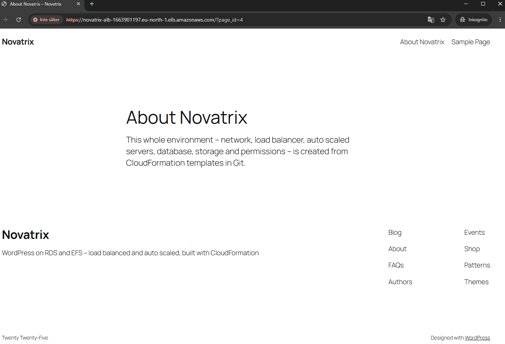

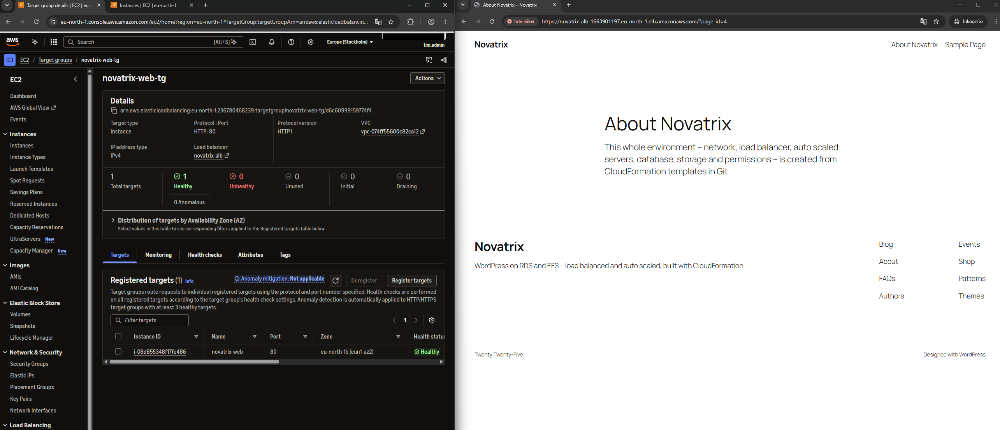

### *__SSH via Bastion fungerar:__*

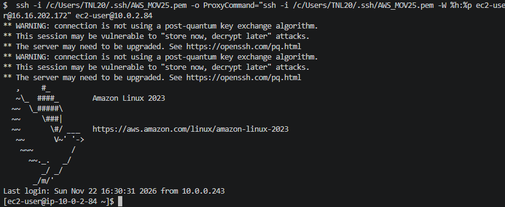

### *__Cloud Formation:__*

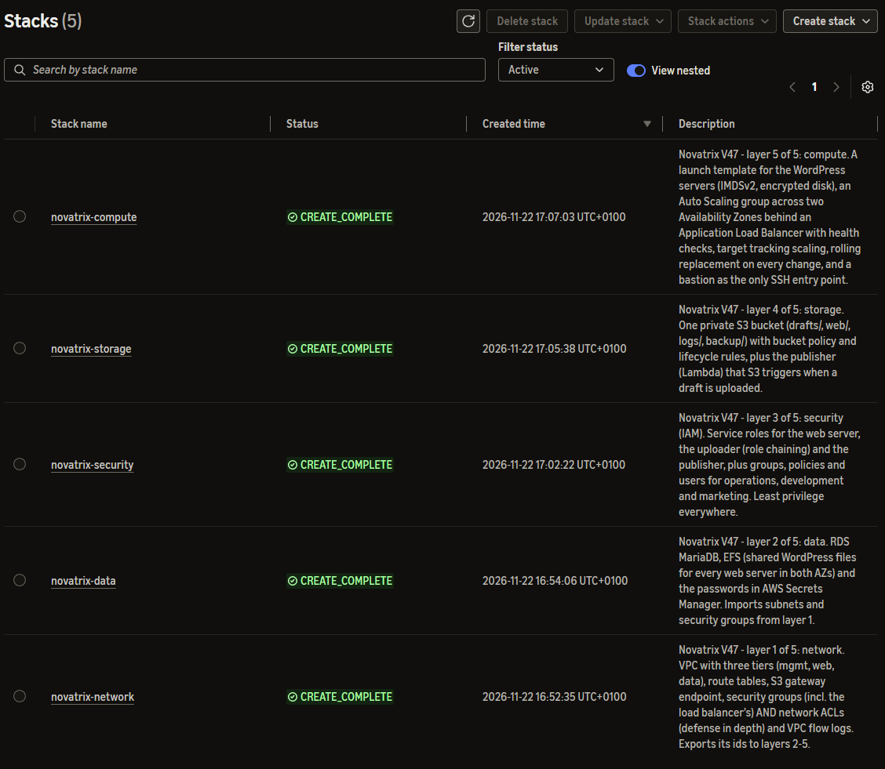

### *__Secrets Manager:__*

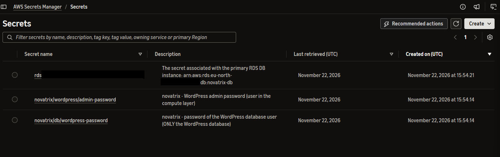

### *__Auto Scaling Groups:__*

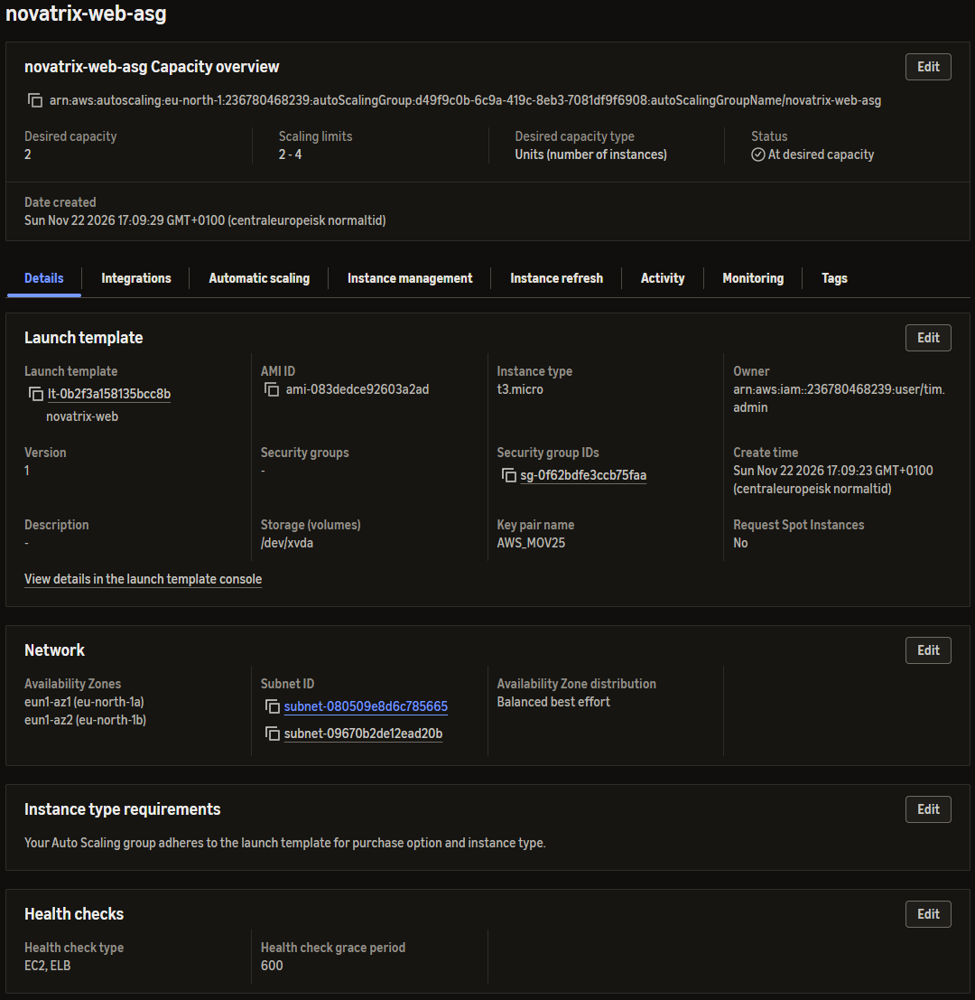

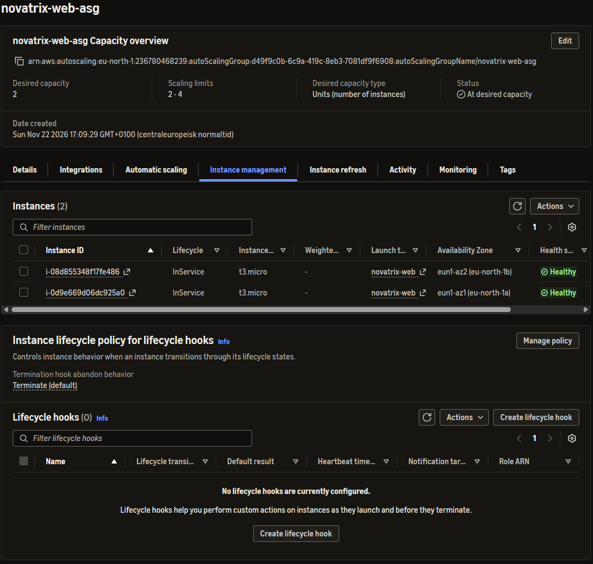

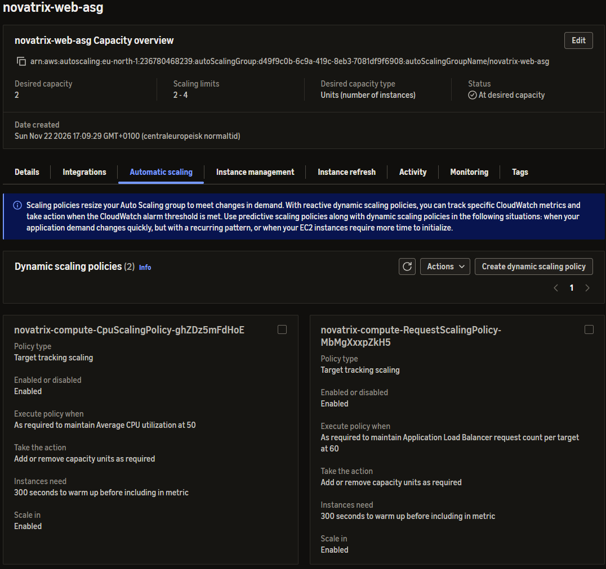

### *__Target Groups:__*

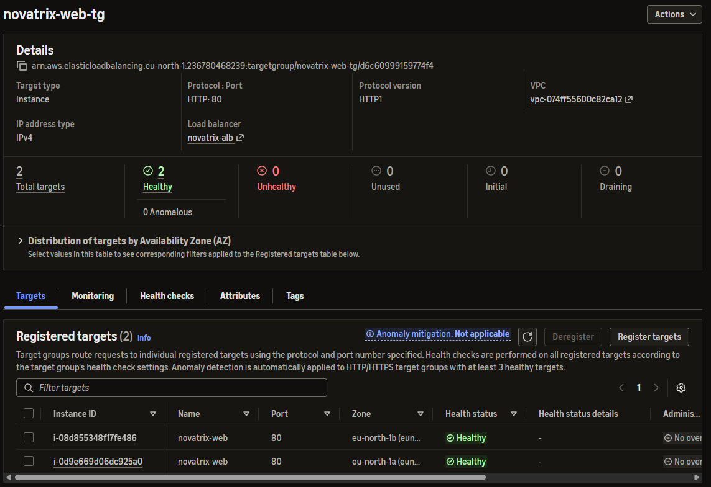

### *__Health Check:__*

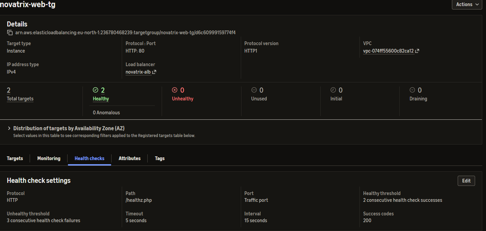

### *__Load Balancers:__*

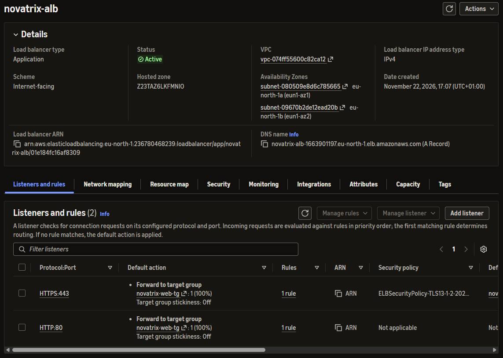

### *__Skalning och självläkning:__*

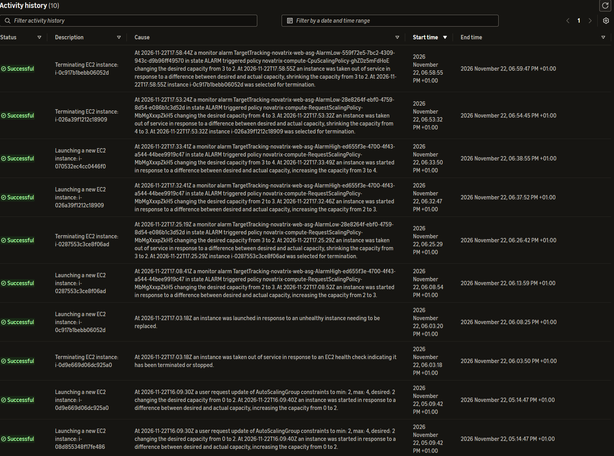

### *__Verifiering OK:__*

Resultat: *__260 OK, 0 FEL__*. Del 8 visar att lösningen förblir tillgänglig när en instans faller bort
(8.1 och 8.2) och att den skalar under last (8.3).

```
Novatrix V47 - verifiering 2026-11-22 19:03   konto 236780468239   region eu-north-1

=== Del 0: CloudFormation - stacken i AWS är koden i repot ===
Repo:  ec8b363  2026-11-22  script fix
Mallarnas historik (senaste commits som rör templates/):
    5bc0dbf  2026-11-22  03timnor  script fixes
    6adffb7  2026-11-22  03timnor  template update
    1aa8f05  2026-11-22  03timnor  scripts fixes
    efdaa76  2026-11-22  03timnor  first versions of scripts added

OK   förväntat ALLOW fick ALLOW stack novatrix-network klar (CREATE_COMPLETE)
OK   förväntat ALLOW fick ALLOW mallen i AWS = templates/V47_01-network.yaml i repot (inget odeployat, inget ändrat bredvid)
OK   förväntat ALLOW fick ALLOW stack novatrix-data klar (CREATE_COMPLETE)
OK   förväntat ALLOW fick ALLOW mallen i AWS = templates/V47_02-data.yaml i repot (inget odeployat, inget ändrat bredvid)
OK   förväntat ALLOW fick ALLOW stack novatrix-security klar (CREATE_COMPLETE)
OK   förväntat ALLOW fick ALLOW mallen i AWS = templates/V47_03-security.yaml i repot (inget odeployat, inget ändrat bredvid)
OK   förväntat ALLOW fick ALLOW stack novatrix-storage klar (CREATE_COMPLETE)
OK   förväntat ALLOW fick ALLOW mallen i AWS = templates/V47_04-storage.yaml i repot (inget odeployat, inget ändrat bredvid)
OK   förväntat ALLOW fick ALLOW stack novatrix-compute klar (CREATE_COMPLETE)
OK   förväntat ALLOW fick ALLOW mallen i AWS = templates/V47_05-compute.yaml i repot (inget odeployat, inget ändrat bredvid)

Driftdetektering - AWS jämför varje resurs med mallen (ändrat för hand i konsolen?):
OK   förväntat IN_SYNC fick IN_SYNC drift: novatrix-network
OK   förväntat IN_SYNC fick IN_SYNC drift: novatrix-data
OK   förväntat IN_SYNC fick IN_SYNC drift: novatrix-security
OK   förväntat IN_SYNC fick IN_SYNC drift: novatrix-storage
OK   förväntat IN_SYNC fick IN_SYNC drift: novatrix-compute

Ägarskap - de centrala resurserna är skapade av en stack, inte för hand:
OK   förväntat ALLOW fick ALLOW VPC (vpc-074ff55600c82ca12) -> stack novatrix-network
OK   förväntat ALLOW fick ALLOW security group web-sg (sg-0f62bdfe3ccb75faa) -> stack novatrix-network
OK   förväntat ALLOW fick ALLOW NACL data-nivån (acl-056fbbceb89e82505) -> stack novatrix-network
OK   förväntat ALLOW fick ALLOW RDS-databasen (novatrix-db) -> stack novatrix-data
OK   förväntat ALLOW fick ALLOW EFS (fs-0e85dafc1350eac25) -> stack novatrix-data
OK   förväntat ALLOW fick ALLOW S3-bucketen (novatrix-web-236780468239) -> stack novatrix-storage
OK   förväntat ALLOW fick ALLOW publicerar-Lambdan (novatrix-publisher) -> stack novatrix-storage
OK   förväntat ALLOW fick ALLOW IAM-roll webbserver (novatrix-web-ec2-role) -> stack novatrix-security
OK   förväntat ALLOW fick ALLOW IAM-roll uppladdare (novatrix-uploader-role) -> stack novatrix-security
OK   förväntat ALLOW fick ALLOW IAM-policy drift (arn:aws:iam::236780468239:policy/novatrix-operations-policy) -> stack novatrix-security
OK   förväntat ALLOW fick ALLOW IAM-användare (anna.ops) -> stack novatrix-security
OK   förväntat ALLOW fick ALLOW lastbalanseraren (ALB) (arn:aws:elasticloadbalancing:eu-north-1:236780468239:loadbalancer/app/novatrix-alb/01e184fc16af8309) -> stack novatrix-compute
OK   förväntat ALLOW fick ALLOW målgruppen (target group) (arn:aws:elasticloadbalancing:eu-north-1:236780468239:targetgroup/novatrix-web-tg/d6c60999159774f4) -> stack novatrix-compute
OK   förväntat ALLOW fick ALLOW launch template för webbservrarna (lt-0b2f3a158135bcc8b) -> stack novatrix-compute
OK   förväntat ALLOW fick ALLOW Auto Scaling-gruppen (novatrix-web-asg) -> stack novatrix-compute
OK   förväntat ALLOW fick ALLOW EC2 bastion (i-0ab7ed3dfb861ebcb) -> stack novatrix-compute
OK   förväntat ALLOW fick ALLOW hemlighet: WordPress databaslösenord (Secrets Manager) (arn:aws:secretsmanager:eu-north-1:236780468239:secret:novatrix/db/wordpress-password-7OYvvC) -> stack novatrix-data
OK   förväntat ALLOW fick ALLOW hemlighet: WordPress adminlösenord (Secrets Manager) (arn:aws:secretsmanager:eu-north-1:236780468239:secret:novatrix/wordpress/admin-password-ZJmOYz) -> stack novatrix-data
OK   förväntat ALLOW fick ALLOW RDS hanterar masterlösenordet själv i Secrets Manager (status active)
OK   förväntat ALLOW fick ALLOW masterlösenordet roteras automatiskt (RotationEnabled)
OK   förväntat DENY  fick DENY  gamla lösenord ligger kvar i SSM Parameter Store (0 st)
INFO HTTPS-certifikatet (novatrix-alb.invalid, arn:aws:acm:eu-north-1:236780468239:certificate/b88a93d8-c896-4098-82d2-95c6bdd10ad0) importeras avsiktligt av skriptet - CloudFormation kan inte importera till ACM

=== Del 1: IAM policy simulator ===

--- anna.ops (grupp novatrix-operations) ---
OK   förväntat ALLOW fick ALLOW ec2:DescribeInstances  -  se alla instanser
OK   förväntat ALLOW fick ALLOW ec2:StopInstances  -  stoppa instans taggad Project=novatrix
OK   förväntat ALLOW fick ALLOW ec2:StartInstances  -  starta bastionen när den behövs (taggad Project=novatrix)
OK   förväntat DENY  fick DENY  ec2:StopInstances  -  stoppa instans från annat projekt
OK   förväntat DENY  fick DENY  ec2:TerminateInstances  -  terminera Novatrix-instansen
OK   förväntat ALLOW fick ALLOW logs:FilterLogEvents  -  läsa publiceringsloggen
OK   förväntat ALLOW fick ALLOW logs:FilterLogEvents  -  läsa VPC-flödesloggarna
OK   förväntat ALLOW fick ALLOW ec2:DescribeNetworkAcls  -  se nätverkets NACL:er
OK   förväntat ALLOW fick ALLOW rds:DescribeDBInstances  -  se databasens status
OK   förväntat ALLOW fick ALLOW elasticfilesystem:DescribeFileSystems  -  se den delade lagringen
OK   förväntat DENY  fick DENY  rds:ModifyDBInstance  -  ändra databasen
OK   förväntat DENY  fick DENY  rds:DeleteDBInstance  -  radera databasen
OK   förväntat DENY  fick DENY  secretsmanager:GetSecretValue  -  läsa databasens masterlösenord
OK   förväntat ALLOW fick ALLOW s3:GetObject  -  hämta backup för återställning
OK   förväntat DENY  fick DENY  s3:DeleteObject  -  radera backuper
OK   förväntat DENY  fick DENY  ec2:AuthorizeSecurityGroupIngress  -  öppna en port i en security group
OK   förväntat DENY  fick DENY  ec2:CreateNetworkAclEntry  -  lägga till en NACL-regel
OK   förväntat ALLOW fick ALLOW cloudformation:DescribeStacks  -  se stackarnas status
OK   förväntat DENY  fick DENY  cloudformation:UpdateStack  -  ändra infrastrukturstacken
OK   förväntat DENY  fick DENY  cloudformation:DeleteStack  -  radera infrastrukturstacken
OK   förväntat ALLOW fick ALLOW s3:GetObject  -  läsa arkiverad Apache-logg
OK   förväntat DENY  fick DENY  s3:PutObject  -  skriva i loggarkivet
OK   förväntat DENY  fick DENY  sts:AssumeRole  -  anta uppladdarrollen
OK   förväntat DENY  fick DENY  s3:PutObject  -  ändra det statiska innehållet
OK   förväntat DENY  fick DENY  lambda:UpdateFunctionCode  -  ändra publicerarens kod
OK   förväntat DENY  fick DENY  iam:CreateUser  -  skapa IAM-användare
OK   förväntat ALLOW fick ALLOW autoscaling:DescribeAutoScalingGroups  -  se Auto Scaling-gruppen
OK   förväntat ALLOW fick ALLOW elasticloadbalancing:DescribeTargetHealth  -  se lastbalanserarens hälsokontroller
OK   förväntat ALLOW fick ALLOW autoscaling:SetDesiredCapacity  -  ändra antal webbservrar (inom min/max)
OK   förväntat ALLOW fick ALLOW autoscaling:TerminateInstanceInAutoScalingGroup  -  byta ut en sjuk webbserver
OK   förväntat ALLOW fick ALLOW autoscaling:StartInstanceRefresh  -  rulla ut alla webbservrar på nytt
OK   förväntat DENY  fick DENY  autoscaling:SetDesiredCapacity  -  ändra en annan grupps storlek
OK   förväntat DENY  fick DENY  autoscaling:UpdateAutoScalingGroup  -  ändra min/max (kostnadstaket)
OK   förväntat DENY  fick DENY  autoscaling:PutScalingPolicy  -  ändra skalningspolicyerna
OK   förväntat DENY  fick DENY  elasticloadbalancing:DeleteLoadBalancer  -  radera lastbalanseraren

--- erik.dev (grupp novatrix-development) ---
OK   förväntat ALLOW fick ALLOW s3:PutObject  -  ladda upp utkast
OK   förväntat ALLOW fick ALLOW s3:GetObject  -  läsa publicerad sida
OK   förväntat DENY  fick DENY  s3:PutObject  -  publicera förbi publiceraren
OK   förväntat ALLOW fick ALLOW lambda:UpdateFunctionCode  -  driftsätta ny publicerarkod
OK   förväntat DENY  fick DENY  lambda:UpdateFunctionConfiguration  -  byta roll/inställningar på Lambda
OK   förväntat DENY  fick DENY  iam:PassRole  -  skicka vidare Lambdarollen
OK   förväntat DENY  fick DENY  ec2:StopInstances  -  stoppa servern
OK   förväntat DENY  fick DENY  s3:GetObject  -  läsa besökarloggar
OK   förväntat DENY  fick DENY  s3:GetObject  -  ladda ner databasbackup
OK   förväntat DENY  fick DENY  secretsmanager:GetSecretValue  -  läsa WordPress databaslösenord
OK   förväntat DENY  fick DENY  autoscaling:SetDesiredCapacity  -  ändra antal webbservrar
OK   förväntat DENY  fick DENY  logs:FilterLogEvents  -  läsa VPC-flödesloggarna
OK   förväntat DENY  fick DENY  ec2:AuthorizeSecurityGroupIngress  -  öppna en port i en security group

--- maja.marketing (grupp novatrix-marketing) ---
OK   förväntat ALLOW fick ALLOW s3:PutObject  -  ladda upp bild
OK   förväntat ALLOW fick ALLOW s3:ListBucket  -  lista sina bilder
OK   förväntat DENY  fick DENY  s3:ListBucket  -  lista hela bucketen
OK   förväntat DENY  fick DENY  s3:PutObject  -  ändra sidans HTML
OK   förväntat DENY  fick DENY  s3:PutObject  -  publicera förbi publiceraren
OK   förväntat DENY  fick DENY  s3:DeleteObject  -  radera bilder
OK   förväntat DENY  fick DENY  s3:GetObject  -  ladda ner databasbackup
OK   förväntat DENY  fick DENY  lambda:UpdateFunctionCode  -  ändra publicerarens kod

--- roll novatrix-web-ec2-role (webbservern) ---
OK   förväntat ALLOW fick ALLOW s3:GetObject  -  läsa statiskt innehåll
OK   förväntat ALLOW fick ALLOW s3:ListBucket  -  lista web/
OK   förväntat DENY  fick DENY  s3:ListBucket  -  lista drafts/
OK   förväntat DENY  fick DENY  s3:GetObject  -  läsa opublicerade utkast
OK   förväntat DENY  fick DENY  s3:PutObject  -  skriva över det statiska innehållet
OK   förväntat DENY  fick DENY  s3:ListAllMyBuckets  -  lista kontots buckets
OK   förväntat DENY  fick DENY  s3:PutObject  -  skriva loggar själv (utan att byta roll)
OK   förväntat DENY  fick DENY  s3:PutObject  -  skriva backup själv (utan att byta roll)
OK   förväntat DENY  fick DENY  s3:GetObject  -  läsa backuper
OK   förväntat ALLOW fick ALLOW secretsmanager:GetSecretValue  -  läsa WordPress databaslösenord
OK   förväntat ALLOW fick ALLOW secretsmanager:GetSecretValue  -  läsa masterlösenordet (skapar/uppdaterar DB-användaren vid start)
OK   förväntat DENY  fick DENY  secretsmanager:GetSecretValue  -  läsa andra hemligheter i kontot
OK   förväntat DENY  fick DENY  secretsmanager:PutSecretValue  -  byta databaslösenordet
OK   förväntat DENY  fick DENY  secretsmanager:ListSecrets  -  lista kontots hemligheter
OK   förväntat DENY  fick DENY  autoscaling:SetDesiredCapacity  -  skala sin egen grupp
OK   förväntat ALLOW fick ALLOW elasticfilesystem:ClientMount  -  montera EFS via WordPress access point
OK   förväntat DENY  fick DENY  elasticfilesystem:ClientMount  -  montera EFS UTAN access point (som root)
OK   förväntat DENY  fick DENY  elasticfilesystem:ClientRootAccess  -  root-åtkomst till EFS
OK   förväntat DENY  fick DENY  rds:DeleteDBInstance  -  radera databasen
OK   förväntat ALLOW fick ALLOW sts:AssumeRole  -  begära uppladdarrollen
OK   förväntat DENY  fick DENY  sts:AssumeRole  -  begära publicerarrollen
OK   förväntat DENY  fick DENY  ec2:AuthorizeSecurityGroupIngress  -  öppna sin egen brandvägg

--- roll novatrix-uploader-role (antas av EC2-rollen) ---
OK   förväntat ALLOW fick ALLOW s3:PutObject  -  ladda upp logg
OK   förväntat ALLOW fick ALLOW s3:PutObject  -  ladda upp backup
OK   förväntat DENY  fick DENY  s3:GetObject  -  läsa backuper
OK   förväntat DENY  fick DENY  s3:DeleteObject  -  radera backuper
OK   förväntat DENY  fick DENY  s3:GetObject  -  läsa loggar
OK   förväntat DENY  fick DENY  s3:GetObject  -  läsa statiskt innehåll
OK   förväntat DENY  fick DENY  s3:PutObject  -  skriva över det statiska innehållet
OK   förväntat DENY  fick DENY  s3:PutObject  -  lägga utkast (starta publicering)
OK   förväntat DENY  fick DENY  s3:ListBucket  -  lista bucketen
OK   förväntat DENY  fick DENY  secretsmanager:GetSecretValue  -  läsa databaslösenordet

--- roll novatrix-publisher-role (publiceraren) ---
OK   förväntat ALLOW fick ALLOW s3:GetObject  -  läsa utkast
OK   förväntat ALLOW fick ALLOW s3:PutObject  -  publicera till web/
OK   förväntat ALLOW fick ALLOW logs:PutLogEvents  -  skriva till egen logggrupp
OK   förväntat DENY  fick DENY  logs:PutLogEvents  -  skriva till annan logggrupp
OK   förväntat DENY  fick DENY  s3:PutObject  -  skriva utkast (kan inte trigga sig själv)
OK   förväntat DENY  fick DENY  s3:GetObject  -  läsa publicerad sajt
OK   förväntat DENY  fick DENY  s3:DeleteObject  -  radera publicerade filer
OK   förväntat DENY  fick DENY  s3:ListBucket  -  lista bucketen
OK   förväntat DENY  fick DENY  s3:GetObject  -  läsa backuper
OK   förväntat DENY  fick DENY  ec2:DescribeInstances  -  se EC2-instanser

=== Del 2: webbplatsen genom lastbalanseraren (WordPress, statiskt innehåll, publiceringskedjan) ===
Webbplatsen: http://novatrix-alb-1663901197.eu-north-1.elb.amazonaws.com   (lastbalanserare, webbservrar: i-070532ec4cc0446f0 eu-north-1a, i-08d855348f17fe486 eu-north-1b)
OK   förväntat 200   fick 200   startsidan svarar genom ALB över HTTP (port 80)
OK   förväntat ALLOW fick ALLOW startsidan genereras av WordPress
OK   förväntat ALLOW fick ALLOW webbplatsens titel (Novatrix) kommer från databasen
OK   förväntat 200   fick 200   startsidan svarar över HTTPS (TLS avslutas i ALB, självsignerat certifikat)
OK   förväntat DENY  fick DENY  HTTPS-sidan länkar till http:// (blandat innehåll)
OK   förväntat DENY  fick DENY  ALB accepterar gammal TLS 1.1 (SslPolicy TLS13-1-2)
OK   förväntat 200   fick 200   inloggningssidan /wp-login.php finns (lösenord i Secrets Manager)
OK   förväntat ALLOW fick ALLOW säkerhetshuvuden skickas (X-Frame-Options, nosniff, CSP)
OK   förväntat DENY  fick DENY  Server-huvudet avslöjar Apache-version
OK   förväntat DENY  fick DENY  X-Powered-By avslöjar PHP-version
OK   förväntat DENY  fick DENY  xmlrpc.php (gammalt API för lösenordsgissning) är åtkomligt
OK   förväntat DENY  fick DENY  kataloglistning av /wp-content/uploads/ (Options -Indexes)
OK   förväntat DENY  fick DENY  servrarnas lås/markeringar på EFS (/.novatrix/) är åtkomliga
OK   förväntat ALLOW fick ALLOW hälsokontrollen /healthz.php svarar ok
OK   förväntat ALLOW fick ALLOW statiskt innehåll från S3 under /static/
OK   förväntat ALLOW fick ALLOW drafts/v47-test-190332.html publiceras till web/ av Lambdan
OK   förväntat DENY  fick DENY  drafts/v47-test-190332.php (otillåten filtyp) publiceras inte

Senaste publiceringsloggen (väntar tills testets rader har levererats till CloudWatch):
2026-11-22T18:08:09.091000+00:00 2026/11/22/[$LATEST]bb7ed83188874c34b32b8adfb2af3b0b {"published": "web/v47-test-190332.html", "bytes": 46}
2026-11-22T18:08:09.968000+00:00 2026/11/22/[$LATEST]bb7ed83188874c34b32b8adfb2af3b0b {"rejected": "drafts/v47-test-190332.php", "reason": "file type .php is not published"}
OK   förväntat ALLOW fick ALLOW Lambdan skriver sin logg med sin egen roll (raden ovan)

OK   förväntat DENY  fick DENY  du själv (admin, utan läsarrollen) antar uppladdarrollen

=== Del 3: inifrån en webbserver - via bastionen (S3 med curl och instansrollen) ===
Bastion: 16.16.202.172 (i-0ab7ed3dfb861ebcb)  ->  webbserver 10.0.2.121 (i-070532ec4cc0446f0, eu-north-1a)
OK   förväntat ALLOW fick ALLOW SSH till webbservern via bastionen
OK   förväntat ALLOW fick ALLOW SSH till webbservern i den andra AZ:n (10.0.3.112, eu-north-1b) via bastionen
Instansen kör som: arn:aws:sts::236780468239:assumed-role/novatrix-web-ec2-role/i-070532ec4cc0446f0
OK   förväntat ALLOW fick ALLOW SSH-härdning aktiv (inga lösenord, ingen root, ingen tunnling)
OK   förväntat ALLOW fick ALLOW curl: läsa web/index.html
OK   förväntat DENY  fick DENY  curl: läsa drafts/index.html
OK   förväntat DENY  fick DENY  curl: skriva till web/
OK   förväntat DENY  fick DENY  cli: lista kontots buckets
OK   förväntat DENY  fick DENY  cli: lista IAM-användare
OK   förväntat ALLOW fick ALLOW ny publicering syns under /static/

--- Role chaining: läsarrollen -> uppladdarrollen ---
Identitet före rollbytet:  arn:aws:sts::236780468239:assumed-role/novatrix-web-ec2-role/i-070532ec4cc0446f0
Identitet efter rollbytet: arn:aws:sts::236780468239:assumed-role/novatrix-uploader-role/uploader-ip-10-0-2-121

OK   förväntat DENY  fick DENY  läsarrollen: skriva logg själv
OK   förväntat ALLOW fick ALLOW läsarrollen antar uppladdarrollen
OK   förväntat ALLOW fick ALLOW uppladdaren: skriva till logs/
OK   förväntat DENY  fick DENY  uppladdaren: läsa web/
OK   förväntat DENY  fick DENY  uppladdaren: skriva till web/
OK   förväntat DENY  fick DENY  uppladdaren: lägga utkast
OK   förväntat ALLOW fick ALLOW loggjobbet arkiverar Apache-loggarna
OK   förväntat ALLOW fick ALLOW arkiverade loggar finns i s3://novatrix-web-236780468239/logs/ (4 st)

=== Del 4: WordPress mot databasen (RDS) och den delade lagringen (EFS) ===
--- 4.1 Delad lagring (EFS) ---
Monterat på /var/www/html:  nfs4   127.0.0.1:/ rw,relatime,vers=4.1,rsize=1048576,wsize=1048576,namlen=255,hard,noresvport,fatal_neterrors
                       127.0.0.1:/     8.0E  123M  8.0E   1% /var/www/html
OK   förväntat ALLOW fick ALLOW EFS monterad på /var/www/html, krypterad i transit (TLS-tunnel via 127.0.0.1)
OK   förväntat ALLOW fick ALLOW WordPress-filerna ligger på EFS (wp-config.php, wp-includes/)
OK   förväntat ALLOW fick ALLOW access point: root på servern skriver som apache (uid 48) på EFS
OK   förväntat ALLOW fick ALLOW fil skriven på EFS av servern i eu-north-1a serveras av servern i eu-north-1b
    EFS-namnet ger varje server mount target i sin EGEN AZ: eu-north-1a -> 10.0.10.46,  eu-north-1b -> 10.0.11.105
OK   förväntat ALLOW fick ALLOW filen på EFS serveras genom lastbalanseraren (/wp-content/uploads/v47-efs-190332.txt)
OK   förväntat DENY  fick DENY  PHP-kod i uppladdningsmappen körs (uppladdat skal)

--- 4.2 Databasen (RDS) ---
Databas: novatrix-db.c3aiaqweg0m7.eu-north-1.rds.amazonaws.com -> 10.0.10.58
OK   förväntat ALLOW fick ALLOW databasens namn pekar på en privat adress i data-nivån (10.0.10.58 i subnet-0e7273d0d4c1e9e16)
WordPress-användarens rättigheter:
    GRANT USAGE ON *.* TO `wordpress`@`10.0.2.0/255.255.254.0` 
    GRANT ALL PRIVILEGES ON `wordpress`.* TO `wordpress`@`10.0.2.0/255.255.254.0`
Krypterad anslutning: Ssl_version TLSv1.3
OK   förväntat ALLOW fick ALLOW anslutningen till databasen är krypterad (TLS, servercertifikatet verifieras)
OK   förväntat ALLOW fick ALLOW WordPress-användaren läser sin databas (wordpress.wp_posts)
OK   förväntat DENY  fick DENY  WordPress-användaren skapar en annan databas
OK   förväntat DENY  fick DENY  WordPress-användaren läser mysql.user (andra konton och lösenord)

--- 4.3 Hela vägen: WordPress -> RDS -> webbplatsen ---
WordPress skapade inlägg ID 7
OK   förväntat ALLOW fick ALLOW inlägget ligger i RDS-tabellen wordpress.wp_posts
OK   förväntat ALLOW fick ALLOW inlägget visas genom lastbalanseraren, 4 av 4 anrop (http://novatrix-alb-1663901197.eu-north-1.elb.amazonaws.com/?p=7)

=== Del 5: backup ===
--- 5.1 S3: databasdump + wp-content, raderas automatiskt efter 14 dagar ---
OK   förväntat 14    fick 14    livscykelregel: objekt under backup/ raderas efter (dagar)
OK   förväntat ALLOW fick ALLOW backupjobbet laddar upp databasdump + wp-content via uppladdarrollen
Backuper i s3://novatrix-web-236780468239/backup/ (nyaste sist):
    2026-11-22 19:09:25      21438 backup/db/20261122T180923Z-wordpress.sql.gz
    2026-11-22 17:57:27   12699913 backup/files/20261122T165723Z-wp-content.tar.gz
    2026-11-22 17:57:41   12699913 backup/files/20261122T165737Z-wp-content.tar.gz
    2026-11-22 19:09:28   12699905 backup/files/20261122T180923Z-wp-content.tar.gz
OK   förväntat ALLOW fick ALLOW databasdump finns (backup/db/20261122T180923Z-wordpress.sql.gz)
OK   förväntat ALLOW fick ALLOW wp-content-arkiv finns (backup/files/20261122T180923Z-wp-content.tar.gz)
OK   förväntat ALLOW fick ALLOW dumpen innehåller WordPress-tabellerna (12 CREATE TABLE)
OK   förväntat DENY  fick DENY  läsarrollen (webbservern) laddar ner en backup
OK   förväntat DENY  fick DENY  uppladdaren raderar en backup (en angripare kan inte förstöra dem)
    server 2 (eu-north-1b): Today's backup is already taken by ip-10-0-2-84 - skipping.
OK   förväntat ALLOW fick ALLOW bara EN server tar dygnets backup (3 dumpar före, 3 efter server 2:s försök)

--- 5.2 RDS automatisk backup ---
Lagringstid: 1 dag(ar)   backupfönster (UTC): 01:00-01:30   senaste återställningspunkt: 2026-11-22T18:05:00+00:00
OK   förväntat 1     fick 1     RDS automatisk backup: lagringstid (dagar)
OK   förväntat ALLOW fick ALLOW RDS har automatiska snapshots (1 st)
OK   förväntat ALLOW fick ALLOW point-in-time restore möjlig (senaste återställningspunkt finns)

=== Del 6: nätverket och lagren runt databasen ===

--- 6.1 Segmentering: subnät och route tables (som AWS ser dem) ---
SUBNÄT  CIDR            AZ           ROUTE TABLE              VÄG TILL INTERNET
mgmt-a   10.0.0.0/24     eu-north-1a  rtb-0044cf6da4eadf944    ja -> igw-0eb36f8bfb39bd99e
web-a    10.0.2.0/24     eu-north-1a  rtb-0044cf6da4eadf944    ja -> igw-0eb36f8bfb39bd99e
web-b    10.0.3.0/24     eu-north-1b  rtb-0044cf6da4eadf944    ja -> igw-0eb36f8bfb39bd99e
data-a   10.0.10.0/24    eu-north-1a  rtb-07c457aaa5a8afb4a    NEJ (endast lokalt)
data-b   10.0.11.0/24    eu-north-1b  rtb-07c457aaa5a8afb4a    NEJ (endast lokalt)

Rutter i rtb-0044cf6da4eadf944:
    10.0.0.0/16            -> local                    active
    0.0.0.0/0              -> igw-0eb36f8bfb39bd99e    active
    pl-c3aa4faa            -> vpce-0836f563ec4f04f03   active
Rutter i rtb-07c457aaa5a8afb4a:
    10.0.0.0/16            -> local                    active
OK   förväntat DENY  fick DENY  privata subnät (RDS, EFS) har en väg till internet
OK   förväntat ALLOW fick ALLOW publika subnät når S3 via gateway endpoint (inte via internet)
OK   förväntat DENY  fick DENY  VPC:ns default security group har några regler (0 st)

--- 6.2 Databasen och den delade lagringen (som AWS ser dem) ---
RDS novatrix-db: mariadb 11.8.9, db.t4g.micro, 20 GiB gp2, krypterad=True, Multi-AZ=False, publik=False, AZ eu-north-1a
OK   förväntat DENY  fick DENY  databasen är publikt åtkomlig (PubliclyAccessible)
OK   förväntat ALLOW fick ALLOW databasen är krypterad i vila
OK   förväntat ALLOW fick ALLOW databasens subnet group består bara av de privata subnäten data-a + data-b
OK   förväntat ALLOW fick ALLOW databasen har bara security group db-sg
EFS fs-0e85dafc1350eac25: krypterad=True, generalPurpose, bursting, 123 MiB använt
OK   förväntat ALLOW fick ALLOW EFS är krypterad i vila
Mount targets:
    data-b   10.0.11.105     eu-north-1b
    data-a   10.0.10.46      eu-north-1a
OK   förväntat ALLOW fick ALLOW EFS mount targets finns bara i de privata subnäten
OK   förväntat ALLOW fick ALLOW EFS-policyn kräver TLS och tillåter bara webbserverrollen

--- 6.3 Security groups (stateful - svarstrafik släpps automatiskt) ---
alb-sg (sg-028a1db25055ae3d7):
    TILLÅT IN  från 0.0.0.0/0                    tcp   port 443
    TILLÅT IN  från 0.0.0.0/0                    tcp   port 80
    TILLÅT UT  till web-sg                       tcp   port 80
    (allt annat: BLOCKERAS)
web-sg (sg-0f62bdfe3ccb75faa):
    TILLÅT IN  från 0.0.0.0/0                    icmp  port typ 3 kod 4
    TILLÅT IN  från bastion-sg                   tcp   port 22
    TILLÅT IN  från alb-sg                       tcp   port 80
    TILLÅT UT  till efs-sg                       tcp   port 2049
    TILLÅT UT  till db-sg                        tcp   port 3306
    TILLÅT UT  till 0.0.0.0/0                    tcp   port 443
    (allt annat: BLOCKERAS)
bastion-sg (sg-054765596b68f9253):
    TILLÅT IN  från 82.96.38.176/32              tcp   port 22
    TILLÅT UT  till web-sg                       tcp   port 22
    (allt annat: BLOCKERAS)
db-sg (sg-06cef123db4d9cfe4):
    TILLÅT IN  från web-sg                       tcp   port 3306
    TILLÅT UT  till 127.0.0.1/32                 alla  port alla
    (allt annat: BLOCKERAS)
efs-sg (sg-07f16eeae39f4ebaa):
    TILLÅT IN  från web-sg                       tcp   port 2049
    TILLÅT UT  till 127.0.0.1/32                 alla  port alla
    (allt annat: BLOCKERAS)

--- 6.4 Network ACL:er (stateless - regler prövas i nummerordning, första träff gäller) ---
nacl-mgmt (acl-00e83a9cd4e2c9a06):
    IN    100  ALLOW  tcp  82.96.38.176/32    port 22
    IN    110  ALLOW  tcp  10.0.2.0/23        port 32768-60999
    IN      *  DENY   alla 0.0.0.0/0          port alla
    UT    100  ALLOW  tcp  82.96.38.176/32    port 1024-65535
    UT    110  ALLOW  tcp  10.0.2.0/23        port 22
    UT      *  DENY   alla 0.0.0.0/0          port alla
nacl-web (acl-077d685e248f69277):
    IN    100  ALLOW  tcp  0.0.0.0/0          port 80
    IN    110  ALLOW  tcp  0.0.0.0/0          port 443
    IN    120  ALLOW  tcp  10.0.0.0/24        port 22
    IN    130  ALLOW  tcp  0.0.0.0/0          port 32768-60999
    IN    135  ALLOW  tcp  10.0.2.0/23        port 1024-65535
    IN    140  ALLOW  icmp 0.0.0.0/0          port typ 3 kod 4
    IN      *  DENY   alla 0.0.0.0/0          port alla
    UT    100  ALLOW  tcp  0.0.0.0/0          port 1024-65535
    UT    110  ALLOW  tcp  0.0.0.0/0          port 443
    UT    120  ALLOW  tcp  10.0.10.0/23       port 3306
    UT    130  ALLOW  tcp  10.0.10.0/23       port 2049
    UT    140  ALLOW  tcp  10.0.2.0/23        port 80
    UT      *  DENY   alla 0.0.0.0/0          port alla
nacl-data (acl-056fbbceb89e82505):
    IN    100  ALLOW  tcp  10.0.2.0/23        port 3306
    IN    110  ALLOW  tcp  10.0.2.0/23        port 2049
    IN      *  DENY   alla 0.0.0.0/0          port alla
    UT    100  ALLOW  tcp  10.0.2.0/23        port 32768-60999
    UT      *  DENY   alla 0.0.0.0/0          port alla

--- 6.5 Från internet (den här datorn, 82.96.38.176) ---
OK   förväntat ALLOW fick ALLOW lastbalanseraren :80  (HTTP)
OK   förväntat DENY  fick DENY  lastbalanseraren :22  (SSH)
OK   förväntat DENY  fick DENY  lastbalanseraren :3306  (databasporten)
OK   förväntat DENY  fick DENY  lastbalanseraren :8080  (alternativ webbport)
OK   förväntat ALLOW fick ALLOW lastbalanseraren :443  (HTTPS)
OK   förväntat DENY  fick DENY  webbserver 56.228.18.63:80  (HTTP direkt till webbservern, förbi ALB)
OK   förväntat DENY  fick DENY  webbserver 56.228.18.63:443  (HTTPS direkt till webbservern)
OK   förväntat DENY  fick DENY  webbserver 56.228.18.63:22  (SSH direkt till webbservern)
OK   förväntat DENY  fick DENY  webbserver 56.228.18.63:3306  (databasporten)
OK   förväntat DENY  fick DENY  webbserver 56.228.18.63:2049  (NFS)
OK   förväntat DENY  fick DENY  webbserver 56.228.18.63:8080  (alternativ webbport)
OK   förväntat DENY  fick DENY  webbserver 56.228.18.63:3389  (RDP)
OK   förväntat ALLOW fick ALLOW bastion 16.16.202.172:22  (SSH från din IP)
OK   förväntat DENY  fick DENY  bastion 16.16.202.172:80  (HTTP)
OK   förväntat DENY  fick DENY  bastion 16.16.202.172:443  (HTTPS)
    (databasen och EFS har ingen publik IP och deras subnät ingen väg till internet - de kan inte
     ens adresseras härifrån; se 6.1-6.2)

--- 6.6 Från bastionen (hoppserver: får bara vidarebefordra SSH) ---
OK   förväntat ALLOW fick ALLOW bastion -> webbserver 10.0.2.121:22 (SSH)
OK   förväntat DENY  fick DENY  bastion -> webbserver 10.0.2.121:80 (HTTP)
OK   förväntat DENY  fick DENY  bastion -> databasen novatrix-db.c3aiaqweg0m7.eu-north-1.rds.amazonaws.com:3306
OK   förväntat DENY  fick DENY  bastion -> EFS 10.0.10.46:2049
OK   förväntat DENY  fick DENY  bastion -> internet :443 (ladda ner verktyg/exfiltrera)
OK   förväntat ALLOW fick ALLOW bastionens SSH-härdning aktiv (PermitOpen *:22, inga lösenord)
OK   förväntat ALLOW fick ALLOW SSH-tunnel genom bastionen till port 22 (kontroll: tillåten port)
OK   förväntat DENY  fick DENY  SSH-tunnel genom bastionen till 10.0.2.121:80 (sshd PermitOpen)
OK   förväntat DENY  fick DENY  SSH-tunnel genom bastionen till databasen novatrix-db.c3aiaqweg0m7.eu-north-1.rds.amazonaws.com:3306

--- 6.7 Från webbservern (det en angripare som tagit över WordPress skulle försöka) ---
OK   förväntat ALLOW fick ALLOW webb -> databasen novatrix-db.c3aiaqweg0m7.eu-north-1.rds.amazonaws.com:3306 (WordPress)
OK   förväntat ALLOW fick ALLOW webb -> EFS 10.0.10.46:2049 (samma AZ)
OK   förväntat ALLOW fick ALLOW webb -> internet :443 (S3, STS, SSM, wordpress.org)
OK   förväntat DENY  fick DENY  webb -> internet :80 (okrypterad trafik ut)
OK   förväntat DENY  fick DENY  webb -> internet :22 (SSH ut till angriparens server)
OK   förväntat DENY  fick DENY  webb -> internet :3306 (databasdump ut till angriparens server)
OK   förväntat DENY  fick DENY  webb -> bastion 10.0.0.243:22 (bakåt mot admin-zonen)
OK   förväntat ALLOW fick ALLOW webb -> S3 via endpoint (statiskt innehåll)

--- 6.8 Stulna nycklar: instansrollens credentials används UTANFÖR VPC:n ---
OK   förväntat ALLOW fick ALLOW de stulna nycklarna är giltiga (sts get-caller-identity)
OK   förväntat DENY  fick DENY  ...men S3 nekar dem utanför VPC:n (bucket policy aws:SourceVpce)
INFO ...de kan läsa DB-lösenordet i Secrets Manager (ingen VPC-endpoint), men databasen nås bara
     från web-sg/10.0.2.0/23: utan fotfäste i VPC:n är lösenordet oanvändbart (se 6.2 och 6.5).

--- 6.9 VPC flow logs: AWS:s egen logg över släppt (ACCEPT) och blockerad (REJECT) trafik ---
Format: version konto ENI källa mål källport målport protokoll paket bytes start slut BESLUT status
Väntar på leverans (upp till 6 minuter)...
OK   förväntat REJECT fick REJECT flödeslogg: HTTP direkt till webbservern (förbi ALB)
       2 236780468239 eni-06724c30bbcdbeb9f 82.96.38.176 10.0.2.121 65103 80 6 2 104 1795371033 1795371060 REJECT OK
OK   förväntat REJECT fick REJECT flödeslogg: SSH direkt till webbservern
       2 236780468239 eni-06724c30bbcdbeb9f 82.96.38.176 10.0.2.121 64436 22 6 3 156 1795371060 1795371090 REJECT OK
OK   förväntat REJECT fick REJECT flödeslogg: databasporten på webbservern
       2 236780468239 eni-06724c30bbcdbeb9f 82.96.38.176 10.0.2.121 64437 3306 6 3 156 1795371060 1795371090 REJECT OK
OK   förväntat ACCEPT fick ACCEPT flödeslogg: SSH till bastionen
       2 236780468239 eni-0707850d5dd83c8cb 82.96.38.176 10.0.0.243 60549 22 6 28 7318 1795370906 1795370929 ACCEPT OK
OK   förväntat ACCEPT fick ACCEPT flödeslogg: lastbalanseraren -> webbservern (trafik + hälsokontroll)
       2 236780468239 eni-0df4d581da3494e0a 10.0.3.204 10.0.2.121 53548 80 6 5 404 1795370495 1795370518 ACCEPT OK
OK   förväntat ACCEPT fick ACCEPT flödeslogg: webbserver -> databasen (RDS)
       2 236780468239 eni-06724c30bbcdbeb9f 10.0.2.121 10.0.10.58 39116 3306 6 61 10319 1795370553 1795370580 ACCEPT OK
OK   förväntat ACCEPT fick ACCEPT flödeslogg: webbserver -> EFS
       2 236780468239 eni-06724c30bbcdbeb9f 10.0.2.121 10.0.10.46 39454 2049 6 11 1904 1795370523 1795370548 ACCEPT OK

=== Del 7: hög tillgänglighet - lastbalanserare och Auto Scaling-grupp ===
--- 7.1 Lastbalanseraren ---
novatrix-alb: internet-facing, active, noder i: eu-north-1a	eu-north-1b
OK   förväntat active fick active lastbalanseraren är aktiv
OK   förväntat ALLOW fick ALLOW lastbalanseraren har noder i minst två AZ (eu-north-1a	eu-north-1b)
Lyssnare:
    port 80   HTTP   
    port 443  HTTPS  ELBSecurityPolicy-TLS13-1-2-2021-06
Hälsokontroll: GET /healthz.php var 15s - frisk efter 2 OK, ur rotation efter 3 fel (45s)

--- 7.2 Auto Scaling-gruppen ---
novatrix-web-asg: min 2, max 4, önskat nu 2, hälsokontroll ELB (grace 600s)
OK   förväntat ELB   fick ELB   gruppen byter ut servrar som lastbalanseraren underkänner (HealthCheckType)
OK   förväntat ALLOW fick ALLOW minst två webbservrar hela tiden (MinSize 2)
OK   förväntat ALLOW fick ALLOW gruppen startar servrar i både web-a och web-b
    INSTANS              AZ           LIVSCYKEL   ASG-HÄLSA ALB-HÄLSA LT-VERSION
    i-070532ec4cc0446f0  eu-north-1a  InService   Healthy   healthy    1
    i-08d855348f17fe486  eu-north-1b  InService   Healthy   healthy    1
OK   förväntat ALLOW fick ALLOW webbservrarna är spridda över 2 AZ
OK   förväntat ALLOW fick ALLOW alla önskade servrar är friska i lastbalanseraren (2 av 2)
OK   förväntat ALLOW fick ALLOW alla servrar kör senaste launch template-versionen (1) - inget halvfärdigt utrullat

--- 7.3 Skalning: target tracking (AWS skapar larmen själv) ---
    håll ASGAverageCPUUtilization   runt 50.0
    håll ALBRequestCountPerTarget   runt 60.0
OK   förväntat 2     fick 2     skalningspolicyer: CPU och anrop per server (target tracking)
    CloudWatch-larm som target tracking skapat: 4 (ett för hög och ett för låg last per policy)
Senaste aktiviteterna i gruppen:
    2026-11-22T17:58:55.698000+00:00	Successful	Terminating EC2 instance: i-0c917b1bebb06052d
    2026-11-22T17:53:32.985000+00:00	Successful	Terminating EC2 instance: i-026a39f1212c18909
    2026-11-22T17:33:50.656000+00:00	Successful	Launching a new EC2 instance: i-070532ec4cc0446f0
    2026-11-22T17:32:47.893000+00:00	Successful	Launching a new EC2 instance: i-026a39f1212c18909
    2026-11-22T17:25:29.671000+00:00	Successful	Terminating EC2 instance: i-0287553c3ce8f06ad

=== Del 8.1: en webbserver försvinner (EC2 terminerar den hårt, under trafik) ===
    gruppen i vila: 2 servrar, alla friska
Offer: i-070532ec4cc0446f0 i eu-north-1a - termineras direkt i EC2 (inte via gruppen: ingen förvarning, ingen dränering)
    lastbalanseraren tog servern ur rotation efter 25s (draining)
    ... 4s: 1 andra servrar i tjänst, 1 friska i ALB (mål 2)
    ... 77s: 2 andra servrar i tjänst, 1 friska i ALB (mål 2)
OK   förväntat ALLOW fick ALLOW gruppen ersatte servern automatiskt (tillbaka till fullt antal friska efter 114s)
    Besökarens bild: 79 anrop, 75 OK (200), 4 fel, längsta tid utan lyckat svar 25s
    Felkoder: 000 x2  502 x2  (000 = inget svar inom 10 s)
OK   förväntat ALLOW fick ALLOW server terminerad: sajten svarade hela tiden (längsta lucka 25s < 30s, 94% OK)
    Nu i tjänst: i-073548bf2d289b183 (eu-north-1a)  i-08d855348f17fe486 (eu-north-1b)  
    2026-11-22T18:14:42.305000+00:00	Launching a new EC2 instance: i-073548bf2d289b183
    2026-11-22T18:14:40.535000+00:00	Terminating EC2 instance: i-070532ec4cc0446f0

=== Del 8.2: en webbserver går sönder (Apache stoppas) - hälsokontroll + självläkning ===
    gruppen i vila: 2 servrar, alla friska
Offer: i-08d855348f17fe486 (10.0.3.112, eu-north-1b) - instansen kör vidare, men webbservern svarar inte
OK   förväntat ALLOW fick ALLOW hälsokontrollen upptäckte felet och tog servern ur rotation efter 45s (unhealthy)
    ... 4s: 1 andra servrar i tjänst, 1 friska i ALB (mål 2)
    ... 77s: 1 andra servrar i tjänst, 1 friska i ALB (mål 2)
    ... 150s: 2 andra servrar i tjänst, 1 friska i ALB (mål 2)
    ... 222s: 2 andra servrar i tjänst, 1 friska i ALB (mål 2)
    ... 295s: 2 andra servrar i tjänst, 1 friska i ALB (mål 2)
OK   förväntat ALLOW fick ALLOW gruppen terminerade den sjuka servern och startade en ny (klart efter 351s)
    Besökarens bild: 213 anrop, 202 OK (200), 11 fel, längsta tid utan lyckat svar 8s
    Felkoder: 502 x11  (000 = inget svar inom 10 s)
OK   förväntat ALLOW fick ALLOW trasig server: sajten svarade hela tiden (längsta lucka 8s < 30s, 94% OK)
    (eventuella fel ovan är anrop som hann gå till servern innan den underkändes: 3 kontroller à 15s)
    2026-11-22T18:19:55.019000+00:00	Launching a new EC2 instance: i-065046acd756e16aa
    2026-11-22T18:19:53.350000+00:00	Terminating EC2 instance: i-08d855348f17fe486
Mål: http://novatrix-alb-1663901197.eu-north-1.elb.amazonaws.com/  = novatrix-alb i konto 236780468239 (eu-north-1) - bara GET mot startsidan, ingen annan adress.

=== Del 8.3: lasttest - 12 parallella besökare i 8 minuter mot http://novatrix-alb-1663901197.eu-north-1.elb.amazonaws.com/ ===
    gruppen i vila: 2 servrar, alla friska
Före: önskat 2 servrar. Målvärden: 60 anrop/server/minut och 50% CPU.
    0 min (last ): önskat 2, i tjänst 2, friska i ALB 2
    0 min (last ): önskat 2, i tjänst 2, friska i ALB 2
    1 min (last ): önskat 2, i tjänst 2, friska i ALB 2
    1 min (last ): önskat 2, i tjänst 2, friska i ALB 2
    2 min (last ): önskat 2, i tjänst 2, friska i ALB 2
    2 min (last ): önskat 2, i tjänst 2, friska i ALB 2
    3 min (last ): önskat 2, i tjänst 2, friska i ALB 2
    4 min (last ): önskat 2, i tjänst 2, friska i ALB 2
    4 min (last ): önskat 2, i tjänst 2, friska i ALB 2
    5 min (last ): önskat 2, i tjänst 2, friska i ALB 2
    5 min (last ): önskat 4, i tjänst 4, friska i ALB 2
    6 min (last ): önskat 4, i tjänst 4, friska i ALB 2
    7 min (last ): önskat 4, i tjänst 4, friska i ALB 2
    7 min (last ): önskat 4, i tjänst 4, friska i ALB 2
    8 min (efter): önskat 4, i tjänst 4, friska i ALB 4
OK   förväntat ALLOW fick ALLOW gruppen skalade ut under last (2 -> 4 servrar, max 4)
    2026-11-22T18:29:48.262000+00:00	Launching a new EC2 instance: i-0828dc610ca07d83e
    2026-11-22T18:29:48.249000+00:00	Launching a new EC2 instance: i-0f94d3b24f461e072
    2026-11-22T18:19:55.019000+00:00	Launching a new EC2 instance: i-065046acd756e16aa
INFO target tracking skalar in först efter ~15 min låg last (avsiktligt försiktigt) - kör
     ./V47_verify.sh om en halvtimme och se att gruppen är tillbaka på 2 servrar (7.2).

=== Resultat: 260 OK, 0 FEL ===
Sparat i V47_verifiering_20261122-1903.txt
```